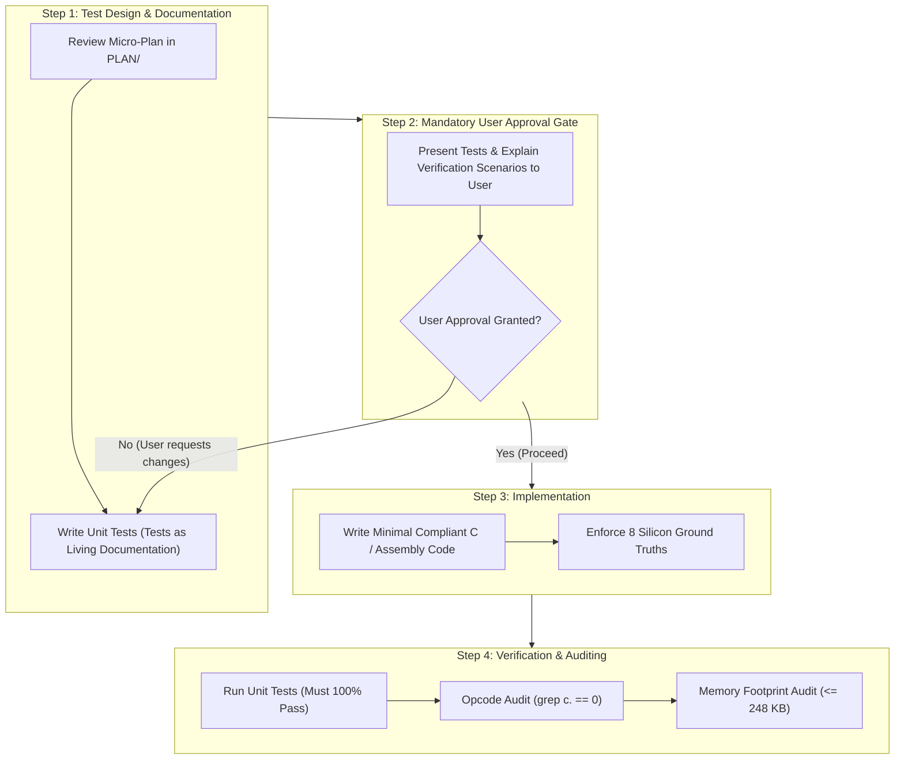
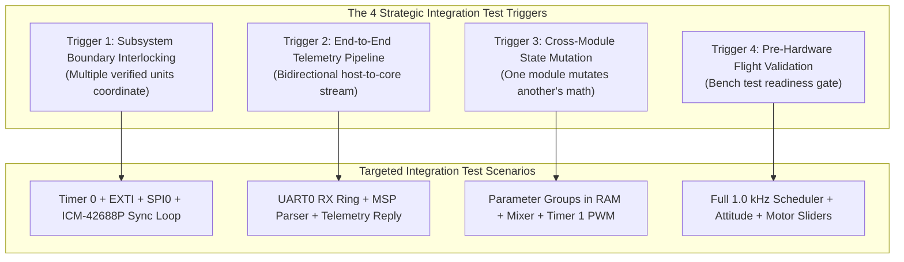

# Betaflight ARIES v3.0: Test-Driven Development (TDD) Guide for Agents

> **Target Platform**: C-DAC ARIES v3.0 (THEJAS32 SoC / VEGA ET1031 RISC-V RV32IM @ 100 MHz)  
> **Repository Active Branch**: `rebuild`  
> **Core Methodology**: Strict Test-Driven Development (TDD) with Mandatory User Approval Gate  
> **Master Macro Plan**: [`MACRO_PLAN.md`](file:///home/ivan/Desktop/betaflight/MACRO_PLAN.md)  
> **Micro-Planning Suite**: [`PLAN/00_MASTER_PLAN_OVERVIEW.md`](file:///home/ivan/Desktop/betaflight/PLAN/00_MASTER_PLAN_OVERVIEW.md)  
> **Critical Knowledge Gaps**: [`knowledgebase/CRITICAL_KNOWLEDGE_GAPS_AND_ASSUMPTIONS.md`](file:///home/ivan/Desktop/betaflight/knowledgebase/CRITICAL_KNOWLEDGE_GAPS_AND_ASSUMPTIONS.md)

---

## 1. Executive Mandate: Test-Driven Development (TDD)

In bare-metal embedded flight controller development on sovereign silicon, **writing code before tests is strictly prohibited**. 

Historical failures on this platform (such as assuming 2 MB memory-mapped external flash, tolerating 16-bit compressed instruction traps masked by Renode, and experiencing 16550 UART interrupt storms) were direct consequences of writing untested code based on unverified assumptions.

Every agent and developer operating on this repository **MUST** follow a strict **Test-First, User-Approved, Implementation-Second** workflow:



---

## 2. The 4-Step Agent TDD Protocol

### Step 1: Write Unit Test Cases First (Tests as Living Documentation)
1. **Never write implementation files (`.c`, `.S`) before the unit test exists.**
2. **Tests as Documentation**: Anyone reading the test file must immediately understand:
   - What the unit under test (UUT) is intended to do.
   - The functional contracts, mathematical calculations, and hardware register mutations.
   - The exact inputs, expected outputs, boundary limits, and error recovery sequences.
   - Which specific Silicon Ground Truth or hardware constraint is being satisfied.
3. **Structure of Tests**:
   - Each test case must strictly follow the **Arrange-Act-Assert (AAA)** pattern.
   - Descriptive test names that state the condition and expected outcome:  
     `TEST(Subsystem, Feature_Condition_ExpectedBehavior)`.
   - Clear explanatory comments explaining the real-world flight control consequence if the test fails.

### Step 2: Present Tests & Await User Approval (The Mandatory Gate)
1. **Agents MUST NOT proceed to write code immediately after creating tests.**
2. **Presentation Requirement**: The agent must output a structured turn to the user detailing:
   - The exact microcomponent being tested.
   - A clear summary table of each test case and what silicon/flight condition it verifies.
   - How edge cases, failure modes, and hardware registers are mocked and validated.
3. **The Gate**: Explicitly ask the user for approval:
   > *"I have created the unit tests for [Component Name] that serve as the functional specification. Please review the test scenarios detailed below. Once you approve, I will write the implementation code and run the verification suite."*
4. **Wait for User Response**: Do not execute tools to modify source code until the user explicitly responds with approval.

### Step 3: Implement Minimal Compliant Code
1. Once the user grants approval, write the minimal code in `src/platform/ARIES/` or `src/main/` required to satisfy the tests.
2. Comply strictly with:
   - **0 Compressed Instructions**: Pure RV32IM, link `rv32i_zicsr_zifencei/ilp32`.
   - **In-SRAM Execution**: Total image strictly $\le 248\text{ KB}$ (`0x00202000` to `0x0023FFFF`).
   - **Config in RAM**: Parameter Groups in 8 KB RAM buffer (`EEPROM_SIZE 8192`).
   - **1.0 kHz Loop Clamping**: Soft-float math budget ($1000\,\mu\text{s}$ period).
   - **State-Preserving Atomics**: CSR `mstatus.MIE` via `csrrci` / `csrs`.
   - **Timer 1 Deadline Scheduler**: Non-blocking motor PWM pulses ($< 3\,\mu\text{s}$ CPU).
   - **12.5 MHz Clamped SPI0**: Protect IMU 24.0 MHz maximum rating.
   - **16550 UART0**: Bounded 16-byte burst drain, RX interrupt ring buffer.

### Step 4: Run Tests, Verify & Audit
1. **Execute Test Suite**: Run the unit test binary to verify $100\%$ test pass rate.
2. **Pre-Commit Silicon Audits**:
   - Disassemble the target ELF: `riscv32-esp-elf-objdump -d <binary>.elf > disasm.s`
   - Opcode Audit: `grep -E "\sc\.[a-z]" disasm.s | wc -l` strictly equals **0**.
   - Sizing Audit: `riscv32-esp-elf-size -B <binary>.elf` confirms $\text{text} + \text{data} + \text{bss} \le 253{,}952\text{ bytes}$ ($248\text{ KB}$).
   - Git Branch: Verify branch is strictly `rebuild`.
3. Report the verified test results and audit metrics back to the user.

---

## 3. Unit Test Documentation Standards

Unit tests serve as the **executable specification** for the ARIES v3.0 platform. A developer or agent should be able to read the test file and understand the complete silicon behavior without opening the C-DAC hardware manual.

### 3.1 Test File Structure Template

Every test file must be located in `src/test/unit/` (or `src/test/unit/platform/aries/`) and adhere to this structure:

```cpp
/**
 * ==============================================================================
 * UNIT SPECIFICATION & TEST DOCUMENTATION: [Component Name]
 * ==============================================================================
 * Component Plan ID : PLAN-DOM-XX (Microcomponent XX_X)
 * Target Hardware   : C-DAC ARIES v3.0 (THEJAS32 SoC / VEGA ET1031 RV32IM)
 * Primary References: knowledgebase/codebase_evaluations/XX_...
 *
 * ARCHITECTURAL CONTRACT & SILICON CONSTRAINTS:
 * 1. [Constraint 1, e.g. Address-decoded single-instruction atomic writes]
 * 2. [Constraint 2, e.g. Strict 12.5 MHz SPI clock clamp to prevent IMU damage]
 * 3. [Constraint 3, e.g. Bounded FIFO draining to prevent flight loop stalls]
 * ==============================================================================
 */

#include "gtest/gtest.h"

// System under test header
extern "C" {
#include "platform.h"
#include "drivers/io.h"
}

// Mock register bank representing physical hardware memory-mapped IO
static uint32_t mock_peripheral_registers[64];

class PeripheralDriverTest : public ::testing::Test {
protected:
    void SetUp() override {
        // Reset mock hardware registers to reset-default states before each test
        memset(mock_peripheral_registers, 0, sizeof(mock_peripheral_registers));
    }
    
    void TearDown() override {
        // Verify no stray interrupt or bus-lock conditions remain
    }
};

/**
 * @brief TEST 1: [Descriptive Scenario Name]
 * 
 * FLIGHT / SILICON CONSEQUENCE:
 * Explains what goes wrong on the real drone if this test fails.
 * E.g., "If baud rate divisor is calculated incorrectly, telemetry fails
 * and Betaflight Configurator permanently hangs during handshake."
 */
TEST_F(PeripheralDriverTest, CalculateBaudRateDivisor_115200Baud_YieldsDivisor54WithAcceptableError) {
    // 1. ARRANGE: Set up clock frequency and target baud rate
    const uint32_t systemClockHz = 100000000; // 100 MHz APB
    const uint32_t targetBaud = 115200;

    // 2. ACT: Compute divisor using hardware driver equation
    uint16_t divisor = computeUartDivisor(systemClockHz, targetBaud);

    // 3. ASSERT: Must equal 54, producing +0.47% error (well within +/- 2.0% tolerance)
    EXPECT_EQ(divisor, 54);
    
    double actualBaud = (double)systemClockHz / (16.0 * (double)divisor);
    double errorPct = ((actualBaud - targetBaud) / targetBaud) * 100.0;
    EXPECT_NEAR(errorPct, 0.469, 0.01);
}
```

---

## 4. The User Approval Protocol

When an agent finishes writing the unit tests for a planned component, it **must pause and present the verification plan to the user**.

### 4.1 Required Agent Presentation Format

The agent must output the following markdown structure in its conversational response:

---

### *Example Agent Output to User:*

> ### 📋 Test Specification Ready for Review: `io_aries` (Flat Address-Decoded GPIO)
> 
> **Micro-Plan Reference**: [`PLAN/04_GPIO_EXTI_AND_HARDWARE_TIMERS.md`](file:///home/ivan/Desktop/betaflight/PLAN/04_GPIO_EXTI_AND_HARDWARE_TIMERS.md#microcomponent-04_a-flat-dual-bank-address-decoded-atomic-gpio-driver-io_ariesc)  
> **Test File Created**: `src/test/unit/platform/aries_io_unittest.cc`
> 
> The following 5 unit test cases have been written to serve as the executable specification for the flat 32-bit address-decoded GPIO driver:
> 
> | Test Identifier | Silicon / Flight Scenario Tested | Expected Result |
> | :--- | :--- | :--- |
> | `IOGetByTag_ValidTags_ReturnsDirectIndexPointer` | Verifies $O(1)$ tag resolution for tags 1..32 (`DEFIO_TAG_MAKE`). | Tag 1 yields `&ioRecs[0]`, Tag 32 yields `&ioRecs[31]`. Zero popcount tables. |
> | `IOGetByTag_InvalidTags_ReturnsIONone` | Handles out-of-bounds tags (0, 33, 255) cleanly. | Returns `IO_NONE` (`NULL`), preventing illegal memory dereferences. |
> | `IOHi_Bank0Pin_WritesToAddressDecodedRegister` | Validates atomic single-instruction pin write for Pin 5 (`PA5`). | Computes address `0x10080000 + ((1 << 5) << 2)` and writes `(1 << 5)`. 0 race conditions. |
> | `IOLo_Bank1Pin_ClearsAddressDecodedRegister` | Validates atomic pin clearing for Pin 22 (`PA22` Status LED). | Computes Bank 1 address `0x10180000 + ((1 << 6) << 2)` and writes `0`. |
> | `MemoryFence_InsertedAfterPinWrite` | Ensures out-of-order store reordering is prevented on RISC-V pipeline. | Inline `fence` instruction executed immediately after bus write. |
> 
> **Why this adequately proves correctness**:  
> These tests guarantee that pin operations execute in a single CPU cycle ($< 10\text{ ns}$) without read-modify-write hazards, ensuring high-frequency motor pulses and SPI Chip Select assertions remain 100% race-free.
> 
> **Approval Gate**:  
> *Please confirm if you approve these test cases. Once approved, I will implement `src/platform/ARIES/io_aries.c`, run the tests, and verify opcode and memory constraints.*

---

## 5. Strategic Integration Testing Criteria

Unit tests validate individual functions in isolation with mocked registers. However, embedded flight control requires complex hardware interlocks.

### 5.1 When to Write Integration Tests

> [!IMPORTANT]
> **Integration tests are NOT required after every single phase or small component.**  
> Writing integration tests prematurely on isolated primitives creates maintenance friction. Instead, integration tests must be scheduled only when specific subsystem boundary triggers are reached.

Integration tests **MUST** be written upon reaching any of the following **4 Trigger Events**:



#### Trigger 1: Subsystem Boundary Interlocking
* **When**: When two or more independently verified hardware drivers must interface in real-time.
* **Key Example**: The **IMU Telemetry Pipeline** ([`PLAN-DOM-05`](file:///home/ivan/Desktop/betaflight/PLAN/05_SPI_BUS_IMU_AND_FLASH_PERSISTENCE.md)).
  - Requires: Timer 0 (`system.c`) microsecond timebase + EXTI (`exti_aries.c`) on `PA0` + SPI0 master (`bus_spi_aries.c`) at 12.5 MHz + ICM-42688P driver.
  - **Integration Test Focus**: Verify that the rising edge on `PA0` fires an EXTI interrupt that successfully triggers a 14-byte SPI0 read without deadlocking or dropping bytes.

#### Trigger 2: End-to-End Telemetry & Configuration Pipeline
* **When**: When host protocol transactions span low-level hardware drivers up through application dispatchers.
* **Key Example**: The **Configurator 7-Step Handshake** ([`PLAN-DOM-03`](file:///home/ivan/Desktop/betaflight/PLAN/03_SERIAL_COMMUNICATION_MSP_AND_CLI.md)).
  - Requires: 16550 UART0 driver + RX ring buffer + Bounded TX FIFO drain + MSP parser (`msp_serial.c`) + System metadata.
  - **Integration Test Focus**: Feed raw bytes `$M<0\x01\x01` (`MSP_API_VERSION`) into UART0 RX and verify that the exact byte stream `$M>3\x01\x01...` is emitted into the TX buffer within $< 200\text{ ms}$ without blocking the scheduler.

#### Trigger 3: Cross-Module State Mutations
* **When**: When runtime settings stored in one subsystem directly alter the algorithmic output of another subsystem.
* **Key Example**: **Parameter Groups in RAM $\rightarrow$ Motor Mixer $\rightarrow$ Timer 1 Soft-PWM** ([`PLAN-DOM-02`](file:///home/ivan/Desktop/betaflight/PLAN/02_BUILD_SYSTEM_AND_MEMORY_OPTIMIZATION.md) & [`PLAN-DOM-04`](file:///home/ivan/Desktop/betaflight/PLAN/04_GPIO_EXTI_AND_HARDWARE_TIMERS.md)).
  - Requires: `CONFIG_IN_RAM` (8 KB buffer) + Mixer tables + Timer 1 ascending deadline soft-PWM queue.
  - **Integration Test Focus**: Change motor mixer geometry via Parameter Group API, trigger `pwmCompleteMotorUpdate()`, and verify that Timer 1 reload counts match the updated pulse widths.

#### Trigger 4: Pre-Hardware Bench Flight Validation
* **When**: Prior to flashing firmware onto physical hardware for bench motor spinning or flight tests.
* **Key Example**: The **1.0 kHz Complete Flight Loop Integration Test** ([`PLAN-DOM-06`](file:///home/ivan/Desktop/betaflight/PLAN/06_SENSORS_RC_TELEMETRY_AND_SCHEDULER.md)).
  - Requires: Cooperative Scheduler (`scheduler.c`) running `TASK_GYROPID`, `TASK_SERIAL`, `TASK_RX`, `TASK_BATTERY` simultaneously.
  - **Integration Test Focus**: Verify that across 10,000 continuous flight loop cycles:
    1. Loop period remains $1000\,\mu\text{s} \pm 5\,\mu\text{s}$.
    2. Zero task starvation occurs.
    3. Peak flight control WCET consumes $\le 350\,\mu\text{s}$ ($> 65\%$ idle headroom).

---

## 6. Hardware Mocking Architecture for THEJAS32

To allow unit and integration tests to run natively on developer workstations and CI runners, hardware peripheral registers must be cleanly mocked:

```cpp
// ==============================================================================
// THEJAS32 HARDWARE REGISTER MOCK HARNESS (test_thejas32_mocks.h)
// ==============================================================================

#pragma once
#include <stdint.h>

// Mock Memory Map Apertures
#define MOCK_UART0_BASE   0x10000100
#define MOCK_GPIO_BASE0   0x10080000
#define MOCK_GPIO_BASE1   0x10180000
#define MOCK_TIMER1_BASE  0x10000514
#define MOCK_SPI0_BASE    0x10001000

// Generic register access interception
uint32_t mock_read32(uintptr_t addr);
void mock_write32(uintptr_t addr, uint32_t val);

#define regRead(addr)        mock_read32((uintptr_t)(addr))
#define regWrite(addr, val)  mock_write32((uintptr_t)(addr), (uint32_t)(val))
```

* **Zero Hardware Lockup**: Mocks must simulate register side-effects (such as reading `LSR` automatically clearing the `ORE` bit, or reading `Timer1.EOI` clearing the pending interrupt).
* **Deterministic Clock Simulation**: Mocks provide incrementing `mcycle` values to test microsecond math and rollover logic deterministically.

---

## 7. Pre-Commit Verification & Silicon Audits

Before declaring any implementation complete, the agent must run the pre-commit audit pipeline:

```bash
# 1. Run Unit / Integration Tests
cd src/test && make test

# 2. Compile Target Binary for Physical Hardware
cd ../.. && make TARGET=ARIESV3

# 3. Audit for 0 Compressed (RVC) Instructions (Ground Truth 1)
riscv32-esp-elf-objdump -d obj/main/betaflight_ARIESV3.elf > obj/disasm.s
RVC_COUNT=$(grep -E "\sc\.[a-z]" obj/disasm.s | wc -l)
if [ "$RVC_COUNT" -ne 0 ]; then
    echo "FATAL: Found $RVC_COUNT compressed instructions in binary! Halting."
    exit 1
fi

# 4. Audit Binary Footprint (Ground Truth 2: <= 248 KB)
TOTAL_SIZE=$(riscv32-esp-elf-size -B obj/main/betaflight_ARIESV3.elf | awk 'NR==2 {print $1 + $2 + $3}')
if [ "$TOTAL_SIZE" -gt 253952 ]; then
    echo "FATAL: Binary size ($TOTAL_SIZE bytes) exceeds 248 KB SRAM budget! Halting."
    exit 1
fi

# 5. Verify Active Git Branch (Rule 2)
BRANCH=$(git branch --show-current)
if [ "$BRANCH" != "rebuild" ]; then
    echo "FATAL: Active branch is '$BRANCH'. Work must be strictly on 'rebuild'!"
    exit 1
fi
```

---

## 8. Summary Checklist for Agents

On every single turn involving new driver or feature development:

- [ ] **Reviewed Plan**: Checked [`MACRO_PLAN.md`](file:///home/ivan/Desktop/betaflight/MACRO_PLAN.md) and corresponding [`PLAN/`](file:///home/ivan/Desktop/betaflight/PLAN/) document.
- [ ] **Consulted Gap Register**: Verified no unconfirmed assumptions in [`CRITICAL_KNOWLEDGE_GAPS_AND_ASSUMPTIONS.md`](file:///home/ivan/Desktop/betaflight/knowledgebase/CRITICAL_KNOWLEDGE_GAPS_AND_ASSUMPTIONS.md).
- [ ] **Wrote Unit Tests First**: Tests created in `src/test/unit/` using AAA pattern and serving as living documentation.
- [ ] **Presented Tests to User**: Detailed what the tests do and requested user approval before writing code.
- [ ] **Awaited Approval**: Did not write implementation code until user explicitly approved.
- [ ] **Implemented Minimal Code**: Strictly adhered to the 8 Inviolable Silicon Ground Truths.
- [ ] **Executed Tests**: Verified 100% test pass rate.
- [ ] **Performed Silicon Audits**: Verified `grep c. == 0`, $\text{Size} \le 248\text{ KB}$, branch is `rebuild`.
- [ ] **Assessed Integration Test Need**: Checked if a trigger event occurred (subsystem boundary, protocol pipeline, cross-module mutation).