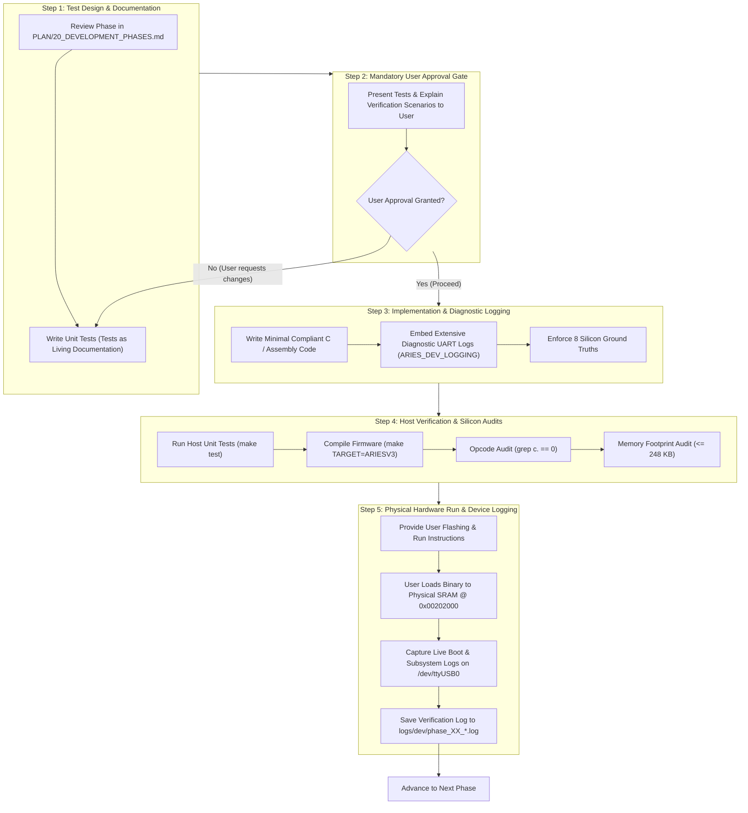
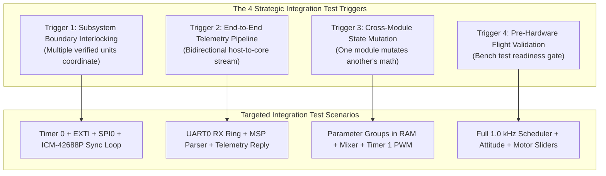

# Betaflight ARIES v3.0: Test-Driven Development (TDD) Guide for Agents

> **Target Platform**: C-DAC ARIES v3.0 (THEJAS32 SoC / VEGA ET1031 RISC-V RV32IM @ 100 MHz)  
> **Repository Active Branch**: `rebuild`  
> **Core Methodology**: Strict Test-Driven Development (TDD) with Mandatory User Approval Gate  
> **Master Macro Plan**: [`MACRO_PLAN.md`](MACRO_PLAN.md)  
> **Detailed 20-Phase Roadmap**: [`PLAN/20_DEVELOPMENT_PHASES.md`](PLAN/20_DEVELOPMENT_PHASES.md)  
> **Micro-Planning Suite**: [`PLAN/00_MASTER_PLAN_OVERVIEW.md`](PLAN/00_MASTER_PLAN_OVERVIEW.md)  
> **Critical Knowledge Gaps**: [`knowledgebase/CRITICAL_KNOWLEDGE_GAPS_AND_ASSUMPTIONS.md`](knowledgebase/CRITICAL_KNOWLEDGE_GAPS_AND_ASSUMPTIONS.md)

---

## 1. Executive Mandate: Test-Driven Development (TDD)

In bare-metal embedded flight controller development on sovereign silicon, **writing code before tests is strictly prohibited**. 

Historical failures on this platform (such as assuming 2 MB memory-mapped external flash, tolerating 16-bit compressed instruction traps masked by Renode, and experiencing 16550 UART interrupt storms) were direct consequences of writing untested code based on unverified assumptions.

Every agent and developer operating on this repository **MUST** follow a strict **Test-First, User-Approved, Implementation-Second, Device-Verified, Log-Persisted** workflow:



### 1.1 Automatic Skill Activation Mapping

Agents working through the TDD protocol must automatically activate and execute the designated workspace skill at each step without waiting for user prompting:

| TDD Workflow Step | Skill Automatically Activated | Mandatory Action Required |
| :--- | :--- | :--- |
| **Session Kickoff / Phase Start** | **`project-onboarding`** | Verify git branch `rebuild`, review 8 silicon ground truths, check toolchain. |
| **Step 1: Test Design** | **`knowledge-search`** | Query component blueprints (`knowledgebase/components/`) and evaluation nodes to author AAA unit tests. |
| **Step 2: User Approval Gate** | *(Interactive)* | Present test scenarios, explain coverage, and await explicit user approval. |
| **Step 3: Implementation** | **`knowledge-search`** | **Triple-Reference Gate:** Consult VEGA SDK (`lib/vega-sdk/`), STM32 (`src/platform/STM32/`), and ESP32 (`src/platform/ESP32/`) before writing code. |
| **Step 4: Host Verification** | *(Local Tooling)* | Run `make test`, compile firmware, verify opcode audit (`c. == 0`), check 248 KB SRAM budget. |
| **Step 5: Post-Phase Logging** | **`knowledge-update`** | Persist log to `logs/dev/phase_XX_*.log`, update 0–10 scores, sync `INDEX.md` and `PORTING_KNOWLEDGE_GRAPH.md`. |

---

## 2. The 5-Step Agent TDD Protocol

### Step 1: Write Unit Test Cases First (Tests as Living Documentation)
1. **Never write implementation files (`.c`, `.S`) before the unit test exists.**
2. **Tests as Documentation**: Anyone reading the test file must immediately understand:
   - What the unit under test (UUT) is intended to do.
   - The functional contracts, mathematical calculations, and hardware register mutations.
   - The exact inputs, expected outputs, boundary limits, and error recovery sequences.
   - Which specific Silicon Ground Truth or hardware constraint is being satisfied.
3. **Structure of Tests**:
   - Each test case must strictly follow the **Arrange-Act-Assert (AAA)** pattern.
   - Descriptive test names that state the condition and expected outcome:  
     `TEST(Subsystem, Feature_Condition_ExpectedBehavior)`.
   - Clear explanatory comments explaining the real-world flight control consequence if the test fails.

### Step 2: Present Tests & Await User Approval (The Mandatory Gate)
1. **Agents MUST NOT proceed to write code immediately after creating tests.**
2. **Presentation Requirement**: The agent must output a structured turn to the user detailing:
   - The exact phase and microcomponent being tested.
   - A clear summary table of each test case and what silicon/flight condition it verifies.
   - How edge cases, failure modes, and hardware registers are mocked and validated.
3. **The Gate**: Explicitly ask the user for approval:
   > *"I have created the unit tests for [Phase XX: Component Name] that serve as the functional specification. Please review the test scenarios detailed below. Once you approve, I will write the implementation code with extensive diagnostic logging and run the verification suite."*
4. **Wait for User Response**: Do not execute tools to modify source code until the user explicitly responds with approval.

### Step 3: Implement Code with Extensive Diagnostic Logging
1. **Mandatory Triple-Reference Consultation Gate (Development Only)**:
   - **During development (not testing)**, after reading the relevant nodes from the knowledge base, the agent **MUST** refer to all three reference implementations for maximum clarity before writing any actual code:
     1. **C-DAC VEGA SDK** ([`lib/vega-sdk/vega-sdk/bsp/`](lib/vega-sdk/vega-sdk/bsp)): Cross-check raw hardware register definitions, base addresses, control bitmasks, and driver sequencing directly from C-DAC's official BSP.
     2. **STM32 Implementation** ([`src/platform/STM32/`](src/platform/STM32) & [`logs/hardware_inspection/01..13`](logs/hardware_inspection)): Inspect the standard, mature Betaflight flight controller implementation to understand the required API contracts, timing boundaries, and DMA/interrupt designs.
     3. **ESP32 Implementation** ([`src/platform/ESP32/`](src/platform/ESP32) & [`logs/hardware_inspection/17..25`](logs/hardware_inspection)): Inspect how Betaflight HAL abstractions were adapted to non-STM32 RISC-V targets.
   - **ONLY AFTER CONSULTING THESE THREE REFERENCE IMPLEMENTATIONS CAN THE AGENT WRITE ANY ACTUAL CODE.**
2. Once approved and references consulted, write minimal compliant code in `src/platform/ARIES/` or `src/main/`.
3. **Extensive Diagnostic Logging Mandate**:
   - Because the user will run the compiled code on the physical hardware after each phase, the code **must include comprehensive diagnostic UART logging** across every major entry point, register configuration, state transition, and error path.
   - Use the non-blocking logging primitives defined in Section 3 (`LOG_INFO`, `LOG_HEX`, `LOG_DUMP`).
   - Prefix every log message with a subsystem tag: `[BOOT]`, `[TIME]`, `[UART]`, `[GPIO]`, `[EXTI]`, `[PWM]`, `[SPI]`, `[IMU]`, `[CRSF]`, `[SCHED]`, `[TRAP]`.
4. Obey the **8 Inviolable Silicon Ground Truths** at all times.

### Step 4: Execute Host Tests & Silicon Audits
1. Run host GoogleTest / native unit test harness: `cd src/test && make test`.
2. Compile firmware: `make TARGET=ARIESV3 -j$(nproc) hex`.
3. Run the automated 10-point audit script (`src/test/unit/aries/build_verify.sh`):
   - Opcode Audit: `riscv32-esp-elf-objdump -d obj/main/betaflight_ARIESV3.elf | grep -E "\sc\.[a-z]"` strictly equals **0**.
   - Sizing Audit: `riscv32-esp-elf-size -B obj/main/betaflight_ARIESV3.elf` confirms total image $\le 253{,}952\text{ bytes}$ ($248\text{ KB}$).
   - Entry point: `_start` strictly at `0x00202000`.
   - Float audit: Zero double-precision soft-float calls (`__adddf3`, `__muldf3`) in PID loop.
   - Active branch: Strictly `rebuild`.

### Step 5: Deliver Hardware Runbook & Persist Phase Log in `logs/dev/`
1. Conclude the phase turn by giving the user:
   - The exact compilation output and binary artifact paths (`obj/betaflight_ARIESV3.bin` / `.hex`).
   - The exact physical device loading command (OpenOCD or Serial Bootloader).
   - The expected serial console log output on `/dev/ttyUSB0` at 115,200 baud.
   - What physical hardware state to observe (LED toggling, oscilloscope frequency, Configurator connection).
2. **Mandatory Phase Log Persistence**:
   - Save the complete verification log into **`logs/dev/phase_XX_<name>.log`** (or `.md`).
   - Record compilation metrics, opcode counts, host test passes, and the captured serial terminal logs from the physical hardware run.

---

## 3. Where to Find Logs in this Repository

Understanding the logging landscape is critical for rapid debugging and audit compliance. There are two distinct categories of logs:

```
+----------------------------------------------------------------------------------------------------+
|                                    REPOSITORY LOGGING LANDSCAPE                                    |
+---+-----------------------------+----------------------------------+-------------------------------+
| # | Category                    | Directory Path                   | Purpose & Contents            |
+---+-----------------------------+----------------------------------+-------------------------------+
| 1 | Development Phase Logs      | logs/dev/                        | Post-phase hardware run logs, |
|   |                             |                                  | compiler sizing, console dumps|
| 2 | Hardware Inspection Logs    | logs/hardware_inspection/        | 25 comparative logs comparing |
|   |                             |                                  | STM32, ESP32, and THEJAS32    |
| 3 | Codebase Evaluation Logs    | knowledgebase/codebase_eval/     | 15 deep evaluations with 0-10 |
|   |                             | logs/code_critique/              | decision scoring rubrics      |
| 4 | Retrospective Audit Logs    | knowledgebase/retrospective_logs/| 14 post-mortems of historical |
|   |                             |                                  | simulation fallacies          |
| 5 | Physical Runtime Device Logs| /dev/ttyUSB0 (CP2102N USB-UART)  | Live serial ASCII telemetry   |
|   |                             | @ 115,200 baud (8N1)             | emitted by physical SoC       |
+---+-----------------------------+----------------------------------+-------------------------------+
```

---

## 4. Mandatory Post-Phase Logging into `logs/dev/`

> [!IMPORTANT]
> **After each phase, extensive logs must be preserved inside [`logs/dev/`](logs/dev).**  
> This maintains an indisputable audit trail of hardware bringup progress and enables instant diagnosis of regressions across phases.

> [!WARNING]
> **Strict Relative File Path Policy in Dev Logs**:  
> All file cross-references, test records, and build artifacts cited inside `logs/dev/` must strictly use POSIX relative file paths (e.g. `../../src/platform/ARIES/system.c` or `../../obj/betaflight_ARIESV3.elf`). Never record machine-specific absolute paths (such as `/home/ivan/...` or `file:///home/...`).

### 4.1 Log File Naming Convention
Every phase must create a dedicated log file inside `logs/dev/`:
```text
logs/dev/phase_01_toolchain_isolation.log
logs/dev/phase_02_machine_startup_gpr.log
logs/dev/phase_03_sram_linker_layout.log
...
logs/dev/phase_20_flight_readiness.log
```

### 4.2 Required Contents of a Phase Dev Log (`logs/dev/phase_XX_*.log`)
Each phase log must document the following 5 sections:

```markdown
# Phase XX Dev Log: [Phase Title]
* **Date & Timestamp**: 2026-11-XX ...
* **Git Commit Hash**: [git rev-parse HEAD]
* **Active Branch**: rebuild

## 1. Host Unit Test Execution Summary
[Paste stdout of 'cd src/test && make test' or specific unit test pass output]

## 2. Target Compilation & Sizing Metrics
[Paste stdout of 'riscv32-esp-elf-size -B obj/main/betaflight_ARIESV3.elf']
- Total Footprint (text + data + bss): [X] bytes / 253,952 bytes limit (248 KB)
- Free SRAM Headroom: [Y] bytes

## 3. Silicon Invariant Audits
- 16-Bit Compressed Opcode Count (grep c.): 0 (PASS)
- Entry Point Address (_start): 0x00202000 (PASS)
- Trap Vector Alignment (mtvec): 0x002020f0 (64-byte aligned) (PASS)

## 4. Physical Device Serial Console Output (/dev/ttyUSB0)
[Paste the raw output captured via picocom --logfile logs/dev/phase_XX_*.log /dev/ttyUSB0]
[BOOT] Startup: Sanitized 31 GPRs. sp = 0x0023FFE0
[TIME] Timer 0: Hardware timebase active. micros() monotonic.
[UART] UART0: Initialized at 115,200 baud (Divisor 54, +0.47% error)
...

## 5. Hardware Observations & Bench Outcome
- Physical Status LED: [e.g. Toggling at 2 Hz]
- Oscilloscope Measurements: [e.g. Pin 86 frequency confirmed at 400.0 Hz]
- Configurator Status: [e.g. Connected, 0 arming flags]
- Deviations / Anomalies: None
```

---

## 5. Extensive Development Logging Subsystem

To ensure rapid, pain-free hardware debugging on physical ARIES v3.0 silicon, an embedded diagnostic logger is integrated into the platform layer.

```
+-----------------------------------------------------------------------------+
|                      ARIES v3.0 DIAGNOSTIC LOGGING SUBSYSTEM                |
+-----------------------------------------------------------------------------+
| Physical Link   : UART0 (PA30 TX / PA31 RX) -> Silicon Labs CP2102N USB    |
| Serial Framing  : 115,200 Baud, 8 Data Bits, 1 Stop Bit, No Parity (8N1)   |
| Host Terminal   : /dev/ttyUSB0 (picocom -b 115200 /dev/ttyUSB0)             |
| Persistent Log  : logs/dev/phase_XX_<name>.log                              |
| Development Flag: #define ARIES_DEV_LOGGING 1 (in src/platform/ARIES/platform.h) |
+-----------------------------------------------------------------------------+
```

### 5.1 Logging Primitives & API

```c
// Low-level polled UART0 string output (operates before full driver init)
void uart0_puts_early(const char *str);
void uart0_puthex_early(uint32_t val);
void uart0_dump_buffer(const char *prefix, const uint8_t *buf, uint16_t len);

#if defined(ARIES_DEV_LOGGING) && (ARIES_DEV_LOGGING == 1)
    #define LOG_INIT()                uart0_init_early()
    #define LOG_INFO(tag, msg)        do { uart0_puts_early("[" tag "] " msg "\r\n"); } while (0)
    #define LOG_HEX(tag, label, val)  do { uart0_puts_early("[" tag "] " label " = 0x"); uart0_puthex_early(val); uart0_puts_early("\r\n"); } while (0)
    #define LOG_DUMP(tag, buf, len)   uart0_dump_buffer(tag, buf, len)
#else
    #define LOG_INIT()                ((void)0)
    #define LOG_INFO(tag, msg)        ((void)0)
    #define LOG_HEX(tag, label, val)  ((void)0)
    #define LOG_DUMP(tag, buf, len)   ((void)0)
#endif
```

### 5.2 Real-Time Hardware Trap Debugger (`startup.S`)

If the CPU triggers an exception, the trap handler in `startup.S` saves GPRs and calls `thejas32_trap_dump()`, emitting a full register core dump over `UART0` before halting:

```text
======================================================================
!!! FATAL RISC-V HARDWARE EXCEPTION TRAP !!!
======================================================================
[TRAP] mcause  = 0x00000002 (Illegal Instruction)
[TRAP] mepc    = 0x002024A8 (Offending Instruction Address)
[TRAP] mtval   = 0x00000000 (Fault Qualifier / Instruction Bits)
[TRAP] mstatus = 0x00001800 (Machine Status Prior to Trap)
[TRAP] sp      = 0x0023FFE0 (Stack Pointer)
[TRAP] ra      = 0x00202114 (Return Address)
======================================================================
System Halted.
```

This immediately pinpoints the exact function and instruction that caused any crash on the physical board without requiring a JTAG hardware debugger.

---

## 6. Comprehensive Compilation & Testing Runbook

### 6.1 How to Compile the Firmware

All builds occur on the active `rebuild` branch:

```bash
# 1. Ensure you are on the rebuild branch
git branch --show-current
# Must output: rebuild

# 2. Clean previous build artifacts
make TARGET=ARIESV3 clean

# 3. Compile across all CPU cores in parallel
make TARGET=ARIESV3 -j"$(nproc)" hex

# 4. Verify generated artifacts
ls -lh obj/main/betaflight_ARIESV3.elf \
      obj/betaflight_*.hex \
      obj/betaflight_*.bin
```

#### Understanding the Output Artifacts:
- `obj/main/betaflight_ARIESV3.elf`: Complete Executable and Linkable Format with debugging symbols and section tables.
- `obj/betaflight_*.hex`: Standard Intel HEX format used by flashing utilities.
- `obj/betaflight_*.bin`: Pure raw binary image loaded directly into SRAM starting at `0x00202000`.

### 6.2 How to Run Unit Tests

Betaflight maintains GoogleTest and native unit test harnesses under `src/test/`:

```bash
# Run all host unit tests
cd src/test
make test

# Run a specific unit test (e.g. ARIES UART)
make test_aries_uart

# Clean test build cache
make clean
cd ../..
```

### 6.3 How to Run the Automated Silicon Verification Script

Derived from the verified test harness on `master`, run the 10-point audit script:

```bash
./src/test/unit/aries/build_verify.sh
```

#### What `build_verify.sh` Validates:
1. `T8-01`: Clean build exits with return code 0.
2. `T8-02`: Total binary footprint strictly $\le 248\text{ KB}$ ($253,952\text{ bytes}$).
3. `T8-03`: RAM runtime footprint $\le 40\text{ KB}$ ($40,960\text{ bytes}$).
4. `T8-04`: `_start` symbol located exactly at `0x00202000` (physical SRAM entry).
5. `T8-05`: `trap_entry` vector located at `0x002020f0` (64-byte aligned).
6. `T8-06`: Zero double-precision soft-float calls (`__adddf3`, `__muldf3`) in PID, gyro, and filter loops.
7. `T8-07`: Zero `__udivdi3` 64-bit integer division calls in `micros()`.
8. `T8-08`: Intel HEX artifact exists and is non-empty.
9. `T8-09`: **Strictly zero 16-bit compressed instructions (RVC)** across all executable code.
10. `T8-10`: Raw `.bin` artifact exists and fits within the 248 KB physical SRAM limit.

---

## 7. Physical Device Execution Runbook (Post-Phase Hardware Testing)

After each phase, the user will execute the compiled firmware on the physical C-DAC ARIES v3.0 board. Agents must provide this exact runbook tailored to the phase being tested:

### 7.1 Hardware Setup Checklist
1. **Connect USB**: Connect the ARIES v3.0 board to the host PC via micro-USB (`Header J1` side). The Silicon Labs CP2102N bridge will enumerate as `/dev/ttyUSB0` (Linux) or `COMx` (Windows).
2. **Remove Propellers**: For any phase touching motors (`Phase 16`, `Phase 20`), ensure propellers are strictly removed.
3. **Power Peripherals**: Ensure external 5V BEC supplies the receiver/sensors if external breakouts are connected.

### 7.2 Opening the Live Diagnostic Monitor
Open a terminal before flashing to capture early boot messages and pipe into the phase log:

```bash
# Using picocom with automatic logging to logs/dev/
picocom -b 115200 --logfile logs/dev/phase_XX_run.log /dev/ttyUSB0

# Or using minicom
minicom -D /dev/ttyUSB0 -b 115200
```
*(To exit `picocom`, press `Ctrl+A` followed by `Ctrl+X`)*.

### 7.3 Loading Binary into SRAM at `0x00202000`

Choose either Method A (OpenOCD JTAG) or Method B (Serial Bootloader):

#### Method A: OpenOCD JTAG SRAM Upload (Recommended for Rapid Debugging)
```bash
openocd -f /usr/share/openocd/scripts/interface/ftdi/esp32_devkitj_v1.cfg \
        -f aries_v3.cfg \
        -c "init; halt; load_image obj/betaflight_2026.12.0-alpha_ARIESV3.bin 0x00202000 bin; resume 0x00202000; exit"
```

#### Method B: Serial Bootloader / XMODEM SRAM Upload
```bash
# Using the C-DAC flasher utility
python3 vega_flasher.py -p /dev/ttyUSB0 -b 115200 -a 0x00202000 -w obj/betaflight_2026.12.0-alpha_ARIESV3.bin
```

---

## 8. Strategic Integration Testing Criteria

Unit tests validate individual functions in isolation with mocked registers. However, embedded flight control requires complex hardware interlocks.

Integration tests **MUST** be written upon reaching any of the following **4 Trigger Events**:



1. **Trigger 1 (IMU Sensor Telemetry Pipeline)**: Interlocking Phases 05, 14, 15, 17, 18 (Timer 0 + EXTI `PA0` + SPI0 @ 12.5 MHz + ICM-42688P).
2. **Trigger 2 (End-to-End Configurator Handshake)**: Interlocking Phases 09, 10, 11, 12, 13 (UART0 + Ring Buffer + Bounded Drain + MSP Parser + Configurator GUI).
3. **Trigger 3 (Mixer & Timer 1 Soft-PWM Actuation)**: Interlocking Phases 08, 14, 16 (Parameter Groups + Mixer Tables + Timer 1 Deadline Queue).
4. **Trigger 4 (Pre-Hardware 1.0 kHz Flight Loop Validation)**: Interlocking Phases 04, 05, 12, 16, 18, 19, 20 (Full cooperative scheduler running all tasks across 10,000 cycles with $> 65\%$ idle headroom).

---

## 9. Summary Checklist for Agents on Every Turn

When working on any of the 20 phases:

- [ ] **1. Consulted Plan**: Checked [`PLAN/20_DEVELOPMENT_PHASES.md`](PLAN/20_DEVELOPMENT_PHASES.md) and the corresponding domain micro-plan.
- [ ] **2. Consulted Gap Register**: Verified zero unconfirmed assumptions in [`CRITICAL_KNOWLEDGE_GAPS_AND_ASSUMPTIONS.md`](knowledgebase/CRITICAL_KNOWLEDGE_GAPS_AND_ASSUMPTIONS.md).
- [ ] **3. Wrote Unit Tests First**: Authored unit tests in `src/test/unit/platform/` following the AAA pattern as living documentation.
- [ ] **4. Presented Tests to User & Awaited Approval**: Stated clearly what each test does and **waited for explicit user approval before writing code**.
- [ ] **5. Consulted Reference Implementations**: Prior to writing code, cross-referenced VEGA SDK (`lib/vega-sdk/`), STM32 implementation (`src/platform/STM32/`), and ESP32 implementation (`src/platform/ESP32/`).
- [ ] **6. Implemented Code with Extensive Logging**: Embedded `LOG_INFO`, `LOG_HEX`, and `LOG_DUMP` across all critical paths.
- [ ] **7. Ran Host Tests & Silicon Audits**: Verified tests pass 100%, `grep c.` equals 0, total footprint $\le 248\text{ KB}$, branch is `rebuild`.
- [ ] **8. Provided Device Flashing Runbook**: Delivered exact compile commands, loading instructions, and expected serial logs for the user to run on the physical device.
- [ ] **9. Persisted Phase Log**: Saved complete verification log to **`logs/dev/phase_XX_<name>.log`**.
- [ ] **10. Updated Knowledge Base**: Synchronized [`knowledgebase/INDEX.md`](knowledgebase/INDEX.md) with findings.
- [ ] **11. Strictly Relative File Paths**: Verified that all file links, documentation cross-references, test logs, and phase reports use POSIX relative paths (0 instances of `/home/...` or `file:///...`).

---

## 10. Mandatory File Path & Documentation Linking Rule: Strictly Relative Paths

A primary defect identified during the retrospective audit of the historical `master` codebase was the proliferation of hardcoded host paths (such as `ARM_SDK_PREFIX ?= /home/ivan/...`), which rendered the project non-portable and broke CI/CD pipelines across different environments.

To ensure total portability across workstations, CI runners, and container environments, all agents and developers must strictly adhere to the **Relative File Path Law**:

### 10.1 The Three Inviolable Path Rules
1. **Zero Absolute Host Paths in Committed Files**:
   - Never commit files containing `/home/...`, `/Users/...`, `C:\...`, or `file:///home/...` paths.
   - All links to source code, headers, test suites, and documentation must resolve relative to the directory of the document containing the link.
2. **POSIX Forward Slashes Only**:
   - Always format paths using POSIX forward slashes (`/`), even when developing on Windows.
3. **Anchor Preservation**:
   - Line number ranges (`#L10-L20`) and markdown header anchors (`#section-name`) must be appended directly to the relative path: `[system.c](../../src/platform/ARIES/system.c#L45-L60)`.

### 10.2 Relative Path Resolution Examples

| Referencing File Location | Referenced Target File | Correct Relative Markdown Link |
| :--- | :--- | :--- |
| `DEVELOPMENT_GUIDE.md` (Repo Root) | `PLAN/20_DEVELOPMENT_PHASES.md` | `[20 Phases](PLAN/20_DEVELOPMENT_PHASES.md)` |
| `DEVELOPMENT_GUIDE.md` (Repo Root) | `src/platform/ARIES/system.c` | `[system.c](src/platform/ARIES/system.c)` |
| `logs/dev/phase_01_toolchain.log` | `src/platform/ARIES/mk/ARIES.mk` | `[ARIES.mk](../../src/platform/ARIES/mk/ARIES.mk)` |
| `knowledgebase/codebase_evaluations/01_EVAL.md` | `src/platform/ARIES/startup.S` | `[startup.S](../../src/platform/ARIES/startup.S)` |
| `knowledgebase/codebase_evaluations/01_EVAL.md` | `logs/code_critique/01_STARTUP_S.md` | `[Critique](../../logs/code_critique/01_STARTUP_S.md)` |
| `PLAN/20_DEVELOPMENT_PHASES.md` | `knowledgebase/INDEX.md` | `[Index](../knowledgebase/INDEX.md)` |

### 10.3 Pre-Commit Path Normalization Tool
A dedicated normalizer script is maintained at [`scripts/convert_paths_to_relative.py`](scripts/convert_paths_to_relative.py). Before completing any phase or submitting changes, run:

```bash
# Preview changes without modifying files
python3 scripts/convert_paths_to_relative.py --dry-run --all-docs

# Apply relative path conversion across all documentation, plans, and logs
python3 scripts/convert_paths_to_relative.py --all-docs

# Verify strictly zero absolute paths remain
grep -rn "file:///home/" logs/ knowledgebase/ PLAN/ .agents/
```
