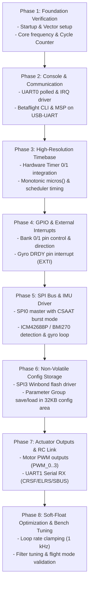

# Comprehensive Firmware Implementation Plan: C-DAC ARIES v3.0 (THEJAS32 / VEGA ET1031)

This document outlines the detailed architectural analysis and concrete phase-by-phase implementation plan for transitioning the **Betaflight ARIES v3.0** port from the initial stub/dummy build into a fully functional flight controller firmware.

This plan directly incorporates register-level drivers, peripheral mappings, interrupt handling schemes, and hardware specifications extracted from the official **C-DAC VEGA SDK BSP** (`lib/vega-sdk/vega-sdk/bsp/`).

---

## 1. VEGA SDK BSP Peripheral Analysis & Register Mapping

An inspection of `lib/vega-sdk/vega-sdk/bsp/` reveals the exact memory-mapped registers, control words, and interrupt structures for the THEJAS32 SoC:

### 1.1 Memory Map & Peripheral Base Addresses
From [`lib/vega-sdk/vega-sdk/bsp/include/config.h`](file:///home/ivan/Desktop/betaflight/lib/vega-sdk/vega-sdk/bsp/include/config.h) and driver headers:

| Peripheral | Base Address | Register Structure / Notes |
| :--- | :--- | :--- |
| **System RAM** | `0x10000000` | 256 KB internal SRAM (`0x10000000` - `0x1003FFFF`) |
| **External Flash** | `0x20000000` | 2 MB SPI NOR Flash (`0x20000000` - `0x201FFFFF`) |
| **UART 0** | `0x10000100` | 16550-like: `UART_DR`, `UART_IE`, `UART_IIR_FCR`, `UART_LCR`, `UART_LSR` |
| **UART 1** | `0x10000200` | Offset: `UART_BASE + (0x100 * i)` |
| **UART 2** | `0x10000300` | Offset: `UART_BASE + (0x100 * i)` |
| **SPI 0** | `0x10000600` | Control (packed bitfield), Status, Baudrate, TxData, RxData |
| **SPI 1** | `0x10000700` | `SPI_BASE_ADDR(i)` = `0x10000600` for 0 & 1 |
| **SPI 2** | `0x10200100` | `SPI_BASE_ADDR(i)` = `0x10200100` for 2 & 3 |
| **SPI 3** (Flash) | `0x10200200` | Onboard Winbond SPI NOR flash controller |
| **I2C 0** | `0x10000800` | `I2C_CR`, `I2C_SR0`, `I2C_SR1`, `I2C_IER`, `I2C_TxFF`, `I2C_RxFF`, `I2C_CHL`, `I2C_CHH` |
| **I2C 1 / I2C 2** | `0x10000900`+ | Offset: `I2C_BASE_ADDR + (0x100 * i)` |
| **Timers (0, 1, 2)**| `0x10000A00` | `LoadCount`, `CurrentValue`, `Control`, `EOI`, `IntrStatus` (stride: 20 bytes: `0x14`) |
| **Timer Raw Intr** | `0x10000AA8` | Global Raw Interrupt Status Register (`TIMER_BASE_ADDRESS + 0xA8`) |
| **ADC** | `0x10001000` | `address_reg`, `status_reg`, `data_reg` (Channels A0–A3) |
| **GPIO 0** | `0x10080000` | Pins 0–15; Data address: `base + (pin_bit << 2)`; Dir reg: `base + 0x40000` |
| **GPIO 1** | `0x10180000` | Pins 16–31; Data address: `base + (pin_bit << 2)`; Dir reg: `base + 0x40000` |
| **Interrupt Controller** | `0x20010000` | `RAW_INTR` (`0x00`), `INTR_EN` (`0x08`), `INTR_STATUS` (`0x10`) |

---

### 1.2 Peripheral Driver Analysis

#### A. UART Driver (`lib/vega-sdk/vega-sdk/bsp/drivers/uart/uart.c`)
- **Register Architecture:**
  - `UART_LCR`: Line Control Register. Bit 7 is DLAB (Divisor Latch Access Bit). `0x83` sets 8N1 + DLAB; `0x03` sets 8N1 standard.
  - `UART_DR`: Data Register (or Baud Divisor LSB when DLAB=1).
  - `UART_IE`: Interrupt Enable (or Baud Divisor MSB when DLAB=1). Bit 0: Rx Data Ready, Bit 1: Tx Holding Reg Empty.
  - `UART_LSR`: Line Status Register. Bit 0: Data Ready (`0x01`), Bit 5: Transmitter Empty (`0x20`).
- **Baud Calculation:**
  $$\text{Divisor} = \frac{F_{\text{CPU}}}{16 \times \text{Baudrate}}$$
  At 100 MHz clock and 115200 baud:
  $$\text{Divisor} = \frac{100,000,000}{16 \times 115,200} \approx 54 \quad (\text{hex: } 0x0036)$$

#### B. SPI Driver (`lib/vega-sdk/vega-sdk/bsp/drivers/spi/spi.c`)
- **Control Word Structure:**
  - `Bits.PeriphCS` (bits 1:0): Hardware CS selection (0–3).
  - `Bits.Periph` (bit 2): 0 = Fixed Peripheral, 1 = Variable Peripheral.
  - `Bits.DataOrder` (bit 3): 0 = MSB first, 1 = LSB first.
  - `Bits.Mode` (bits 5:4): CPOL/CPHA mode (Mode 0: 00, Mode 3: 11).
  - `Bits.SPIrxTxIntr` (bits 7:6): Interrupt enables (00 = Disabled).
  - `Bits.CSAAT` (bit 8): Chip Select Active After Transfer (essential for multi-byte burst transfers to IMU registers).
  - `Bits.Dbits` (bits 12:9): Bits per transfer (0 = 8-bit).
- **Status & Data:**
  - `SPI_BUSY_BIT` = `(1 << 4)`
  - `SPI_RX_COMPLETE_BIT` = `(1 << 6)`
  - `SPI_TX_HOLD_EMPTY_BIT` = `(1 << 7)`
  - Data transfer requires waiting for `TX_HOLD_EMPTY_BIT`, writing to `TxData`, then waiting for `RX_COMPLETE_BIT` and reading `RxData`.

#### C. Hardware Timers (`lib/vega-sdk/vega-sdk/bsp/drivers/timer/timer.c`)
- **Architecture:** 3 independent 32-bit decrementing timers (`TIMER_0`, `TIMER_1`, `TIMER_2`).
- **Registers:**
  - `LoadCount`: Reload value.
  - `CurrentValue`: Current down-counter value.
  - `Control`:
    - Bit 0: Enable (1) / Disable (0)
    - Bit 1: Mode (0 = Free-running down to 0, 1 = User-defined reload)
    - Bit 2: Interrupt Mask (0 = Unmasked, 1 = Masked)
  - `EOI`: Read to clear interrupt.
  - `IntrStatus`: Interrupt active flag.
- **Global Status:** Raw interrupt register at `0x10000AA8` has flags for Timer 0 (`bit 0`), Timer 1 (`bit 1`), Timer 2 (`bit 2`).

#### D. GPIO (`lib/vega-sdk/vega-sdk/bsp/drivers/gpio/gpio.c`)
- **Unique Address-Decoding Scheme:**
  - Direction Register (`base + 0x40000`): Bit 0 = Input, Bit 1 = Output.
  - Data Read/Write uses pin bit shift in address space:
    $$\text{Pin Address} = \text{GPIO\_BASE} + (1 \ll \text{pin\_no}) \times 4$$
  - GPIO 0 handles pins 0–15; GPIO 1 handles pins 16–31 (where `pin_no = pin - 16`).

#### E. Interrupt Controller (`lib/vega-sdk/vega-sdk/bsp/drivers/interrupt/interrupt.c`)
- **Registers at `0x20010000`:**
  - `RAW_INTR` (`0x00`)
  - `INTR_EN` (`0x08`): Peripheral interrupt enable bitmask.
  - `INTR_STATUS` (`0x10`): Active interrupt vector flag.
- **Trap Entry (`crt.S`):**
  - MTVEC is pointed to `INTERRUPT_Handler_0` / `trap_entry`.
  - Machine Mode External Interrupt (MEIP) in `mie` and MIE bit in `mstatus` are enabled.
  - Peripheral IRQ IDs for 32-bit processor:
    - Timer 0 = IRQ 7
    - Timer 1 = IRQ 8
    - Timer 2 = IRQ 9
    - UART 0 = IRQ 0 (or PLIC equivalent)

---

## 2. Betaflight Architectural Integration Strategy

To keep upstream compatibility and maintain clean separation, all driver adaptations will reside exclusively in `src/platform/ARIES/`:

```
src/platform/ARIES/
├── mk/
│   └── ARIES.mk                  # Source inclusions, compiler flags, link options
├── link/
│   └── aries_v3.ld               # Memory segments (Flash, SRAM, config, stack)
├── target/
│   └── ARIESV3/
│       ├── target.h              # Hardware feature flags, pin allocations
│       └── target.mk             # MCU identifiers
├── include/
│   └── platform/
│       ├── platform.h            # Core macros, IRQ management, traits
│       ├── timer_def.h           # Timer constants
│       └── bsp_vega.h            # Inlined register access definitions from BSP
├── startup.S                     # Reset, stack setup, .data copy, .bss clear
├── system.c                      # Clocks, cycle counting, micros() / millis(), delays
├── io_aries.c                    # GPIO driver implementation (replacing dummy stubs)
├── serial_uart_aries.c           # UART0 (CLI/MSP), UART1 (Serial RX)
├── bus_spi_aries.c               # SPI0 master driver for IMU
├── exti_aries.c                  # GPIO external interrupt for Gyro DRDY
├── timer_aries.c                 # Hardware Timer driver for microsecond timebase
├── pwm_motor_aries.c             # Motor pulse generation (PWM / OneShot125)
└── config_flash_aries.c          # SPI Flash parameter group save/restore
```

---

## 3. Phased Implementation Roadmap



---

### Detailed Implementation Phases

### Phase 1: Foundation & Interrupt Trap Handler Verification
- **Goal:** Ensure CPU starts reliably, sets up the stack, initializes the trap table, and handles exceptions cleanly.
- **Tasks:**
  1. Audit `startup.S`: Ensure `sp` is loaded from `_estack`, `.data` copied, `.bss` cleared.
  2. Implement `trap_entry` in `src/platform/ARIES/startup.S` or a dedicated assembly file using the context save/restore logic from BSP `crt.S`.
  3. Set `mtvec` to point to the trap vector.
  4. Implement `handle_trap(uint32_t mcause, uint32_t mepc, uint32_t *sp)` in `system.c` to print crash diagnostics or safely halt.
- **Verification:**
  - Trigger a software trap or deliberate illegal instruction in Renode and verify `mcause` and `mepc` are correctly logged.

---

### Phase 2: UART Driver & Betaflight CLI / MSP (UART0)
- **Goal:** Enable bi-directional communication between the ARIES v3.0 board and the host PC via CP2102N USB-UART bridge.
- **BSP Source:** `lib/vega-sdk/vega-sdk/bsp/drivers/uart/uart.c`.
- **Tasks:**
  1. Create `src/platform/ARIES/serial_uart_aries.c`.
  2. Implement Betaflight `serialPort_t` virtual function table:
     - `uartOpen()`: Configure baud rate (115200), 8N1, enable FIFOs.
     - `uartWrite()`: Non-blocking byte transfer into ring buffer or polling `UART_LSR` bit 5.
     - `uartRead()`: Pull from RX ring buffer.
     - `uartTotalRxBytesWaiting()`: Check RX buffer count.
  3. Implement interrupt handler:
     - On RX interrupt (`UART_IE` bit 0), read `UART_DR` and push into Betaflight serial RX buffer.
  4. In `target.h`:
     - Bind `SERIAL_PORT_USART1` or CLI port to `UART0`.
     - `#define USE_UART0` or map `UART1` to hardware index 0.
- **Verification:**
  - Launch Renode or flash real board.
  - Open terminal at 115200 baud.
  - Send `#` or press Enter; verify Betaflight banner and `# status` response.

---

### Phase 3: Hardware Timer & Monotonic Timebase
- **Goal:** Replace the naive `mcycle` CSR-based `micros()` with a robust hardware timer timebase and verify task scheduler jitter.
- **BSP Source:** `lib/vega-sdk/vega-sdk/bsp/drivers/timer/timer.c`.
- **Tasks:**
  1. Configure `TIMER_0` in `src/platform/ARIES/system.c`:
     - Set `LoadCount` to `0xFFFFFFFF`.
     - Set `Control = 0x03` (Free-running / periodic mode, interrupt enabled or masked).
  2. Refine `micros()`:
     - Read decrementing `Timer(0).CurrentValue`.
     - Account for counter underflow with an overflow accumulator variable.
     - Alternatively, use `mcycle` (64-bit cycle counter via `csrr rdcycle` / `csrr mcycle`) calibrated to exactly 100 MHz:
       $$\mu s = \frac{\text{mcycle}}{100}$$
  3. Implement `delayMicroseconds()` and `delay()`.
- **Verification:**
  - Run CLI `tasks` command; verify `SYSTEM`, `SERIAL`, and `BATTERY` tasks report stable execution intervals.

---

### Phase 4: GPIO Subsystem & EXTI (Interrupts)
- **Goal:** Complete the GPIO HAL and external pin interrupt mechanism for sensor data ready triggers.
- **BSP Source:** `lib/vega-sdk/vega-sdk/bsp/drivers/gpio/gpio.c` and `interrupt.c`.
- **Tasks:**
  1. Create `src/platform/ARIES/io_aries.c`:
     - Implement `IOInitGlobal()`, `IOConfigGPIO()`.
     - Implement `IOHi()`, `IOLo()`, `IOToggle()`, `IORead()`, `IOWrite()` using the BSP address bit-shift mechanism:
       ```c
       void IOWrite(IO_t io, bool hi) {
           uint16_t pin = IO_GPIOPinIdx(io);
           uint8_t bank = IO_GPIOPortIdx(io);
           uint32_t base = (bank == 0) ? GPIO_0_BASE_ADDRESS : GPIO_1_BASE_ADDRESS;
           volatile uint16_t *dir = (volatile uint16_t *)(base + 0x40000);
           *dir |= (1 << pin); // Set as Output
           volatile uint16_t *reg = (volatile uint16_t *)(base + ((1 << pin) << 2));
           *reg = hi ? 1 : 0;
       }
       ```
  2. Implement `src/platform/ARIES/exti_aries.c`:
     - Route GPIO 0 interrupt (Gyro DRDY pin on `J2_11`) through the interrupt controller (`0x20010000`).
     - Bind EXTI callback to Betaflight gyro task trigger.
- **Verification:**
  - Toggle an onboard LED (e.g. `LD4` or RGB `LD1`) via CLI command `status` or beeper test.

---

### Phase 5: SPI Bus Driver & IMU Sensor Integration
- **Goal:** Enable high-speed synchronous SPI communication for the primary IMU (accelerometer + gyroscope).
- **BSP Source:** `lib/vega-sdk/vega-sdk/bsp/drivers/spi/spi.c`.
- **Tasks:**
  1. Create `src/platform/ARIES/bus_spi_aries.c`:
     - Initialize `SPI0` at base `0x10000600`.
     - Configure baud rate divisor for 10–20 MHz operation.
     - Implement `spiTransferByte()` and `spiTransfer()`:
       - Set `CSAAT = 1` during multi-byte transfers; set `CSAAT = 0` on final byte.
       - Poll `SPI_TX_HOLD_EMPTY_BIT` and `SPI_RX_COMPLETE_BIT`.
  2. Configure IMU in `target.h`:
     - Enable `#define USE_GYRO_SPI_ICM42688P` (or BMI270 / MPU6000 depending on connected module).
     - Assign CS pin (`J1_8`) and EXTI pin (`J2_11`).
- **Verification:**
  - CLI `status` reports detected Gyro/Acc (e.g., `GYRO: ICM42688P`).
  - Open Betaflight Configurator "Setup" tab; confirm 3D model rotates with physical sensor movement.

---

### Phase 6: SPI Flash Driver & Parameter Group (PG) Storage
- **Goal:** Enable persistent saving of PID configurations, RC rates, and target settings across reboots.
- **BSP Source:** `lib/vega-sdk/vega-sdk/bsp/include/m25p80_eeprom.h`.
- **Tasks:**
  1. Create `src/platform/ARIES/config_flash_aries.c`:
     - Control onboard Winbond flash chip connected to `SPI3` (`0x10200200`).
     - Implement standard SPI NOR flash commands:
       - `0x06`: Write Enable
       - `0x05`: Read Status Register (poll WIP bit 0)
       - `0x20`: Sector Erase (4 KB)
       - `0x02`: Page Program (up to 256 bytes)
       - `0x03`: Read Data Bytes
  2. Map Betaflight config streamer to the reserved Flash region:
     - Base: `0x20000000 + 2048K - 32K` = `0x201F8000`.
     - Length: 32 KB.
- **Verification:**
  - Execute `set pilot_name = ARIES_PILOT` followed by `save`.
  - Power cycle the board; run `get pilot_name` and confirm the value is retained.

---

### Phase 7: Motor PWM Actuation & RC Receiver
- **Goal:** Drive 4 ESCs / motors and decode incoming pilot radio signals.
- **Tasks:**
  1. Motor PWM (`src/platform/ARIES/pwm_motor_aries.c`):
     - Configure hardware timers to output 400 Hz analog PWM or OneShot125 (125–250 $\mu s$ pulses).
     - Map channels `PWM_0` to `PWM_3` on headers J1/J2.
     - Implement `pwmWriteMotor()`.
  2. Serial Receiver (`UART1`):
     - Configure `UART1` on pins `J2_13` (TX) and `J2_15` (RX).
     - Enable CRSF / ExpressLRS or SBUS protocol in Betaflight.
- **Verification:**
  - Check PWM pulse width with an oscilloscope or logic analyzer.
  - Configurator "Receiver" tab displays live stick movements from transmitter.
  - Configurator "Motors" tab safely spins motors (props off).

---

### Phase 8: Soft-Float Tuning & Flight Loop Optimization
- **Goal:** Ensure stable loop times on the non-FPU RV32IM core without task overruns.
- **Tasks:**
  1. Rate Clamping:
     - Set PID and Gyro loop rate to **1 kHz** (1000 $\mu s$).
     - Disable CPU-intensive filters (bidirectional DShot, high-order dynamic notch filters).
  2. Soft-Float Optimization:
     - Verify math functions link with optimized soft-float routines from `libgcc.a`.
     - Ensure `-ffast-math -fno-math-errno` are active.
  3. Validate loop jitter via CLI `tasks`:
     - Max task duration for `PID` must remain well under $500\,\mu s$.

---

## 4. File Modification Matrix

| File Path | Action | Description |
| :--- | :--- | :--- |
| `src/platform/ARIES/include/platform/bsp_vega.h` | **New** | Consolidates peripheral addresses and register bitfields from VEGA SDK |
| `src/platform/ARIES/serial_uart_aries.c` | **New** | Hardware UART driver (UART0 CLI, UART1 RX) replacing dummy serial stubs |
| `src/platform/ARIES/bus_spi_aries.c` | **New** | SPI0 master driver with CSAAT support for external IMU |
| `src/platform/ARIES/io_aries.c` | **New** | Full GPIO driver using VEGA address-decoded pin toggling |
| `src/platform/ARIES/config_flash_aries.c` | **New** | SPI3 Flash erase/program routines for persistent config saving |
| `src/platform/ARIES/pwm_motor_aries.c` | **New** | Timer-based motor pulse generator |
| `src/platform/ARIES/stub_drivers.c` | **Modify** | Remove stubs as real drivers are linked; retain only unsupported features |
| `src/platform/ARIES/system.c` | **Modify** | Hook hardware timer/trap handler into system initialization |
| `src/platform/ARIES/target/ARIESV3/target.h`| **Modify** | Enable real hardware feature flags (`USE_UART0`, `USE_FLASH`, etc.) |
| `src/platform/ARIES/mk/ARIES.mk` | **Modify** | Add newly implemented C source files to `MCU_COMMON_SRC` |

---

## 5. Risk Assessment & Mitigations

| Risk | Impact | Mitigation Strategy |
| :--- | :--- | :--- |
| **No FPU on Core (RV32IM)** | PID loop calculations could exceed 1 ms, causing flight loop overruns | Lock loop rate at 1 kHz; use lightweight biquad filters; profile `pidController()` runtime. |
| **Atomic Operations Missing** | Multithreaded/interrupt races in shared buffers | Continue using the interrupt-safe software wrapper `__atomic_fetch_add_4` implemented in Phase 2. |
| **Burst SPI for Gyro FIFO** | Reading gyro registers requires continuous CS low | Leverage `CSAAT` bit in the VEGA SPI control register to hold CS active across byte bursts. |
| **Flash Write Latency** | Flash sector erase (4 KB) blocks CPU execution | Run config saves only when disarmed; ensure interrupts are appropriately handled during flash operations. |
