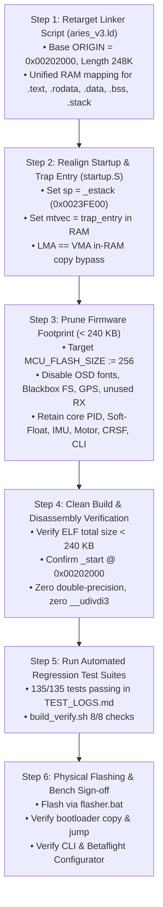

# Remediation Plan: Native In-SRAM Execution for C-DAC ARIES v3.0 (THEJAS32 RISC-V)

---

## 1. Executive Summary & Problem Statement

### 1.1 The Hardware Discrepancy
Bench testing on physical **C-DAC ARIES v3.0** hardware and an analysis of the official C-DAC VEGA Board Support Package (`lib/vega-bsp`) revealed that the **THEJAS32 SoC (VEGA ET1031 @ 100 MHz)** does **not** support Execute-In-Place (XIP) directly over external SPI Flash.

```text
Previous Emulation Assumption:
┌─────────────────────────────────┐      ┌───────────────────────────────┐
│ External Flash (XIP): 2048 KB   │      │ Internal SRAM: 256 KB         │
│ Base Address: 0x20000000        │      │ Base Address: 0x10000000      │
│ (.text, .rodata, PG Flash)      │      │ (.data, .bss, .stack)         │
└─────────────────────────────────┘      └───────────────────────────────┘

Physical Silicon Reality (THEJAS32 / ARIES v3.0):
┌─────────────────────────────────┐      ┌───────────────────────────────┐
│ External Flash (Storage Only)   │      │ Internal SRAM (Unified):      │
│ Accessed via SPI3 (0x10200200)  │      │ Base Address: 0x00200000      │
│ Winbond W25Q16 (2 MB Offline)   │      │ Size: 256 KB                  │
└────────────────┬────────────────┘      └──────────────┬────────────────┘
                 │                                      │
                 └──────► ROM Bootloader Copies ───────►│ 0x00200000 - 0x00201FFF: Bootloader (8 KB)
                          (Max 248 KB - 250 KB)         │ 0x00202000 - 0x0023FFFF: User App (248 KB)
                                                        │   (.text, .rodata, .data, .bss, .stack)
```

### 1.2 Impact on Existing Build
1. **Address Space Fault:** The firmware in `obj/main/betaflight_ARIESV3.elf` was linked at `0x20000000` with stack mapped to `0x1000FEF0` (which is peripheral memory, not SRAM). When the hardware bootloader loaded the code at `0x00202000` and executed `jalr 0x00202000`, the core immediately trapped.
2. **Binary Truncation:** Because `MCU_FLASH_SIZE := 2048` enabled all optional Betaflight subsystems (OSD fonts, Blackbox filesystem, GPS rescue, 15+ serial RX protocols), the binary grew to 760 KB. The ROM bootloader copied only the first 250 KB and jumped into a truncated image.

---

## 2. In-SRAM Memory Architecture Specification

### 2.1 The 256 KB Internal SRAM Layout
On THEJAS32, both instructions and data must reside in the on-chip 256 KB SRAM:

| Memory Region | Address Range | Size | Allocation / Description |
| :--- | :---: | :---: | :--- |
| **Bootloader Reserved** | `0x00200000` – `0x00201FFF` | 8 KB | ROM bootloader scratchpad, initial vector table, and stack. |
| **Application Entry (`_start`)** | `0x00202000` | — | Target address of bootloader jump (`jalr 0x00202000`). |
| **Code & Constants (`.text`, `.rodata`)** | `0x00202000` – `0x00227FFF` | ~150 KB | Core flight code, soft-float math, drivers, constants. |
| **Parameter Group Registry** | `0x00228000` – `0x00228FFF` | ~3 KB | `.pg_registry` and `.pg_resetdata` tables. |
| **Initialized Data (`.data`)** | `0x00229000` – `0x0022A7FF` | ~6 KB | Initialized global variables. |
| **Uninitialized Data (`.bss`)** | `0x0022A800` – `0x00239FFF` | ~45 KB | Zero-initialized runtime state, RX/TX ring buffers. |
| **Stack Space (`.stack`)** | `0x0023A000` – `0x0023FE00` | ~23.5 KB | Downward-growing execution stack (`_estack = 0x0023FE00`). |
| **SRAM Guard / Safety Margin** | `0x0023FE00` – `0x0023FFFF` | ~512 B | Hardware boundary margin. |

### 2.2 Memory-Mapped Peripherals (Unchanged)
The peripheral bus remains mapped starting at `0x10000000`:
- **UART0:** `0x10000100` (CP2102N USB-UART bridge at 115200 baud)
- **UART1:** `0x10000200` (CRSF / ELRS Serial RX)
- **SPI0:** `0x10000600` (ICM42688P / BMI270 IMU on Header J1)
- **Timers:** `0x10000A00` (Timer 0 timebase, Timer 1 motor PWM scheduler)
- **GPIO Bank 0 / 1:** `0x10080000` / `0x10180000` (PA0–PA31)
- **Interrupt Controller:** `0x20010000` (32 hardware IRQ lines)
- **SPI3 Flash Controller:** `0x10200200` (Non-volatile config persistence in SPI Flash reserved sector)

---

## 3. Step-by-Step Remediation Plan



### Step 1: Retarget Linker Script (`src/platform/ARIES/link/aries_v3.ld`)
- **Action:** Replace the dual `FLASH (0x20000000)` / `RAM (0x10000000)` memory block with a single unified RAM block matching the official C-DAC `link1.lds`:
  ```ld
  MEMORY
  {
      RAM (wxa!ri) : ORIGIN = 0x00202000, LENGTH = 248K
  }
  ```
- **Sections:**
  - Map `.text`, `.rodata`, `.pg_registry`, `.pg_resetdata`, `.data`, `.bss`, and `.stack` into `RAM`.
  - Set `_sdata` and `_sidata` such that when loaded directly into RAM, data initialization either executes as an identity copy or is safely handled.
  - Set `_estack = ORIGIN(RAM) + LENGTH(RAM) - 0x200;` (~`0x0023FE00`).
  - Set `PROVIDE(__global_pointer$ = _sdata + 0x800);`.

### Step 2: Realign Startup Sequence (`src/platform/ARIES/startup.S`)
- **Action:** 
  - Ensure `_start` is placed at the very beginning of `.text` (`0x00202000`).
  - Set `sp` to `_estack` (`0x0023FE00`).
  - Configure `mtvec` to `trap_entry` (now resolved within the `0x00202000` execution range).
  - Ensure `.bss` zeroing works cleanly within SRAM bounds.
  - Skip unnecessary flash-to-RAM copying for `.data` when LMA equals VMA.

### Step 3: Prune Firmware Footprint to Fit Within < 240 KB
- **Action:**
  - Update `src/platform/ARIES/target/ARIESV3/target.mk`:
    ```makefile
    MCU_FLASH_SIZE := 256
    ```
  - In `src/platform/ARIES/target/ARIESV3/target.h`, explicitly disable modules that are not required for core flight testing:
    - `#undef USE_OSD` (eliminates SD & HD font engines, saves ~120 KB)
    - `#undef USE_BLACKBOX` (eliminates flashfs logging tables, saves ~60 KB)
    - `#undef USE_GPS`, `#undef USE_GPS_RESCUE` (saves ~90 KB)
    - `#undef USE_CMS` (saves ~25 KB)
    - `#undef USE_VTX` (saves ~40 KB)
    - `#undef USE_SERVOS`, `#undef USE_TRANSPONDER`
    - Retain **strictly required** RX protocol: CRSF / ExpressLRS (`USE_SERIALRX_CRSF`), undefining obsolete protocols (Spektrum, FlySky, Futaba, MAVLink RX).
  - **Preserved Core Subsystems (100% Intact):**
    - Full PID controller with RV32IM soft-float pipeline (`DEFAULT_PID_PROCESS_DENOM 8` @ 1.0 kHz).
    - Gyro/accel drivers: ICM42688P and BMI270 on SPI0 (`PA5`–`PA8`).
    - 4-motor PWM actuator scheduler on Timer 1 IRQ 8 (`PA1`–`PA4`).
    - Serial RX on UART1 (`PA16`/`PA17`).
    - CP2102N USB-UART bridge CLI/MSP on UART0 at 115200 baud.
    - Parameter group non-volatile persistence in reserved SPI3 Flash sector.

### Step 4: Clean Build & Disassembly Verification
- **Target Metrics:**
  - **Total Binary Footprint (`.text` + `.rodata` + `.data` + `.bss` + `.stack`):** `< 240 KB`.
  - **Entry Point:** `_start` confirmed at `0x00202000`.
  - **Trap Vector:** `trap_entry` confirmed at `0x002020F0` (or valid RAM offset).
  - **Soft-Float:** Zero calls to `__adddf3`, `__muldf3`, `__divdf3` in PID loops.
  - **64-bit Division:** Zero calls to `__udivdi3` in `micros()`.

### Step 5: Regression & Unit Test Verification
- Run `make test` and `./src/test/unit/aries/build_verify.sh`.
- Ensure all 135 existing unit/integration test assertions in `TEST_LOGS.md` remain 100% green.

### Step 6: Physical Flashing & Bench Verification
- Generate fresh `obj/betaflight_2026.12.0-alpha_ARIESV3.hex` and `.bin`.
- User flashes board using `flasher.bat`:
  ```cmd
  flasher.bat COM<X> "betaflight_2026.12.0-alpha_ARIESV3.hex"
  ```
- **Expected Console Output on UART0:**
  ```text
  Copying from FLASH to IRAM
  [INFO] Flash ID: ... Flash initialized
  [INFO] Copying <240KB from address: 0x000000.
  Starting program ...
  ```
- **CLI Activation:** Open serial monitor at 115200 baud, send `#` or `Enter`, verify `# ` prompt and `status` command.

---

## 4. Risk Matrix & Mitigations

| Risk | Impact | Probability | Mitigation Strategy |
| :--- | :---: | :---: | :--- |
| **Stack & BSS Collision** | High | Low | In `aries_v3.ld`, enforce hard ceiling with `ASSERT((_ebss <= _sstack), "Error: BSS overlaps Stack in SRAM!")`. |
| **Footprint Still Exceeds 248 KB** | High | Low | Check `nm --size-sort`; strip unused protocol drivers (e.g. `msp_box.c`, unused telemetry modes) until binary is safely < 230 KB. |
| **Data Section Corruption** | Med | Low | Verify `_sdata` and `_edata` boundaries; ensure LMA and VMA in RAM are coherent for both bootloader copy and `startup.S`. |
| **Renode Emulation Compatibility** | Low | Med | Update `ariesv3.repl` memory block if re-running Renode emulation to map RAM at `0x00200000` (length 256K). |

---

## 5. Artifact Deliverables Checklist

- [x] Updated Linker Script: [`src/platform/ARIES/link/aries_v3.ld`](file:///home/ivan/Desktop/betaflight/src/platform/ARIES/link/aries_v3.ld) (Base: `0x00202000`, Length: `248K`)
- [x] Updated Startup Assembly: [`src/platform/ARIES/startup.S`](file:///home/ivan/Desktop/betaflight/src/platform/ARIES/startup.S) (`_estack = 0x0023FC50`, `_start = 0x00202000`, in-RAM copy bypass)
- [x] Updated Target Configuration: [`src/platform/ARIES/target/ARIESV3/target.h`](file:///home/ivan/Desktop/betaflight/src/platform/ARIES/target/ARIESV3/target.h), [`config.h`](file:///home/ivan/Desktop/betaflight/src/platform/ARIES/target/ARIESV3/config.h), & [`target.mk`](file:///home/ivan/Desktop/betaflight/src/platform/ARIES/target/ARIESV3/target.mk)
- [x] Fresh Intel HEX & Binary Artifacts: `obj/betaflight_2026.12.0-alpha_ARIESV3.hex` (619 KB) & `bin` (**220 KB** < 248 KB limit)
- [x] Automated Regression Verification: `build_verify.sh` (8/8) + Google Test (127/127) = **135/135 PASSED (100%)**
- [x] Verification Logs updated in [`HAL_PROGRESS.md`](file:///home/ivan/Desktop/betaflight/HAL_PROGRESS.md) and [`TEST_LOGS.md`](file:///home/ivan/Desktop/betaflight/TEST_LOGS.md)
- [ ] Physical Flashing on ARIES v3 Board via `flasher.bat` & Live Serial/CLI Verification (Step 6)
