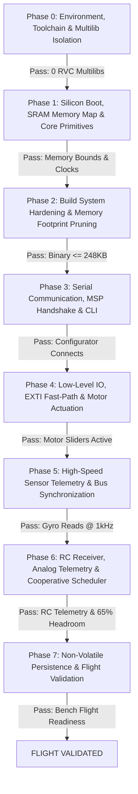

# Betaflight ARIES v3.0: Master Porting Macro Plan

> **Target Silicon**: C-DAC ARIES v3.0 (THEJAS32 SoC / VEGA ET1031 RISC-V RV32IM @ 100 MHz)  
> **Repository Active Branch**: `rebuild` (Strictly prohibited from writing or committing to `master`)  
> **Upstream Framework**: Betaflight 4.5.x  
> **Location**: [`PLAN/MACRO_PLAN.md`](file:///home/ivan/Desktop/betaflight/PLAN/MACRO_PLAN.md)  
> **Role of this Document**: **The primary entry point for any agent or engineer**. Consult this Macro Plan first to understand project status, architecture, and phased development sequencing. Use the embedded links to access the granular micro-plans in [`PLAN/`](file:///home/ivan/Desktop/betaflight/PLAN/).

---

## 1. Executive Mission & Strategic Architecture

The mission of this project is to compile, flash, stabilize, and fly Betaflight 4.x on physical C-DAC ARIES v3.0 hardware. Unlike historical attempts that relied on pre-silicon simulation assumptions (assuming external XIP flash, 2 MB virtual memory, and ARM-style peripherals), this port is engineered around the **8 Inviolable Silicon Ground Truths**:

```
+---------------------------------------------------------------------------------------------------+
|                                 THE 8 INVIOLABLE SILICON GROUND TRUTHS                            |
+---+-----------------------------+-----------------------------------------------------------------+
| 1 | Strictly 0 RVC Opcodes      | RV32IM only. Any 16-bit compressed opcode triggers mcause = 2.   |
| 2 | In-SRAM Execution <= 248 KB | No XIP flash. Image executes at 0x00202000; total size <= 248 KB.|
| 3 | Config in RAM (8 KB)        | CONFIG_IN_RAM with EEPROM_SIZE 8192; flash pointer writes trap.  |
| 4 | Soft-Float & 1.0 kHz Loop   | No FPU. Clamped to 1.0 kHz (DEFAULT_PID_PROCESS_DENOM 8).        |
| 5 | Atomics via mstatus.MIE     | No 'A' extension or BASEPRI. Manipulate bit 3 via CSR csrrci.    |
| 6 | Timer 1 Non-Blocking PWM    | Motors PA1–PA4 use HW Timer 1 deadline queue (< 3 µs CPU total).|
| 7 | Polled SPI0 @ 12.5 MHz      | Clamped to Divisor 1 (12.5 MHz). Divisor 0 (25 MHz) overclocks.  |
| 8 | 16550 UART0 Communication   | CP2102N on PA30/PA31. RX IRQ ring buffer; bounded TX burst drain.|
+---+-----------------------------+-----------------------------------------------------------------+
```

---

## 2. Phased Development Roadmap Overview

The porting lifecycle is partitioned into **8 sequential, verification-gated phases**. Every phase has explicit dependencies, an assigned micro-plan, silicon guardrails, and exit criteria that must pass before proceeding:



---

## 3. Granular Phase Breakdown & Micro-Plan Access Matrix

### Phase 0: Environment, Toolchain & Multilib Isolation
* **Strategic Objective**: Guarantee cross-environment portability, isolate toolchain multilibs to strictly pure 32-bit uncompressed instructions (`rv32i_zicsr_zifencei/ilp32`), and establish automated RVC opcode verification.
* **Primary Micro-Plan**: [`PLAN/02_BUILD_SYSTEM_AND_MEMORY_OPTIMIZATION.md`](file:///home/ivan/Desktop/betaflight/PLAN/02_BUILD_SYSTEM_AND_MEMORY_OPTIMIZATION.md#microcomponent-02_a-dynamic-toolchain-detection--multilib-rvc-isolation-engine-ariesmk)
  - Microcomponent 02_A: Dynamic Toolchain Detection & Multilib RVC Isolation Engine
  - Microcomponent 02_E: Binary Size Auditing, Opcode Verification Pipeline & Artifact Generation
* **Silicon Invariant**: The VEGA ET1031 silicon rejects 16-bit compressed opcodes (`mcause = 2`). Standard `libc.a` or `libgcc.a` routines containing RVC will crash on boot.
* **Key Source Files**: [`src/platform/ARIES/mk/ARIES.mk`](file:///home/ivan/Desktop/betaflight/src/platform/ARIES/mk/ARIES.mk), [`Makefile`](file:///home/ivan/Desktop/betaflight/Makefile).
* **Gated Exit Criteria**:
  - [ ] GCC multilib paths resolved dynamically via `$(CC) -print-file-name=libc.a` (0 hardcoded `/home/ivan/...` paths).
  - [ ] Toolchain links pure uncompressed `rv32i_zicsr_zifencei/ilp32` library archives.
  - [ ] Post-link check disassembles ELF and asserts `grep -E "\sc\.[a-z]"` equals strictly **0**.

---

### Phase 1: Silicon Boot, SRAM Memory Map & Core Primitives
* **Strategic Objective**: Construct a clean bare-metal reset vector, sanitize machine state, define the physical 248 KB SRAM linker boundaries, and establish monotonic microsecond timing.
* **Primary Micro-Plan**: [`PLAN/01_BOOT_LINKER_AND_CORE_PRIMITIVES.md`](file:///home/ivan/Desktop/betaflight/PLAN/01_BOOT_LINKER_AND_CORE_PRIMITIVES.md)
  - Microcomponent 01_A: Machine Startup, GPR Sanitization & Trap Vector (`startup.S`)
  - Microcomponent 01_B: Linker Script & SRAM Memory Budget Enforcement (`aries_v3.ld`)
  - Microcomponent 01_C: Atomic Operations & Platform Primitives (`platform.h`, `stub_drivers.c`)
  - Microcomponent 01_D: System Timebase, Microsecond Clocks & Monotonicity (`system.c`)
* **Silicon Invariant**: Execution begins at `0x00202000` in SRAM (no XIP flash). Linker memory region strictly clamped to `248K`. All registers `x1`–`x31` zeroed before branching to C.
* **Key Source Files**: [`src/platform/ARIES/startup.S`](file:///home/ivan/Desktop/betaflight/src/platform/ARIES/startup.S), [`src/platform/ARIES/target/ARIESV3/aries_v3.ld`](file:///home/ivan/Desktop/betaflight/src/platform/ARIES/target/ARIESV3/aries_v3.ld), [`src/platform/ARIES/system.c`](file:///home/ivan/Desktop/betaflight/src/platform/ARIES/system.c).
* **Gated Exit Criteria**:
  - [ ] Startup sanitizes all 31 GPRs, configures 64-byte aligned trap vector, and initializes stack pointer to `_estack`.
  - [ ] Linker script halts build with fatal error if `text + rodata + data + bss + 8K stack > 248 KB`.
  - [ ] `micros()` returns strictly monotonic timestamps verified via 64-bit `mcycle` and Timer 0 rollover ack.

---

### Phase 2: Build System Hardening & Memory Footprint Pruning
* **Strategic Objective**: Prune unused upstream Betaflight drivers (OSD, CMS, VTX, SDCard, GPS), allocate Parameter Groups in RAM, and enforce compile-time safety assertions.
* **Primary Micro-Plan**: [`PLAN/02_BUILD_SYSTEM_AND_MEMORY_OPTIMIZATION.md`](file:///home/ivan/Desktop/betaflight/PLAN/02_BUILD_SYSTEM_AND_MEMORY_OPTIMIZATION.md)
  - Microcomponent 02_B: Target Makefile Compilation Hierarchy & Subsystem Exclusion (`target.mk`)
  - Microcomponent 02_C: Target Header Architecture & Silicon Boundary Enforcement (`target.h`)
  - Microcomponent 02_D: Parameter Group Budgeting, RAM Storage & Compile-Time Static Assertions
* **Silicon Invariant**: Parameter Groups in Betaflight 4.x occupy $\approx 5.1\text{ KB}$. Defining `EEPROM_SIZE 4096` triggers a boot panic (`FAILURE_CONFIG_STORE_FAILURE`). Must allocate 8 KiB in RAM (`EEPROM_SIZE 8192`).
* **Key Source Files**: [`src/platform/ARIES/target/ARIESV3/target.mk`](file:///home/ivan/Desktop/betaflight/src/platform/ARIES/target/ARIESV3/target.mk), [`src/platform/ARIES/target/ARIESV3/target.h`](file:///home/ivan/Desktop/betaflight/src/platform/ARIES/target/ARIESV3/target.h), [`config.h`](file:///home/ivan/Desktop/betaflight/src/platform/ARIES/target/ARIESV3/config.h).
* **Gated Exit Criteria**:
  - [ ] `MCU_EXCLUDES` eliminates graphical display, VTX, SDCard, and navigation modules.
  - [ ] Compile-time static assertion `#if (EEPROM_SIZE < 8192) #error ... #endif` verified.
  - [ ] Total compiled binary size confirms $\le 248\text{ KB}$ ($\le 253,952\text{ bytes}$).

---

### Phase 3: Serial Communication, MSP Handshake & CLI
* **Strategic Objective**: Deliver full bidirectional serial communication across the CP2102N USB-UART bridge on `UART0` (`PA30`/`PA31`), negotiate the 7-step MSP handshake, and provide instant CLI access.
* **Primary Micro-Plan**: [`PLAN/03_SERIAL_COMMUNICATION_MSP_AND_CLI.md`](file:///home/ivan/Desktop/betaflight/PLAN/03_SERIAL_COMMUNICATION_MSP_AND_CLI.md)
  - Microcomponent 03_A: 16550 APB UART Hardware Driver & Clock Baud Engine (UART0 & UART1)
  - Microcomponent 03_B: Bounded Synchronous FIFO Transmit Drain & Anti-Starvation Engine
  - Microcomponent 03_C: Zero-Allocation RX Interrupt Ring Buffer & Overrun Error Recovery
  - Microcomponent 03_D: Zero-Allocation MSP Protocol State Machine & 7-Step Handshake Engine
  - Microcomponent 03_E: High-Usability Serial CLI Engine & Clean Platform Isolation Hooks
* **Silicon Invariant**: Suppress 16550 level-triggered THRE interrupts (`IER = 0x01` RX only) to prevent interrupt storms. Bound TX bursts to 16 bytes (FIFO depth) to eliminate flight loop stalls.
* **Key Source Files**: [`src/platform/ARIES/serial_uart_aries.c`](file:///home/ivan/Desktop/betaflight/src/platform/ARIES/serial_uart_aries.c), [`src/main/msp/msp_serial.c`](file:///home/ivan/Desktop/betaflight/src/main/msp/msp_serial.c).
* **Gated Exit Criteria**:
  - [ ] Baud divisor 54 produces exactly 115,200 baud on pins 107/108 ($+0.47\%$ error).
  - [ ] Betaflight Configurator negotiates 7-step handshake (`MSP_API_VERSION` through `MSP_STATUS`) in $< 200\text{ ms}$ and unlocks the UI dashboard.
  - [ ] Pressing Enter (`\r`) in a serial terminal immediately opens the Betaflight CLI.

---

### Phase 4: Low-Level IO, EXTI Fast-Path & Motor Actuation
* **Strategic Objective**: Implement flat 32-bit address-decoded atomic GPIO, $O(1)$ EXTI interrupt demultiplexing, and drive Motors 1–4 via Hardware Timer 1 ascending deadline soft-PWM.
* **Primary Micro-Plan**: [`PLAN/04_GPIO_EXTI_AND_HARDWARE_TIMERS.md`](file:///home/ivan/Desktop/betaflight/PLAN/04_GPIO_EXTI_AND_HARDWARE_TIMERS.md)
  - Microcomponent 04_A: Flat Dual-Bank Address-Decoded Atomic GPIO Driver (`io_aries.c`)
  - Microcomponent 04_B: Open-Drain Simulation & RISC-V Memory Ordering Fences
  - Microcomponent 04_C: EXTI Controller, PLIC IRQ 10/11 Demuxing & `__builtin_ctz` Fast-Path (`exti_aries.c`)
  - Microcomponent 04_D: Hardware Timer 1 Non-Blocking Ascending Deadline Motor Scheduler (`pwm_motor_aries.c`)
  - Microcomponent 04_E: Non-Null Motor VTable & Configurator Interactive Control
* **Silicon Invariant**: Address-decoded pin writes (`BASE + ((1 << pin) << 2)`) execute in $< 10\text{ ns}$ without critical sections. Ascending deadline soft-PWM on Timer 1 updates 4 ESC channels using $< 3\,\mu\text{s}$ CPU total.
* **Key Source Files**: [`src/platform/ARIES/io_aries.c`](file:///home/ivan/Desktop/betaflight/src/platform/ARIES/io_aries.c), [`src/platform/ARIES/exti_aries.c`](file:///home/ivan/Desktop/betaflight/src/platform/ARIES/exti_aries.c), [`src/platform/ARIES/pwm_motor_aries.c`](file:///home/ivan/Desktop/betaflight/src/platform/ARIES/pwm_motor_aries.c).
* **Gated Exit Criteria**:
  - [ ] `ioRecs[32]` table occupies exactly 256 bytes in `.bss`.
  - [ ] EXTI `PA0` IMU DRDY interrupt dispatches in $O(1)$ via `__builtin_ctz` ($< 0.15\,\mu\text{s}$ latency).
  - [ ] Configurator "Motors" tab sliders spin motors interactively without crashing (non-null VTable).
  - [ ] Timer 1 generates clean 400 Hz Standard PWM or OneShot125 pulses on pins `PA1`–`PA4`.

---

### Phase 5: High-Speed Sensor Telemetry & Bus Synchronization
* **Strategic Objective**: Bring up Header J1 SPI0 master, strictly clamp SCK to 12.5 MHz (Divisor 1), read 14-byte raw gyro/accel packets at 1.0 kHz, and implement orientation calibration.
* **Primary Micro-Plan**: [`PLAN/05_SPI_BUS_IMU_AND_FLASH_PERSISTENCE.md`](file:///home/ivan/Desktop/betaflight/PLAN/05_SPI_BUS_IMU_AND_FLASH_PERSISTENCE.md)
  - Microcomponent 05_A: Polled SPI0 Master Controller & Conservative 12.5 MHz Clock Engine (`bus_spi_aries.c`)
  - Microcomponent 05_B: Segmented Bidirectional Bus Engine & Bus-Timeout Error Recovery
  - Microcomponent 05_C: ICM-42688P High-Rate Sensor Synchronization & Header J1 Pinout Binding
* **Silicon Invariant**: High-grade sensors (ICM-42688P) are rated for 24.0 MHz max. Divisor 0 generates 25.0 MHz (overclock). Must clamp to Divisor 1 (12.5 MHz).
* **Key Source Files**: [`src/platform/ARIES/bus_spi_aries.c`](file:///home/ivan/Desktop/betaflight/src/platform/ARIES/bus_spi_aries.c), [`src/main/drivers/accgyro/accgyro_spi_icm42688p.c`](file:///home/ivan/Desktop/betaflight/src/main/drivers/accgyro/accgyro_spi_icm42688p.c).
* **Gated Exit Criteria**:
  - [ ] SPI0 SCK verified $\le 12.5\text{ MHz}$ on oscilloscope/logic analyzer.
  - [ ] ICM-42688P `WHO_AM_I` register read returns `0x47` reliably.
  - [ ] 14-byte raw gyro packet transferred in $< 9\,\mu\text{s}$ at 1.0 kHz.
  - [ ] Configurator 3D model moves coherently with physical board rotation.

---

### Phase 6: RC Receiver, Analog Telemetry & Cooperative Scheduler
* **Strategic Objective**: Ingest RC control frames via non-inverted ExpressLRS (CRSF) over `UART1` at 420,000 baud, establish safe battery telemetry fallback, and clamp the cooperative flight loop to 1.0 kHz.
* **Primary Micro-Plan**: [`PLAN/06_SENSORS_RC_TELEMETRY_AND_SCHEDULER.md`](file:///home/ivan/Desktop/betaflight/PLAN/06_SENSORS_RC_TELEMETRY_AND_SCHEDULER.md)
  - Microcomponent 06_A: Serial Receiver Subsystem & Non-Inverted CRSF/ELRS Engine (UART1)
  - Microcomponent 06_B: Analog ADC Architecture & Safe Battery Telemetry Fallback (`adc_aries.c`, `U9`)
  - Microcomponent 06_C: 1.0 kHz Cooperative Task Scheduler & Phased System Initialization (`main.c`)
  - Microcomponent 06_D: State-Preserving RV32IM Software Atomics & Linker Isolation Shims (`stub_drivers.c`)
  - Microcomponent 06_E: Flight Loop Timing Budgets, Soft-Float Math Profiling & CPU Headroom Verification
* **Silicon Invariant**: 16550 has no hardware inverters (SBUS fails without external transistor; CRSF works natively). Soft-float PID math on 100 MHz RV32IM requires clamping to 1.0 kHz to maintain $> 65\%$ idle CPU headroom.
* **Key Source Files**: [`src/main/rx/crsf.c`](file:///home/ivan/Desktop/betaflight/src/main/rx/crsf.c), [`src/platform/ARIES/adc_aries.c`](file:///home/ivan/Desktop/betaflight/src/platform/ARIES/adc_aries.c), [`src/main/main.c`](file:///home/ivan/Desktop/betaflight/src/main/main.c), [`scheduler/scheduler.c`](file:///home/ivan/Desktop/betaflight/src/main/scheduler/scheduler.c).
* **Gated Exit Criteria**:
  - [ ] ExpressLRS receiver channels update at up to 250 Hz over `PA16`/`PA17` (Divisor 15, $-0.79\%$ error).
  - [ ] Battery telemetry does not report 0V; `ARMING_DISABLED_BATTERY` lockout prevented.
  - [ ] State-preserving CSR `mstatus.MIE` sequence preserves interrupt nesting inside ISRs.
  - [ ] Full PID loop WCET profiled at $\approx 320\,\mu\text{s}$, verifying $> 65\%$ idle CPU headroom.

---

### Phase 7: Non-Volatile Persistence & Flight Validation Runbook
* **Strategic Objective**: Solidify Parameter Group retention across warm reboots (`CONFIG_IN_RAM`) and cold reboots (command-based `MDP_SPI_3` flash persistence), execute arming sequences, and complete bench motor testing.
* **Primary Micro-Plan**: [`PLAN/05_SPI_BUS_IMU_AND_FLASH_PERSISTENCE.md`](file:///home/ivan/Desktop/betaflight/PLAN/05_SPI_BUS_IMU_AND_FLASH_PERSISTENCE.md#microcomponent-05_d-in-sram-configuration-architecture-config_in_ram--eeprom_size-8192)
  - Microcomponent 05_D: In-SRAM Configuration Architecture (`CONFIG_IN_RAM` & `EEPROM_SIZE 8192`)
  - Microcomponent 05_E: JEDEC Command-Based Cold-Reboot Flash Persistence Engine (`MDP_SPI_3`)
* **Silicon Invariant**: External SPI flash is not memory-mapped. Raw pointer dereferencing of `0x20000000` causes fatal Store Access Faults (`mcause = 7`). Non-volatile writes must pass through JEDEC command opcodes (`0x03`, `0x02`, `0x20`).
* **Key Source Files**: [`src/platform/ARIES/config_flash_aries.c`](file:///home/ivan/Desktop/betaflight/src/platform/ARIES/config_flash_aries.c), [`src/main/config/config_eeprom.c`](file:///home/ivan/Desktop/betaflight/src/main/config/config_eeprom.c).
* **Gated Exit Criteria**:
  - [ ] Changes made in Configurator GUI persist through `save` and warm reboot.
  - [ ] Cold-boot persistence via `MDP_SPI_3` (`0x10200100`) verified using staged command buffers.
  - [ ] Quadcopter passes pre-arming safety checks (`status` command reports 0 blocking arming flags).
  - [ ] Motor response verified on transmitter throttle and roll/pitch stick inputs on bench test stand.

---

## 4. Master Navigation & Traceability Directory

When executing any task, navigate directly from this Macro Plan into the specific domain documentation:

| Domain Area | Target Source Subsystem | Micro-Plan Document | Primary Knowledge Base Citation |
| :--- | :--- | :--- | :--- |
| **Boot & Linker** | `startup.S`, `aries_v3.ld`, `platform.h` | [`PLAN-DOM-01`](file:///home/ivan/Desktop/betaflight/PLAN/01_BOOT_LINKER_AND_CORE_PRIMITIVES.md) | `01_EVAL_STARTUP_S.md`<br>`02_EVAL_LINKER_ARIES_V3_LD.md` |
| **Build System** | `ARIES.mk`, `target.mk`, `target.h` | [`PLAN-DOM-02`](file:///home/ivan/Desktop/betaflight/PLAN/02_BUILD_SYSTEM_AND_MEMORY_OPTIMIZATION.md) | `13_EVAL_MAKEFILES_ARIES_MK_TARGET_MK.md`<br>`14_EVAL_TARGET_H_AND_CONFIG.md` |
| **Serial & MSP** | `serial_uart_aries.c`, `msp_serial.c` | [`PLAN-DOM-03`](file:///home/ivan/Desktop/betaflight/PLAN/03_SERIAL_COMMUNICATION_MSP_AND_CLI.md) | `06_EVAL_SERIAL_UART_ARIES_C.md`<br>`MSP_CONFIGURATOR_HANDSHAKE_GRAPH.md` |
| **GPIO & Timers** | `io_aries.c`, `exti_aries.c`, `pwm_motor_aries.c` | [`PLAN-DOM-04`](file:///home/ivan/Desktop/betaflight/PLAN/04_GPIO_EXTI_AND_HARDWARE_TIMERS.md) | `07_EVAL_IO_ARIES_C_AND_DEF.md`<br>`11_EVAL_PWM_MOTOR_ARIES_C.md` |
| **SPI & IMU** | `bus_spi_aries.c`, `config_flash_aries.c` | [`PLAN-DOM-05`](file:///home/ivan/Desktop/betaflight/PLAN/05_SPI_BUS_IMU_AND_FLASH_PERSISTENCE.md) | `09_EVAL_BUS_SPI_ARIES_C.md`<br>`10_EVAL_CONFIG_FLASH_ARIES_C.md` |
| **Sensors & Loop**| `crsf.c`, `adc_aries.c`, `main.c`, `scheduler.c` | [`PLAN-DOM-06`](file:///home/ivan/Desktop/betaflight/PLAN/06_SENSORS_RC_TELEMETRY_AND_SCHEDULER.md) | `12_EVAL_STUB_DRIVERS_C.md`<br>`10_SCHEDULER_AND_TASK_ARCHITECTURE.md` |

---

## 5. Mandatory Agent Execution Directives

Any agent operating in this repository **MUST** adhere to the following workflow on every turn:
1. **Locate Current Phase in this Macro Plan**: Identify what phase the user's task belongs to.
2. **Open the Corresponding Micro-Plan**: Review the **Why**, **How**, **Expected Inputs**, and **Expected Results** sections.
3. **Consult the Knowledge Base & Gap Register**: Cross-reference [`knowledgebase/INDEX.md`](file:///home/ivan/Desktop/betaflight/knowledgebase/INDEX.md) and [`knowledgebase/CRITICAL_KNOWLEDGE_GAPS_AND_ASSUMPTIONS.md`](file:///home/ivan/Desktop/betaflight/knowledgebase/CRITICAL_KNOWLEDGE_GAPS_AND_ASSUMPTIONS.md). Never guess hardware specs or pinouts marked `[PENDING TEAM CONFIRMATION]`.
4. **Enforce Pre-Commit Checks**:
   - Disassembly opcode check: `grep c.` strictly equals **0**.
   - Binary footprint: Strictly $\le 248\text{ KB}$.
   - Git branch: Strictly `rebuild`.
5. **Update Knowledge Base**: Log findings and sync [`knowledgebase/INDEX.md`](file:///home/ivan/Desktop/betaflight/knowledgebase/INDEX.md) upon completing tasks.