# Betaflight ARIES v3.0: 20-Phase Master Development Plan

> **Target Platform**: C-DAC ARIES v3.0 (THEJAS32 SoC / VEGA ET1031 RISC-V RV32IM @ 100 MHz)  
> **Repository Active Branch**: `rebuild`  
> **Methodology**: Test-Driven Development (TDD) with Mandatory User Approval Gate ([`DEVELOPMENT_GUIDE.md`](../DEVELOPMENT_GUIDE.md))  
> **Macro Architecture**: [`MACRO_PLAN.md`](../MACRO_PLAN.md)  
> **Micro-Planning Suite**: [`PLAN/00_MASTER_PLAN_OVERVIEW.md`](00_MASTER_PLAN_OVERVIEW.md)  
> **Knowledge Base Index**: [`knowledgebase/INDEX.md`](../knowledgebase/INDEX.md)  
> **Knowledge Gaps & Assumptions Register**: [`knowledgebase/CRITICAL_KNOWLEDGE_GAPS_AND_ASSUMPTIONS.md`](../knowledgebase/CRITICAL_KNOWLEDGE_GAPS_AND_ASSUMPTIONS.md)

---

## 1. Executive Roadmap Architecture

This document breaks down the entire Betaflight port into **20 discrete, sequential, test-driven phases**. Every phase represents a verifiable milestone, complete with its technical rationale, knowledgebase citations, covered microcomponents, unit test specifications (tests as living documentation), user approval gate criteria, silicon invariant guardrails, and exit criteria.

```mermaid
flowchart TD
    subgraph GROUP1 ["Group I: Silicon Runtime, Toolchain & Core Primitives (Phases 1-5)"]
        P01["Phase 01: Dynamic Toolchain & Multilib RVC Isolation"]
        P02["Phase 02: Bare-Metal Reset, GPR Sanitization & Trap Vector"]
        P03["Phase 03: 248 KB SRAM Linker Layout & Section Sizing"]
        P04["Phase 04: RV32IM Machine Status Atomics & Platform Primitives"]
        P05["Phase 05: Monotonic System Timebase & Timer 0 Microsecond Clock"]
        P01 --> P02 --> P03 --> P04 --> P05
    end

    subgraph GROUP2 ["Group II: Build Hardening & Memory Footprint Pruning (Phases 6-8)"]
        P06["Phase 06: Target Header Architecture & 1.0 kHz Loop Clamping"]
        P07["Phase 07: Driver Stripping (MCU_EXCLUDES) & Sizing Optimization"]
        P08["Phase 08: Parameter Group In-RAM Storage & Compile-Time Assertions"]
        P05 --> P06 --> P07 --> P08
    end

    subgraph GROUP3 ["Group III: Serial Link, Configurator MSP & CLI (Phases 9-13)"]
        P09["Phase 09: 16550 UART0 Driver & Baud Rate Clock Generator"]
        P10["Phase 10: Zero-Allocation RX Ring Buffer & LSR Error Recovery"]
        P11["Phase 11: Bounded 16-Byte FIFO Burst Transmit Drain"]
        P12["Phase 12: Zero-Allocation MSP State Machine & 7-Step Handshake"]
        P13["Phase 13: Instant Enter/# CLI Activation & Platform Diagnostics"]
        P08 --> P09 --> P10 --> P11 --> P12 --> P13
    end

    subgraph GROUP4 ["Group IV: Low-Level IO, EXTI & Motor Actuation (Phases 14-16)"]
        P14["Phase 14: Flat Dual-Bank Address-Decoded Atomic GPIO"]
        P15["Phase 15: External Interrupt Controller & O(1) EXTI Dispatch"]
        P16["Phase 16: Timer 1 Ascending Deadline Soft-PWM & Safe Motor VTable"]
        P13 --> P14 --> P15 --> P16
    end

    subgraph GROUP5 ["Group V: SPI Master, Sensors & Telemetry (Phases 17-19)"]
        P17["Phase 17: Header J1 SPI0 Master Clamped to 12.5 MHz"]
        P18["Phase 18: ICM-42688P IMU Synchronization & 1.0 kHz Reads"]
        P19["Phase 19: Non-Inverted CRSF Receiver & Safe Battery Telemetry"]
        P16 --> P17 --> P18 --> P19
    end

    subgraph GROUP6 ["Group VI: Flight Loop, Persistence & Bench Readiness (Phase 20)"]
        P20["Phase 20: 1.0 kHz Cooperative Scheduler, JEDEC Flash & Flight Readiness"]
        P19 --> P20
    end
```

---

## 2. The 20 Detailed Development Phases

---

### Phase 01: Dynamic Toolchain Discovery & Multilib RVC Isolation
* **Core Objective**: Automate host toolchain detection across environments and isolate multilib library paths strictly to uncompressed `rv32i_zicsr_zifencei/ilp32` archives.
* **Micro-Plan References**:
  - [`PLAN/02_BUILD_SYSTEM_AND_MEMORY_OPTIMIZATION.md#microcomponent-02_a`](02_BUILD_SYSTEM_AND_MEMORY_OPTIMIZATION.md#microcomponent-02_a-dynamic-toolchain-detection--multilib-rvc-isolation-engine-ariesmk)
  - [`PLAN/02_BUILD_SYSTEM_AND_MEMORY_OPTIMIZATION.md#microcomponent-02_e`](02_BUILD_SYSTEM_AND_MEMORY_OPTIMIZATION.md#microcomponent-02_e-binary-size-auditing-opcode-verification-pipeline--artifact-generation)
* **Knowledgebase Citations**:
  - [`knowledgebase/codebase_evaluations/13_EVAL_MAKEFILES_ARIES_MK_TARGET_MK.md`](../knowledgebase/codebase_evaluations/13_EVAL_MAKEFILES_ARIES_MK_TARGET_MK.md) (Decision Score 10/10 for Multilib RVC Override; 4/10 for hardcoded `/home/ivan/...` paths).
  - [`knowledgebase/retrospective_logs/01_STARTUP_AND_TOOLCHAIN.md`](../knowledgebase/retrospective_logs/01_STARTUP_AND_TOOLCHAIN.md)
* **Reason / Silicon Necessity**:
  The VEGA ET1031 is an RV32IM core without Compressed ('C') instructions. Standard cross-compilers link compressed multilibs by default (`rv32imafc`). Standard `libc` and `libgcc` helpers (e.g. `__divsi3`, `memset`) will trigger fatal Illegal Instruction traps (`mcause = 2`) unless overridden. Hardcoded workstation paths break CI/CD.
* **Features / Files Implemented**:
  - [`src/platform/ARIES/mk/ARIES.mk`](../src/platform/ARIES/mk/ARIES.mk): Dynamic GCC path derivation via `which` and `-print-file-name=libc.a`.
  - Compiler flags: `-march=rv32im_zicsr -mabi=ilp32 -fno-builtin-memcpy -fno-builtin-memset`.
* **TDD Unit Test Specification (Living Documentation)**:
  - `src/test/unit/platform/test_toolchain_flags.py`: Verifies compiler command emits pure RV32IM flags, verifies derived library directories contain no `rv32imafc` paths, and parses `objdump` output to assert `grep -E "\sc\.[a-z]"` equals 0.
* **User Approval Gate**: Present toolchain resolution logic and opcode verification test script to the user before updating Makefiles.
* **Silicon Invariant & Guardrails**: Strictly 0 compressed instructions; zero hardcoded user paths.
* **Exit Criteria**: `make clean && make TARGET=ARIESV3` auto-detects toolchain and links without compressed opcodes.

---

### Phase 02: Bare-Metal Machine Reset, GPR Sanitization & Trap Vector
* **Core Objective**: Implement machine-mode startup in assembly, zero all 31 General Purpose Registers, set up the stack pointer, and install an aligned trap vector.
* **Primary Micro-Plan Reference**: [`PLAN/01_BOOT_LINKER_AND_CORE_PRIMITIVES.md#microcomponent-01_a`](01_BOOT_LINKER_AND_CORE_PRIMITIVES.md#microcomponent-01_a-machine-startup-gpr-sanitization--trap-vector-startups)
* **Knowledgebase Citations**:
  - [`knowledgebase/codebase_evaluations/01_EVAL_STARTUP_S.md`](../knowledgebase/codebase_evaluations/01_EVAL_STARTUP_S.md) (Decision Score 10/10 for GPR clearing).
  - [`knowledgebase/components/02_STARTUP_BOOT_AND_EXCEPTIONS.md`](../knowledgebase/components/02_STARTUP_BOOT_AND_EXCEPTIONS.md)
* **Reason / Silicon Necessity**:
  Uninitialized RISC-V registers power up with undefined X-states. If soft-float routines branch before registers are cleared, illegal traps occur. Non-aligned trap vectors corrupt exception handling.
* **Features / Files Implemented**:
  - [`src/platform/ARIES/startup.S`](../src/platform/ARIES/startup.S): `_start` entry point, unrolled GPR zeroing (`x1`–`x31`), `la sp, _estack`, `csrw mtvec, _trap_vector` (64-byte aligned), and `.bss` / `.data` initialization loops.
* **TDD Unit Test Specification (Living Documentation)**:
  - `src/test/unit/platform/aries_startup_unittest.cc`: Simulates `_start` register state, validates stack alignment (`sp % 16 == 0`), verifies `mtvec & 0x3F == 0` (64-byte alignment), and validates memory copy loops.
* **User Approval Gate**: Present register sanitization sequence and trap dispatch table to user for confirmation.
* **Silicon Invariant & Guardrails**: Execution origin must be `0x00202000`; stack must grow downward from `_estack`.
* **Exit Criteria**: CPU boots deterministically in simulation/hardware, zeroes all GPRs, and branches to `main()`.

---

### Phase 03: 248 KB SRAM Linker Layout, Section Alignment & Budget Enforcement
* **Core Objective**: Author the linker script to strictly enforce the physical 248 KB SRAM budget (`0x00202000` to `0x0023FFFF`), reserve 8 KB stack, and export Parameter Group anchors.
* **Primary Micro-Plan Reference**: [`PLAN/01_BOOT_LINKER_AND_CORE_PRIMITIVES.md#microcomponent-01_b`](01_BOOT_LINKER_AND_CORE_PRIMITIVES.md#microcomponent-01_b-linker-script--sram-memory-budget-enforcement-aries_v3ld)
* **Knowledgebase Citations**:
  - [`knowledgebase/codebase_evaluations/02_EVAL_LINKER_ARIES_V3_LD.md`](../knowledgebase/codebase_evaluations/02_EVAL_LINKER_ARIES_V3_LD.md) (Score 10/10 for strict SRAM enforcement).
  - [`knowledgebase/components/09_BUILD_LINKER_AND_MEMORY.md`](../knowledgebase/components/09_BUILD_LINKER_AND_MEMORY.md)
* **Reason / Silicon Necessity**:
  THEJAS32 internal SRAM is 250 KB (`0x00200000` to `0x0023E7FF`), with `0x00200000`–`0x00201FFF` reserved for bootloader. Overflowing 248 KB corrupts hardware vectors or memory boundaries.
* **Features / Files Implemented**:
  - [`src/platform/ARIES/target/ARIESV3/aries_v3.ld`](../src/platform/ARIES/target/ARIESV3/aries_v3.ld): `MEMORY { IRAM (rwx) : ORIGIN = 0x00202000, LENGTH = 248K }`, `_Min_Stack = 8K`, section anchors `__pg_registry_start` / `__pg_registry_end`.
* **TDD Unit Test Specification (Living Documentation)**:
  - `src/test/unit/platform/aries_linker_unittest.cc`: Verifies symbol resolution from `.map` file, checks that `_ebss <= 0x0023FFFF`, asserts stack size is at least 8192 bytes, and validates 4-byte section alignment.
* **User Approval Gate**: Present memory map layout and section boundaries to user for review.
* **Silicon Invariant & Guardrails**: Total image size strictly $\le 248\text{ KB}$ ($\le 253,952\text{ bytes}$).
* **Exit Criteria**: Build fails with linker error if sections exceed 248 KB; generates accurate `.map` artifact.

---

### Phase 04: RV32IM Machine Status Atomics & Platform Primitives
* **Core Objective**: Implement state-preserving atomic operations and critical sections using CSR `mstatus.MIE` manipulation without breaking interrupt nesting.
* **Primary Micro-Plan References**:
  - [`PLAN/01_BOOT_LINKER_AND_CORE_PRIMITIVES.md#microcomponent-01_c`](01_BOOT_LINKER_AND_CORE_PRIMITIVES.md#microcomponent-01_c-atomic-operations--platform-primitives-platformh-stub_driversc)
  - [`PLAN/06_SENSORS_RC_TELEMETRY_AND_SCHEDULER.md#microcomponent-06_d`](06_SENSORS_RC_TELEMETRY_AND_SCHEDULER.md#microcomponent-06_d-state-preserving-rv32im-software-atomics--linker-isolation-shims-stub_driversc)
* **Knowledgebase Citations**:
  - [`knowledgebase/codebase_evaluations/04_EVAL_PLATFORM_H.md`](../knowledgebase/codebase_evaluations/04_EVAL_PLATFORM_H.md)
  - [`knowledgebase/codebase_evaluations/12_EVAL_STUB_DRIVERS_C.md`](../knowledgebase/codebase_evaluations/12_EVAL_STUB_DRIVERS_C.md) (Critique of unconditional interrupt re-enabling in ISRs).
* **Reason / Silicon Necessity**:
  THEJAS32 lacks ARM `BASEPRI` and RISC-V Atomic ('A') instructions (`lr.w`/`sc.w`). Atomics must be emulated by reading and clearing `mstatus.MIE` (bit 3) via `csrrci`, restoring the prior state on exit.
* **Features / Files Implemented**:
  - [`src/platform/ARIES/platform.h`](../src/platform/ARIES/platform.h): `__disable_irq()`, `__enable_irq()`, state-preserving atomic macros.
  - [`src/platform/ARIES/stub_drivers.c`](../src/platform/ARIES/stub_drivers.c): `__atomic_fetch_add_4` and standard libatomic shims.
* **TDD Unit Test Specification (Living Documentation)**:
  - `src/test/unit/platform/aries_atomic_unittest.cc`: Verifies `__atomic_fetch_add_4` thread safety, confirms `mstatus.MIE` is restored to 0 when called from inside an ISR context, and tests multi-threaded atomic counters.
* **User Approval Gate**: Present state-preserving CSR assembly sequence and ISR nesting safety rationale to user.
* **Silicon Invariant & Guardrails**: Never unconditionally unmask interrupts upon exit from an atomic block.
* **Exit Criteria**: `libatomic` links with 0 unresolved symbols; atomic operations execute in $< 8$ clock cycles.

---

### Phase 05: Monotonic System Timebase & Timer 0 Microsecond Clock
* **Core Objective**: Implement high-resolution, monotonic `micros()` and `millis()` clocks combining 64-bit `mcycle` CSR reads with Synopsys DW APB Timer 0 rollover management.
* **Primary Micro-Plan Reference**: [`PLAN/01_BOOT_LINKER_AND_CORE_PRIMITIVES.md#microcomponent-01_d`](01_BOOT_LINKER_AND_CORE_PRIMITIVES.md#microcomponent-01_d-system-timebase-microsecond-clocks--monotonicity-systemc)
* **Knowledgebase Citations**:
  - [`knowledgebase/codebase_evaluations/05_EVAL_SYSTEM_C.md`](../knowledgebase/codebase_evaluations/05_EVAL_SYSTEM_C.md) (Decision Score 10/10 for 64-bit rollover unlatch; 9.5/10 for reciprocal multiplication).
  - [`knowledgebase/components/01_SYSTEM_AND_CLOCKS.md`](../knowledgebase/components/01_SYSTEM_AND_CLOCKS.md)
* **Reason / Silicon Necessity**:
  Integer division (`/ 100`) on RV32IM takes 35+ cycles. Using pre-computed 32-bit reciprocal multiplication computes microseconds in 3 cycles. Timer 0 interrupt must read `EOI` (`0x1000050C`) to clear hardware IRQ 7.
* **Features / Files Implemented**:
  - [`src/platform/ARIES/system.c`](../src/platform/ARIES/system.c): `systemInit()`, `micros()`, `millis()`, `getCycleCounter64()`, Timer 0 IRQ handler (`thejas32_timer0_isr`).
* **TDD Unit Test Specification (Living Documentation)**:
  - `src/test/unit/platform/aries_system_time_unittest.cc`: Tests monotonicity across 32-bit timer rollover boundaries, verifies reciprocal division accuracy against standard division, and asserts `micros()` execution time is $\le 10$ cycles.
* **User Approval Gate**: Present reciprocal math derivation and Timer 0 `EOI` handling to user for approval.
* **Silicon Invariant & Guardrails**: Microsecond counter must be strictly non-decreasing; Timer 0 EOI must be cleared.
* **Exit Criteria**: 100,000 continuous `micros()` queries exhibit 0 backward jumps or rollover glitches.

---

### Phase 06: Target Header Configuration, 1.0 kHz Loop Clamping & Pin Matrix
* **Core Objective**: Configure target board identities, assign collision-free 12-pin header mappings, and lock flight loop timing to 1.0 kHz.
* **Primary Micro-Plan Reference**: [`PLAN/02_BUILD_SYSTEM_AND_MEMORY_OPTIMIZATION.md#microcomponent-02_c`](02_BUILD_SYSTEM_AND_MEMORY_OPTIMIZATION.md#microcomponent-02_c-target-header-architecture--silicon-boundary-enforcement-targeth-configh)
* **Knowledgebase Citations**:
  - [`knowledgebase/codebase_evaluations/14_EVAL_TARGET_H_AND_CONFIG.md`](../knowledgebase/codebase_evaluations/14_EVAL_TARGET_H_AND_CONFIG.md) (Score 10/10 for 1.0 kHz loop rate; 10/10 for 12-pin layout).
  - [`knowledgebase/CRITICAL_KNOWLEDGE_GAPS_AND_ASSUMPTIONS.md`](../knowledgebase/CRITICAL_KNOWLEDGE_GAPS_AND_ASSUMPTIONS.md)
* **Reason / Silicon Necessity**:
  Running soft-float PID math at 4 kHz or 8 kHz on a 100 MHz RV32IM core exceeds $350\%$ CPU capacity. Clamping to 1.0 kHz (`DEFAULT_PID_PROCESS_DENOM 8`) keeps PID math to $\approx 290\,\mu\text{s}$, leaving $> 65\%$ idle CPU headroom.
* **Features / Files Implemented**:
  - [`src/platform/ARIES/target/ARIESV3/target.h`](../src/platform/ARIES/target/ARIESV3/target.h): `TARGET_BOARD_IDENTIFIER "ARV3"`, `#define DEFAULT_PID_PROCESS_DENOM 8`, pin assignments (Header J1: SPI0 `PA5`–`PA8`, Gyro DRDY `PA0`, Motor 4 `PA4`; Header J2: Motors 1–3 `PA1`–`PA3`).
* **TDD Unit Test Specification (Living Documentation)**:
  - `src/test/unit/platform/aries_target_config_unittest.cc`: Verifies pin definition uniqueness (0 duplicate GPIO tags), asserts `DEFAULT_PID_PROCESS_DENOM == 8`, and checks board identification strings.
* **User Approval Gate**: Present pin allocation table and loop rate calculation to user before committing.
* **Silicon Invariant & Guardrails**: Zero pin collisions between Header J1, Header J2, and onboard transceivers.
* **Exit Criteria**: `target.h` compiles cleanly; preprocessor checks guarantee loop rate is locked to 1.0 kHz.

---

### Phase 07: Modular Driver Stripping (`MCU_EXCLUDES`) & Binary Footprint Pruning
* **Core Objective**: Strip non-existent peripheral drivers (OSD, CMS, VTX, SDCard, GPS) from the build tree, reducing compiled binary size to $< 248\text{ KB}$.
* **Primary Micro-Plan Reference**: [`PLAN/02_BUILD_SYSTEM_AND_MEMORY_OPTIMIZATION.md#microcomponent-02_b`](02_BUILD_SYSTEM_AND_MEMORY_OPTIMIZATION.md#microcomponent-02_b-target-makefile-compilation-hierarchy--subsystem-exclusion-targetmk)
* **Knowledgebase Citations**:
  - [`knowledgebase/components/11_TARGET_OPTIMIZATION_BUDGET.md`](../knowledgebase/components/11_TARGET_OPTIMIZATION_BUDGET.md)
  - [`knowledgebase/TARGET_OPTIMIZATION_128KB.md`](../knowledgebase/TARGET_OPTIMIZATION_128KB.md)
* **Reason / Silicon Necessity**:
  An unpruned Betaflight 4.x image compiles to $> 850\text{ KB}$. Physical ARIES v3 hardware has no analog OSD chip, no SDCard slot, and no native USB OTG. Compiling these drivers wastes $> 500\text{ KB}$ of memory.
* **Features / Files Implemented**:
  - [`src/platform/ARIES/target/ARIESV3/target.mk`](../src/platform/ARIES/target/ARIESV3/target.mk): `MCU_EXCLUDES` pruning display, osd, cms, vtx, barometer, compass, sdcard, flashfs, navigation.
* **TDD Unit Test Specification (Living Documentation)**:
  - `src/test/unit/platform/test_mcu_excludes.py`: Inspects object output directories and symbols in the compiled `.map` file to verify that excluded modules produce 0 object files and 0 bytes in `.text`.
* **User Approval Gate**: Present the list of excluded subsystems and expected memory savings to user.
* **Silicon Invariant & Guardrails**: Firmware footprint must fit completely within 248 KB SRAM.
* **Exit Criteria**: Compiled binary artifact size confirms strictly $\le 248\text{ KB}$ ($\le 253,952\text{ bytes}$).

---

### Phase 08: Parameter Group In-RAM Storage & Compile-Time Bounds Guard
* **Core Objective**: Allocate 8 KiB in SRAM for Parameter Groups (`CONFIG_IN_RAM`), eliminate unmapped flash dereferences, and implement a compile-time static assertion guard.
* **Primary Micro-Plan References**:
  - [`PLAN/02_BUILD_SYSTEM_AND_MEMORY_OPTIMIZATION.md#microcomponent-02_d`](02_BUILD_SYSTEM_AND_MEMORY_OPTIMIZATION.md#microcomponent-02_d-parameter-group-budgeting-ram-storage--compile-time-static-assertions)
  - [`PLAN/05_SPI_BUS_IMU_AND_FLASH_PERSISTENCE.md#microcomponent-05_d`](05_SPI_BUS_IMU_AND_FLASH_PERSISTENCE.md#microcomponent-05_d-in-sram-configuration-architecture-config_in_ram--eeprom_size-8192)
* **Knowledgebase Citations**:
  - [`knowledgebase/codebase_evaluations/10_EVAL_CONFIG_FLASH_ARIES_C.md`](../knowledgebase/codebase_evaluations/10_EVAL_CONFIG_FLASH_ARIES_C.md) (Score 1/10 for raw pointer dereferencing; 10/10 for `CONFIG_IN_RAM`).
  - [`knowledgebase/codebase_evaluations/14_EVAL_TARGET_H_AND_CONFIG.md`](../knowledgebase/codebase_evaluations/14_EVAL_TARGET_H_AND_CONFIG.md)
* **Reason / Silicon Necessity**:
  Physical THEJAS32 silicon has no memory-mapped XIP flash at `0x20000000`. Memory writes to that address trigger Store Access Faults (`mcause = 7`). Active Parameter Groups require $\approx 5.1\text{ KB}$; setting `EEPROM_SIZE 4096` causes a boot panic (`FAILURE_CONFIG_STORE_FAILURE`).
* **Features / Files Implemented**:
  - [`src/platform/ARIES/target/ARIESV3/target.h`](../src/platform/ARIES/target/ARIESV3/target.h): `#define CONFIG_IN_RAM`, `#define EEPROM_SIZE 8192`.
  - [`src/platform/ARIES/target/ARIESV3/config.h`](../src/platform/ARIES/target/ARIESV3/config.h): Static assertion `#if (EEPROM_SIZE < 8192) #error ... #endif`.
* **TDD Unit Test Specification (Living Documentation)**:
  - `src/test/unit/platform/aries_pg_bounds_unittest.cc`: Tests serialization of full Betaflight Parameter Group registry, asserts serialized size is $\le 8192$ bytes, and checks that static assertion rejects smaller buffer sizes.
* **User Approval Gate**: Present static assertion guard and RAM memory allocation to user for approval.
* **Silicon Invariant & Guardrails**: Never dereference raw pointer `0x20000000`; `EEPROM_SIZE >= 8192`.
* **Exit Criteria**: Configuration stores cleanly into RAM buffer; soft reboots execute without panics.

---

### Phase 09: 16550 APB UART0 Hardware Driver & Baud Rate Clock Generator
* **Core Objective**: Implement the physical 16550 APB UART0 driver connected to the onboard CP2102N USB-UART bridge on pins `PA30` (TX) and `PA31` (RX) at 115,200 baud.
* **Primary Micro-Plan Reference**: [`PLAN/03_SERIAL_COMMUNICATION_MSP_AND_CLI.md#microcomponent-03_a`](03_SERIAL_COMMUNICATION_MSP_AND_CLI.md#microcomponent-03_a-16550-apb-uart-hardware-driver--clock-baud-engine-uart0--uart1)
* **Knowledgebase Citations**:
  - [`knowledgebase/codebase_evaluations/06_EVAL_SERIAL_UART_ARIES_C.md`](../logs/code_critique/06_SERIAL_UART_ARIES_C.md) (Decision Score 9.5/10 for RX-only IRQ; 9.0/10 for Divisor 54).
  - [`knowledgebase/components/03_SERIAL_UART_AND_MSP.md`](../knowledgebase/components/03_SERIAL_UART_AND_MSP.md)
* **Reason / Silicon Necessity**:
  Standard 16550 IP requires Divisor Latch Access Bit (`DLAB`) toggling to program baud rate latches (`DLL`/`DLM`). Formula yields Divisor 54 at 100 MHz, producing 115,740 bps ($+0.47\%$ error, well within serial tolerance). 16-byte hardware FIFOs must be enabled (`FCR = 0x07`).
* **Features / Files Implemented**:
  - [`src/platform/ARIES/serial_uart_aries.c`](../src/platform/ARIES/serial_uart_aries.c): `uart0_init()`, baud rate calculation, DLAB latching, 8N1 line control (`LCR = 0x03`).
* **TDD Unit Test Specification (Living Documentation)**:
  - `src/test/unit/platform/aries_uart_hw_unittest.cc`: Mocks 16550 MMIO registers (`0x10000100`), validates DLAB write sequence, asserts `DLL == 54` and `DLM == 0`, and checks that `FCR` has bit 0 (FIFO enable) set.
* **User Approval Gate**: Present register map, baud calculation, and mock test plan to user.
* **Silicon Invariant & Guardrails**: Baud rate error must remain $< 1.0\%$; hardware FIFOs must be enabled.
* **Exit Criteria**: UART0 registers initialize correctly; logic analyzer/test verifies 115,200 baud output.

---

### Phase 10: Zero-Allocation RX Interrupt Ring Buffer & LSR Error Recovery
* **Core Objective**: Implement a 256-byte circular ring buffer driven by the 16550 RX interrupt (IRQ 2), with automatic Line Status Register (`LSR`) Overrun Error (`ORE`) unlatching.
* **Primary Micro-Plan Reference**: [`PLAN/03_SERIAL_COMMUNICATION_MSP_AND_CLI.md#microcomponent-03_c`](03_SERIAL_COMMUNICATION_MSP_AND_CLI.md#microcomponent-03_c-zero-allocation-rx-interrupt-ring-buffer--overrun-error-recovery)
* **Knowledgebase Citations**:
  - [`knowledgebase/codebase_evaluations/06_EVAL_SERIAL_UART_ARIES_C.md`](../logs/code_critique/06_SERIAL_UART_ARIES_C.md) (Critique of missing ring buffer collision checks).
  - [`knowledgebase/components/03_SERIAL_UART_AND_MSP.md`](../knowledgebase/components/03_SERIAL_UART_AND_MSP.md)
* **Reason / Silicon Necessity**:
  On 16550 IP, unread bytes cause Overrun Errors (`ORE`). Reading the `LSR` register automatically clears line status errors. Moving buffer pointers without head/tail collision guards corrupts unread byte history under high throughput.
* **Features / Files Implemented**:
  - [`src/platform/ARIES/serial_uart_aries.c`](../src/platform/ARIES/serial_uart_aries.c): `thejas32_uart0_isr()`, `uart0RxBuffer[256]`, head/tail collision guard, polled hardware FIFO fallback in `uartRxBytesWaiting()`.
* **TDD Unit Test Specification (Living Documentation)**:
  - `src/test/unit/platform/aries_uart_rx_unittest.cc`: Injects mock bytes into `RBR`, simulates `ORE` flag assertion in `LSR` and verifies it clears, tests 256-byte buffer wrap-around, and asserts no byte corruption occurs when buffer is full.
* **User Approval Gate**: Present ISR state machine and buffer collision protection logic to user.
* **Silicon Invariant & Guardrails**: Static allocation in `.bss` (0 dynamic `malloc`); `LSR` read before `RBR`.
* **Exit Criteria**: 100% of received bytes ingested into ring buffer; overrun states unlatch automatically.

---

### Phase 11: Bounded 16-Byte FIFO Burst Transmit Drain & Anti-Starvation
* **Core Objective**: Prevent flight loop stalls during telemetry transmission by clamping synchronous TX draining to the 16-byte depth of the 16550 hardware FIFO.
* **Primary Micro-Plan Reference**: [`PLAN/03_SERIAL_COMMUNICATION_MSP_AND_CLI.md#microcomponent-03_b`](03_SERIAL_COMMUNICATION_MSP_AND_CLI.md#microcomponent-03_b-bounded-synchronous-fifo-transmit-drain--anti-starvation-engine)
* **Knowledgebase Citations**:
  - [`knowledgebase/codebase_evaluations/06_EVAL_SERIAL_UART_ARIES_C.md`](../logs/code_critique/06_SERIAL_UART_ARIES_C.md) (Decision Score 4/10 for unbounded synchronous loop; 9.5/10 for suppressing THRE interrupts).
* **Reason / Silicon Necessity**:
  Draining a 200-byte MSP packet synchronously at 115,200 baud blocks the CPU for $17.36\text{ ms}$, dropping 17 consecutive flight loop cycles. Bounding transmission to 16 bytes per call limits execution time to $< 2.0\,\mu\text{s}$, completely eliminating flight loop starvation.
* **Features / Files Implemented**:
  - [`src/platform/ARIES/serial_uart_aries.c`](../src/platform/ARIES/serial_uart_aries.c): `uartDrainTxQueue()`, 16-byte burst limiter, `UART_LSR_THRE` checking, level-triggered THRE interrupt suppression (`IER = 0x01`).
* **TDD Unit Test Specification (Living Documentation)**:
  - `src/test/unit/platform/aries_uart_tx_drain_unittest.cc`: Enqueues 128 bytes into TX queue, calls `uartDrainTxQueue()`, verifies that exactly 16 bytes are written to `THR`, and asserts execution time remains under $2.0\,\mu\text{s}$.
* **User Approval Gate**: Present bounded burst draining algorithm and flight loop timing preservation analysis to user.
* **Silicon Invariant & Guardrails**: Strictly suppress 16550 THRE interrupts; clamp burst drain to $\le 16$ bytes.
* **Exit Criteria**: Maximum TX drain execution time verified $\le 2.0\,\mu\text{s}$; zero flight loop deadline misses.

---

### Phase 12: Zero-Allocation MSP Protocol Parser & 7-Step Configurator Handshake
* **Core Objective**: Implement the MultiWii Serial Protocol (MSP v1/v2) state machine to execute the minimal 7-step handshake sequence required to connect to Betaflight Configurator.
* **Primary Micro-Plan Reference**: [`PLAN/03_SERIAL_COMMUNICATION_MSP_AND_CLI.md#microcomponent-03_d`](03_SERIAL_COMMUNICATION_MSP_AND_CLI.md#microcomponent-03_d-zero-allocation-msp-protocol-state-machine--7-step-handshake-engine)
* **Knowledgebase Citations**:
  - [`knowledgebase/MSP_CONFIGURATOR_HANDSHAKE_GRAPH.md`](../knowledgebase/MSP_CONFIGURATOR_HANDSHAKE_GRAPH.md)
  - [`knowledgebase/components/03_SERIAL_UART_AND_MSP.md`](../knowledgebase/components/03_SERIAL_UART_AND_MSP.md)
* **Reason / Silicon Necessity**:
  Betaflight Configurator requires a strict sequence of 7 handshake commands (`MSP_API_VERSION` to `MSP_STATUS`) to unlock the GUI dashboard. The parser must operate without dynamic memory allocation on the heap.
* **Features / Files Implemented**:
  - [`src/main/msp/msp_serial.c`](../src/main/msp/msp_serial.c), [`src/main/msp/msp.c`](../src/main/msp/msp.c): Support for commands 1, 2, 3, 4, 5, 160, 101.
* **TDD Unit Test Specification (Living Documentation)**:
  - `src/test/unit/platform/aries_msp_handshake_unittest.cc`: Feeds byte stream for each handshake command into parser, verifies XOR checksum and CRC8-DVB validation, and checks response payload framing (`$M>...`).
* **Integration Test Trigger**: **Trigger 2 (End-to-End Telemetry Pipeline)**. Validates UART0 driver $\leftrightarrow$ ring buffer $\leftrightarrow$ MSP parser $\leftrightarrow$ host reply transaction.
* **User Approval Gate**: Present the 7 handshake command payloads and integration test plan to user.
* **Silicon Invariant & Guardrails**: Zero heap allocations; response buffer built into static `sbuf_t`.
* **Exit Criteria**: Configurator GUI connects in $< 200\text{ ms}$, transitions to green "Connected", and unlocks UI tabs.

---

### Phase 13: High-Usability Enter/`#` Serial CLI & Platform Diagnostics Hooks
* **Core Objective**: Upgrade CLI activation in `msp_serial.c` to enter CLI immediately on Enter (`\r` or `\n`) or `#`, and encapsulate platform diagnostics cleanly.
* **Primary Micro-Plan Reference**: [`PLAN/03_SERIAL_COMMUNICATION_MSP_AND_CLI.md#microcomponent-03_e`](03_SERIAL_COMMUNICATION_MSP_AND_CLI.md#microcomponent-03_e-high-usability-serial-cli-engine--clean-platform-isolation-hooks)
* **Knowledgebase Citations**:
  - [`knowledgebase/codebase_evaluations/15_EVAL_CORE_DIFFS_MAIN_CONFIG_PG_MSP.md`](../knowledgebase/codebase_evaluations/15_EVAL_CORE_DIFFS_MAIN_CONFIG_PG_MSP.md) (Score 10/10 for Enter key CLI UX upgrade; 4/10 for direct `#ifdef THEJAS32` pollution).
* **Reason / Silicon Necessity**:
  Standard upstream Betaflight requires three consecutive `#` characters with preceding 100 ms quiet time, which frequently fails in standard serial terminals (`picocom`, `minicom`). Direct `#ifdef THEJAS32` in upstream files creates rebasing debt; platform hooks isolate target code cleanly.
* **Features / Files Implemented**:
  - [`src/main/msp/msp_serial.c`](../src/main/msp/msp_serial.c): Immediate CLI entry on `\r`, `\n`, or `#`.
  - [`src/platform/ARIES/platform.h`](../src/platform/ARIES/platform.h): `THEJAS_LOG` macro conditionally disabled in production.
* **TDD Unit Test Specification (Living Documentation)**:
  - `src/test/unit/platform/aries_cli_entry_unittest.cc`: Simulates sending `\r` over serial stream, verifies `cliEnter()` is invoked without 100 ms guard time, and verifies CLI command dispatch (`status`, `tasks`, `version`).
* **User Approval Gate**: Present CLI activation flow and platform hook encapsulation to user.
* **Silicon Invariant & Guardrails**: 0 debug string literals present in production SRAM image.
* **Exit Criteria**: Pressing Enter in `picocom /dev/ttyUSB0 115200` instantly opens the interactive Betaflight CLI.

---

### Phase 14: Flat Dual-Bank Address-Decoded Atomic GPIO & Open-Drain Emulation
* **Core Objective**: Implement the flat 32-bit GPIO driver utilizing THEJAS32's unique address-decoded bus for single-instruction atomic bit writes, and emulate open-drain modes.
* **Primary Micro-Plan References**:
  - [`PLAN/04_GPIO_EXTI_AND_HARDWARE_TIMERS.md#microcomponent-04_a`](04_GPIO_EXTI_AND_HARDWARE_TIMERS.md#microcomponent-04_a-flat-dual-bank-address-decoded-atomic-gpio-driver-io_ariesc)
  - [`PLAN/04_GPIO_EXTI_AND_HARDWARE_TIMERS.md#microcomponent-04_b`](04_GPIO_EXTI_AND_HARDWARE_TIMERS.md#microcomponent-04_b-open-drain-simulation--risc-v-memory-ordering-fences)
* **Knowledgebase Citations**:
  - [`knowledgebase/codebase_evaluations/07_EVAL_IO_ARIES_C_AND_DEF.md`](../logs/code_critique/07_IO_ARIES_C_AND_DEF.md) (Decision Score 9.8/10 for address-decoded atomic writes; 9.5/10 for memory fences).
  - [`knowledgebase/components/04_GPIO_AND_PIN_IO.md`](../knowledgebase/components/04_GPIO_AND_PIN_IO.md)
* **Reason / Silicon Necessity**:
  Writing to `BASE + ((1 << pin) << 2)` sets or clears a bit in a single store instruction ($< 10\text{ ns}$), eliminating read-modify-write races without disabling interrupts. THEJAS32 IO pads are push-pull CMOS; open-drain must be emulated by toggling direction registers to prevent electrical contention on shared buses.
* **Features / Files Implemented**:
  - [`src/platform/ARIES/io_aries.c`](../src/platform/ARIES/io_aries.c): Bank 0 (`0x10080000`) and Bank 1 (`0x10180000`), `IOHi`, `IOLo`, `IOToggle`, `IORead`, inline `fence` instructions, open-drain direction toggling.
* **TDD Unit Test Specification (Living Documentation)**:
  - `src/test/unit/platform/aries_io_unittest.cc`: Mocks Bank 0/1 memory apertures, verifies calculated store addresses for each of the 32 pins, asserts `ioRecs` SRAM usage is exactly 256 bytes, and tests open-drain direction switching.
* **User Approval Gate**: Present address-decoded store address math and memory barrier architecture to user.
* **Silicon Invariant & Guardrails**: Direct $O(1)$ pin lookup `&ioRecs[tag - 1]`; memory fences after register writes.
* **Exit Criteria**: Toggling status LED on `PA22` works reliably; address-decoded writes execute race-free.

---

### Phase 15: External Interrupt (EXTI) Controller & $O(1)$ `__builtin_ctz` Fast-Path
* **Core Objective**: Implement the EXTI driver mapping Bank 0 to PLIC IRQ 10 and Bank 1 to IRQ 11, replacing linear pin scanning with an $O(1)$ `__builtin_ctz` bitmask dispatch engine.
* **Primary Micro-Plan Reference**: [`PLAN/04_GPIO_EXTI_AND_HARDWARE_TIMERS.md#microcomponent-04_c`](04_GPIO_EXTI_AND_HARDWARE_TIMERS.md#microcomponent-04_c-exti-controller-plic-irq-1011-demuxing--__builtin_ctz-fast-path-exti_ariesc)
* **Knowledgebase Citations**:
  - [`knowledgebase/codebase_evaluations/08_EVAL_EXTI_ARIES_C.md`](../logs/code_critique/08_EXTI_ARIES_C.md) (Critique of linear 16-pin loop overhead; recommendation of `__builtin_ctz`).
  - [`knowledgebase/components/06_INTERRUPTS_AND_EXTI.md`](../knowledgebase/components/06_INTERRUPTS_AND_EXTI.md)
* **Reason / Silicon Necessity**:
  Gyro DRDY interrupt fires at 1.0 kHz. Scanning 16 pin descriptors linearly in the ISR wastes CPU cycles on 15 empty channels. An active bitmask evaluated with `__builtin_ctz` resolves `PA0` in a single machine cycle ($< 0.15\,\mu\text{s}$ latency).
* **Features / Files Implemented**:
  - [`src/platform/ARIES/exti_aries.c`](../src/platform/ARIES/exti_aries.c): `thejas32_gpio0_isr` (IRQ 10), `thejas32_gpio1_isr` (IRQ 11), active channel bitmask tracking, Betaflight EXTI API implementation.
* **TDD Unit Test Specification (Living Documentation)**:
  - `src/test/unit/platform/aries_exti_unittest.cc`: Simulates active interrupt bitmasks, verifies `__builtin_ctz` dispatches directly to registered callback, asserts inactive channels are skipped, and tests atomic enable/disable masking.
* **User Approval Gate**: Present bitmask dispatch algorithm and latency reduction metrics to user.
* **Silicon Invariant & Guardrails**: $O(1)$ dispatch execution; zero linear scanning of inactive channels.
* **Exit Criteria**: EXTI dispatch latency verified $< 0.15\,\mu\text{s}$; clean handling of 1.0 kHz interrupt pulses.

---

### Phase 16: Hardware Timer 1 Ascending Deadline Soft-PWM & Safe Motor VTable
* **Core Objective**: Implement 4-channel motor pulse generation (`PA1`–`PA4`) using Hardware Timer 1 (IRQ 8) ascending deadline scheduling, and bind a non-null `motorVTable_t`.
* **Primary Micro-Plan References**:
  - [`PLAN/04_GPIO_EXTI_AND_HARDWARE_TIMERS.md#microcomponent-04_d`](04_GPIO_EXTI_AND_HARDWARE_TIMERS.md#microcomponent-04_d-hardware-timer-1-non-blocking-ascending-deadline-motor-scheduler-pwm_motor_ariesc)
  - [`PLAN/04_GPIO_EXTI_AND_HARDWARE_TIMERS.md#microcomponent-04_e`](04_GPIO_EXTI_AND_HARDWARE_TIMERS.md#microcomponent-04_e-non-null-motor-vtable--configurator-interactive-control)
* **Knowledgebase Citations**:
  - [`knowledgebase/codebase_evaluations/11_EVAL_PWM_MOTOR_ARIES_C.md`](../logs/code_critique/11_PWM_MOTOR_ARIES_C.md) (Score 10/10 for deadline scheduler; 5/10 for Timer 1 enable race condition).
  - [`knowledgebase/components/05_TIMER_AND_MOTOR_PWM.md`](../knowledgebase/components/05_TIMER_AND_MOTOR_PWM.md)
* **Reason / Silicon Necessity**:
  THEJAS32 lacks multi-channel compare PWM timers. Busy-waiting in software (`delayMicroseconds`) consumes $100\%$ CPU for 1–2 ms per flight loop. The deadline queue sets pins HIGH at $t=0$ and drops them on Timer 1 compare IRQs, consuming $< 3\,\mu\text{s}$ CPU total. Non-null passthrough functions in `motorVTable_t` prevent hard faults on Configurator motor sliders.
* **Features / Files Implemented**:
  - [`src/platform/ARIES/pwm_motor_aries.c`](../src/platform/ARIES/pwm_motor_aries.c): Preemptive Timer 1 disable, deadline sorting, 100-cycle threshold grouping, Synopsys APB Timer `EOI` clearing, non-null passthrough functions.
* **TDD Unit Test Specification (Living Documentation)**:
  - `src/test/unit/platform/aries_pwm_motor_unittest.cc`: Tests sorting of arbitrary pulse widths ($1000$ to $2000\,\mu\text{s}$), verifies Timer 1 reload countdown calculations, tests 100-cycle grouping for close deadlines, and asserts VTable function pointers are non-null.
* **Integration Test Trigger**: **Trigger 3 (Cross-Module State Mutation)**. Tests Parameter Groups / Mixer $\rightarrow$ motor pulse generation $\rightarrow$ Timer 1 compare events.
* **User Approval Gate**: Present deadline sorting algorithm, race condition fix, and VTable safety to user.
* **Silicon Invariant & Guardrails**: Total CPU time for all 4 channels $< 3\,\mu\text{s}$; non-null VTable passthrough.
* **Exit Criteria**: Oscilloscope verifies clean 400 Hz Standard PWM / OneShot125 on pins `PA1`–`PA4`; Configurator motor sliders spin motors interactively without crashing.

---

### Phase 17: Header J1 SPI0 Polled Master Clamped to 12.5 MHz & Auto-Recovery
* **Core Objective**: Implement the polled SPI0 master driver on Header J1 (`PA5`–`PA8`), strictly clamping SCK to 12.5 MHz (Divisor 1), supporting segmented transfers, and providing bus timeout auto-recovery.
* **Primary Micro-Plan References**:
  - [`PLAN/05_SPI_BUS_IMU_AND_FLASH_PERSISTENCE.md#microcomponent-05_a`](05_SPI_BUS_IMU_AND_FLASH_PERSISTENCE.md#microcomponent-05_a-polled-spi0-master-controller--conservative-125-mhz-clock-engine-bus_spi_ariesc)
  - [`PLAN/05_SPI_BUS_IMU_AND_FLASH_PERSISTENCE.md#microcomponent-05_b`](05_SPI_BUS_IMU_AND_FLASH_PERSISTENCE.md#microcomponent-05_b-segmented-bidirectional-bus-engine--bus-timeout-error-recovery)
* **Knowledgebase Citations**:
  - [`knowledgebase/codebase_evaluations/09_EVAL_BUS_SPI_ARIES_C.md`](../logs/code_critique/09_BUS_SPI_ARIES_C.md) (Decision Score 4/10 for 25 MHz overclock; 10/10 for shift-by-4 divisor math).
  - [`knowledgebase/components/07_BUS_SPI_AND_I2C.md`](../knowledgebase/components/07_BUS_SPI_AND_I2C.md)
* **Reason / Silicon Necessity**:
  Setting SPI divisor to 0 produced 25.0 MHz, violating the ICM-42688P maximum specification (24.0 MHz) by 4.1%. Clamping to Divisor 1 produces 12.5 MHz; a 14-byte gyro burst takes only $8.96\,\mu\text{s}$ ($< 1\%$ of loop budget). Timeout loops must flush internal shift registers to prevent permanent deadlocks on disconnected headers.
* **Features / Files Implemented**:
  - [`src/platform/ARIES/bus_spi_aries.c`](../src/platform/ARIES/bus_spi_aries.c): Shift-by-4 divisor formula, strict 12.5 MHz ceiling clamp, segmented transfer engine supporting null TX/RX, bus auto-recovery routine.
* **TDD Unit Test Specification (Living Documentation)**:
  - `src/test/unit/platform/aries_spi_hw_unittest.cc`: Validates shift-by-4 divisor calculation, asserts Divisor 0 is never returned, simulates timeout condition and verifies controller reset, and tests chained `busSegment_t` transactions.
* **User Approval Gate**: Present clock divisor clamp and controller auto-recovery logic to user.
* **Silicon Invariant & Guardrails**: SCK strictly clamped $\le 12.5\text{ MHz}$; 0 DMA complexity.
* **Exit Criteria**: Logic analyzer confirms SCK frequency is exactly 12.5 MHz; SPI transactions recover cleanly from simulated timeouts.

---

### Phase 18: ICM-42688P IMU Synchronization & 1.0 kHz Burst Telemetry
* **Core Objective**: Integrate the ICM-42688P IMU sensor driver over SPI0, synchronize reads to the 1.0 kHz EXTI rising-edge on `PA0` (DRDY), and provide runtime orientation alignment.
* **Primary Micro-Plan Reference**: [`PLAN/05_SPI_BUS_IMU_AND_FLASH_PERSISTENCE.md#microcomponent-05_c`](05_SPI_BUS_IMU_AND_FLASH_PERSISTENCE.md#microcomponent-05_c-icm-42688p-high-rate-sensor-synchronization--header-j1-pinout-binding)
* **Knowledgebase Citations**:
  - [`knowledgebase/codebase_evaluations/09_EVAL_BUS_SPI_ARIES_C.md`](../logs/code_critique/09_BUS_SPI_ARIES_C.md)
  - [`knowledgebase/CRITICAL_KNOWLEDGE_GAPS_AND_ASSUMPTIONS.md`](../knowledgebase/CRITICAL_KNOWLEDGE_GAPS_AND_ASSUMPTIONS.md) (Gap 1: IMU Model & Orientation Guardrail).
* **Reason / Silicon Necessity**:
  The flight loop requires fresh gyro rates sampled at 1.0 kHz. Polling without synchronization causes aliasing. IMU breakout boards have varying physical rotations; hardcoding axis orientation causes instant flip-overs on arming.
* **Features / Files Implemented**:
  - [`src/main/drivers/accgyro/accgyro_spi_icm42688p.c`](../src/main/drivers/accgyro/accgyro_spi_icm42688p.c): Probe `WHO_AM_I` (`0x75 == 0x47`), 1.0 kHz ODR setup, 14-byte burst read on EXTI DRDY interrupt, configurable orientation alignment in `target.h`.
* **TDD Unit Test Specification (Living Documentation)**:
  - `src/test/unit/platform/aries_icm42688p_unittest.cc`: Simulates SPI transaction sequence for `WHO_AM_I`, validates register configuration sequence, unpacks 14-byte raw gyro/accel frames, and tests orientation matrix transformations (`CW0`, `CW90`, `CW180`, `CW270`).
* **Integration Test Trigger**: **Trigger 1 (Subsystem Boundary Interlocking)**. Tests Timer 0 timebase + EXTI DRDY on `PA0` + SPI0 master at 12.5 MHz + ICM-42688P driver.
* **User Approval Gate**: Present sensor initialization sequence and orientation matrix configuration options to user.
* **Silicon Invariant & Guardrails**: Never hardcode sensor orientation; verify `WHO_AM_I == 0x47`.
* **Exit Criteria**: `WHO_AM_I` returns `0x47`; 14-byte burst executes in $< 9\,\mu\text{s}$; Configurator 3D model reflects physical board rotation accurately.

---

### Phase 19: Non-Inverted CRSF/ExpressLRS Receiver (`UART1`) & Safe Battery Telemetry
* **Core Objective**: Implement RC receiver decoding for native non-inverted ExpressLRS (CRSF) on `UART1` (`PA16`/`PA17`) at 420,000 baud, and provide an anti-lockout safe battery ADC telemetry cache.
* **Primary Micro-Plan References**:
  - [`PLAN/06_SENSORS_RC_TELEMETRY_AND_SCHEDULER.md#microcomponent-06_a`](06_SENSORS_RC_TELEMETRY_AND_SCHEDULER.md#microcomponent-06_a-serial-receiver-subsystem--non-inverted-crsfelrs-engine-uart1)
  - [`PLAN/06_SENSORS_RC_TELEMETRY_AND_SCHEDULER.md#microcomponent-06_b`](06_SENSORS_RC_TELEMETRY_AND_SCHEDULER.md#microcomponent-06_b-analog-adc-architecture--safe-battery-telemetry-fallback-adc_ariesc-u9)
* **Knowledgebase Citations**:
  - [`knowledgebase/codebase_evaluations/12_EVAL_STUB_DRIVERS_C.md`](../logs/code_critique/12_STUB_DRIVERS_C.md) (Score 3/10 for ADC stub returning 0V, causing permanent arming lockout).
  - [`knowledgebase/CRITICAL_KNOWLEDGE_GAPS_AND_ASSUMPTIONS.md`](../knowledgebase/CRITICAL_KNOWLEDGE_GAPS_AND_ASSUMPTIONS.md) (Gap 2: RC Inversion Reality; Gap 4: Battery ADC).
* **Reason / Silicon Necessity**:
  THEJAS32 16550 UART has no hardware pin inverter; inverted SBUS fails with $100\%$ framing errors without an external hardware transistor. ExpressLRS (CRSF) is natively non-inverted. If ADC returns 0V, Betaflight permanently locks arming with `ARMING_DISABLED_BATTERY`.
* **Features / Files Implemented**:
  - [`src/main/rx/crsf.c`](../src/main/rx/crsf.c): `UART1` at 420,000 baud (Divisor 15, $-0.79\%$ error).
  - [`src/platform/ARIES/adc_aries.c`](../src/platform/ARIES/adc_aries.c): Safe nominal voltage cache (12.6V / count 2048) or `#undef USE_ADC`, with background asynchronous reader for external I2C ADC chip `U9`.
* **TDD Unit Test Specification (Living Documentation)**:
  - `src/test/unit/platform/aries_rx_crsf_unittest.cc`: Ingests CRSF channel frames and link statistics, verifies 16-channel RC decoding, checks Divisor 15 baud rate calculation, and verifies `adcGetValue()` never returns 0V.
* **User Approval Gate**: Present CRSF protocol setup, baud precision, and battery anti-lockout strategy to user.
* **Silicon Invariant & Guardrails**: Strictly non-inverted serial RX; never return raw 0V from ADC.
* **Exit Criteria**: Transmitter sticks update 16 RC channels smoothly in Configurator "Receiver" tab; 0 `ARMING_DISABLED_BATTERY` flags.

---

### Phase 20: 1.0 kHz Cooperative Flight Scheduler, JEDEC Flash & Flight Readiness
* **Core Objective**: Orchestrate the complete 1.0 kHz cooperative scheduler, verify soft-float math budgets ($> 65\%$ idle headroom), implement JEDEC SPI flash persistence (`MDP_SPI_3`), and execute the bench flight validation runbook.
* **Primary Micro-Plan References**:
  - [`PLAN/06_SENSORS_RC_TELEMETRY_AND_SCHEDULER.md#microcomponent-06_c`](06_SENSORS_RC_TELEMETRY_AND_SCHEDULER.md#microcomponent-06_c-10-khz-cooperative-task-scheduler--phased-system-initialization-mainc)
  - [`PLAN/06_SENSORS_RC_TELEMETRY_AND_SCHEDULER.md#microcomponent-06_e`](06_SENSORS_RC_TELEMETRY_AND_SCHEDULER.md#microcomponent-06_e-flight-loop-timing-budgets-soft-float-math-profiling--cpu-headroom-verification)
  - [`PLAN/05_SPI_BUS_IMU_AND_FLASH_PERSISTENCE.md#microcomponent-05_e`](05_SPI_BUS_IMU_AND_FLASH_PERSISTENCE.md#microcomponent-05_e-jedec-command-based-cold-reboot-flash-persistence-engine-mdp_spi_3)
* **Knowledgebase Citations**:
  - [`knowledgebase/codebase_evaluations/10_EVAL_CONFIG_FLASH_ARIES_C.md`](../logs/code_critique/10_CONFIG_FLASH_ARIES_C.md) (C-DAC reference for `MDP_SPI_3`).
  - [`knowledgebase/components/10_SCHEDULER_AND_TASK_ARCHITECTURE.md`](../knowledgebase/components/10_SCHEDULER_AND_TASK_ARCHITECTURE.md)
* **Reason / Silicon Necessity**:
  All flight tasks (`TASK_GYROPID`, `TASK_SERIAL`, `TASK_RX`, `TASK_BATTERY`) share a single stack (`_estack`), saving $> 20\text{ KB}$ of SRAM compared to RTOS multi-threading. Cold-reboot persistence requires JEDEC standard commands (`0x03`, `0x02`, `0x20`) on `MDP_SPI_3` (`0x10200100`) with zero raw pointer dereferences.
* **Features / Files Implemented**:
  - [`src/main/main.c`](../src/main/main.c): 3-phase boot sequence, `mstatus.MIE = 1` unmask, cooperative `scheduler()`.
  - [`src/platform/ARIES/config_flash_aries.c`](../src/platform/ARIES/config_flash_aries.c): Command-based SPI flash driver for onboard Winbond chip (`U5`).
* **TDD Unit Test Specification (Living Documentation)**:
  - `src/test/unit/platform/aries_scheduler_integration_unittest.cc`: Simulates 10,000 cooperative scheduler cycles, verifies loop period stays within $1000\,\mu\text{s} \pm 5\,\mu\text{s}$, asserts peak flight control WCET is $\le 350\,\mu\text{s}$, and tests JEDEC flash page read/write sequences.
* **Integration Test Trigger**: **Trigger 4 (Pre-Hardware Bench Flight Validation)**. End-to-end integration test running all tasks, sensors, actuators, and telemetry concurrently.
* **User Approval Gate**: Present timing budget profile, flash command driver, and bench test runbook to user.
* **Silicon Invariant & Guardrails**: Verified $> 65\%$ idle CPU headroom; zero raw pointer flash access.
* **Exit Criteria**: Total loop WCET $\le 350\,\mu\text{s}$; parameters persist across power cycles; motors arm and respond smoothly to transmitter throttle on the bench.

---

## 3. Comprehensive Phase-to-Microcomponent Traceability Matrix

| Phase | Phase Name | Primary Micro-Plan Reference | Covered Microcomponents | Silicon Verification Target |
| :---: | :--- | :--- | :--- | :--- |
| **01** | Toolchain & Multilib Isolation | [`PLAN-DOM-02`](02_BUILD_SYSTEM_AND_MEMORY_OPTIMIZATION.md) | `02_A`, `02_E` | Auto-detects toolchain; links `rv32i_zicsr_zifencei/ilp32`; `grep c.` equals 0. |
| **02** | Reset, GPRs & Trap Vector | [`PLAN-DOM-01`](01_BOOT_LINKER_AND_CORE_PRIMITIVES.md) | `01_A` | Zeroes `x1`–`x31`; sets `sp` to `_estack`; aligns `mtvec` to 64 bytes. |
| **03** | 248 KB Linker & Memory Budget | [`PLAN-DOM-01`](01_BOOT_LINKER_AND_CORE_PRIMITIVES.md) | `01_B` | Clamps origin to `0x00202000`, size to 248 KB; reserves 8 KB stack. |
| **04** | CSR Atomics & Platform Primitives | [`PLAN-DOM-01`](01_BOOT_LINKER_AND_CORE_PRIMITIVES.md) [`PLAN-DOM-06`](06_SENSORS_RC_TELEMETRY_AND_SCHEDULER.md) | `01_C`, `06_D` | State-preserving `csrrci` / `csrs` on `mstatus.MIE`; 0 ISR unmasking bugs. |
| **05** | Monotonic Timebase & Timer 0 | [`PLAN-DOM-01`](01_BOOT_LINKER_AND_CORE_PRIMITIVES.md) | `01_D` | Monotonic `micros()`; 3-cycle reciprocal multiplication; Timer 0 `EOI` ack. |
| **06** | Target Header & 1.0 kHz Loop Clamping | [`PLAN-DOM-02`](02_BUILD_SYSTEM_AND_MEMORY_OPTIMIZATION.md) | `02_C` | `DEFAULT_PID_PROCESS_DENOM 8` guarantees $> 58\%$ idle; zero-conflict 12-pin map. |
| **07** | Modular Driver Stripping (`MCU_EXCLUDES`)| [`PLAN-DOM-02`](02_BUILD_SYSTEM_AND_MEMORY_OPTIMIZATION.md) | `02_B` | Prunes OSD, CMS, VTX, SDCard, GPS; final binary strictly $\le 248\text{ KB}$. |
| **08** | In-RAM Parameter Groups & Bounds Guard | [`PLAN-DOM-02`](02_BUILD_SYSTEM_AND_MEMORY_OPTIMIZATION.md) [`PLAN-DOM-05`](05_SPI_BUS_IMU_AND_FLASH_PERSISTENCE.md) | `02_D`, `05_D` | `CONFIG_IN_RAM` (8 KB); `#error` static assertion guard; 0 memory access traps. |
| **09** | 16550 APB UART0 Driver & Baud Engine | [`PLAN-DOM-03`](03_SERIAL_COMMUNICATION_MSP_AND_CLI.md) | `03_A` | Divisor 54 (115,200 baud, $+0.47\%$ error); 16-byte hardware FIFOs active. |
| **10** | RX Ring Buffer & LSR Error Recovery | [`PLAN-DOM-03`](03_SERIAL_COMMUNICATION_MSP_AND_CLI.md) | `03_C` | Reading `LSR` clears `ORE`; head/tail collision protected; 0 bytes dropped. |
| **11** | Bounded 16-Byte FIFO TX Drain | [`PLAN-DOM-03`](03_SERIAL_COMMUNICATION_MSP_AND_CLI.md) | `03_B` | Clamped to 16 bytes per burst; drain duration strictly $< 2.0\,\mu\text{s}$. |
| **12** | MSP Parser & 7-Step Handshake | [`PLAN-DOM-03`](03_SERIAL_COMMUNICATION_MSP_AND_CLI.md) | `03_D` | Configurator completes 7-step handshake in $< 200\text{ ms}$; unlocks GUI. |
| **13** | Instant Enter/`#` CLI & Platform Hooks | [`PLAN-DOM-03`](03_SERIAL_COMMUNICATION_MSP_AND_CLI.md) | `03_E` | Enter (`\r`) activates CLI immediately; 0 debug strings in production SRAM. |
| **14** | Address-Decoded Atomic GPIO | [`PLAN-DOM-04`](04_GPIO_EXTI_AND_HARDWARE_TIMERS.md) | `04_A`, `04_B` | Single `sw` instruction atomic pin writes ($< 10\text{ ns}$); memory barriers. |
| **15** | EXTI Demuxing & `__builtin_ctz` Fast-Path | [`PLAN-DOM-04`](04_GPIO_EXTI_AND_HARDWARE_TIMERS.md) | `04_C` | $O(1)$ dispatch for 1.0 kHz IMU DRDY on `PA0`; latency $< 0.15\,\mu\text{s}$. |
| **16** | Timer 1 Soft-PWM & Safe Motor VTable | [`PLAN-DOM-04`](04_GPIO_EXTI_AND_HARDWARE_TIMERS.md) | `04_D`, `04_E` | Motors `PA1`–`PA4` modulated with $< 3\,\mu\text{s}$ CPU; non-null VTable passthrough. |
| **17** | Header J1 SPI0 Master Clamped to 12.5 MHz | [`PLAN-DOM-05`](05_SPI_BUS_IMU_AND_FLASH_PERSISTENCE.md) | `05_A`, `05_B` | SCK clamped to 12.5 MHz; burst read in $< 9\,\mu\text{s}$; shift register auto-flush. |
| **18** | ICM-42688P Sync & 1.0 kHz Burst Telemetry | [`PLAN-DOM-05`](05_SPI_BUS_IMU_AND_FLASH_PERSISTENCE.md) | `05_C` | `WHO_AM_I == 0x47`; 1.0 kHz DRDY sync; configurable orientation matrix. |
| **19** | Non-Inverted CRSF & Safe Battery ADC | [`PLAN-DOM-06`](06_SENSORS_RC_TELEMETRY_AND_SCHEDULER.md) | `06_A`, `06_B` | ExpressLRS on `UART1` (420,000 baud); 0 `ARMING_DISABLED_BATTERY` lockouts. |
| **20** | 1.0 kHz Scheduler & Flight Readiness | [`PLAN-DOM-06`](06_SENSORS_RC_TELEMETRY_AND_SCHEDULER.md) [`PLAN-DOM-05`](05_SPI_BUS_IMU_AND_FLASH_PERSISTENCE.md) | `06_C`, `06_E`, `05_E` | Loop period $1000\,\mu\text{s} \pm 5\,\mu\text{s}$; $> 65\%$ idle; JEDEC flash; bench test. |

---

## 4. The 4 Strategic Integration Testing Milestones

| Trigger Event | Milestone Description | Participating Phases | Target Integration Test File |
| :---: | :--- | :--- | :--- |
| **Trigger 1** | **IMU Sensor Telemetry Pipeline** | Phases 05, 14, 15, 17, 18 | `src/test/unit/platform/aries_imu_pipeline_integration_unittest.cc` |
| **Trigger 2** | **End-to-End Configurator Handshake** | Phases 09, 10, 11, 12, 13 | `src/test/unit/platform/aries_msp_e2e_integration_unittest.cc` |
| **Trigger 3** | **Mixer & Timer 1 Soft-PWM Actuation** | Phases 08, 14, 16 | `src/test/unit/platform/aries_actuator_integration_unittest.cc` |
| **Trigger 4** | **1.0 kHz Complete Flight Loop Validation** | Phases 04, 05, 12, 16, 18, 19, 20 | `src/test/unit/platform/aries_scheduler_integration_unittest.cc` |

---

## 5. Mandatory Agent Execution Workflow for Every Phase

When an agent begins working on any of the 20 phases:
1. **Read the Phase Specification**: Review the objective, knowledgebase citations, covered microcomponents, and silicon invariants in this document.
2. **Open the Corresponding Micro-Plan**: Review the granular register addresses, algorithms, expected inputs, and expected outputs in [`PLAN/`](.).
3. **Write Unit Tests First**: Author the unit test file in `src/test/unit/platform/` following the AAA pattern as living documentation.
4. **Execute User Approval Gate**: Present the test scenarios and verification objectives to the user. **Wait for explicit approval.**
5. **Implement Code**: Write the minimal code adhering to the 8 Inviolable Silicon Ground Truths.
6. **Verify & Audit**: Run tests (100% pass), run opcode audit (`grep c.` strictly 0), run memory check ($\le 248\text{ KB}$), verify branch is `rebuild`.
7. **Document & Synchronize**: Update [`knowledgebase/INDEX.md`](../knowledgebase/INDEX.md) with any new driver benchmarks or findings.