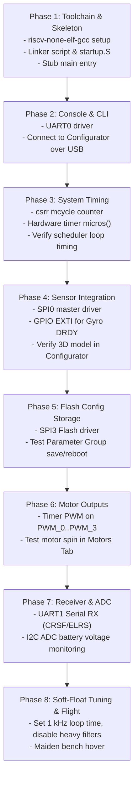

# Betaflight Porting Guide: ARIES v3.0 (THEJAS32 / VEGA ET1031)

This document provides a comprehensive architectural breakdown and step-by-step implementation roadmap for porting Betaflight firmware to the **C-DAC ARIES v3.0** development board powered by the **THEJAS32 SoC** (VEGA ET1031 32-bit RISC-V core).

---

## 1. Executive Summary & Feasibility Analysis

| Metric | Board Specification | Betaflight Requirement & Impact |
| :--- | :--- | :--- |
| **Processor Core** | VEGA ET1031 (RV32IM, 100 MHz, 3-stage pipeline) | RV32IM lacks a hardware FPU (soft-float only). Target a **500 Hz to 1 kHz** PID loop instead of 4 kHz/8 kHz. |
| **SRAM** | 256 KB internal SRAM | Ample space (Betaflight comfortably fits in 64–128 KB). |
| **Flash** | 2 MB external SPI NOR Flash (Winbond on SPI3) | Plenty of space for full firmware image and Parameter Group storage. |
| **USB Connectivity** | Silicon Labs CP2102N USB-UART bridge connected to **UART0** | **Massive simplification:** No USB stack or CDC/VCP endpoints needed. Connecting UART0 allows instant Betaflight Configurator access. |
| **IMU / Sensors** | None onboard (Generic dev board) | External SPI IMU module (e.g. ICM42688P or BMI270) wired to Header J1 (**SPI0**). |
| **Battery Sensing** | External I2C ADC chip (U9) on **I2C2** (4 channels on Header J10) | Write a simple periodic I2C reader for battery voltage (`vbat`) instead of reading internal MCU ADC registers. |
| **Motor Protocol** | 8 PWM output channels (PWM_0–PWM_7) | Initial port will use standard analog PWM (400 Hz) or OneShot125. |

---

## 2. Hardware Pinout & Peripheral Assignment

```
                                    +-----------------------+
                                    |     ARIES v3.0 Board  |
                                    |                       |
[USB-C Cable] --------------------> | CP2102N -> UART0      |  (Betaflight Configurator & CLI)
                                    |                       |
[External IMU Module (SPI)] ------> | SPI0 (Header J1)      |  (Gyro & Accelerometer Data)
  - Gyro INT (DRDY) --------------> | GPIO0 (Header J2_11)  |  (Flight Loop Trigger EXTI)
                                    |                       |
[Serial Receiver (ELRS/CRSF)] ----> | UART1 (Header J2)     |  (RC Channels & Telemetry)
                                    |                       |
[4x ESC Signal Lines] <------------ | PWM_0..3 (J2 / J1)    |  (Motor Control: 400Hz / OneShot)
                                    |                       |
[Battery Voltage Divider] --------> | ADC_CH0 (Header J10)  |  (Read via Onboard U9 I2C ADC)
                                    |                       |
[Onboard Boot Flash] <------------> | SPI3 (U5 IC)          |  (Persistent Config Storage)
                                    |                       |
[Status Indicators] <-------------- | LD1 (RGB) & LD4 (LED) |  (Arming & System Status)
                                    +-----------------------+
```

### Detailed Connector Mapping

| Function | ARIES v3.0 Pin / Header | Peripheral ID | Notes |
| :--- | :--- | :--- | :--- |
| **CLI / Configurator** | USB-C (`U10` CP2102N) | `UART0` (`UART0_TXD`, `UART0_RXD`) | Baud rate: 115200 or 921600 |
| **Serial RX (Radio)** | `J2_15` (RX), `J2_13` (TX) | `UART1` | ExpressLRS / CRSF / SBUS |
| **Telemetry / GPS** | `J5_1` (RX), `J5_2` (TX) | `UART2` | Optional GPS or VTX telemetry |
| **IMU SCK** | `J1_5` | `SPI0_SCLK` | 10–20 MHz SPI Clock |
| **IMU MISO** | `J1_6` | `SPI0_MISO` | Gyro SPI data in |
| **IMU MOSI** | `J1_7` | `SPI0_MOSI` | Gyro SPI data out |
| **IMU CS (Chip Select)**| `J1_8` | `SPI0_SS` (or GPIO) | Active low slave select |
| **IMU Interrupt (DRDY)**| `J2_11` | `GPIO0` (EXTI) | Triggers `TASK_GYRO` |
| **Motor 1** | `J2_5` | `PWM_0` | Rear Right |
| **Motor 2** | `J2_3` | `PWM_1` | Front Right |
| **Motor 3** | `J2_1` | `PWM_2` | Rear Left |
| **Motor 4** | `J1_10` | `PWM_3` | Front Left |
| **Battery Voltage ADC**| `J10_2` | `ADC_CH0` (via `U9`) | Read over `I2C2` (`U9_9` SDA, `U9_10` SCL) |
| **Arming / Status LED**| `LD4` (Heartbeat) & `LD1` | `GPIO22..24` | System state indication |

---

## 3. Codebase File Structure

To integrate cleanly into Betaflight, add the new platform under `src/platform/ARIES/`:

```
src/platform/ARIES/
├── mk/
│   ├── ARIES.mk                   # Compiler flags (-march=rv32im -mabi=ilp32), include paths
│   └── tools.mk                   # riscv-none-elf-gcc toolchain definitions
├── link/
│   └── aries_v3.ld                # Linker script (256KB SRAM, 2MB Flash)
├── startup/
│   └── start.S                    # Reset vector, stack init, BSS clear, main jump
├── include/
│   └── platform/
│       ├── platform.h             # Chip macros, register definitions, endianness
│       └── timer_def.h            # Hardware timer registers
├── target/
│   └── ARIESV3/
│       ├── target.h               # Pin mapping definitions (SPI0, UART0/1, PWM, LED)
│       └── target.mk              # Board target makefile rules
├── system.c                       # systemInit(), getCycleCounter(), micros(), millis()
├── io_aries.c                     # GPIO setup, digital read/write
├── exti_aries.c                   # External pin interrupt handler (Gyro DRDY)
├── serial_uart_aries.c            # UART0, UART1, UART2 driver implementations
├── bus_spi_aries.c                # SPI0 (IMU) and SPI3 (Flash) driver
├── bus_i2c_aries.c                # I2C2 driver for onboard ADC
├── adc_aries.c                    # Battery voltage reader using I2C ADC
├── pwm_motor_aries.c              # Timer PWM driver for motor outputs
└── config_flash.c                 # SPI Flash erase/write for parameter storage
```

---

## 4. Step-by-Step Implementation Roadmap



---

### Phase 1: Toolchain & Boot Skeleton (Est. 3–5 days)
1. **Toolchain Setup:** Install `riscv-none-elf-gcc` or `riscv32-unknown-elf-gcc`.
2. **Makefile Configuration:** Create `src/platform/ARIES/mk/ARIES.mk`:
   ```makefile
   ARCH_FLAGS = -march=rv32im -mabi=ilp32 -mcmodel=medany
   OPTIMIZATION ?= -O3 -ffast-math -fno-math-errno
   ```
3. **Linker Script (`aries_v3.ld`):** Define Flash base (`0x20000000` or per memory map, 2 MB) and internal SRAM (`0x10000000`, 256 KB).
4. **Startup Assembly (`start.S`):** Initialize `sp` (stack pointer), initialize `gp`, zero `.bss` section, copy `.data` from Flash to SRAM, and branch to `main()`.

---

### Phase 2: Console & Interactive CLI (Est. 2–4 days)
1. Implement `serial_uart_aries.c`:
   * Initialize `UART0` baud rate to 115200 (divisor = `100 MHz / (16 * 115200)`).
   * Implement FIFO ring buffer with TX/RX interrupts.
2. In `target.h`, bind `SERIAL_PORT_USB_VCP` or `SERIAL_PORT_USART1` to `UART0`.
3. **Validation Milestone:** Power the board via USB-C, open a terminal (or Betaflight Configurator), type `status`, and confirm the CLI responds.

---

### Phase 3: System Clocks & Timing (Est. 2–3 days)
1. **Cycle Counter:** In `system.c`:
   ```c
   FAST_CODE uint32_t getCycleCounter(void) {
       uint32_t val;
       __asm__ __volatile__("csrr %0, mcycle" : "=r"(val));
       return val;
   }
   ```
2. **Microsecond Timer:** Configure hardware Timer 0 to increment at 1 MHz (prescaler = 100). Implement `micros()`:
   ```c
   timeUs_t micros(void) {
       return (timeUs_t)TIMER0_COUNT_REG;
   }
   ```
3. **Validation Milestone:** Run the CLI `tasks` command to confirm the cooperative scheduler is running with jitter < 5 µs.

---

### Phase 4: SPI0 Driver & External IMU (Est. 1–2 weeks)
1. Implement `bus_spi_aries.c` for `SPI0` (Header J1: pins `J1_5` to `J1_8`).
2. Implement `exti_aries.c` to catch the rising edge from the Gyro DRDY pin on `GPIO0` (`J2_11`).
3. Connect your breakout board (e.g. ICM42688P). In `target.h`, enable:
   ```c
   #define USE_GYRO_SPI_ICM42688P
   #define USE_ACC_SPI_ICM42688P
   #define GYRO_1_CS_PIN      PIN_J1_8
   #define GYRO_1_EXTI_PIN    PIN_J2_11
   ```
4. **Validation Milestone:** Open Betaflight Configurator "Setup" tab. The 3D drone graphic moves smoothly in real-time as you rotate the ARIES board.

---

### Phase 5: Flash Configuration Storage (Est. 3–5 days)
1. Implement SPI driver for `SPI3` connected to the onboard Winbond 2 MB Flash (`U5`).
2. Implement sector erase (4 KB) and page program (256 B) in `config_flash.c`.
3. Hook into Betaflight's Parameter Group (PG) system.
4. **Validation Milestone:** Change a setting in the CLI (e.g. `set name = ARIES_DRONE`), run `save`, power-cycle the board, and verify the setting persists.

---

### Phase 6: Motor Outputs (Est. 3–5 days)
1. Map `PWM_0` through `PWM_3` (Headers J1/J2) in `pwm_motor_aries.c`.
2. Configure the hardware timer for 400 Hz PWM (2.5 ms period, pulse width 1000–2000 µs) or OneShot125 (125–250 µs).
3. **Validation Milestone:** Connect an ESC and brushless motor. Use the Configurator "Motors" tab (with propellers removed!) to verify motor spin and direction.

---

### Phase 7: Radio Receiver & Battery ADC (Est. 3–5 days)
1. **Serial RX:** Implement `UART1` (`J2_13`/`J2_15`) for CRSF/ExpressLRS or SBUS. Test stick inputs in the Configurator "Receiver" tab.
2. **I2C ADC:** Implement a background task in `adc_aries.c` that queries the onboard `U9` I2C ADC chip over `I2C2` to read battery voltage on `ADC_CH0`.

---

## 5. Soft-Float Performance Tuning & CLI Settings

Because the VEGA ET1031 lacks a hardware FPU, apply these settings in the Betaflight CLI to ensure stability and prevent loop overruns:

```text
# Set Gyro loop rate to 1 kHz (1000 us)
set gyro_sync_denom = 8

# Set PID loop rate to 1 kHz (1:1 with gyro)
set pid_process_denom = 1

# Disable high-overhead filters
set dyn_notch_count = 1
set dyn_notch_q = 250
set dshot_bidir = OFF

# Use Standard PWM or OneShot125 motor protocol
set motor_pwm_protocol = ONESHOT125

save
```

---

## 6. Development Checklist

- [ ] RISC-V GCC cross-compiler compiling minimal ELF executable.
- [ ] Linker script accurately mapping 256 KB SRAM and 2 MB Flash.
- [ ] UART0 echoing characters to serial terminal.
- [ ] Betaflight CLI responding over USB-C.
- [ ] `micros()` and `getCycleCounter()` monotonic and calibrated to 100 MHz.
- [ ] SPI0 communication reading WHO_AM_I register from external IMU.
- [ ] Gyro EXTI interrupt triggering PID loop.
- [ ] 3D model orientation verified in Betaflight Configurator.
- [ ] Settings saved and restored from SPI Flash.
- [ ] Motors responding to throttle commands in Motors tab.
- [ ] Radio receiver channels mapped and responding.
- [ ] Maiden hover test in Angle/Acro mode.
