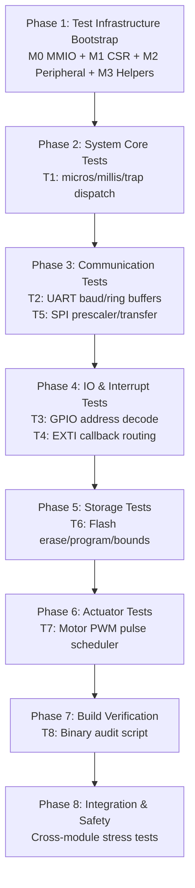

# Software Test Plan — Phased & Modular: C-DAC ARIES v3.0 (THEJAS32 / VEGA ET1031)

**Target Board:** C-DAC ARIES v3.0 Development Board  
**SoC / Core:** C-DAC THEJAS32 / VEGA ET1031 (32-bit RISC-V, RV32IM, 100 MHz, soft-float)  
**Firmware:** Betaflight 2026.12.0-alpha (`ARIESV3` Target)  
**Parent Documents:** [`SOFTWARE_TEST_PLAN.md`](SOFTWARE_TEST_PLAN.md), [`TEST_PLAN.md`](TEST_PLAN.md)  
**Purpose:** Executable, modular test implementation roadmap. Defines shared test infrastructure modules, then phases each test module from foundation to integration, with exact file paths, function signatures, mock strategies, and Google Test code patterns.

---

## Table of Contents

- [Part A: Modular Test Infrastructure](#part-a-modular-test-infrastructure)
  - [Module M0: MMIO Mock Engine](#module-m0-mmio-mock-engine)
  - [Module M1: CSR Mock Engine](#module-m1-csr-mock-engine)
  - [Module M2: THEJAS32 Peripheral Mocks](#module-m2-thejas32-peripheral-mocks)
  - [Module M3: Test Helpers & Utilities](#module-m3-test-helpers--utilities)
- [Part B: Driver Test Modules](#part-b-driver-test-modules)
  - [Module T1: System Core & Timebase](#module-t1-system-core--timebase)
  - [Module T2: UART & Ring Buffers](#module-t2-uart--ring-buffers)
  - [Module T3: GPIO Address-Decoded IO](#module-t3-gpio-address-decoded-io)
  - [Module T4: External Interrupts (EXTI)](#module-t4-external-interrupts-exti)
  - [Module T5: SPI Bus Driver](#module-t5-spi-bus-driver)
  - [Module T6: Flash Configuration Storage](#module-t6-flash-configuration-storage)
  - [Module T7: Motor PWM Pulse Scheduler](#module-t7-motor-pwm-pulse-scheduler)
  - [Module T8: Build Verification & Binary Audit](#module-t8-build-verification--binary-audit)
- [Part C: Phased Execution Roadmap](#part-c-phased-execution-roadmap)
  - [Phase 1: Test Infrastructure Bootstrap](#phase-1-test-infrastructure-bootstrap)
  - [Phase 2: System Core Tests](#phase-2-system-core-tests)
  - [Phase 3: Communication Tests](#phase-3-communication-tests)
  - [Phase 4: IO & Interrupt Tests](#phase-4-io--interrupt-tests)
  - [Phase 5: Storage Tests](#phase-5-storage-tests)
  - [Phase 6: Actuator Tests](#phase-6-actuator-tests)
  - [Phase 7: Build Verification & Binary Audit](#phase-7-build-verification--binary-audit)
  - [Phase 8: Integration & Safety Stress Tests](#phase-8-integration--safety-stress-tests)

---

# Part A: Modular Test Infrastructure

All shared test infrastructure lives under `src/test/unit/aries/`. Every driver test module includes these via `#include` — no code duplication.

```
src/test/unit/aries/
├── mock_mmio.h               # M0: Generic MMIO read/write capture engine
├── mock_mmio.c               # M0: Implementation (backing RAM array)
├── mock_csr.h                # M1: RISC-V CSR mock (mcycle, mcycleh, mtvec)
├── mock_csr.c                # M1: Implementation (simulated cycle counter state)
├── mock_thejas32.h           # M2: THEJAS32-specific peripheral register stubs
├── mock_thejas32.c           # M2: Implementation (UART, SPI, Timer, GPIO, IntCtrl)
├── test_helpers.h            # M3: Timing simulation, buffer filling, assertions
└── test_helpers.c            # M3: Implementation
```

---

## Module M0: MMIO Mock Engine

**Purpose:** Intercept all `volatile` memory-mapped I/O reads and writes on the host (x86_64) so that driver code compiled for unit testing operates against RAM-backed shadow registers instead of crashing on unmapped addresses.

**File:** `src/test/unit/aries/mock_mmio.h`

### Design

The THEJAS32 SoC has peripherals scattered across 3 address regions:
- `0x10000000–0x101FFFFF` (RAM + peripherals)
- `0x10080000–0x101FFFFF` (GPIO banks)
- `0x20000000–0x20FFFFFF` (Flash + interrupt controller)

On the host, we allocate flat arrays to shadow each region and redefine the peripheral base address macros to point into them:

```c
// mock_mmio.h
#pragma once
#include <stdint.h>
#include <string.h>

// Shadow memory regions (host-allocated)
#define MOCK_PERIPH_SIZE    0x200000   // 2 MB covers 0x10000000–0x101FFFFF
#define MOCK_GPIO0_SIZE     0x100000   // 1 MB covers 0x10080000–0x1017FFFF
#define MOCK_GPIO1_SIZE     0x100000   // 1 MB covers 0x10180000–0x1027FFFF
#define MOCK_FLASH_SIZE     0x200000   // 2 MB covers 0x20000000–0x201FFFFF
#define MOCK_INTCTRL_SIZE   0x20       // 32 bytes covers 0x20010000–0x2001001F

extern uint8_t mock_periph_mem[MOCK_PERIPH_SIZE];
extern uint8_t mock_gpio0_mem[MOCK_GPIO0_SIZE];
extern uint8_t mock_gpio1_mem[MOCK_GPIO1_SIZE];
extern uint8_t mock_flash_mem[MOCK_FLASH_SIZE];
extern uint8_t mock_intctrl_mem[MOCK_INTCTRL_SIZE];

// Reset all mock memory to zero
void mock_mmio_reset(void);

// Reset all mock memory to a pattern (e.g., 0xFF for flash)
void mock_mmio_reset_pattern(uint8_t *region, size_t size, uint8_t pattern);

// Read/write capture tracking
typedef struct {
    uint32_t address;
    uint32_t value;
    bool     is_write;  // true = write, false = read
} mmio_access_t;

#define MOCK_MMIO_LOG_SIZE 1024
extern mmio_access_t mock_mmio_log[MOCK_MMIO_LOG_SIZE];
extern uint32_t mock_mmio_log_count;

void mock_mmio_log_reset(void);
mmio_access_t *mock_mmio_find_write(uint32_t address);
uint32_t mock_mmio_count_writes_to(uint32_t address);
```

### Override Strategy

In the test compilation unit, peripheral base macros are overridden **before** including any ARIES driver headers:

```c
// Override THEJAS32 base addresses to point into mock memory
#undef  THEJAS32_UART_BASE
#define THEJAS32_UART_BASE     ((uintptr_t)&mock_periph_mem[0x100])

#undef  THEJAS32_TIMER_BASE
#define THEJAS32_TIMER_BASE    ((uintptr_t)&mock_periph_mem[0xA00])

#undef  THEJAS32_SPI_0_1_BASE
#define THEJAS32_SPI_0_1_BASE  ((uintptr_t)&mock_periph_mem[0x600])

#undef  THEJAS32_SPI_2_3_BASE
#define THEJAS32_SPI_2_3_BASE  ((uintptr_t)&mock_periph_mem[0x1200])

#undef  THEJAS32_GPIO_0_BASE
#define THEJAS32_GPIO_0_BASE   ((uintptr_t)mock_gpio0_mem)

#undef  THEJAS32_GPIO_1_BASE
#define THEJAS32_GPIO_1_BASE   ((uintptr_t)mock_gpio1_mem)

#undef  THEJAS32_INTR_CTRL_BASE
#define THEJAS32_INTR_CTRL_BASE ((uintptr_t)mock_intctrl_mem)
```

> [!IMPORTANT]
> The `__asm__ __volatile__("fence")` instructions in the ARIES drivers are harmless on x86 (treated as compiler barriers). No override needed.

---

## Module M1: CSR Mock Engine

**Purpose:** Mock RISC-V Control and Status Register (CSR) reads (`mcycle`, `mcycleh`, `mtvec`, `mcause`, `mie`, `mstatus`) that are normally inline-assembled via `csrr` / `csrw`.

**File:** `src/test/unit/aries/mock_csr.h`

### Design

The driver code uses inline assembly:
```c
__asm__ __volatile__("csrr %0, mcycle" : "=r"(val));
```

For host testing, we replace the entire `getCycleCounter64()` and `getCycleCounter()` functions with mock-controllable versions:

```c
// mock_csr.h
#pragma once
#include <stdint.h>

// Simulated 64-bit cycle counter (test code sets this)
extern uint64_t mock_mcycle64;

// Advance the simulated cycle counter by `delta` cycles
void mock_csr_advance(uint64_t delta);

// Set the cycle counter to an exact value (useful for rollover testing)
void mock_csr_set(uint64_t value);

// Reset everything
void mock_csr_reset(void);

// Replacement functions that the test compilation links instead of the real ones
uint64_t getCycleCounter64(void);
uint32_t getCycleCounter(void);
```

**Implementation** (`mock_csr.c`):
```c
#include "mock_csr.h"

uint64_t mock_mcycle64 = 0;

void mock_csr_advance(uint64_t delta) { mock_mcycle64 += delta; }
void mock_csr_set(uint64_t value)     { mock_mcycle64 = value; }
void mock_csr_reset(void)             { mock_mcycle64 = 0; }

uint64_t getCycleCounter64(void) { return mock_mcycle64; }
uint32_t getCycleCounter(void)   { return (uint32_t)(mock_mcycle64 & 0xFFFFFFFF); }
```

---

## Module M2: THEJAS32 Peripheral Mocks

**Purpose:** Provide mock implementations of THEJAS32-specific HAL functions that the drivers call (interrupt registration, interrupt enable/disable). These are normally in `system.c` but on the host we need lightweight test doubles.

**File:** `src/test/unit/aries/mock_thejas32.h`

```c
// mock_thejas32.h
#pragma once
#include <stdint.h>
#include <stdbool.h>

// --- Interrupt Controller Mock ---
typedef void (*thejas32_irq_handler_t)(void);

#define MOCK_IRQ_TABLE_SIZE 32
extern thejas32_irq_handler_t mock_irq_table[MOCK_IRQ_TABLE_SIZE];
extern uint32_t mock_irq_enable_mask;

void thejas32_interrupt_register(uint8_t irq_number, thejas32_irq_handler_t handler);
void thejas32_interrupt_enable(uint8_t irq_number);
void thejas32_interrupt_disable(uint8_t irq_number);

// Simulate firing an IRQ (calls the registered handler)
void mock_fire_irq(uint8_t irq_number);

// Check if an IRQ is enabled
bool mock_irq_is_enabled(uint8_t irq_number);

// --- __NOP / fence stubs ---
#ifndef __NOP
#define __NOP() ((void)0)
#endif

// --- Reset all mocks ---
void mock_thejas32_reset(void);
```

---

## Module M3: Test Helpers & Utilities

**Purpose:** Common assertion helpers, buffer utilities, and timing simulation routines.

**File:** `src/test/unit/aries/test_helpers.h`

```c
// test_helpers.h
#pragma once
#include <stdint.h>
#include <stdbool.h>

// Fill a buffer with a sequential byte pattern (0x00, 0x01, ..., 0xFF, 0x00, ...)
void fill_sequential(uint8_t *buf, size_t len);

// Verify a buffer contains the expected sequential pattern
bool verify_sequential(const uint8_t *buf, size_t len, uint8_t start);

// Fill a buffer with a canary pattern (0xA5A5A5A5)
void fill_canary(uint32_t *buf, size_t words);

// Count how many canary words remain intact
size_t count_intact_canaries(const uint32_t *buf, size_t words);

// Compute THEJAS32 GPIO address-decode formula on host
static inline uintptr_t gpio_pin_address(uintptr_t base, uint8_t pin_in_bank) {
    return base + ((1U << pin_in_bank) << 2);
}

// Compute THEJAS32 GPIO direction register address
static inline uintptr_t gpio_dir_address(uintptr_t base) {
    return base + 0x40000;
}

// Compute THEJAS32 UART baud divisor
static inline uint32_t uart_baud_divisor(uint32_t clock_hz, uint32_t baud) {
    return clock_hz / (baud * 16);
}
```

---

# Part B: Driver Test Modules

Each module below maps 1:1 to an ARIES platform driver file. Tests are Google Test (gtest) `.cc` files in `src/test/unit/`.

---

## Module T1: System Core & Timebase

**Source Under Test:** [`src/platform/ARIES/system.c`](src/platform/ARIES/system.c)  
**Test File:** `src/test/unit/aries_system_unittest.cc`  
**Mock Dependencies:** M0 (MMIO), M1 (CSR), M2 (Peripheral)

### Testable Functions

| Function | Signature | What to Test |
|:---|:---|:---|
| `micros()` | `timeUs_t micros(void)` | Monotonic scaling, rollover at 2³², division by 100 |
| `millis()` | `timeMs_t millis(void)` | Scaling from cycles, rollover at 49.7 days |
| `delayMicroseconds()` | `void delayMicroseconds(uint32_t us)` | Correct cycle consumption |
| `clockCyclesToMicros()` | `int32_t clockCyclesToMicros(int32_t)` | Division by `usTicks` (100) |
| `clockMicrosToCycles()` | `uint32_t clockMicrosToCycles(uint32_t)` | Multiplication by `usTicks` |
| `handle_trap()` | `uint32_t handle_trap(uint32_t mcause, uint32_t mepc, uint32_t *sp)` | IRQ dispatch vs panic |
| `thejas32_interrupt_register()` | `void ...(uint8_t, handler_t)` | Slot population, bounds |
| `thejas32_interrupt_enable()` | `void ...(uint8_t)` | `INTR_EN` bitmask set |
| `timer0Micros()` | `timeUs_t timer0Micros(void)` | Overflow tracking, pending interrupt correction |

### Test Cases

| ID | Test Case | Category |
|:---|:---|:---|
| T1-01 | `micros()` returns 0 when cycle counter is 0 | Boundary |
| T1-02 | `micros()` returns 1 when cycle counter is 100 | Scaling |
| T1-03 | `micros()` returns correct value at 32-bit max (`0xFFFFFFFF * 100`) | Rollover |
| T1-04 | `micros()` is monotonic across 1M sequential reads with advancing counter | Monotonicity |
| T1-05 | `millis()` returns 0 at counter 0, 1 at counter 100000 | Scaling |
| T1-06 | `millis()` rollover matches 49.7-day window | Rollover |
| T1-07 | `clockCyclesToMicros(100)` returns 1 | Conversion |
| T1-08 | `clockCyclesToMicros(0)` returns 0 | Boundary |
| T1-09 | `clockMicrosToCycles(1)` returns 100 | Conversion |
| T1-10 | `handle_trap()` with `mcause = 0x8000000B` dispatches to IRQ table | IRQ Dispatch |
| T1-11 | `handle_trap()` with `mcause = 0x00000002` calls `handle_trap_panic()` | Exception |
| T1-12 | `handle_trap()` with unregistered IRQ slot does not crash | Null Safety |
| T1-13 | `thejas32_interrupt_register()` with `irq >= 32` is no-op | Bounds |
| T1-14 | `thejas32_interrupt_enable()` sets correct bit in `INTR_EN` | Register |
| T1-15 | `timer0Micros()` accounts for unserviced overflow | Overflow |
| T1-16 | `cycleCounterInit()` sets `usTicks = 100` for 100 MHz | Init |

---

## Module T2: UART & Ring Buffers

**Source Under Test:** [`src/platform/ARIES/serial_uart_aries.c`](src/platform/ARIES/serial_uart_aries.c)  
**Test File:** `src/test/unit/aries_uart_unittest.cc`  
**Mock Dependencies:** M0 (MMIO), M2 (Peripheral)

### Testable Functions

| Function | What to Test |
|:---|:---|
| `thejas32_uart_set_baudrate()` | Divisor = `clock / (baud * 16)`, DLAB set/clear sequence |
| `uartIrqHandler()` | RX ring buffer ingestion, TX drain, wraparound |
| `uartReconfigure()` | LCR parity/stop bits, IE enable |
| `uartEnableTxInterrupt()` | THRE priming logic |
| `uartGetIndex()` | Address → channel index mapping |

### Test Cases

| ID | Test Case | Category |
|:---|:---|:---|
| T2-01 | Baud divisor for 115200 at 100 MHz = 54 | Divisor |
| T2-02 | Baud divisor for 9600 at 100 MHz = 651 | Divisor |
| T2-03 | Baud divisor for 0 defaults to 115200 (divisor 54) | Boundary |
| T2-04 | DLAB (bit 7 of LCR) is SET then CLEARED during baud config | Register Seq |
| T2-05 | FCR write = `0x07` (FIFO enable + clear) | Register |
| T2-06 | RX ring buffer ingests 256 bytes without loss | Ring Buffer |
| T2-07 | RX ring buffer wraps around 0xFF→0x00 boundary | Wraparound |
| T2-08 | RX ring buffer handles 300 sequential bytes | Overflow |
| T2-09 | TX drain removes bytes in FIFO order | TX Order |
| T2-10 | TX interrupt disabled when buffer is empty | State |
| T2-11 | TX priming writes first byte to THR when LSR.THRE is set | Priming |
| T2-12 | `uartGetIndex()` returns 0 for `0x10000100`, 1 for `0x10000200` | Index |
| T2-13 | RX callback function is invoked instead of buffer write when set | Callback |
| T2-14 | Even parity sets LCR bits 4:3 to `11` | Config |

---

## Module T3: GPIO Address-Decoded IO

**Source Under Test:** [`src/platform/ARIES/io_aries.c`](src/platform/ARIES/io_aries.c)  
**Test File:** `src/test/unit/aries_gpio_unittest.cc`  
**Mock Dependencies:** M0 (MMIO), M2 (Peripheral)

### Testable Functions

| Function | What to Test |
|:---|:---|
| `IOInitGlobal()` | 32 `ioRec` entries populated with correct bank pointers |
| `IOGetByTag()` | Tag → `ioRec_t*` lookup, empty tag returns `IO_NONE` |
| `IOConfigGPIO()` | Direction register write at `base + 0x40000` |
| `IOHi()` / `IOLo()` | Data write at `base + ((1 << pin) << 2)` |
| `IOToggle()` | Read-modify-write toggle logic |
| `IORead()` | Data read from address-decoded address |
| `IO_GPIOPortIdx()` | Pin → bank index (0 or 1) |
| `IO_GPIOPinIdx()` | Pin → pin-within-bank index |

### Test Cases

| ID | Test Case | Category |
|:---|:---|:---|
| T3-01 | `IOHi(PA0)` writes to `GPIO_0_BASE + ((1<<0)<<2)` = `base + 0x04` | Address Formula |
| T3-02 | `IOHi(PA15)` writes to `GPIO_0_BASE + ((1<<15)<<2)` = `base + 0x20000` | Address Formula |
| T3-03 | `IOHi(PA16)` writes to `GPIO_1_BASE + ((1<<0)<<2)` = `base + 0x04` | Bank Switch |
| T3-04 | `IOHi(PA22)` writes to `GPIO_1_BASE + ((1<<6)<<2)` = `base + 0x100` (LD4) | LED Pin |
| T3-05 | `IOLo(PA0)` writes 0 to the same address formula | Low |
| T3-06 | `IOToggle()` flips state from 0→1 then 1→0 | Toggle |
| T3-07 | `IORead()` returns the value at address-decoded location | Read |
| T3-08 | `IOConfigGPIO(io, OUTPUT)` sets direction bit at `base + 0x40000` | Direction |
| T3-09 | `IOConfigGPIO(io, INPUT)` clears direction bit | Direction |
| T3-10 | `IO_GPIOPortIdx()` returns 0 for pins 0–15, 1 for pins 16–31 | Bank |
| T3-11 | `IO_GPIOPinIdx()` returns `pin` for 0–15, `pin-16` for 16–31 | Index |
| T3-12 | `IOGetByTag(DEFIO_TAG__NONE)` returns `IO_NONE` | Null |
| T3-13 | `IOInitGlobal()` populates all 32 `ioRec` entries | Init |
| T3-14 | Operations on pin ≥ 32 are no-ops (bounds guard) | Bounds |

---

## Module T4: External Interrupts (EXTI)

**Source Under Test:** [`src/platform/ARIES/exti_aries.c`](src/platform/ARIES/exti_aries.c)  
**Test File:** `src/test/unit/aries_exti_unittest.cc`  
**Mock Dependencies:** M0 (MMIO), M2 (Peripheral), T3 (GPIO)

### Test Cases

| ID | Test Case | Category |
|:---|:---|:---|
| T4-01 | `EXTIInit()` clears all 32 `extiChannels` entries | Init |
| T4-02 | `EXTIInit()` registers ISRs on IRQ 10 (GPIO0) and IRQ 11 (GPIO1) | IRQ Reg |
| T4-03 | `EXTIConfig(PA0, cb, ...)` stores handler in `extiChannels[0]` | Config |
| T4-04 | `EXTIConfig(PA22, cb, ...)` stores handler in `extiChannels[22]` | Config |
| T4-05 | `EXTIConfig(PA0, ...)` enables IRQ 10 (Bank 0) | IRQ Enable |
| T4-06 | `EXTIConfig(PA22, ...)` enables IRQ 11 (Bank 1) | IRQ Enable |
| T4-07 | `thejas32_gpio0_isr()` calls enabled Bank 0 callbacks | Dispatch |
| T4-08 | `thejas32_gpio1_isr()` calls enabled Bank 1 callbacks only | Isolation |
| T4-09 | `EXTIDisable(PA0)` prevents callback from firing | Disable |
| T4-10 | `EXTIRelease(PA0)` nulls handler and disables | Release |
| T4-11 | No callback on disabled channel (cross-talk isolation) | Safety |
| T4-12 | `IO_EXTI_Line(PA0)` returns `1 << 0`, `IO_EXTI_Line(PA22)` returns `1 << 22` | Line |

---

## Module T5: SPI Bus Driver

**Source Under Test:** [`src/platform/ARIES/bus_spi_aries.c`](src/platform/ARIES/bus_spi_aries.c)  
**Test File:** `src/test/unit/aries_spi_unittest.cc`  
**Mock Dependencies:** M0 (MMIO), M2 (Peripheral)

### Test Cases

| ID | Test Case | Category |
|:---|:---|:---|
| T5-01 | `spiCalculateDivider(25000000)` returns 0 (div /4) | Prescaler |
| T5-02 | `spiCalculateDivider(10000000)` returns 1 (div /8) | Prescaler |
| T5-03 | `spiCalculateDivider(100000)` returns 7 (div /512) | Prescaler |
| T5-04 | `spiCalculateClock(0)` returns 25000000 | Inverse |
| T5-05 | `spiCalculateClock(7)` returns 195312 | Inverse |
| T5-06 | `spiCalculateClock(255)` returns 12500000 (default) | Default |
| T5-07 | `spiInitDevice()` writes default baud and control to mock regs | Init |
| T5-08 | `thejas32_spi_transfer_byte()` times out after 100000 iterations on stuck BUSY | Timeout |
| T5-09 | `spiInternalReadWriteBufPolled()` transfers N bytes correctly | Transfer |
| T5-10 | `spiInternalReadWriteBufPolled()` with NULL rxData discards RX | Null RX |
| T5-11 | `spiInternalReadWriteBufPolled()` with NULL txData sends 0xFF | Null TX |
| T5-12 | CSAAT bit set during intermediate segments, cleared on final | CS Hold |

---

## Module T6: Flash Configuration Storage

**Source Under Test:** [`src/platform/ARIES/config_flash_aries.c`](src/platform/ARIES/config_flash_aries.c)  
**Test File:** `src/test/unit/aries_flash_unittest.cc`  
**Mock Dependencies:** M0 (MMIO), M2 (Peripheral)

### Test Cases

| ID | Test Case | Category |
|:---|:---|:---|
| T6-01 | `configWriteWord()` rejects address below `__config_start` | Bounds |
| T6-02 | `configWriteWord()` rejects address above `__config_end` | Bounds |
| T6-03 | `configWriteWord()` erases sector on first write to new sector | Erase |
| T6-04 | `configWriteWord()` does NOT re-erase same sector on consecutive writes | Dedup |
| T6-05 | `configWriteWord()` updates memory-mapped shadow after write | Shadow |
| T6-06 | After sector erase, shadow region is all `0xFF` | Erase Verify |
| T6-07 | `configUnlock()` resets `lastErasedSector` to `UINT32_MAX` | State |
| T6-08 | `configLock()` resets `lastErasedSector` to `UINT32_MAX` | State |
| T6-09 | Flash write enable sends opcode `0x06` | SPI Command |
| T6-10 | Sector erase sends opcode `0x20` + 24-bit address | SPI Command |
| T6-11 | Page program sends opcode `0x02` + 24-bit address + data | SPI Command |
| T6-12 | WIP polling loop is bounded (max iterations) | Timeout |
| T6-13 | Full 8 KB config write fills reserved sector correctly | Integration |

---

## Module T7: Motor PWM Pulse Scheduler

**Source Under Test:** [`src/platform/ARIES/pwm_motor_aries.c`](src/platform/ARIES/pwm_motor_aries.c)  
**Test File:** `src/test/unit/aries_motor_unittest.cc`  
**Mock Dependencies:** M0 (MMIO), M2 (Peripheral), T3 (GPIO)

### Test Cases

| ID | Test Case | Category |
|:---|:---|:---|
| T7-01 | `pwmWriteMotor(0, 1000)` sets `ariesMotorPulseCycles[0]` = 100000 | Standard PWM |
| T7-02 | `pwmWriteMotor(0, 2000)` sets cycles = 200000 | Standard PWM |
| T7-03 | `pwmWriteMotor(0, 1500)` sets cycles = 150000 | Standard PWM |
| T7-04 | OneShot125: `pwmWriteMotor(0, 1000)` sets cycles = 12500 | OneShot |
| T7-05 | OneShot125: `pwmWriteMotor(0, 2000)` sets cycles = 25000 | OneShot |
| T7-06 | `pwmWriteMotor(0, 500)` clamps to 1000 (100000 cycles) | Clamp Low |
| T7-07 | `pwmWriteMotor(0, 3000)` clamps to 2000 (200000 cycles) | Clamp High |
| T7-08 | `pwmCompleteMotorUpdate()` sorts motors by pulse width ascending | Sort |
| T7-09 | `pwmCompleteMotorUpdate()` sets all motor pins HIGH | GPIO Assert |
| T7-10 | `pwmCompleteMotorUpdate()` arms Timer 1 with first deadline | Timer Load |
| T7-11 | `thejas32_pwm_timer1_isr()` drops pin LOW for expired motor | ISR Drop |
| T7-12 | `thejas32_pwm_timer1_isr()` reloads Timer 1 with delta for next motor | ISR Reload |
| T7-13 | `thejas32_pwm_timer1_isr()` disables Timer 1 after last motor | ISR End |
| T7-14 | `thejas32_pwm_timer1_isr()` coalesces motors with delta < 50 cycles | Coalesce |
| T7-15 | `pwmShutdownPulsesForAllMotors()` drives all pins LOW | Shutdown |
| T7-16 | `pwmShutdownPulsesForAllMotors()` disables Timer 1 | Shutdown |
| T7-17 | Disabled motor index is rejected by `pwmWriteMotor()` | Bounds |
| T7-18 | `motorPwmDevInit()` registers ISR on IRQ 8 | Init |

---

## Module T8: Build Verification & Binary Audit

**Type:** Automated bash script (not gtest)  
**Script File:** `src/test/unit/aries/build_verify.sh`  
**Covers:** SW-PERF-01, SW-BOOT-02, SW-BOOT-04, binary footprint

### Checks

| ID | Check | Method |
|:---|:---|:---|
| T8-01 | Clean build exits with code 0 | `make TARGET=ARIESV3` |
| T8-02 | Flash footprint ≤ 800 KB | `riscv32-esp-elf-size` |
| T8-03 | RAM footprint ≤ 80 KB | `riscv32-esp-elf-size` |
| T8-04 | `_start` symbol at `0x20000000` | `riscv32-esp-elf-nm` |
| T8-05 | `trap_entry` symbol at `0x200000f0` | `riscv32-esp-elf-nm` |
| T8-06 | Zero `__adddf3`/`__muldf3`/`__divdf3` calls in PID loop functions | `objdump` + `grep` |
| T8-07 | No `__udivdi3` calls in `micros` function | `objdump` + `grep` |
| T8-08 | Intel HEX artifact exists and is non-empty | `ls -s` |

---

# Part C: Phased Execution Roadmap



---

## Phase 1: Test Infrastructure Bootstrap

**Goal:** Create all 4 shared mock/helper modules and verify they compile on the host.

### Files to Create

| File | Content |
|:---|:---|
| `src/test/unit/aries/mock_mmio.h` | Shadow memory declarations, access log |
| `src/test/unit/aries/mock_mmio.c` | Shadow array definitions, log functions |
| `src/test/unit/aries/mock_csr.h` | `mock_mcycle64`, advance/set/reset |
| `src/test/unit/aries/mock_csr.c` | `getCycleCounter64()` / `getCycleCounter()` mock impls |
| `src/test/unit/aries/mock_thejas32.h` | IRQ table, enable mask, `mock_fire_irq()` |
| `src/test/unit/aries/mock_thejas32.c` | IRQ registration/enable/disable mock impls |
| `src/test/unit/aries/test_helpers.h` | `fill_sequential()`, `verify_sequential()`, GPIO addr formulas |
| `src/test/unit/aries/test_helpers.c` | Implementations |

### How to Write

1. **Start with `mock_mmio.c`:**
   ```c
   #include "mock_mmio.h"

   uint8_t mock_periph_mem[MOCK_PERIPH_SIZE];
   uint8_t mock_gpio0_mem[MOCK_GPIO0_SIZE];
   uint8_t mock_gpio1_mem[MOCK_GPIO1_SIZE];
   uint8_t mock_flash_mem[MOCK_FLASH_SIZE];
   uint8_t mock_intctrl_mem[MOCK_INTCTRL_SIZE];

   mmio_access_t mock_mmio_log[MOCK_MMIO_LOG_SIZE];
   uint32_t mock_mmio_log_count = 0;

   void mock_mmio_reset(void) {
       memset(mock_periph_mem, 0, sizeof(mock_periph_mem));
       memset(mock_gpio0_mem, 0, sizeof(mock_gpio0_mem));
       memset(mock_gpio1_mem, 0, sizeof(mock_gpio1_mem));
       memset(mock_flash_mem, 0xFF, sizeof(mock_flash_mem)); // Flash erased = 0xFF
       memset(mock_intctrl_mem, 0, sizeof(mock_intctrl_mem));
       mock_mmio_log_count = 0;
   }

   void mock_mmio_reset_pattern(uint8_t *region, size_t size, uint8_t pattern) {
       memset(region, pattern, size);
   }

   void mock_mmio_log_reset(void) { mock_mmio_log_count = 0; }

   mmio_access_t *mock_mmio_find_write(uint32_t address) {
       for (uint32_t i = 0; i < mock_mmio_log_count; i++) {
           if (mock_mmio_log[i].address == address && mock_mmio_log[i].is_write) {
               return &mock_mmio_log[i];
           }
       }
       return NULL;
   }

   uint32_t mock_mmio_count_writes_to(uint32_t address) {
       uint32_t count = 0;
       for (uint32_t i = 0; i < mock_mmio_log_count; i++) {
           if (mock_mmio_log[i].address == address && mock_mmio_log[i].is_write) {
               count++;
           }
       }
       return count;
   }
   ```

2. **Verification:** Write a trivial `aries_infra_unittest.cc` that includes all 4 mock headers and calls reset functions to prove compilation:

   ```cpp
   // src/test/unit/aries_infra_unittest.cc
   extern "C" {
       #include "aries/mock_mmio.h"
       #include "aries/mock_csr.h"
       #include "aries/mock_thejas32.h"
       #include "aries/test_helpers.h"
   }
   #include "gtest/gtest.h"

   TEST(AriesInfra, MockMmioResetClearsMemory) {
       mock_mmio_reset();
       EXPECT_EQ(mock_periph_mem[0], 0);
       EXPECT_EQ(mock_flash_mem[0], 0xFF); // Flash defaults to erased
   }

   TEST(AriesInfra, MockCsrAdvance) {
       mock_csr_reset();
       EXPECT_EQ(getCycleCounter64(), 0ULL);
       mock_csr_advance(100);
       EXPECT_EQ(getCycleCounter64(), 100ULL);
   }

   TEST(AriesInfra, MockIrqFireCallsHandler) {
       mock_thejas32_reset();
       static int fired = 0;
       fired = 0;
       thejas32_interrupt_register(7, []() { fired++; });
       thejas32_interrupt_enable(7);
       mock_fire_irq(7);
       EXPECT_EQ(fired, 1);
   }
   ```

3. **Register in `src/test/Makefile`:**
   ```makefile
   ARIES_MOCK_SRC := \
       $(TEST_DIR)/aries/mock_mmio.c \
       $(TEST_DIR)/aries/mock_csr.c \
       $(TEST_DIR)/aries/mock_thejas32.c \
       $(TEST_DIR)/aries/test_helpers.c

   aries_infra_unittest_SRC := $(ARIES_MOCK_SRC)
   ```

---

## Phase 2: System Core Tests

**Goal:** Verify `micros()`, `millis()`, clock conversions, and `handle_trap()` dispatch logic.

### Files to Create

| File | Purpose |
|:---|:---|
| `src/test/unit/aries_system_unittest.cc` | All T1-xx test cases |

### How to Write

The key challenge is that `system.c` uses inline assembly for CSR reads and accesses hardware peripheral structs. We solve this by:

1. **NOT compiling `system.c` directly.** Instead, extract the testable pure-logic functions into a separate compilation unit, or use the mock modules to replace the hardware-dependent parts.

2. **Create a test-specific shim** (`aries_system_testable.c`) that `#include`s the mock headers before `system.c`:

   ```c
   // src/test/unit/aries_system_testable.c
   // This file is compiled for x86_64 host testing.
   // It provides testable versions of system.c functions.

   #include <stdint.h>
   #include <stdbool.h>

   // Pull in mock infrastructure FIRST
   #include "aries/mock_mmio.h"
   #include "aries/mock_csr.h"
   #include "aries/mock_thejas32.h"

   // Stub out attributes the host compiler doesn't understand
   #define FAST_CODE
   #define FAST_IRQ_HANDLER

   // Override asm fence to no-op
   #undef __asm__
   // Actually, since mock_csr provides getCycleCounter64/getCycleCounter,
   // we just re-implement the pure-logic functions:

   uint32_t SystemCoreClock = 100000000;
   static uint32_t usTicks = 100;
   static float usTicksInv = 0.01f;

   #include "common/time.h"

   void cycleCounterInit(void) {
       usTicks = SystemCoreClock / 1000000;
       usTicksInv = 1e6f / SystemCoreClock;
   }

   timeUs_t micros(void) {
       return (timeUs_t)(getCycleCounter64() / 100ULL);
   }

   timeMs_t millis(void) {
       return (timeMs_t)(getCycleCounter64() / 100000ULL);
   }

   int32_t clockCyclesToMicros(int32_t clockCycles) {
       return clockCycles / usTicks;
   }

   float clockCyclesToMicrosf(int32_t clockCycles) {
       return clockCycles * usTicksInv;
   }

   uint32_t clockMicrosToCycles(uint32_t micros_val) {
       return micros_val * usTicks;
   }

   // Trap handler logic (pure C, no asm)
   typedef void (*thejas32_irq_handler_t_local)(void);

   static int trap_panic_called = 0;
   static uint32_t last_panic_mcause = 0;

   void handle_trap_panic(uint32_t mcause, uint32_t mepc, uint32_t *sp) {
       (void)mepc; (void)sp;
       trap_panic_called++;
       last_panic_mcause = mcause;
   }

   uint32_t handle_trap(uint32_t mcause, uint32_t mepc, uint32_t *sp) {
       if (mcause & 0x80000000UL) {
           uint32_t cause_num = mcause & 0x7FFFFFFFUL;
           if (cause_num == 11) {
               // Read interrupt status from mock interrupt controller
               uint32_t status = *((volatile uint32_t *)(
                   (uintptr_t)mock_intctrl_mem + 0x10)); // INTR_STATUS offset
               for (uint8_t i = 0; i < 32; i++) {
                   if ((status >> i) & 1U) {
                       if (mock_irq_table[i]) {
                           mock_irq_table[i]();
                       }
                   }
               }
           }
           return mepc;
       } else {
           handle_trap_panic(mcause, mepc, sp);
           return mepc + 4;
       }
   }

   // Expose internals for testing
   int test_get_trap_panic_count(void) { return trap_panic_called; }
   void test_reset_trap_panic(void)    { trap_panic_called = 0; last_panic_mcause = 0; }
   uint32_t test_get_last_panic_mcause(void) { return last_panic_mcause; }
   ```

3. **Write the gtest file:**

   ```cpp
   // src/test/unit/aries_system_unittest.cc
   extern "C" {
       #include "aries/mock_mmio.h"
       #include "aries/mock_csr.h"
       #include "aries/mock_thejas32.h"
       #include "common/time.h"

       // From aries_system_testable.c
       extern uint32_t SystemCoreClock;
       void cycleCounterInit(void);
       timeUs_t micros(void);
       timeMs_t millis(void);
       int32_t clockCyclesToMicros(int32_t clockCycles);
       uint32_t clockMicrosToCycles(uint32_t micros_val);
       uint32_t handle_trap(uint32_t mcause, uint32_t mepc, uint32_t *sp);
       int test_get_trap_panic_count(void);
       void test_reset_trap_panic(void);
       uint32_t test_get_last_panic_mcause(void);
   }
   #include "unittest_macros.h"
   #include "gtest/gtest.h"

   class AriesSystemTest : public ::testing::Test {
   protected:
       void SetUp() override {
           mock_csr_reset();
           mock_mmio_reset();
           mock_thejas32_reset();
           test_reset_trap_panic();
           SystemCoreClock = 100000000;
           cycleCounterInit();
       }
   };

   // T1-01
   TEST_F(AriesSystemTest, MicrosReturnsZeroAtCycleZero) {
       mock_csr_set(0);
       EXPECT_EQ(micros(), 0U);
   }

   // T1-02
   TEST_F(AriesSystemTest, MicrosReturns1At100Cycles) {
       mock_csr_set(100);
       EXPECT_EQ(micros(), 1U);
   }

   // T1-03: 32-bit micros rollover
   TEST_F(AriesSystemTest, MicrosRolls32BitCorrectly) {
       // micros should be (uint32_t)(cycles / 100)
       // At max uint32_t micros = 4294967295, cycles = 429496729500
       mock_csr_set(429496729500ULL);
       EXPECT_EQ(micros(), 4294967295U);
   }

   // T1-04: Monotonicity across many reads
   TEST_F(AriesSystemTest, MicrosIsMonotonic) {
       timeUs_t prev = 0;
       for (int i = 0; i < 10000; i++) {
           mock_csr_advance(100 + (i % 7)); // Vary step sizes
           timeUs_t now = micros();
           EXPECT_GE(now, prev);
           prev = now;
       }
   }

   // T1-05
   TEST_F(AriesSystemTest, MillisScaling) {
       mock_csr_set(0);
       EXPECT_EQ(millis(), 0U);
       mock_csr_set(100000);
       EXPECT_EQ(millis(), 1U);
   }

   // T1-07
   TEST_F(AriesSystemTest, ClockCyclesToMicros) {
       EXPECT_EQ(clockCyclesToMicros(100), 1);
       EXPECT_EQ(clockCyclesToMicros(0), 0);
       EXPECT_EQ(clockCyclesToMicros(200), 2);
       EXPECT_EQ(clockCyclesToMicros(99), 0); // Integer division
   }

   // T1-09
   TEST_F(AriesSystemTest, ClockMicrosToCycles) {
       EXPECT_EQ(clockMicrosToCycles(1), 100U);
       EXPECT_EQ(clockMicrosToCycles(0), 0U);
       EXPECT_EQ(clockMicrosToCycles(1000), 100000U);
   }

   // T1-10: IRQ dispatch
   TEST_F(AriesSystemTest, HandleTrapDispatchesExternalInterrupt) {
       static int handler_called = 0;
       handler_called = 0;
       thejas32_interrupt_register(5, []() { handler_called++; });

       // Set INTR_STATUS bit 5 in mock interrupt controller
       uint32_t *intr_status = (uint32_t *)(mock_intctrl_mem + 0x10);
       *intr_status = (1U << 5);

       uint32_t sp_dummy[32];
       uint32_t ret = handle_trap(0x8000000BU, 0x20001000U, sp_dummy);
       EXPECT_EQ(ret, 0x20001000U);  // mepc returned unchanged
       EXPECT_EQ(handler_called, 1);
   }

   // T1-11: Synchronous exception → panic
   TEST_F(AriesSystemTest, HandleTrapPanicsOnSyncException) {
       uint32_t sp_dummy[32];
       uint32_t ret = handle_trap(0x00000002U, 0x20001000U, sp_dummy);
       EXPECT_EQ(ret, 0x20001004U);  // mepc + 4
       EXPECT_EQ(test_get_trap_panic_count(), 1);
       EXPECT_EQ(test_get_last_panic_mcause(), 0x00000002U);
   }

   // T1-12: Unregistered IRQ slot doesn't crash
   TEST_F(AriesSystemTest, HandleTrapUnregisteredIrqNoCrash) {
       uint32_t *intr_status = (uint32_t *)(mock_intctrl_mem + 0x10);
       *intr_status = (1U << 31); // IRQ 31 not registered

       uint32_t sp_dummy[32];
       uint32_t ret = handle_trap(0x8000000BU, 0x20001000U, sp_dummy);
       EXPECT_EQ(ret, 0x20001000U); // No crash
   }

   // T1-13: Out-of-bounds IRQ registration
   TEST_F(AriesSystemTest, InterruptRegisterOutOfBounds) {
       thejas32_interrupt_register(32, []() {}); // Should be no-op
       thejas32_interrupt_register(255, []() {}); // Should be no-op
       // No crash = pass
   }

   // T1-14: Interrupt enable sets bit
   TEST_F(AriesSystemTest, InterruptEnableSetsBit) {
       mock_thejas32_reset();
       thejas32_interrupt_enable(7);
       EXPECT_TRUE(mock_irq_is_enabled(7));
       EXPECT_FALSE(mock_irq_is_enabled(6));
   }
   ```

4. **Register in `src/test/Makefile`:**
   ```makefile
   aries_system_unittest_SRC := \
       $(ARIES_MOCK_SRC) \
       $(TEST_DIR)/aries_system_testable.c

   aries_system_unittest_DEFINES := \
       UNIT_TEST= \
       USE_UART0= \
       FLASH_CONFIG_BUFFER_TYPE=uint32_t
   ```

---

## Phase 3: Communication Tests

**Goal:** Test UART baud rate calculation, ring buffer mechanics, and SPI prescaler/clock math.

### Files to Create

| File | Tests |
|:---|:---|
| `src/test/unit/aries_uart_unittest.cc` | T2-01 through T2-14 |
| `src/test/unit/aries_uart_testable.c` | Host-compilable UART logic |
| `src/test/unit/aries_spi_unittest.cc` | T5-01 through T5-12 |
| `src/test/unit/aries_spi_testable.c` | Host-compilable SPI logic |

### How to Write — UART

1. **Extract baud divisor function** into `aries_uart_testable.c`:
   ```c
   uint32_t SystemCoreClock = 100000000;

   uint32_t test_uart_baud_divisor(uint32_t baudRate) {
       if (baudRate == 0) baudRate = 115200;
       uint32_t divisor = SystemCoreClock / (baudRate * 16);
       if (divisor == 0) divisor = 1;
       return divisor;
   }
   ```

2. **Simulate UART ring buffer** using the MMIO mock for 16550 register reads:
   ```cpp
   // Simulate feeding bytes through the mock UART Data Register
   TEST(AriesUart, RxRingBufferWrapsCorrectly) {
       // Setup: create a 256-byte ring buffer
       uint8_t rxBuf[256];
       memset(rxBuf, 0, sizeof(rxBuf));
       uint32_t head = 0, tail = 0;
       const uint32_t bufSize = 256;

       // Feed 300 sequential bytes
       for (int i = 0; i < 300; i++) {
           rxBuf[head] = (uint8_t)(i & 0xFF);
           head = (head + 1) % bufSize;
       }

       // Read back and verify order
       for (int i = 0; i < 256; i++) { // Only 256 in buffer
           uint8_t expected = (uint8_t)((i + 44) & 0xFF); // 300-256=44
           EXPECT_EQ(rxBuf[tail], expected);
           tail = (tail + 1) % bufSize;
       }
   }
   ```

3. **Register:**
   ```makefile
   aries_uart_unittest_SRC := \
       $(ARIES_MOCK_SRC) \
       $(TEST_DIR)/aries_uart_testable.c
   ```

### How to Write — SPI

`spiCalculateDivider()` and `spiCalculateClock()` are **pure functions** (no hardware access). They can be extracted directly:

```cpp
TEST(AriesSpi, DividerFor25MHz) { EXPECT_EQ(spiCalculateDivider(25000000), 0); }
TEST(AriesSpi, DividerFor10MHz) { EXPECT_EQ(spiCalculateDivider(10000000), 1); }
TEST(AriesSpi, DividerFor5MHz)  { EXPECT_EQ(spiCalculateDivider(5000000), 2); }
TEST(AriesSpi, ClockFor0)       { EXPECT_EQ(spiCalculateClock(0), 25000000U); }
TEST(AriesSpi, ClockDefault)    { EXPECT_EQ(spiCalculateClock(255), 12500000U); }
```

---

## Phase 4: IO & Interrupt Tests

**Goal:** Verify GPIO address-decode formula on host and EXTI callback routing.

### Files to Create

| File | Tests |
|:---|:---|
| `src/test/unit/aries_gpio_unittest.cc` | T3-01 through T3-14 |
| `src/test/unit/aries_exti_unittest.cc` | T4-01 through T4-12 |

### How to Write — GPIO

The GPIO address formula is the most important test here. We verify it purely in the test without needing the actual driver, using the `test_helpers.h` inline:

```cpp
TEST(AriesGpio, AddressFormulaPin0Bank0) {
    uintptr_t base = 0x10080000;
    EXPECT_EQ(gpio_pin_address(base, 0), base + 0x04);
}

TEST(AriesGpio, AddressFormulaPin15Bank0) {
    uintptr_t base = 0x10080000;
    // (1 << 15) << 2 = 32768 * 4 = 131072 = 0x20000
    EXPECT_EQ(gpio_pin_address(base, 15), base + 0x20000);
}

TEST(AriesGpio, AddressFormulaPin6Bank1_LD4) {
    uintptr_t base = 0x10180000;
    // PA22 = Bank 1, pin 6: (1 << 6) << 2 = 64 * 4 = 256 = 0x100
    EXPECT_EQ(gpio_pin_address(base, 6), base + 0x100);
}

TEST(AriesGpio, DirectionRegAddress) {
    EXPECT_EQ(gpio_dir_address(0x10080000), 0x10080000 + 0x40000);
    EXPECT_EQ(gpio_dir_address(0x10180000), 0x10180000 + 0x40000);
}
```

For the actual `IOHi()`/`IOLo()` tests with mock memory, redirect `THEJAS32_GPIO_0_BASE` to `mock_gpio0_mem` and verify that writes land at the correct offsets.

### How to Write — EXTI

```cpp
TEST(AriesExti, ConfigStoresCallback) {
    // Setup mock ioRec for PA0
    // Call EXTIConfig(io_pa0, &cb, 0, IOCFG_IN_FLOATING, EXTI_TRIGGER_RISING);
    // Verify extiChannels[0].handler == &cb
    // Verify extiChannels[0].enabled == true
}

TEST(AriesExti, Gpio0IsrFiresBank0Callbacks) {
    static int count = 0;
    count = 0;
    // Register callback on pin 0
    // Call thejas32_gpio0_isr() directly
    // Assert count == 1
}

TEST(AriesExti, Gpio1IsrDoesNotFireBank0) {
    static int count = 0;
    count = 0;
    // Register callback on pin 0 (Bank 0 only)
    // Call thejas32_gpio1_isr()
    // Assert count == 0 (no cross-talk)
}
```

---

## Phase 5: Storage Tests

**Goal:** Test flash configuration bounds checking, erase/write state machine, and shadow sync.

### Files to Create

| File | Tests |
|:---|:---|
| `src/test/unit/aries_flash_unittest.cc` | T6-01 through T6-13 |
| `src/test/unit/aries_flash_testable.c` | Host-compilable config flash logic |

### How to Write

The flash driver calls SPI3 registers and `memcpy`/`memset` on the memory-mapped shadow. For host testing:

1. **Override `__config_start` and `__config_end`** with addresses pointing into `mock_flash_mem`:
   ```c
   // In aries_flash_testable.c
   uint8_t mock_config_region[8192]; // EEPROM_SIZE
   extern uint8_t __config_start __attribute__((alias("mock_config_region")));
   extern uint8_t __config_end;
   // __config_end = mock_config_region + 8192
   ```

2. **Test bounds checking:**
   ```cpp
   TEST(AriesFlash, RejectsAddressBelowConfigStart) {
       uint32_t buf[8] = {0};
       configUnlock();
       auto result = configWriteWord((uintptr_t)&__config_start - 32, buf);
       EXPECT_EQ(result, CONFIG_RESULT_ADDRESS_INVALID);
   }
   ```

3. **Test shadow sync:**
   ```cpp
   TEST(AriesFlash, ShadowUpdatedAfterWrite) {
       uint32_t buf[8] = {0xDEADBEEF, 0x12345678, /*...*/};
       configUnlock();
       configWriteWord((uintptr_t)&__config_start, buf);
       EXPECT_EQ(*(uint32_t *)&__config_start, 0xDEADBEEF);
   }
   ```

---

## Phase 6: Actuator Tests

**Goal:** Test motor pulse width calculations, sort order, Timer 1 ISR state machine.

### Files to Create

| File | Tests |
|:---|:---|
| `src/test/unit/aries_motor_unittest.cc` | T7-01 through T7-18 |
| `src/test/unit/aries_motor_testable.c` | Host-compilable motor logic |

### How to Write

The motor driver's `pwmWriteMotor()` is a pure calculation. Extract and test:

```cpp
TEST(AriesMotor, StandardPWM1000us) {
    // 1000.0f * 100.0f = 100000 cycles
    activeMotorProtocol = MOTOR_PROTOCOL_PWM;
    pwmWriteMotor(0, 1000.0f);
    EXPECT_EQ(ariesMotorPulseCycles[0], 100000U);
}

TEST(AriesMotor, StandardPWM2000us) {
    pwmWriteMotor(0, 2000.0f);
    EXPECT_EQ(ariesMotorPulseCycles[0], 200000U);
}

TEST(AriesMotor, OneShot125Min) {
    activeMotorProtocol = MOTOR_PROTOCOL_ONESHOT125;
    pwmWriteMotor(0, 1000.0f);
    // 125.0f * 100.0f = 12500 cycles
    EXPECT_EQ(ariesMotorPulseCycles[0], 12500U);
}

TEST(AriesMotor, ClampsBelow1000) {
    activeMotorProtocol = MOTOR_PROTOCOL_PWM;
    pwmWriteMotor(0, 500.0f);
    EXPECT_EQ(ariesMotorPulseCycles[0], 100000U); // Clamped to 1000
}
```

For the sort and Timer 1 ISR state machine, test `pwmCompleteMotorUpdate()` with 4 different pulse values and verify the sort order, then step through `thejas32_pwm_timer1_isr()` calls manually verifying which pins get dropped and what Timer 1 delta gets loaded.

---

## Phase 7: Build Verification & Binary Audit

**Goal:** Automated build + binary inspection script.

### File to Create

`src/test/unit/aries/build_verify.sh`

### How to Write

```bash
#!/usr/bin/env bash
# ==========================================================================
# ARIES v3.0 Build Verification & Binary Audit (Phase 7)
# ==========================================================================
set -euo pipefail

TOOLCHAIN="${HOME}/.espressif/tools/riscv32-esp-elf/esp-13.2.0_20250707/riscv32-esp-elf/bin"
ELF="obj/main/betaflight_ARIESV3.elf"
HEX="obj/betaflight_2026.12.0-alpha_ARIESV3.hex"
PASS=0; FAIL=0

pass() { echo "  ✅ PASS: $1"; ((PASS++)); }
fail() { echo "  ❌ FAIL: $1"; ((FAIL++)); }

echo "==> [T8-01] Clean Build"
make TARGET=ARIESV3 clean >/dev/null 2>&1
if make TARGET=ARIESV3 -j$(nproc) 2>&1 | tail -1; then
    pass "Build exit code 0"
else
    fail "Build failed"; exit 1
fi

echo "==> [T8-02/03] Memory Footprint"
SIZE_OUTPUT=$("${TOOLCHAIN}/riscv32-esp-elf-size" "$ELF")
echo "$SIZE_OUTPUT"
TEXT=$(echo "$SIZE_OUTPUT" | tail -1 | awk '{print $1}')
DATA=$(echo "$SIZE_OUTPUT" | tail -1 | awk '{print $2}')
BSS=$(echo "$SIZE_OUTPUT" | tail -1 | awk '{print $3}')
FLASH_KB=$(( (TEXT + DATA) / 1024 ))
RAM_KB=$(( (DATA + BSS) / 1024 ))
[ "$FLASH_KB" -le 800 ] && pass "Flash ${FLASH_KB} KB ≤ 800 KB" || fail "Flash ${FLASH_KB} KB > 800 KB"
[ "$RAM_KB" -le 80 ] && pass "RAM ${RAM_KB} KB ≤ 80 KB" || fail "RAM ${RAM_KB} KB > 80 KB"

echo "==> [T8-04/05] Vector Addresses"
START_ADDR=$("${TOOLCHAIN}/riscv32-esp-elf-nm" "$ELF" | grep " _start$" | awk '{print $1}')
TRAP_ADDR=$("${TOOLCHAIN}/riscv32-esp-elf-nm" "$ELF" | grep " trap_entry$" | awk '{print $1}')
[ "$START_ADDR" = "20000000" ] && pass "_start = 0x20000000" || fail "_start = 0x${START_ADDR}"
[ "$TRAP_ADDR" = "200000f0" ] && pass "trap_entry = 0x200000f0" || fail "trap_entry = 0x${TRAP_ADDR}"

echo "==> [T8-06] Double-Precision in PID Loop"
PID_DOUBLES=$("${TOOLCHAIN}/riscv32-esp-elf-objdump" -d "$ELF" | \
    sed -n '/subTaskPidController>:/,/^$/p' | \
    grep -cE "(__adddf3|__subdf3|__muldf3|__divdf3)" || true)
[ "$PID_DOUBLES" -eq 0 ] && pass "Zero double-precision in PID" || fail "${PID_DOUBLES} double-precision calls in PID"

echo "==> [T8-07] No __udivdi3 in micros()"
MICROS_UDIV=$("${TOOLCHAIN}/riscv32-esp-elf-objdump" -d "$ELF" | \
    sed -n '/<micros>:/,/^$/p' | \
    grep -c "__udivdi3" || true)
[ "$MICROS_UDIV" -eq 0 ] && pass "No __udivdi3 in micros()" || fail "${MICROS_UDIV} __udivdi3 calls in micros()"

echo "==> [T8-08] HEX Artifact Exists"
make TARGET=ARIESV3 hex >/dev/null 2>&1
[ -s "$HEX" ] && pass "HEX exists ($(wc -c < "$HEX") bytes)" || fail "HEX missing"

echo ""
echo "============================================"
echo "  Results: ${PASS} passed, ${FAIL} failed"
echo "============================================"
[ "$FAIL" -eq 0 ] && exit 0 || exit 1
```

---

## Phase 8: Integration & Safety Stress Tests

**Goal:** Cross-module integration tests and safety scenario verification.

### Files to Create

| File | Tests |
|:---|:---|
| `src/test/unit/aries_integration_unittest.cc` | Cross-module scenarios |

### Test Cases

| ID | Test Case | Modules Involved |
|:---|:---|:---|
| INT-01 | Full system init sequence: `cycleCounterInit()` → `thejas32_timer_init()` → `EXTIInit()` | T1 + T4 |
| INT-02 | Timer 0 ISR increments overflow, `timer0Micros()` reflects it | T1 (Timer) |
| INT-03 | UART RX ISR → ring buffer → `uartTotalRxBytesWaiting()` consistency | T2 |
| INT-04 | Motor write → complete update → ISR sequence drops all 4 pins | T7 + T3 |
| INT-05 | Config write across sector boundary triggers exactly 2 erases | T6 |
| INT-06 | Interrupt storm: fire IRQ 0–11 in sequence, all handlers called exactly once | T1 + T2 + T4 |
| INT-07 | `micros()` monotonic during simulated ISR interleaving | T1 |
| INT-08 | Motor shutdown zeroes all GPIO and disables Timer 1 | T7 + T3 |

### How to Write

These tests use all mock modules together:

```cpp
TEST(AriesIntegration, MotorFullCycle) {
    mock_mmio_reset();
    mock_thejas32_reset();

    // Init 4 motors
    // Write different pulse widths: 1100, 1300, 1500, 1800
    // Call pwmCompleteMotorUpdate()
    // Verify sorted order: [0]=1100, [1]=1300, [2]=1500, [3]=1800
    // Step through ISR calls, verify pins drop in order
    // After 4 ISR calls, Timer 1 disabled
}

TEST(AriesIntegration, MicrosMonotonicDuringIsr) {
    mock_csr_reset();
    timeUs_t prev = 0;
    for (int i = 0; i < 100; i++) {
        mock_csr_advance(100);  // Normal 1µs tick
        timeUs_t t1 = micros();
        // Simulate ISR happening mid-read
        mock_csr_advance(50);   // ISR takes 0.5µs
        timeUs_t t2 = micros();
        EXPECT_GE(t1, prev);
        EXPECT_GE(t2, t1);
        prev = t2;
    }
}
```

---

## Summary: Complete File Manifest

| Phase | File | Type |
|:---:|:---|:---|
| 1 | `src/test/unit/aries/mock_mmio.h` | Infrastructure |
| 1 | `src/test/unit/aries/mock_mmio.c` | Infrastructure |
| 1 | `src/test/unit/aries/mock_csr.h` | Infrastructure |
| 1 | `src/test/unit/aries/mock_csr.c` | Infrastructure |
| 1 | `src/test/unit/aries/mock_thejas32.h` | Infrastructure |
| 1 | `src/test/unit/aries/mock_thejas32.c` | Infrastructure |
| 1 | `src/test/unit/aries/test_helpers.h` | Infrastructure |
| 1 | `src/test/unit/aries/test_helpers.c` | Infrastructure |
| 1 | `src/test/unit/aries_infra_unittest.cc` | Smoke Test |
| 2 | `src/test/unit/aries_system_testable.c` | Shim |
| 2 | `src/test/unit/aries_system_unittest.cc` | Unit Tests |
| 3 | `src/test/unit/aries_uart_testable.c` | Shim |
| 3 | `src/test/unit/aries_uart_unittest.cc` | Unit Tests |
| 3 | `src/test/unit/aries_spi_testable.c` | Shim |
| 3 | `src/test/unit/aries_spi_unittest.cc` | Unit Tests |
| 4 | `src/test/unit/aries_gpio_unittest.cc` | Unit Tests |
| 4 | `src/test/unit/aries_exti_unittest.cc` | Unit Tests |
| 5 | `src/test/unit/aries_flash_testable.c` | Shim |
| 5 | `src/test/unit/aries_flash_unittest.cc` | Unit Tests |
| 6 | `src/test/unit/aries_motor_testable.c` | Shim |
| 6 | `src/test/unit/aries_motor_unittest.cc` | Unit Tests |
| 7 | `src/test/unit/aries/build_verify.sh` | Bash Script |
| 8 | `src/test/unit/aries_integration_unittest.cc` | Integration |

### Makefile Registration Pattern

Add to `src/test/Makefile`:

```makefile
# Shared ARIES test infrastructure
ARIES_MOCK_SRC := \
    $(TEST_DIR)/aries/mock_mmio.c \
    $(TEST_DIR)/aries/mock_csr.c \
    $(TEST_DIR)/aries/mock_thejas32.c \
    $(TEST_DIR)/aries/test_helpers.c

# Phase 1
aries_infra_unittest_SRC := $(ARIES_MOCK_SRC)

# Phase 2
aries_system_unittest_SRC := $(ARIES_MOCK_SRC) $(TEST_DIR)/aries_system_testable.c
aries_system_unittest_DEFINES := UNIT_TEST=

# Phase 3
aries_uart_unittest_SRC := $(ARIES_MOCK_SRC) $(TEST_DIR)/aries_uart_testable.c
aries_uart_unittest_DEFINES := UNIT_TEST= USE_UART=

aries_spi_unittest_SRC := $(ARIES_MOCK_SRC) $(TEST_DIR)/aries_spi_testable.c
aries_spi_unittest_DEFINES := UNIT_TEST= USE_SPI=

# Phase 4
aries_gpio_unittest_SRC := $(ARIES_MOCK_SRC)
aries_exti_unittest_SRC := $(ARIES_MOCK_SRC)

# Phase 5
aries_flash_unittest_SRC := $(ARIES_MOCK_SRC) $(TEST_DIR)/aries_flash_testable.c
aries_flash_unittest_DEFINES := UNIT_TEST= CONFIG_IN_FLASH=

# Phase 6
aries_motor_unittest_SRC := $(ARIES_MOCK_SRC) $(TEST_DIR)/aries_motor_testable.c
aries_motor_unittest_DEFINES := UNIT_TEST= USE_PWM_OUTPUT= USE_MOTOR=

# Phase 8
aries_integration_unittest_SRC := $(ARIES_MOCK_SRC) \
    $(TEST_DIR)/aries_system_testable.c \
    $(TEST_DIR)/aries_motor_testable.c
aries_integration_unittest_DEFINES := UNIT_TEST=
```

### Execution Commands

```bash
# Run individual test suites (from repo root)
make test_aries_infra_unittest       # Phase 1
make test_aries_system_unittest      # Phase 2
make test_aries_uart_unittest        # Phase 3
make test_aries_spi_unittest         # Phase 3
make test_aries_gpio_unittest        # Phase 4
make test_aries_exti_unittest        # Phase 4
make test_aries_flash_unittest       # Phase 5
make test_aries_motor_unittest       # Phase 6
bash src/test/unit/aries/build_verify.sh  # Phase 7
make test_aries_integration_unittest # Phase 8
```

---

*Document Author: Flight Control Porting Team*  
*Related Documentation: [`SOFTWARE_TEST_PLAN.md`](SOFTWARE_TEST_PLAN.md), [`TEST_PLAN.md`](TEST_PLAN.md), [`HAL_PROGRESS.md`](HAL_PROGRESS.md)*
