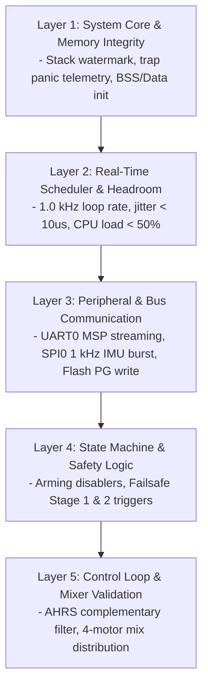

# Betaflight Master Test & Validation Plan: C-DAC ARIES v3.0

**Target Board:** C-DAC ARIES v3.0 Development Board  
**SoC / Core:** C-DAC THEJAS32 / VEGA ET1031 (32-bit RISC-V, RV32IM, 100 MHz, soft-float)  
**Firmware:** Betaflight 2026.12.0-alpha (`ARIESV3` Target)  
**Document Purpose:** Unified testing protocol, electrical/mechanical safety rules, historical roadblock watch-items, and operational guidelines for engineers and autonomous agents.

---

## 1. Executive Summary & Hardware Context

The C-DAC ARIES v3.0 development board is powered by the **VEGA ET1031** 32-bit RISC-V microprocessor core. Unlike conventional STM32 flight controllers (Cortex-M4F/M7), THEJAS32 operates under unique hardware and architectural constraints:
- **RV32IM (No FPU):** Lacks hardware floating-point support. All real-time attitude estimation, filtering, and PID operations run via single-precision soft-float. The flight loop is clamped to **1.0 kHz** ($1000\,\mu\text{s}$).
- **No Hardware Atomics:** Synchronization relies on fast global machine interrupt masking (`__disable_irq()` / `__enable_irq()`).
- **Development Board Form Factor:** Unlike commercial integrated flight controllers, the ARIES v3.0 does not include onboard flight sensors, soft-mounting grommets, or integrated power distribution. Sensors, actuators, and receivers are wired externally via 2.54 mm pin headers.

This master document consolidates the complete pre-flight verification pipeline, physical bench procedures, historical roadblock watch-items, and development best practices.

> [!IMPORTANT]
> **Low-Level Code & Register Test Specifications:**  
> For granular, register-level test cases, GDB inspection steps, unit test commands, and automated test runner scripts, consult the companion document:  
> 📄 **[`SOFTWARE_TEST_PLAN.md`](SOFTWARE_TEST_PLAN.md)**

---

## 2. Essential Ground Rules & Electrical/Mechanical Safeguards

> [!CAUTION]
> ### ⚠️ STRICT OPERATIONAL & SAFETY PROTOCOLS — READ BEFORE POWERING

### 2.1 The Golden Rule: Bare Motor Shafts Only
- **NEVER ATTACH PROPELLERS ON THE BENCH.**
- Any software watchdog panic, unhandled trap, or timer edge latency can latch a motor output high, ramping brushless motors to 100% full throttle within milliseconds.
- Perform all receiver tests, mixer checks, motor direction tests, and failsafe validations exclusively with **bare motor shafts**.

### 2.2 Electrical Protection (Dev Board Power Conditioning)
- **Do Not Supply Raw Battery Voltage:** Commercial flight controllers include heavy LC filters and high-voltage Transient Voltage Suppressor (TVS) diodes. The ARIES v3.0 board has **no onboard TVS diodes**. Rapid ESC active braking (Damped Light) dumps inductive back-EMF voltage spikes exceeding **30V** onto 4S LiPo power rails.
- **Dedicated 5V BEC:** Always power the ARIES v3.0 board through a **regulated, clean 5V BEC** (from an ESC or external step-down regulator).
- **Low-ESR Filter Capacitor:** Solder a **low-ESR electrolytic capacitor** ($470\text{--}1000\,\mu\text{F}$, 35V or 50V) directly across the main battery power leads to suppress switching transients.
- **3.3V Logic Ceiling:** THEJAS32 GPIOs operate strictly at **3.3V LVCMOS** and are **NOT 5V tolerant**. Connecting 5V receiver or sensor outputs will permanently destroy the SoC pins.
- **Bench Current Limiting / Smoke Stopper:** On the bench, power electronics through a current-limited bench supply (set to 300–500 mA) or a series automotive bulb / self-resetting fuse ("Smoke Stopper") before attaching high-discharge LiPo batteries.

### 2.3 Mechanical Vibration & IMU Isolation
- **Vibration Sensitivity:** Brushless motors and unbalanced props produce severe high-frequency acoustic and structural vibration ($200\text{--}600\text{ Hz}$). On commercial flight controllers, the IMU is soft-mounted with silicone grommets.
- **External IMU Mounting:** When mounting the ICM42688P or BMI270 breakout to Header J1:
  - Mount the sensor breakout firmly using **thick double-sided gel/foam tape** (e.g. 3M VHB) to isolate structural resonance.
  - Keep SPI jumper leads **under 10 cm** to prevent high-frequency noise pickup and bus capacitance degradation.
  - Never allow loose, rattling wires to pull mechanically on the IMU board during bench runs.

---

## 3. Historical Roadblocks: Things to Keep an Eye Out For

During the 8-phase porting process, specific architectural obstacles were encountered and solved. Every engineer and agent must monitor these failure modes:

| Phase / Area | Historical Roadblock | Root Cause | Failure Mode to Watch Out For | Mandatory Verification Method |
| :--- | :--- | :--- | :--- | :--- |
| **Trap Handling** | Renode aborts on unhandled traps | Uninitialized `mtvec` or missing `mie.MEIE` (bit 11) | Board silently freezes or reboots on external interrupt | Verify `LD4` pulses at 1 Hz; ensure trap panic dumps diagnostic telemetry. |
| **Clock Tree** | Baud rate mismatch at 115200 | Clock divisor ($54$) assumes exact 100 MHz clock | Terminal outputs garbled text or ignores CLI input | Verify crystal frequency; verify clean `#` prompt in `picocom`. |
| **Timebase** | 42.95s rollover discontinuity | Naive 32-bit `mcycle` wrapped at 42.95 seconds | Scheduler panic or wild filter divergence at ~43 seconds | Conduct a **5-minute uptime soak test**; verify uptime advances past 300s. |
| **Timer 0 ISR** | Infinite interrupt loop on exit | Synopsys Timer 0 latch not cleared via `EOI` | MCU hangs permanently inside `trap_entry` | Confirm `thejas32_timer0_isr` evaluates `THEJAS32_TIMER(0).EOI`. |
| **SPI Burst** | Sensor returns all `0x00` / `0xFF` | Controller drops CS between bytes without `CSAAT` | IMU register address resets; no gyro data | Verify `Bits.CSAAT = 1` during multi-byte transfers; test 3D model motion. |
| **Flash Write** | Sector erase stalls CPU for 30–100 ms | SPI3 NOR flash 4 KB erase (`0x20`) is blocking | Temporary control loop pause during configuration save | Prohibit configuration saves while armed (`ARMING_DISABLED_CLI`). |
| **Motor PWM** | Timing jitter or pulse loss | Soft-scheduled Timer 1 interrupts delayed by atomics | Motor speed oscillations or ESC sync loss | Monitor PWM on oscilloscope; ensure critical sections never contain wait loops. |
| **Soft-Float** | Scheduler task collapse (> 300% load) | 8 kHz PID loop on 100 MHz RV32IM soft-float | Task starvation, watchdog panic, death roll | Clamp PID loop to 1.0 kHz; ensure system load remains $< 50\%$. |
| **Double Promotion**| 64-bit math in real-time loop | Implicit constants (e.g. `0.5` instead of `0.5f`) | Execution time doubles/quadruples silently | Enforce `-Wdouble-promotion -Werror` compiler flags on all builds. |

---

## 4. High-Level Software Testing Plan (5-Layer Architecture)



### Layer 1: System Core & Memory Integrity
- [ ] **Stack High-Water Mark:** Paint the 16 KB stack (`_sstack` to `_estack` at `0x1000FEF0`) with `0xA5A5A5A5`. Exercise heavy CLI and MSP traffic. Verify stack pointer maintains at least 4 KB of free headroom above the BSS section.
- [ ] **Trap Panic Telemetry:** Verify that invalid operations (e.g. deliberate misaligned read or illegal instruction) branch to [`handle_trap_panic()`](src/platform/ARIES/system.c), output `mcause`, `mepc`, and `sp` out of UART0, and blink an SOS pattern on LED `LD4` (`PA22`).
- [ ] **Memory Relocation:** Confirm `.data` relocates cleanly from Flash (`0x20000000`) to SRAM (`0x10000000`) and `.bss` is zeroed out during reset in [`startup.S`](src/platform/ARIES/startup.S).

### Layer 2: Real-Time Scheduler & Timing Benchmarks
- [ ] **Monotonic Timebase:** Confirm [`micros()`](src/platform/ARIES/time_thejas32.c) and [`millis()`](src/platform/ARIES/time_thejas32.c) monotonically increment without negative steps across the 42.95-second boundary.
- [ ] **Task Cadence & Jitter:** Run `tasks` in CLI:
  - `GYRO/PID` rate: strictly **1000 Hz** (period $1000\,\mu\text{s}$).
  - Task jitter: $< 10\,\mu\text{s}$.
  - Overruns count: **0**.
- [ ] **Worst-Case Execution Time (WCET):** Confirm peak PID duration (`subTaskPidController`) is $< 500\,\mu\text{s}$, leaving $> 50\%$ CPU idle time.

### Layer 3: Peripheral & Bus Robustness
- [ ] **High-Throughput MSP Streaming:** Connect Betaflight Configurator at 115200 baud; stream live high-frequency Sensor graphs. Confirm zero dropped packets, zero ring buffer overflows, and zero MSP CRC errors.
- [ ] **Continuous SPI Burst Reads:** Sample SPI0 IMU (14 bytes per transaction) continuously at 1.0 kHz. Verify `Bits.CSAAT` keeps Chip Select asserted across all bytes with zero data glitches.
- [ ] **Flash Parameter Coherence:** Perform repeated read-modify-write-erase cycles across Parameter Groups. Verify 4 KB Sector Erase (`0x20`) and 256-byte Page Program (`0x02`) maintain 100% data coherence with the in-memory shadow buffer.

### Layer 4: Flight State Machine & Safety Logic
- [ ] **Arming Prevention Flags:** Verify arming is strictly refused under these conditions:
  - CLI active (`ARMING_DISABLED_CLI`).
  - Throttle raised above minimum (`ARMING_DISABLED_THROTTLE`).
  - Gyro calibrating (`ARMING_DISABLED_CALIBRATING`).
  - No hardware gyro detected (`ARMING_DISABLED_NO_GYRO`).
- [ ] **Failsafe Transition Pipeline:** Simulate loss of receiver signal in software. Confirm clean transition:
  - **Stage 1 (Guard Time, 1.0s):** Holds fallback channel values.
  - **Stage 2 (Kill/Drop):** Enforces immediate motor disarm within 1000 ms.

### Layer 5: Control Loop & Mixer Validation
- [ ] **AHRS Attitude Estimation:** Verify complementary filter converts raw 3-axis gyro and accelerometer inputs into stable roll/pitch angles without attitude drift or numerical blowups.
- [ ] **4-Motor Output Mixer:** Verify motor distribution:
  - Pitch Forward $\rightarrow$ Rear Motors (1 & 3) increase, Front Motors (2 & 4) decrease.
  - Roll Right $\rightarrow$ Left Motors (3 & 4) increase, Right Motors (1 & 2) decrease.
  - Yaw Right $\rightarrow$ CW Motors increase, CCW Motors decrease.

---

## 5. Physical Bench & Oscilloscope Verification Procedures

Execute these tests sequentially on physical hardware:

### Step 1: Power & Console Sanity Check
1. Connect micro-USB cable to CP2102N UART0 (`/dev/ttyUSB0`).
2. Open terminal: `picocom -b 115200 /dev/ttyUSB0`.
3. Type `#` or press Enter.
4. **Pass Criteria:** Betaflight CLI banner displays `Betaflight / ARIESV3 2026.12.0-alpha`. Run `version` and `status`.

### Step 2: 5-Minute Timebase & Uptime Verification
1. Leave board powered in CLI for **at least 5 minutes** (crossing the 43-second rollover boundary).
2. Check `status` every 60 seconds; confirm **System Uptime** advances cleanly.
3. Observe Heartbeat LED `LD4` (`PA22`): must pulse steadily at 1 Hz.
4. Run `tasks`: confirm `GYRO/PID` rate is 1000 Hz, max execution time $< 500\,\mu\text{s}$, and task overruns = 0.

### Step 3: IMU Sensor Live Data & 3D Model Test
1. Wire ICM42688P or BMI270 breakout to Header J1 (`PA5` SCK, `PA6` MISO, `PA7` MOSI, `PA8` CS, `PA0` DRDY).
2. In CLI, run `status` to confirm sensor detection: `GYRO: ICM42688P` or `BMI270`.
3. Open **Betaflight Configurator**:
   - **Setup Tab:** Rotate the physical board in all 3 axes. Confirm 3D quad model moves smoothly without jitter, latency, or gimbal locking.
   - **Sensors Tab:** Watch live gyro traces at rest. Verify rates hover at $0^\circ/\text{s}$ with low background noise and no $0\text{x00}$ or $0\text{xFF}$ data drops.

### Step 4: Flash Parameter Persistence Verification
1. In CLI, execute:
   ```text
   set pilot_name = ARIES_BENCH_TEST
   save
   ```
2. Board will erase sector, program flash, and reboot.
3. Unplug USB power, wait 5 seconds, and reconnect.
4. In CLI, execute `get pilot_name`.
5. **Pass Criteria:** Returns `pilot_name = ARIES_BENCH_TEST` without EEPROM CRC errors.

### Step 5: Motor PWM Pulse Verification via Oscilloscope
1. **Ensure motors are disconnected or props removed.**
2. Connect oscilloscope or logic analyzer probes to Header J2 & J1:
   - Motor 1: `PA1` (`J2_5`)
   - Motor 2: `PA2` (`J2_3`)
   - Motor 3: `PA3` (`J2_1`)
   - Motor 4: `PA4` (`J1_10`)
3. Disarmed State: Verify stable **400 Hz** square wave ($2500\,\mu\text{s}$ period) with **$1000\,\mu\text{s}$** pulse width.
4. Armed / Motor Test Tab: Enable motor test mode in Configurator, sweep master slider:
   - $50\%$ throttle $\rightarrow$ verify exact **$1500\,\mu\text{s}$** pulse width.
   - $100\%$ throttle $\rightarrow$ verify exact **$2000\,\mu\text{s}$** pulse width.
   - Confirm crisp pulse edges with jitter $< 5\,\mu\text{s}$.

### Step 6: Receiver Link & Bench Failsafe Test
1. Connect serial receiver (CRSF / ExpressLRS / SBUS) to Header J2 (`PA16` TX, `PA17` RX).
2. In Configurator **Receiver Tab**, verify channels 1–4 respond smoothly (endpoints 1000–2000 µs, center 1500 µs).
3. Arm the quadcopter on the bench (props off) at idle throttle (~1050 µs).
4. **Switch off the radio transmitter.**
5. **Pass Criteria:** Flight controller immediately disarms, and all motor PWM outputs drop to $1000\,\mu\text{s}$ within $< 1.0\text{ second}$.

---

## 6. Development Ergonomics & Workflow Best Practices

To maximize development velocity and avoid hardware debugging friction:

| Practice | Concrete Setup | Benefit |
| :--- | :--- | :--- |
| **1-Click Flash & Monitor** | OpenOCD + `picocom --imap lfcrlf /dev/ttyUSB0` script | Eliminates manual port release / reconnect cycles on reboots. |
| **Non-Root USB Permissions** | Add user to `dialout` group; install OpenOCD udev rules | Flashing and serial monitoring run without `sudo`. |
| **Trap Panic Diagnostics** | Print `mcause`, `mepc`, `sp` to UART0 before halt | Resolve crashes in seconds via `riscv32-esp-elf-addr2line`. |
| **SOS Heartbeat LED** | Pulse `PA22` (`LD4`) rapidly in panic handler | Instantly distinguishes CPU exception from infinite polling loop. |
| **GDB Hardware Debugging** | Connect `riscv32-esp-elf-gdb` to OpenOCD port `:3333` | Step through assembly, inspect registers, and backtrace hangs. |
| **Soft-Float Guardrails** | Enforce `-Wdouble-promotion -Werror` in Makefile | Prevents accidental promotion to slow 64-bit double operations. |
| **Atomics Latency Rule** | Keep critical sections (`__disable_irq`) under $10\,\mu\text{s}$ | Prevents delaying Timer 1 motor PWM pulse termination interrupts. |
| **Bench Logic Analyzer** | Clip 8-channel logic analyzer to `PA1`–`PA4` and SPI0 | Inspect multi-channel motor pulses and sensor transfers in real time. |
| **Labeled Wire Harness** | Build ribbon breakout for Headers J1 and J2 | Eliminates miswiring and accidental short circuits on crowded pins. |
| **Configuration Backup** | Save `diff all` CLI output to `config/aries_bench_defaults.txt` | Restores tested PID, rate, and pin configuration in 5 seconds after wipe. |

---

## 7. Software Feature Restriction Matrix

Because the VEGA ET1031 is a 100 MHz soft-float core, the following Betaflight features **must remain permanently disabled**:

| Feature | Status | Reason & Impact if Enabled |
| :--- | :---: | :--- |
| **Dynamic Notch Filters** | **DISABLED** | Real-time 3-axis FFT calculation consumes $> 15,000$ cycles; causes fatal PID loop overruns. |
| **RPM Filtering & Bi-directional DShot** | **DISABLED** | Requires microsecond DMA digital bit-banging unsupported by THEJAS32 hardware timers. |
| **Cascaded Biquad D-Term Filters** | **DISABLED** | High floating-point order; replace with lightweight **PT1** lowpass filters. |
| **Autonomous Navigation / GPS Rescue** | **DISABLED** | Matrix transformation and trigonometric calculations degrade real-time attitude tracking. |
| **High-Rate Blackbox Logging** | **DISABLED** | Saturates UART/SPI bandwidth; if used, limit rate to $\le 250\text{ Hz}$ ($1:4$ divisor). |
| **Accelerometer in Acro/Rate Mode** | **OPTIONAL/OFF** | In pure Acro mode, PID uses Gyro only. Disable Accel if CPU load ever exceeds $50\%$. |

---

## 8. Master Sign-Off & Verification Checklist

| Test ID | Test Description | Target Specification | Tested By | Date | Result |
| :---: | :--- | :--- | :---: | :---: | :---: |
| **TST-01** | USB-UART0 CLI Access | 115200 baud, clean `#` prompt | | | [ ] PASS |
| **TST-02** | 5-Minute Monotonic Uptime | Smooth uptime, no 43s rollover jitter | | | [ ] PASS |
| **TST-03** | Scheduler PID Task Frequency | 1000 Hz, jitter $< 10\,\mu\text{s}$, overruns = 0 | | | [ ] PASS |
| **TST-04** | Soft-Float CPU Load Margin | Overall system load $< 50\%$ | | | [ ] PASS |
| **TST-05** | SPI0 IMU Detection & 3D Model | Clean rotation tracking, no dropped data | | | [ ] PASS |
| **TST-06** | Flash PG Save/Load & Persistence | Data intact across hard power cycle | | | [ ] PASS |
| **TST-07** | Motor PWM Output (Scope) | 400 Hz, 1000–2000 µs jitter-free pulse | | | [ ] PASS |
| **TST-08** | Serial RX Stick Response | 1000–2000 µs, midpoint 1500 µs | | | [ ] PASS |
| **TST-09** | Failsafe Motor Cutoff | Motors disarm $< 1.0\text{s}$ on radio loss | | | [ ] PASS |
| **TST-10** | Arming Prevention Checks | Rejects arming on CLI/throttle/no gyro | | | [ ] PASS |
| **TST-11** | IMU Mechanical Soft-Mount | Foam tape isolation, wires $< 10\text{ cm}$ | | | [ ] PASS |
| **TST-12** | Atomics Latency Hygiene | No wait loops in critical sections | | | [ ] PASS |

---

*Document Author: Flight Control Porting Team*  
*Repository Reference: [`HAL_PROGRESS.md`](HAL_PROGRESS.md), [`SOFTWARE_TEST_PLAN.md`](SOFTWARE_TEST_PLAN.md), [`GEMINI.md`](GEMINI.md), & [`RISK_ASSESMENT.md`](RISK_ASSESMENT.md)*
