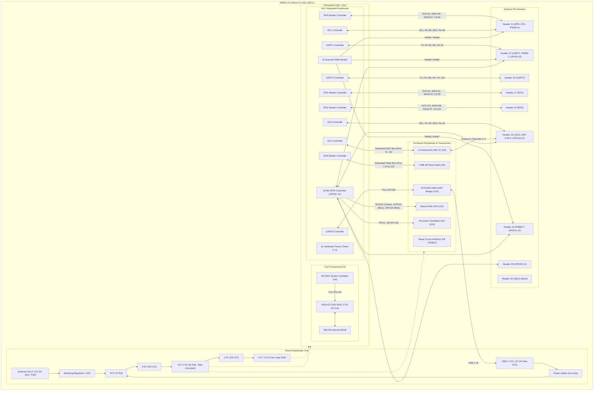
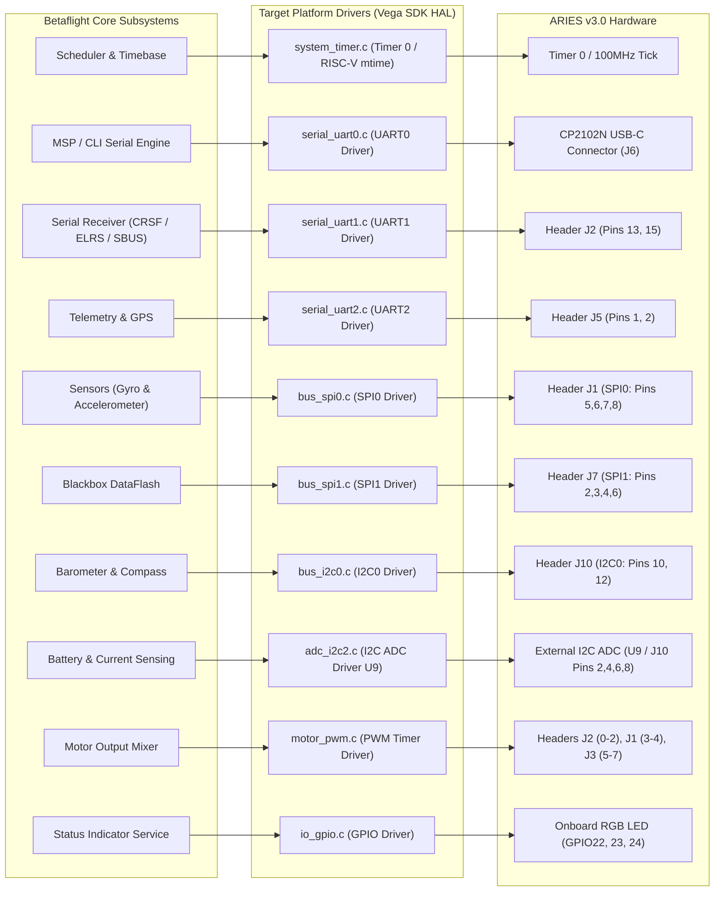
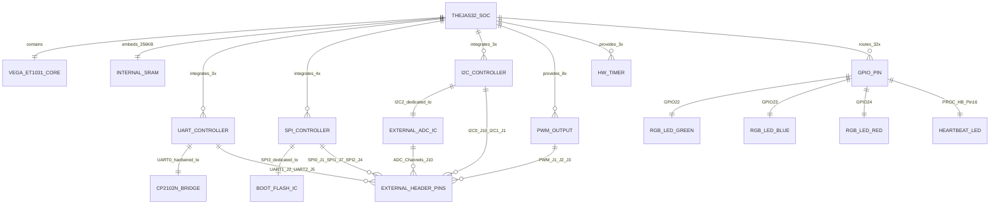

# ARIES v3.0 Hardware & Porting Knowledge Graph

This document models the complete entity-relationship knowledge graph for the **ARIES v3.0 (THEJAS32 / VEGA ET1031)** hardware platform based on the official C-DAC datasheets (`ARIESv3 0_Datasheet-4.pdf` and `ARIESv3 0_Datasheet_14-10-24.pdf`).

### Connected Knowledge Nodes
* **Master Knowledge Index**: [INDEX.md](file:///home/ivan/Desktop/betaflight/knowledgebase/INDEX.md)
* **Hardware Datasheet Specs**: [ARIES_V3_DATASHEET_ANALYSIS.md](file:///home/ivan/Desktop/betaflight/knowledgebase/ARIES_V3_DATASHEET_ANALYSIS.md)
* **Silicon & Core Manual**: [THEJAS32_PROGRAMMER_MANUAL_ANALYSIS.md](file:///home/ivan/Desktop/betaflight/knowledgebase/THEJAS32_PROGRAMMER_MANUAL_ANALYSIS.md)
* **Serial Protocol & Handshake**: [MSP_CONFIGURATOR_HANDSHAKE_GRAPH.md](file:///home/ivan/Desktop/betaflight/knowledgebase/MSP_CONFIGURATOR_HANDSHAKE_GRAPH.md)
* **Subsystem Architecture**: [BETAFLIGHT_ARCHITECTURE_GRAPH.md](file:///home/ivan/Desktop/betaflight/knowledgebase/BETAFLIGHT_ARCHITECTURE_GRAPH.md)
* **128KB Optimization**: [TARGET_OPTIMIZATION_128KB.md](file:///home/ivan/Desktop/betaflight/knowledgebase/TARGET_OPTIMIZATION_128KB.md)

---

## 1. Top-Level Hardware Architecture Knowledge Graph

---

## 2. Betaflight Flight Controller Component Mapping Graph

This graph specifies how the ARIES v3.0 hardware translates directly into standard Betaflight flight controller functional blocks:

---

## 3. Peripheral Entity Relationship Schema

---

## 4. Key Architectural Takeaways for Betaflight Porting

1. **Architecture & Instruction Set**:
   * Processor is a 32-bit RISC-V (`rv32imac` or similar VEGA ET1031 configuration).
   * Toolchain required: `riscv32-unknown-elf-gcc` or `riscv64-unknown-elf-gcc -march=rv32... -mabi=ilp32`.
2. **Interrupt Controller (PLIC / CLIC / CLINT)**:
   * RISC-V standard machine timer (`mtime` / `mtimecmp`) and PLIC (Platform-Level Interrupt Controller) are used for peripheral IRQs (UART, SPI, Timer).
3. **Memory Constrained Footprint**:
   * Internal SRAM: 256 KB (plenty for Betaflight which typically runs comfortably in 64KB - 128KB on STM32F405 / STM32F411).
   * External SPI Flash: 2 MB boot storage.
4. **Asynchronous I2C ADC vs Monolithic SAR ADC**:
   * In traditional STM32 targets, ADC is sampled via internal peripheral DMA. On ARIES v3.0, battery voltage and current monitoring must read from `U9` via `I2C2` bus.
5. **No Native USB OTG Core in SoC**:
   * Unlike STM32F4/F7/H7 which implement USB Full Speed / High Speed VCP internally, ARIES v3.0 relies on the external CP2102N bridge connected to `UART0`. Betaflight will talk to the PC via standard serial UART at 115200 baud or higher.
