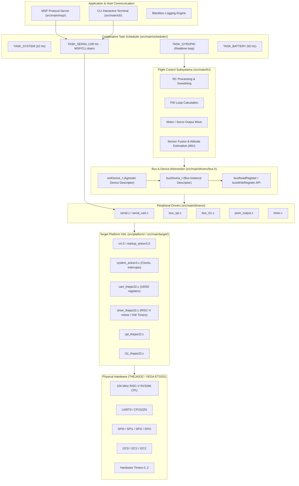
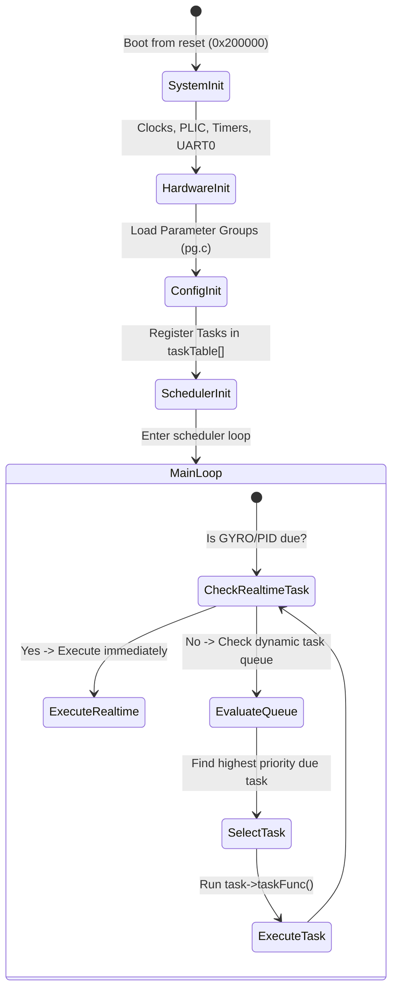
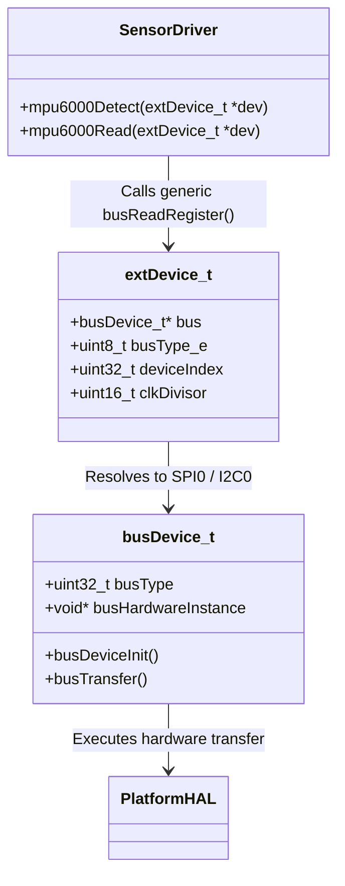

# Betaflight Subsystem & Execution Architecture Knowledge Graph

## 1. Overview & Architectural Hierarchy

Betaflight is structured into modular layers spanning from hardware abstraction up to application and serial protocol handlers.

### Connected Knowledge Nodes
* **Hardware Physical Platform**: [ARIES_V3_DATASHEET_ANALYSIS.md](file:///home/ivan/Desktop/betaflight/knowledgebase/ARIES_V3_DATASHEET_ANALYSIS.md)
* **SoC & Memory Layout**: [THEJAS32_PROGRAMMER_MANUAL_ANALYSIS.md](file:///home/ivan/Desktop/betaflight/knowledgebase/THEJAS32_PROGRAMMER_MANUAL_ANALYSIS.md)
* **Hardware Visual Graph**: [ARIES_V3_KNOWLEDGE_GRAPH.md](file:///home/ivan/Desktop/betaflight/knowledgebase/ARIES_V3_KNOWLEDGE_GRAPH.md)
* **Serial MSP & Configurator Handshake**: [MSP_CONFIGURATOR_HANDSHAKE_GRAPH.md](file:///home/ivan/Desktop/betaflight/knowledgebase/MSP_CONFIGURATOR_HANDSHAKE_GRAPH.md)
* **128 KB Optimization Strategy**: [TARGET_OPTIMIZATION_128KB.md](file:///home/ivan/Desktop/betaflight/knowledgebase/TARGET_OPTIMIZATION_128KB.md)
* **Master Knowledge Index**: [INDEX.md](file:///home/ivan/Desktop/betaflight/knowledgebase/INDEX.md)
* **Betaflight Docs Reference**: [betaflight.com App Architecture](file:///home/ivan/Desktop/betaflight/knowledgebase/betaflight.com/docs/development/App-Architecture.mdx) | [Bus Drivers](file:///home/ivan/Desktop/betaflight/knowledgebase/betaflight.com/docs/development/API/BusDrivers.md)

---

## 2. Betaflight Layered Architecture Knowledge Graph

---

## 3. The Betaflight Cooperative Task Loop

Betaflight uses a priority-based cooperative task scheduler located in `src/main/scheduler/scheduler.c`.

### Essential Tasks for Configurator Communication:
1. `TASK_SYSTEM`: Heartbeat indicator, uptime tracking, CPU load calculation.
2. `TASK_SERIAL`: Polls and drains `UART0` buffers, executes `mspSerialProcess()`, and feeds CLI tokens.

---

## 4. Bus Abstraction Pattern (`extDevice_t` and `busDevice_t`)

As documented in [BusDrivers.md](file:///home/ivan/Desktop/betaflight/knowledgebase/betaflight.com/docs/development/API/BusDrivers.md), Betaflight completely decouples high-level sensor drivers (gyro, accelerometer, compass, barometer, flash memory) from the underlying bus hardware:

### Porting Implication for ARIES v3.0:
To support any sensor or memory chip in Betaflight, we only need to implement the standard `busDevice_t` interface for:
* `bus_spi.c` $\rightarrow$ THEJAS32 SPI controller driver
* `bus_i2c.c` $\rightarrow$ THEJAS32 I2C controller driver
No sensor driver code needs to be modified!
