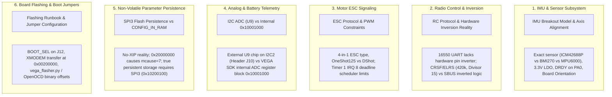

# Critical Knowledge Gaps, Hardware Boundaries & Assumption Guardrails

> **MANDATORY POLICY FOR ALL AGENTS AND DEVELOPERS:**  
> When operating on this repository, **NEVER ASSUME OR GUESS** hardware parameters, pinout behaviors, or protocol requirements.  
> If a task touches any subsystem documented below that is marked with **[PENDING TEAM CONFIRMATION]**, you **MUST NOT** hallucinate an implementation. You must present the verified boundaries, state the open questions, and request user/team confirmation.

---

## 1. Summary of Identified Knowledge Gaps



---

## 2. Granular Gap Breakdown & Strict Assumption Guardrails

### Gap 1: Physical IMU Model, Wiring & Axis Alignment
* **Current Knowledge Base Reality:**
  - Header J1 exposes `SPI0` pins: `PA5` (SCK), `PA6` (MISO), `PA7` (MOSI), `PA8` (CS), and `PA0` (`EXTI` DRDY).
  - Driver `bus_spi_aries.c` clamps SCK to **12.5 MHz** (Divisor 1) to respect the 24.0 MHz maximum specification of high-grade sensors like ICM-42688P.
* **The Gap [PENDING TEAM CONFIRMATION]:**
  - **Specific Sensor Model:** Which sensor breakout is physically mounted to Header J1 on the drone/bench setup? (e.g., ICM-42688P, BMI270, MPU6000, or an indigenous Indian MEMS IMU?)
  - **Voltage Supply:** Does the breakout accept 3.3V directly from Header J1, or does it require 5V from an external BEC?
  - **Sensor Orientation:** Betaflight calculates roll/pitch/yaw using `CW0`, `CW90`, `CW180`, `CW270`, or `CUSTOM` matrix alignment. An incorrect orientation causes instant flyaways upon takeoff!
* **Guardrail Rule for Agents:**
  > **DO NOT** hardcode sensor orientation or assume a specific IMU model without verifying `target.h` against the user's physical sensor board. If sensor data reads inverted or axes swap, immediately prompt the user for physical module orientation.

---

### Gap 2: RC Receiver Protocol & Serial Inversion Realities
* **Current Knowledge Base Reality:**
  - `target.h` configures `UART1` on pins `PA16` (TX) and `PA17` (RX) for `USE_SERIALRX_CRSF`.
  - For a 100 MHz APB clock, standard 420,000 baud generates:
    $$\text{Divisor} = \frac{100{,}000{,}000}{16 \times 420{,}000} \approx 14.88 \implies \text{Divisor } 15 \ (416{,}666.7\text{ baud}, -0.79\%\text{ error})$$
* **The Gap [CRITICAL SILICON LIMITATION]:**
  - **No Hardware Inverter on 16550 UART:** Unlike STM32F3/F7/H7, the THEJAS32 16550 UART has **no internal hardware signal inverters**.
  - **SBUS / SmartPort Limitation:** Standard SBUS uses inverted UART logic ($V_{\text{idle}} = \text{LOW}$, $3.3\text{V} = \text{SPACE}$). Connecting an SBUS receiver directly to `PA17` will yield 100% frame errors and corrupted bytes unless an external transistor inverter circuit is added.
  - **CRSF / ExpressLRS Compatibility:** CRSF/ELRS uses non-inverted UART logic ($V_{\text{idle}} = \text{HIGH}$), making it natively compatible with `PA17`.
* **Guardrail Rule for Agents:**
  > **DO NOT** configure SBUS or SmartPort telemetry without explicitly alerting the user that an external hardware inverter is electrically required. Recommend **ExpressLRS (CRSF)** at 420,000 baud as the native non-inverted protocol for ARIES v3.

---

### Gap 3: Physical ESC Hardware & Protocol Selection
* **Current Knowledge Base Reality:**
  - Motor outputs 1..4 (`PA1`–`PA4`) use Hardware Timer 1 (IRQ 8) ascending deadline event scheduling.
  - Generates 400 Hz Standard PWM ($1000\text{--}2000\,\mu\text{s}$) or OneShot125 ($125\text{--}250\,\mu\text{s}$) consuming $< 3\,\mu\text{s}$ CPU total.
* **The Gap [PENDING TEAM CONFIRMATION]:**
  - **ESC Protocol Support:** What 4-in-1 ESC is installed? Does it support OneShot125 or does it require DShot (digital pulse-width encoding)?
  - **DShot Feasibility:** THEJAS32 lacks STM32-style timer DMA burst engines. Bit-banged DShot300 requires tight timing loops that conflict with soft-float processing.
* **Guardrail Rule for Agents:**
  > **DO NOT** attempt to write a bit-banged DShot driver on THEJAS32 unless Timer 1 OneShot125 is proven insufficient. OneShot125 provides sub-millisecond response latency with zero CPU blocking overhead.

---

### Gap 4: Analog ADC Telemetry (`U9` I2C Chip vs. `0x10001000` Internal Registers)
* **Current Knowledge Base Reality:**
  - `oldfiles/logs/ARIESv3 0_Datasheet_14-10-24.pdf` confirms Header `J10` analog inputs (`ADC_CH0`–`ADC_CH3`) are wired to **`U9`**, an external 4-channel I2C ADC chip connected to `I2C2` (`PA32` SCL, `PA31` SDA).
  - In `lib/vega-sdk/vega-sdk/bsp/include/adc.h`, C-DAC provides an internal register map:
    ```c
    #define ADC_BASE_ADDRESS 0x10001000
    typedef struct {
        UI address_reg; // 0x14 (A0), 0x15 (A1), 0x16 (A2), 0x17 (A3)
        UI status_reg;  // Poll bit 0 for done
        UI data_reg;    // 32-bit conversion
    } ADCReg_type;
    ```
* **The Gap [PENDING TEST CONFIRMATION]:**
  - Is `0x10001000` a functional on-chip peripheral on physical THEJAS32 silicon, or does the board strictly depend on `U9`?
  - Currently, `target.h` defines `#undef USE_ADC` to avoid `stub_drivers.c` returning `0V`, which permanently locks arming under `ARMING_DISABLED_BATTERY`.
* **Guardrail Rule for Agents:**
  > **DO NOT** enable `#define USE_ADC` until either:
  > 1. Register reads on `0x10001000` are validated on physical hardware, or
  > 2. An asynchronous driver for `U9` over `I2C2` is written and tested.

---

### Gap 5: Non-Volatile Flash Persistence across Power Cycles
* **Current Knowledge Base Reality:**
  - The external SPI flash is **NOT memory-mapped** for CPU read/write caching.
  - Attempting to dereference `0x20000000` triggers a fatal Store Access Fault (`mcause = 7`).
  - Active configuration uses `#define CONFIG_IN_RAM` (`EEPROM_SIZE 8192`), storing Parameter Groups in internal SRAM (`.bss`).
  - **The Trade-off:** Configuration survives warm soft-reboots (`_start`), but is lost on complete power disconnect.
* **The Proven Solution from C-DAC SDK:**
  - C-DAC's reference example [`lib/vega-sdk/vega-sdk/examples/spi/spi_write_read_pgm/main.c`](../lib/vega-sdk/vega-sdk/examples/spi/spi_write_read_pgm/main.c) proves how to access persistent storage safely:
    - Target controller: `MDP_SPI_3` (`0x10200100`).
    - Use `SPI_set_CSAAT_pin(MDP_SPI_3, 1)` to assert Chip Select.
    - Read via command `0x03` (`RD_DATA_BYTES_SPI_CMD`) and write via `0x02` (`BYTE_PAGE_PGM_SPI_CMD`) with `0x20` (Sector Erase).
* **Guardrail Rule for Agents:**
  > **NEVER** write pointer dereferences (`*(uint32_t *)0x20000000 = val`) for flash persistence. If cold-reboot persistence is requested, implement the `MDP_SPI_3` command-based driver following the C-DAC example.

---

### Gap 6: Board Flashing Runbook & Boot Jumpers
* **Current Knowledge Base Reality:**
  - Firmware executes from SRAM starting at `0x00202000` with a strict $248\text{ KB}$ ceiling.
  - Intel HEX files (`.hex`) must be converted to raw binary (`.bin`) before uploading to internal SRAM.
* **The Gap [PENDING LAB RUNBOOK]:**
  - Exact boot jumper state: Header `J12` (`BOOT_SEL`) must be documented for SPI boot vs UART XMODEM mode.
  - Flashing commands:
    ```bash
    # OpenOCD SRAM Upload
    openocd -f aries_openocd.cfg -c "init; halt; load_image betaflight_ARIESV3.bin 0x00202000; resume 0x00202000; exit"

    # Serial Bootloader Upload
    python3 vega_flasher.py -p /dev/ttyUSB0 -b 115200 -a 0x00202000 -w betaflight_ARIESV3.bin
    ```
* **Guardrail Rule for Agents:**
  > **DO NOT** instruct users to flash `.hex` files directly to `0x20000000` without specifying the target memory medium (SRAM vs SPI flash) and conversion steps.

---

## 3. Verified Silicon Errata & Architecture Guardrails (Code Audit Node 02)

The following architectural guardrails and silicon quirks were confirmed through physical hardware testing, technical debt analysis ([`code_audit/02_WORKING_TREE_REVIEW_AND_TECHNICAL_DEBT.md`](code_audit/02_WORKING_TREE_REVIEW_AND_TECHNICAL_DEBT.md)), and consultation of official C-DAC VEGA SDK/BSP sources:

### Erratum 1: Synopsys DW_apb_uart 16550 Hardware FIFO Errata (`FCR = 0x00` Mandatory)
* **The Hardware Reality**: The DW_apb_uart 16550 IP on THEJAS32 (VEGA ET1031) silicon has hardware FIFO pointer and clock-crossing errata. Writing `UART_IIR_FCR = 0x07` or `0x01` causes incoming keystrokes to arrive scrambled/out-of-order, duplicates characters, and eventually freezes the hardware FIFO pointer.
* **The Official Precedent**: Every official C-DAC driver ([`lib/vega-sdk/vega-sdk/bsp/drivers/uart/uart.c:104`](../lib/vega-sdk/vega-sdk/bsp/drivers/uart/uart.c), [`lib/vega-bsp/cores/arduino/HardwareSerial.cpp:114`](../lib/vega-bsp/cores/arduino/HardwareSerial.cpp), [`lib/vega-bsp/cores/arduino/UARTClass.cpp:101`](../lib/vega-bsp/cores/arduino/UARTClass.cpp)) strictly disables hardware FIFOs by writing `UART_IIR_FCR = 0x00`.
* **Guardrail Rule**: Always operate in 1-byte register mode (`UART_IIR_FCR = 0x00`). Never enable hardware FIFOs in runtime code.

### Erratum 2: 921,600 Baud Timing Error Exceeds Asynchronous Tolerance (-3.12%)
* **The Math**: On a 100 MHz APB clock, 921,600 baud yields integer divisor 7:
  $$\text{Actual Baud} = \frac{100{,}000{,}000}{16 \times 7} \approx 892{,}857.14\text{ bps} \implies \text{Error} = -3.12\%$$
* **The Consequence**: Exceeds the standard $\pm 2.5\%$ UART asynchronous margin, causing framing errors (`FE`) on high-speed blackbox or logging ports.
* **Guardrail Rule**: Clamp or reject 921,600 baud in `thejas32_uart_set_baudrate_ex()`. Safe high-speed baud rates are 230,400 (Divisor 27, $+0.47\%$) and 420,000 (Divisor 15, $-0.79\%$).

### Erratum 3: Concurrency Hazard in Generic Polled Ingestion Hooks
* **The Mechanism**: In `src/main/drivers/serial_uart.c`, `#ifdef THEJAS32` calls `uartIrqHandler((uartPort_t *)uartPort)` inside `uartTotalRxBytesWaiting()` and `uartRead()`.
* **The Concurrency Risk**: In thread mode, these calls execute without atomic masking. If the hardware external interrupt (`thejas32_uart0_isr`) fires concurrently, both thread and ISR mutate `rxBufferHead` and read `UART_DR` simultaneously, corrupting ring buffers.
* **Guardrail Rule**: Any thread-mode invocation of `uartIrqHandler` must be enclosed in an `ATOMIC_BLOCK(NVIC_PRIO_SERIALUART)`.

### Erratum 4: Linker Script Section Missing for Persistent Objects (`.noinit`)
* **The Vulnerability**: `persistentObjects[16]` in `stub_drivers.c` is placed in `.bss`, which `startup.S` zeroes on every CPU reset.
* **The Consequence**: Warm soft-reboot reason codes, crash flags, and bootloader jump tokens are erased during reset.
* **Guardrail Rule**: When implementing Phase 18 persistent storage, add `.noinit (NOLOAD) : { *(.noinit .noinit.*) } > RAM` to `aries_v3.ld` and annotate persistent data structures accordingly.

### Erratum 5: Missing Memory Barrier Fences Across Timer 1 MMIO Writes (RVWMO)
* **The Mechanism**: In `src/platform/ARIES/pwm_motor_aries.c`, writing `LoadCount = delta;` is immediately followed by `Control = 0x03;` without an intervening memory fence instruction (`__asm__ volatile ("fence" : : : "memory");`).
* **The Concurrency Risk**: Under the RISC-V memory-mapped I/O ordering model (RVWMO), the APB peripheral bus or processor write buffer can commit the timer enable write before the count reload completes, causing Timer 1 to fire with the previous period.
* **Guardrail Rule**: Always insert `__asm__ volatile ("fence" : : : "memory");` after writing `LoadCount` before writing `Control = 0x03` on Synopsys DW APB timers.

### Erratum 6: Bank-Wide EXTI Interrupt Fan-Out
* **The Mechanism**: In `src/platform/ARIES/exti_aries.c`, central interrupt lines IRQ 10 (`THEJAS32_IRQ_GPIO0`) and IRQ 11 (`THEJAS32_IRQ_GPIO1`) dispatch to all enabled pins in `exti_bank0/1_active_mask` without reading a hardware pin-level pending register.
* **The Concurrency Risk**: If more than one pin in Bank 0 is registered with EXTI, a pulse on one pin invokes the callbacks for all registered pins in that bank.
* **Guardrail Rule**: Strictly enforce a limit of 1 active interrupt pin per bank (currently PA0 is the sole interrupt pin on Header J1 for ICM-42688P Gyro DRDY) until hardware pin-level pending status masking is confirmed.

---

## 4. Mandatory Agent Operational Rules Summary

1. **Before writing code touching these areas:** Check this document first.
2. **If an item is marked [PENDING TEAM CONFIRMATION]:** Ask the user for clarification rather than assuming default STM32/ESP32 behavior.
3. **If a team member provides physical hardware details or audits:** Immediately invoke `knowledge-update` to document findings and track technical debt!
