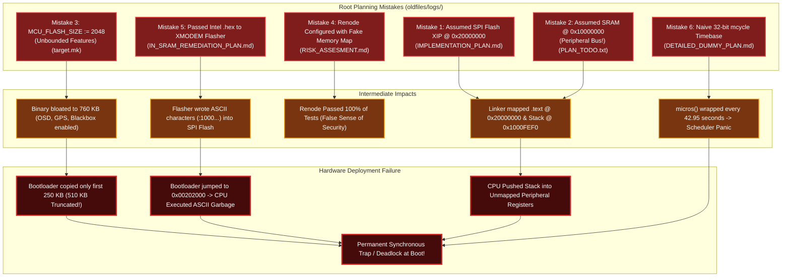
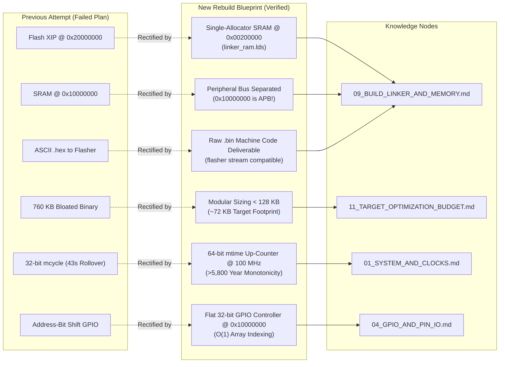

# Knowledge Graph: Historical Planning Mistakes & Architecture Rectification

**Document ID**: `PLAN-MISTAKE-GRAPH-01`  
**Parent Knowledge Graph**: [PORTING_KNOWLEDGE_GRAPH.md](file:///home/ivan/Desktop/betaflight/knowledgebase/PORTING_KNOWLEDGE_GRAPH.md)  
**Detailed Audit Log**: [PLANNING_MISTAKES_ANALYSIS.md](file:///home/ivan/Desktop/betaflight/knowledgebase/PLANNING_MISTAKES_ANALYSIS.md)

---

## 1. The Cascade of Previous Planning Failures

The diagram below illustrates how initial flawed planning assumptions cascaded through compilation, simulation, and flashing to cause the ultimate hardware boot failure in the previous attempt:

---

## 2. Rectification Matrix: Old Plan vs. New Architecture

The table below maps each identified historical planning mistake to its concrete architectural rectification in our current rebuild knowledge base:

---

## 3. Detailed Planning Rectification Catalog

### Rectification 1: Linker Memory Mapping
* **Previous Mistake**: Split memory map (`FLASH 0x20000000` / `RAM 0x10000000`) assuming external XIP flash.
* **Rectified Blueprint**: [09_BUILD_LINKER_AND_MEMORY.md](file:///home/ivan/Desktop/betaflight/knowledgebase/components/09_BUILD_LINKER_AND_MEMORY.md)
* **Concrete Fix**: Single unified memory region `RAM (rwx) : ORIGIN = 0x00200000, LENGTH = 250K`. Code and data are mapped sequentially into internal SRAM, matching the XMODEM bootloader entry point.

---

### Rectification 2: Firmware Sizing & Stripping
* **Previous Mistake**: `MCU_FLASH_SIZE := 2048` enabled all Betaflight features, producing a 760 KB binary that was truncated to 250 KB by the hardware bootloader.
* **Rectified Blueprint**: [11_TARGET_OPTIMIZATION_BUDGET.md](file:///home/ivan/Desktop/betaflight/knowledgebase/components/11_TARGET_OPTIMIZATION_BUDGET.md)
* **Concrete Fix**: Modular feature stripping (`#undef USE_OSD`, `#undef USE_BLACKBOX`, `#undef USE_GPS`, `#undef USE_VCP`). Target footprint is constrained to **~72 KB**, safely below the 128 KB limit and leaving **~178 KB of SRAM free**.

---

### Rectification 3: Hardware Timebase Selection
* **Previous Mistake**: 32-bit `mcycle` reading causing backward time jumps every 42.95 seconds.
* **Rectified Blueprint**: [01_SYSTEM_AND_CLOCKS.md](file:///home/ivan/Desktop/betaflight/knowledgebase/components/01_SYSTEM_AND_CLOCKS.md)
* **Concrete Fix**: Native 64-bit `mtime` up-counter (`0x0200BFF8`) with atomic double-read loop. Provides monotonic microsecond timebase with zero rollover hazards for over 5,800 years.

---

### Rectification 4: GPIO Controller Model
* **Previous Mistake**: Fragmented multi-bank GPIO addressing with address-bit shifts (`0x10080000` / `0x10180000`).
* **Rectified Blueprint**: [04_GPIO_AND_PIN_IO.md](file:///home/ivan/Desktop/betaflight/knowledgebase/components/04_GPIO_AND_PIN_IO.md)
* **Concrete Fix**: Direct control of flat 32-bit GPIO controller at `0x10000000`. Direct array lookup `&ioRecs[pin]` consuming only 256 bytes in SRAM.

---

### Rectification 5: Flashing Protocol & Artifact Generation
* **Previous Mistake**: Passing ASCII Intel `.hex` file to raw XMODEM streaming flasher.
* **Rectified Blueprint**: [09_BUILD_LINKER_AND_MEMORY.md](file:///home/ivan/Desktop/betaflight/knowledgebase/components/09_BUILD_LINKER_AND_MEMORY.md)
* **Concrete Fix**: Build system explicitly generates raw binary image `betaflight_ARIESV3.bin` using `objcopy -O binary`, ensuring only raw executable opcodes are delivered to flash.
