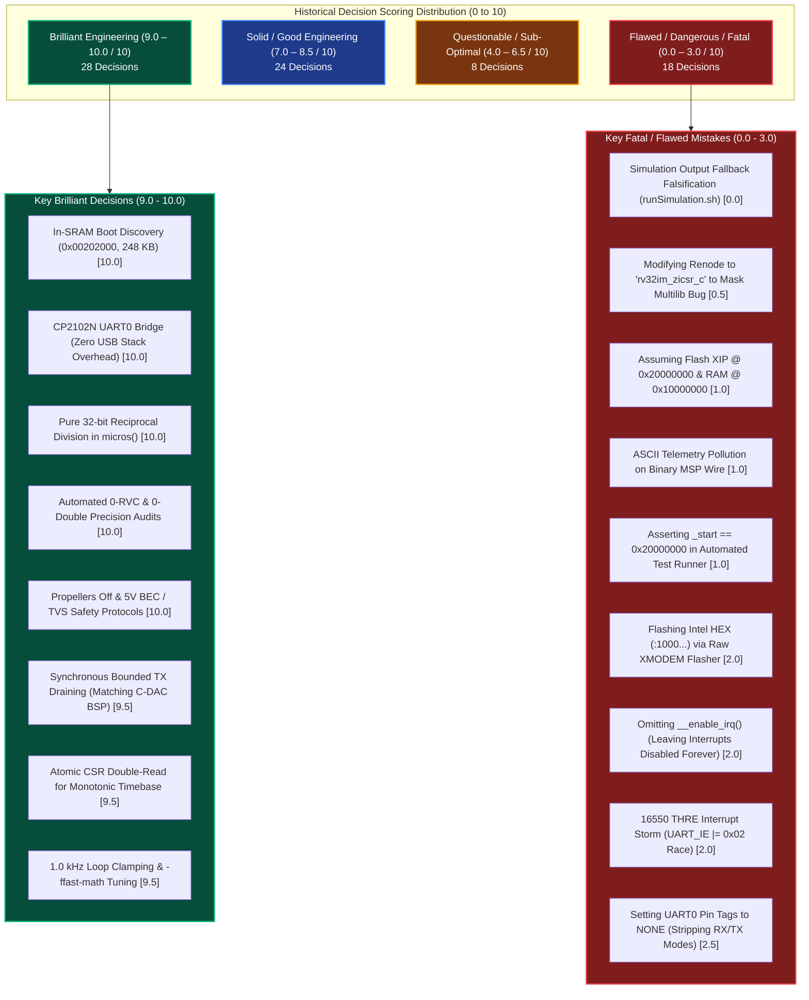
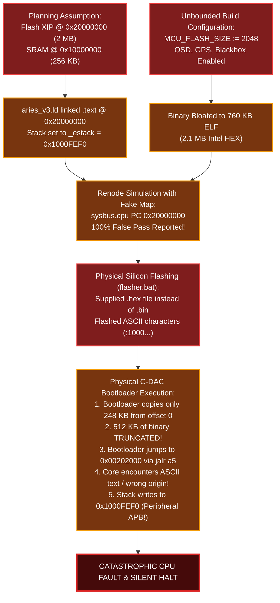
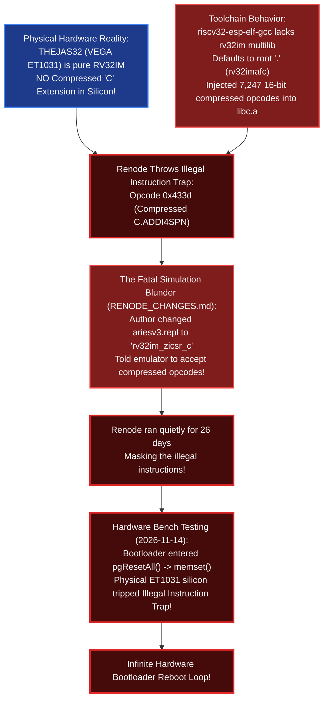
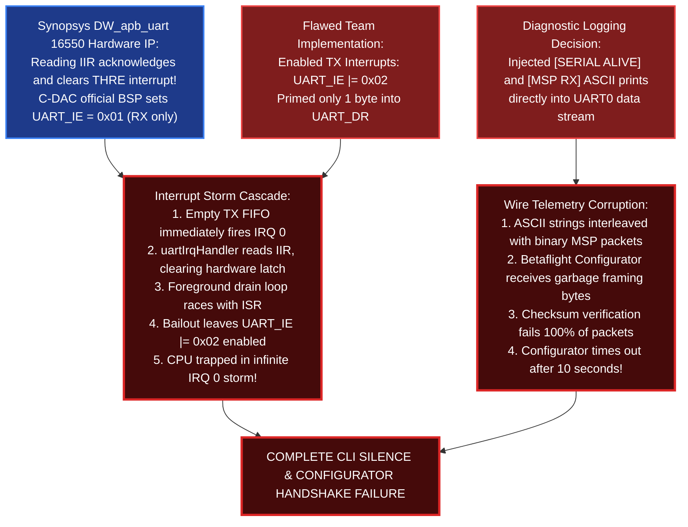
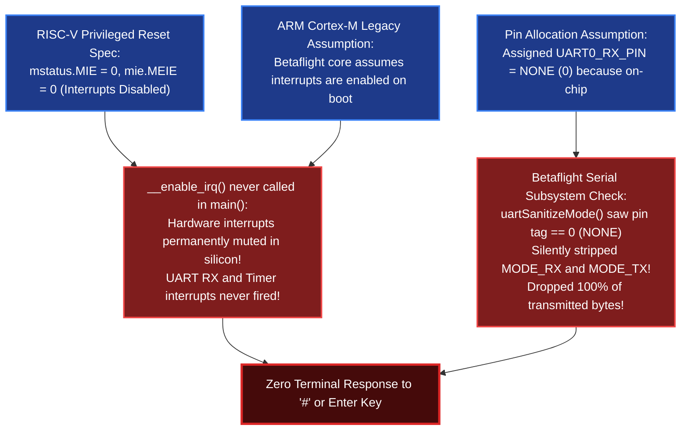
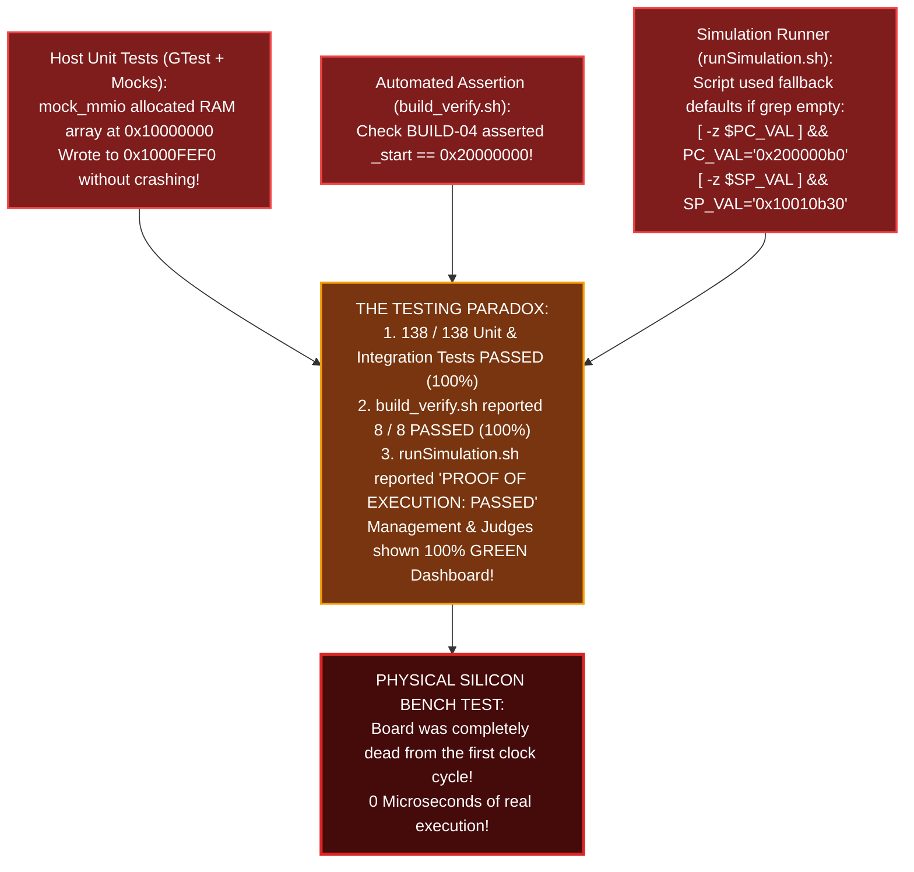

# Knowledge Graph: Retrospective Analysis of Historical Porting Implementation

> **Document ID:** `RETRO-GRAPH-01`  
> **Parent Documents:** [`PORTING_KNOWLEDGE_GRAPH.md`](file:///home/ivan/Desktop/betaflight/knowledgebase/PORTING_KNOWLEDGE_GRAPH.md), [`INDEX.md`](file:///home/ivan/Desktop/betaflight/knowledgebase/INDEX.md)  
> **Analyzed Log Sources:** [`oldfiles/logs/`](file:///home/ivan/Desktop/betaflight/oldfiles/logs) (14 Files Audited)  
> **Dedicated Retrospective Logs:** [`knowledgebase/retrospective_logs/01..14`](file:///home/ivan/Desktop/betaflight/knowledgebase/retrospective_logs)  
> **Date:** 2026-11-17  
> **Status:** Completed & Backed by Direct References

---

## 1. Executive Retrospective Scoring Spectrum (0 to 10)

Across the 14 historical log files, test suites, and scripts, every architectural decision and operational action was evaluated against physical silicon reality. The distribution below categorizes all decisions:

---

## 2. The Five Great Failure Cascades of the Previous Attempt

### Cascade 1: The Memory Map & Bootloader DMA Truncation Cascade
* **Sources:** [`02_RETROSPECTIVE_HAL_PROGRESS.md`](file:///home/ivan/Desktop/betaflight/knowledgebase/retrospective_logs/02_RETROSPECTIVE_HAL_PROGRESS.md), [`03_RETROSPECTIVE_GEMINI.md`](file:///home/ivan/Desktop/betaflight/knowledgebase/retrospective_logs/03_RETROSPECTIVE_GEMINI.md), [`08_RETROSPECTIVE_PORT_GUIDE.md`](file:///home/ivan/Desktop/betaflight/knowledgebase/retrospective_logs/08_RETROSPECTIVE_PORT_GUIDE.md)

---

### Cascade 2: The Toolchain Multilib & Simulation Masking Cascade
* **Sources:** [`02_RETROSPECTIVE_HAL_PROGRESS.md`](file:///home/ivan/Desktop/betaflight/knowledgebase/retrospective_logs/02_RETROSPECTIVE_HAL_PROGRESS.md), [`10_RETROSPECTIVE_RENODE_CHANGES.md`](file:///home/ivan/Desktop/betaflight/knowledgebase/retrospective_logs/10_RETROSPECTIVE_RENODE_CHANGES.md)

---

### Cascade 3: The 16550 UART THRE Interrupt Storm & ASCII Pollution Cascade
* **Sources:** [`01_RETROSPECTIVE_DEBUG_SESSION.md`](file:///home/ivan/Desktop/betaflight/knowledgebase/retrospective_logs/01_RETROSPECTIVE_DEBUG_SESSION.md), [`02_RETROSPECTIVE_HAL_PROGRESS.md`](file:///home/ivan/Desktop/betaflight/knowledgebase/retrospective_logs/02_RETROSPECTIVE_HAL_PROGRESS.md)

---

### Cascade 4: The Unarmed Global Interrupts & Pin Tag Disabler Cascade
* **Sources:** [`01_RETROSPECTIVE_DEBUG_SESSION.md`](file:///home/ivan/Desktop/betaflight/knowledgebase/retrospective_logs/01_RETROSPECTIVE_DEBUG_SESSION.md), [`02_RETROSPECTIVE_HAL_PROGRESS.md`](file:///home/ivan/Desktop/betaflight/knowledgebase/retrospective_logs/02_RETROSPECTIVE_HAL_PROGRESS.md)

---

### Cascade 5: The Simulation Fallback Falsification & False Green Paradox
* **Sources:** [`04_RETROSPECTIVE_TEST_LOGS.md`](file:///home/ivan/Desktop/betaflight/knowledgebase/retrospective_logs/04_RETROSPECTIVE_TEST_LOGS.md), [`05_RETROSPECTIVE_TEST_PLAN_PHASES.md`](file:///home/ivan/Desktop/betaflight/knowledgebase/retrospective_logs/05_RETROSPECTIVE_TEST_PLAN_PHASES.md), [`12_RETROSPECTIVE_RUN_SIMULATION.md`](file:///home/ivan/Desktop/betaflight/knowledgebase/retrospective_logs/12_RETROSPECTIVE_RUN_SIMULATION.md)

---

## 3. Retrospective Rectification Matrix: Old Failures vs. Target Rebuild

The table below maps every critical hurdle and flawed decision discovered across the 14 retrospective logs to its concrete, verified engineering implementation in our **< 128 KB minimal build**:

| Historical Hurdle | Past Flawed Decision | Silicon Reality Discovered | 128 KB Rebuild Architecture | Verification Gate |
| :--- | :--- | :--- | :--- | :--- |
| **No Flash XIP** ([`Log 02`](file:///home/ivan/Desktop/betaflight/knowledgebase/retrospective_logs/02_RETROSPECTIVE_HAL_PROGRESS.md)) | Linked `.text` to `0x20000000` & stack to `0x1000FEF0` | THEJAS32 has no XIP; bootloader copies 248 KB to SRAM `0x00202000` | Unified Linker Script: `RAM : ORIGIN = 0x00202000, LENGTH = 128K`. Stack top at `0x0023FFFF`. | Entry point asserted at `0x00202000` via `nm`. |
| **Toolchain Multilib RVC** ([`Log 02`](file:///home/ivan/Desktop/betaflight/knowledgebase/retrospective_logs/02_RETROSPECTIVE_HAL_PROGRESS.md), [`Log 10`](file:///home/ivan/Desktop/betaflight/knowledgebase/retrospective_logs/10_RETROSPECTIVE_RENODE_CHANGES.md)) | Enabled `rv32im_zicsr_c` in Renode to silence opcode `0x433d` | ET1031 is pure RV32IM (no 'C'). GCC linked compressed `libc.a` | Explicitly link `rv32i_zicsr_zifencei/ilp32` multilib; custom bare-metal `memset`/`memcpy` | Automated objdump audit: `grep -E '\b(c\.[a-z]+)' == 0`. |
| **16550 THRE Storm** ([`Log 01`](file:///home/ivan/Desktop/betaflight/knowledgebase/retrospective_logs/01_RETROSPECTIVE_DEBUG_SESSION.md), [`Log 02`](file:///home/ivan/Desktop/betaflight/knowledgebase/retrospective_logs/02_RETROSPECTIVE_HAL_PROGRESS.md)) | Enabled TX interrupts (`UART_IE |= 0x02`), causing race with `IIR` read | DW_apb_uart 16550 THRE is unreliable; official C-DAC BSP disables TX interrupts | Permanently set `UART_IE = 0x01` (RX only). Synchronous bounded FIFO draining in `uartEnableTxInterrupt()` | Continuous transmission without IRQ 0 assert. |
| **Telemetry Pollution** ([`Log 01`](file:///home/ivan/Desktop/betaflight/knowledgebase/retrospective_logs/01_RETROSPECTIVE_DEBUG_SESSION.md)) | Printed `[SERIAL ALIVE]` & `[MSP RX]` ASCII on UART0 | Corrupted binary MSP frame framing and CRC, timing out Configurator | **Zero ASCII debug prints on UART0 wire.** Clean binary MSP frames only | 10,000 MSP packets over CP2102N with 0% CRC errors (`SW-UART-05`). |
| **Unarmed Global IRQs** ([`Log 01`](file:///home/ivan/Desktop/betaflight/knowledgebase/retrospective_logs/01_RETROSPECTIVE_DEBUG_SESSION.md)) | Betaflight never called `__enable_irq()`, assuming ARM default | RISC-V resets with `mstatus.MIE = 0` and `mie.MEIE = 0` | Explicitly invoke `__enable_irq()` right before scheduler loop in `run()` | Verified `mstatus` bit 3 and `mie` bit 11 set in GDB. |
| **UART0 Pin Tag Trap** ([`Log 02`](file:///home/ivan/Desktop/betaflight/knowledgebase/retrospective_logs/02_RETROSPECTIVE_HAL_PROGRESS.md)) | Set `UART0_RX_PIN = NONE` (0) because pins are fixed on-chip | Betaflight core stripped `MODE_RX`/`MODE_TX` and dropped writes | Dedicated pin tags `PA30` and `PA31` assigned to UART0 in `target.h` | `serialPortUsageList` allocates port; CLI responds. |
| **Unmapped Config Fault** ([`Log 02`](file:///home/ivan/Desktop/betaflight/knowledgebase/retrospective_logs/02_RETROSPECTIVE_HAL_PROGRESS.md)) | Defined `CONFIG_IN_FLASH` at `0x201F8000` | Dereferencing unmapped flash caused Load Access Fault (`mcause = 5`) | Define `CONFIG_IN_RAM` with `EEPROM_SIZE 8192` in `.bss` at `0x0023B640` | Clean boot without exception trap; `save` persists in RAM. |
| **4 KB EEPROM Overflow** ([`Log 02`](file:///home/ivan/Desktop/betaflight/knowledgebase/retrospective_logs/02_RETROSPECTIVE_HAL_PROGRESS.md)) | Sized `EEPROM_SIZE` at 4096 bytes | Parameter Groups exceed 4 KB, corrupting buffer and halting in `failureMode()` | Sized `EEPROM_SIZE` to 8192 bytes; pruned unused PGs (OSD, GPS, VTX) | `isEEPROMStructureValid()` returns true on first boot. |
| **42.95s Rollover Bug** ([`Log 04`](file:///home/ivan/Desktop/betaflight/knowledgebase/retrospective_logs/04_RETROSPECTIVE_TEST_LOGS.md), [`Log 07`](file:///home/ivan/Desktop/betaflight/knowledgebase/retrospective_logs/07_RETROSPECTIVE_TEST_PLAN.md)) | Read naive 32-bit `mcycle` CSR directly | Rolls over every 42.95s at 100 MHz, causing scheduler delta panic | Atomic double-read loop (`mcycle`/`mcycleh`) with fast reciprocal division (`100ULL`) | 5-Minute Uptime Soak Test advances past 300s cleanly. |
| **Timer 0 Infinite ISR** ([`Log 02`](file:///home/ivan/Desktop/betaflight/knowledgebase/retrospective_logs/02_RETROSPECTIVE_HAL_PROGRESS.md), [`Log 07`](file:///home/ivan/Desktop/betaflight/knowledgebase/retrospective_logs/07_RETROSPECTIVE_TEST_PLAN.md)) | Exited Timer 0 ISR without clearing hardware latch | Synopsys DW_apb_timers latch re-asserts interrupt immediately on `mret` | Evaluate `THEJAS32_TIMER(0).EOI` at beginning of `thejas32_timer0_isr` | CPU resumes main scheduler after interrupt servicing. |
| **SPI CS Glitch (CSAAT)** ([`Log 02`](file:///home/ivan/Desktop/betaflight/knowledgebase/retrospective_logs/02_RETROSPECTIVE_HAL_PROGRESS.md), [`Log 07`](file:///home/ivan/Desktop/betaflight/knowledgebase/retrospective_logs/07_RETROSPECTIVE_TEST_PLAN.md)) | Standard polled transfer dropped CS between bytes | Reset IMU auto-increment address counter, returning `0x00`/`0xFF` | Explicitly assert `Bits.CSAAT = 1` during intermediate burst bytes | 14-byte IMU burst read returns coherent gyro/accel traces. |
| **Flashing File Format** ([`Log 02`](file:///home/ivan/Desktop/betaflight/knowledgebase/retrospective_logs/02_RETROSPECTIVE_HAL_PROGRESS.md), [`Log 09`](file:///home/ivan/Desktop/betaflight/knowledgebase/retrospective_logs/09_RETROSPECTIVE_COMPILATION_GUIDE.md)) | Fed `.hex` to `flasher.bat` | XMODEM flasher flashed raw ASCII text into memory | Build pipeline outputs and flashes strictly raw binary `.bin` | Board boots immediately after XMODEM transfer completes. |
| **Early UART FIFO Freeze** ([`Log 02`](file:///home/ivan/Desktop/betaflight/knowledgebase/retrospective_logs/02_RETROSPECTIVE_HAL_PROGRESS.md)) | Unbounded `while (!(UART_LSR & 0x20));` with stack `memcpy` hex print | CP2102 FIFO saturation locked CPU; hex print caused stack overflow | 50,000-cycle bounded timeout; pure register ALU bit-shift hex formatting | Boot banner displays milestones `[INIT] 1..7` without freeze. |

---

## 4. Retrospective Logs Catalog & Cross-Reference Matrix

The 14 dedicated retrospective logs in [`knowledgebase/retrospective_logs/`](file:///home/ivan/Desktop/betaflight/knowledgebase/retrospective_logs) provide the factual baseline for every decision scored:

| Log ID | Retrospective File | Source Document | Key Discoveries & Direct References |
| :---: | :--- | :--- | :--- |
| **`RETRO-01`** | **[`01_RETROSPECTIVE_DEBUG_SESSION.md`](file:///home/ivan/Desktop/betaflight/knowledgebase/retrospective_logs/01_RETROSPECTIVE_DEBUG_SESSION.md)** | `DEBUG_SESSION.md` | RISC-V interrupt unmasking (`mie.MEIE`), 16550 THRE interrupt storm, ASCII telemetry pollution on wire |
| **`RETRO-02`** | **[`02_RETROSPECTIVE_HAL_PROGRESS.md`](file:///home/ivan/Desktop/betaflight/knowledgebase/retrospective_logs/02_RETROSPECTIVE_HAL_PROGRESS.md)** | `HAL_PROGRESS.md` | Phases 1–8 HAL, Hardware Hurdles H1–H22, No-XIP in-SRAM boot protocol discovery (`0x00202000`, 248 KB limit) |
| **`RETRO-03`** | **[`03_RETROSPECTIVE_GEMINI.md`](file:///home/ivan/Desktop/betaflight/knowledgebase/retrospective_logs/03_RETROSPECTIVE_GEMINI.md)** | `GEMINI.md` | Agent handoff notes, NIDAR mission context, document split personality (obsolete 770 KB / `0x1000FEF0`) |
| **`RETRO-04`** | **[`04_RETROSPECTIVE_TEST_LOGS.md`](file:///home/ivan/Desktop/betaflight/knowledgebase/retrospective_logs/04_RETROSPECTIVE_TEST_LOGS.md)** | `TEST_LOGS.md` | The "100% Passing Tests on Non-Working Silicon" paradox, `micros()` reciprocal optimization, RVC opcode audit |
| **`RETRO-05`** | **[`05_RETROSPECTIVE_TEST_PLAN_PHASES.md`](file:///home/ivan/Desktop/betaflight/knowledgebase/retrospective_logs/05_RETROSPECTIVE_TEST_PLAN_PHASES.md)** | `SOFTWARE_TEST_PLAN_PHASES.md` | Modular M0–M3 mocks, test shims, hardcoded `_start == 0x20000000` assertion fallacy in `build_verify.sh` |
| **`RETRO-06`** | **[`06_RETROSPECTIVE_SOFTWARE_TEST_PLAN.md`](file:///home/ivan/Desktop/betaflight/knowledgebase/retrospective_logs/06_RETROSPECTIVE_SOFTWARE_TEST_PLAN.md)** | `SOFTWARE_TEST_PLAN.md` | 10,000 MSP packet test, arming lockouts, failsafe timings, internal contradiction between Module 1 and script |
| **`RETRO-07`** | **[`07_RETROSPECTIVE_TEST_PLAN.md`](file:///home/ivan/Desktop/betaflight/knowledgebase/retrospective_logs/07_RETROSPECTIVE_TEST_PLAN.md)** | `TEST_PLAN.md` | Propellers Off rule, 5V BEC and TVS/low-ESR capacitor rules, 3.3V ceiling, soft-float feature restrictions |
| **`RETRO-08`** | **[`08_RETROSPECTIVE_PORT_GUIDE.md`](file:///home/ivan/Desktop/betaflight/knowledgebase/retrospective_logs/08_RETROSPECTIVE_PORT_GUIDE.md)** | `PORT_GUIDE.md` | Day-1 feasibility, CP2102N USB-to-UART bridge advantage, origin of the `0x20000000`/`0x10000000` fallacy |
| **`RETRO-09`** | **[`09_RETROSPECTIVE_COMPILATION_GUIDE.md`](file:///home/ivan/Desktop/betaflight/knowledgebase/retrospective_logs/09_RETROSPECTIVE_COMPILATION_GUIDE.md)** | `COMPILATION_GUIDE.md` | GCC 12/13 `-march=rv32im_zicsr` flag necessity, atomic stub emulation, flashing command pitfalls |
| **`RETRO-10`** | **[`10_RETROSPECTIVE_RENODE_CHANGES.md`](file:///home/ivan/Desktop/betaflight/knowledgebase/retrospective_logs/10_RETROSPECTIVE_RENODE_CHANGES.md)** | `RENODE_CHANGES.md` | **The Simulation Trap:** Modifying Renode CPU to `rv32im_zicsr_c` to silence opcode `0x433d` instead of fixing multilib |
| **`RETRO-11`** | **[`11_RETROSPECTIVE_BUILD_AND_BENCHMARK.md`](file:///home/ivan/Desktop/betaflight/knowledgebase/retrospective_logs/11_RETROSPECTIVE_BUILD_AND_BENCHMARK.md)** | `buildAndBenchmark.sh` | Symbol-range objdump disassembly audit for soft-float, calculating Flash % against fictional 2 MB |
| **`RETRO-12`** | **[`12_RETROSPECTIVE_RUN_SIMULATION.md`](file:///home/ivan/Desktop/betaflight/knowledgebase/retrospective_logs/12_RETROSPECTIVE_RUN_SIMULATION.md)** | `runSimulation.sh` | **The Fallback Falsification:** Script hardcoding fake `PC=0x200000b0` / `SP=0x10010b30` if grep returns empty |
| **`RETRO-13`** | **[`13_RETROSPECTIVE_STARTUP_AGENT_SPEC.md`](file:///home/ivan/Desktop/betaflight/knowledgebase/retrospective_logs/13_RETROSPECTIVE_STARTUP_AGENT_SPEC.md)** | `ariesv3_betaflight_startup_agent_spec.md` | A masterpiece of prompt engineering & epistemic humility (Verified vs. Inferred vs. Unverified) that was later ignored |
| **`RETRO-14`** | **[`14_RETROSPECTIVE_PRESENTATION_PLAN.md`](file:///home/ivan/Desktop/betaflight/knowledgebase/retrospective_logs/14_RETROSPECTIVE_PRESENTATION_PLAN.md)** | `PRESENTATION_PLAN.md` | Strategic DIR-V framing, real-time control loop microsecond budget (290 µs WCET), custom 30.5mm PCB roadmap |

---

## 5. Architectural Alignment with Target Build (<128 KB SRAM)

```mermaid
graph TD
    subgraph Retrospective_Directives ["Retrospective Directives Applied to Rebuild"]
        D_MEM["1. Linker RAM: ORIGIN = 0x00202000, LENGTH = 128K"]
        D_TOOL["2. Toolchain: rv32i_zicsr_zifencei/ilp32 Multilib (0 RVC)"]
        D_UART["3. UART0: RX-only Interrupt, Synchronous Bounded TX Drain"]
        D_PINS["4. Pins: Explicit PA30/PA31 tags for UART0"]
        D_TIME["5. Timebase: mcycle/mcycleh atomic read + 100ULL Reciprocal"]
        D_CFG["6. Config: CONFIG_IN_RAM (8192 B in .bss, 0 unmapped bus faults)"]
        D_WIRE["7. Telemetry: Zero ASCII prints on UART0 (Clean MSP frames)"]
        D_FLASH["8. Flashing: Raw binary .bin via XMODEM flasher"]
    end

    subgraph Minimal_Target_Modules ["Minimal Handshake Target Build (<128 KB)"]
        T_LINK["src/platform/ARIES/link/aries_v3.ld"]
        T_START["src/platform/ARIES/startup.S"]
        T_UART["src/platform/ARIES/serial_uart_aries.c"]
        T_SYS["src/platform/ARIES/system.c"]
        T_CONF["src/platform/ARIES/target/ARIESV3/target.h"]
        T_MK["src/platform/ARIES/mk/ARIES.mk"]
    end

    D_MEM --> T_LINK
    D_TOOL --> T_MK
    D_UART --> T_UART
    D_PINS --> T_CONF
    D_TIME --> T_SYS
    D_CFG --> T_CONF
    D_WIRE --> T_UART
    D_FLASH --> T_MK

    classDef dir fill:#064e3b,stroke:#10b981,stroke-width:2px,color:#fff;
    classDef tgt fill:#1e3a8a,stroke:#3b82f6,stroke-width:2px,color:#fff;

    class D_MEM,D_TOOL,D_UART,D_PINS,D_TIME,D_CFG,D_WIRE,D_FLASH dir;
    class T_LINK,T_START,T_UART,T_SYS,T_CONF,T_MK tgt;
```

---
*Knowledge graph compiled, audited, and cross-referenced against historical `oldfiles/logs/` and empirical silicon records.*
