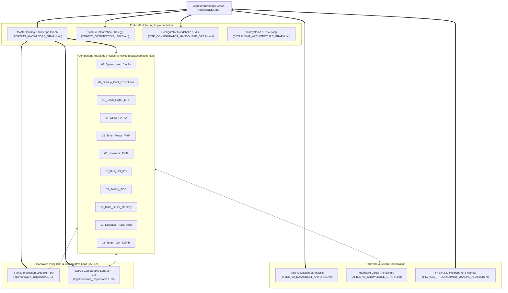

# Betaflight Porting Knowledge Graph Index (ARIES v3.0 / THEJAS32)

Welcome to the central Knowledge Graph index for the **Betaflight Port to ARIES v3.0 (THEJAS32 SoC / VEGA ET1031 RISC-V)**.

This index interconnects hardware datasheets, programming manuals, protocol specifications, target optimization strategies, official Betaflight architecture documentation, **25 deep hardware inspection logs**, and **11 component knowledge nodes** into a fully navigable, non-hallucinated knowledge graph.

---

## 1. High-Level Knowledge Graph Overview

---

## 2. Porting Component Knowledge Nodes (`knowledgebase/components/`)

| Node ID | Component Document | Focus & Implementation Scope | Backed References |
| :---: | :--- | :--- | :--- |
| **`PORT-COMP-01`** | **[01_SYSTEM_AND_CLOCKS.md](file:///home/ivan/Desktop/betaflight/knowledgebase/components/01_SYSTEM_AND_CLOCKS.md)** | 100 MHz timebase, 64-bit `mtime` up-counter (`0x0200BFF8`), eliminating SysTick rollover race, `micros()` and `millis()` APIs | [01_STM32_COMMON_SYSTEM.md](file:///home/ivan/Desktop/betaflight/logs/hardware_inspection/01_STM32_COMMON_SYSTEM.md), [17_ESP32_SYSTEM_AND_TIMER.md](file:///home/ivan/Desktop/betaflight/logs/hardware_inspection/17_ESP32_SYSTEM_AND_TIMER.md) |
| **`PORT-COMP-02`** | **[02_STARTUP_BOOT_AND_EXCEPTIONS.md](file:///home/ivan/Desktop/betaflight/knowledgebase/components/02_STARTUP_BOOT_AND_EXCEPTIONS.md)** | Assembly `crt.S`, `Reset_Handler`, stack watermarking (`0xA5A5A5A5`), `mtvec` trap dispatcher, `mcause` decoding, reboot token safety | [02_STM32_SYSTEM_INIT.md](file:///home/ivan/Desktop/betaflight/logs/hardware_inspection/02_STM32_SYSTEM_INIT.md), [03_STM32_STARTUP_ASSEMBLY.md](file:///home/ivan/Desktop/betaflight/logs/hardware_inspection/03_STM32_STARTUP_ASSEMBLY.md), [04_STM32_FAULT_HANDLERS.md](file:///home/ivan/Desktop/betaflight/logs/hardware_inspection/04_STM32_FAULT_HANDLERS.md) |
| **`PORT-COMP-03`** | **[03_SERIAL_UART_AND_MSP.md](file:///home/ivan/Desktop/betaflight/knowledgebase/components/03_SERIAL_UART_AND_MSP.md)** | 16550 UART0 (`0x10000100`), divisor math @ 100 MHz (Divisor 54, +0.47% error), CP2102N bridge (Pins 107/108), ORE unfreeze, MSP parser state machine | [05_STM32_SERIAL_UART_HW.md](file:///home/ivan/Desktop/betaflight/logs/hardware_inspection/05_STM32_SERIAL_UART_HW.md), [06_STM32_SERIAL_UART_DRIVER.md](file:///home/ivan/Desktop/betaflight/logs/hardware_inspection/06_STM32_SERIAL_UART_DRIVER.md), [15_MSP_SERIAL_PARSER.md](file:///home/ivan/Desktop/betaflight/logs/hardware_inspection/15_MSP_SERIAL_PARSER.md), [18_ESP32_SERIAL_UART.md](file:///home/ivan/Desktop/betaflight/logs/hardware_inspection/18_ESP32_SERIAL_UART.md) |
| **`PORT-COMP-04`** | **[04_GPIO_AND_PIN_IO.md](file:///home/ivan/Desktop/betaflight/knowledgebase/components/04_GPIO_AND_PIN_IO.md)** | Flat 32-bit GPIO controller (`0x10000000`), $O(1)$ direct array index `&ioRecs[pin]` (256 bytes SRAM), eliminating multi-bank popcount tables | [08_STM32_IO_IMPL.md](file:///home/ivan/Desktop/betaflight/logs/hardware_inspection/08_STM32_IO_IMPL.md), [19_ESP32_IO_IMPL.md](file:///home/ivan/Desktop/betaflight/logs/hardware_inspection/19_ESP32_IO_IMPL.md) |
| **`PORT-COMP-05`** | **[05_TIMER_AND_MOTOR_PWM.md](file:///home/ivan/Desktop/betaflight/knowledgebase/components/05_TIMER_AND_MOTOR_PWM.md)** | Dedicated 8-channel PWM controller (`0x10000600`), uniform 100 MHz clock, eliminating APB multipliers and DMA collisions, non-null VTable safety | [09_STM32_TIMER_PWM_HW.md](file:///home/ivan/Desktop/betaflight/logs/hardware_inspection/09_STM32_TIMER_PWM_HW.md), [22_ESP32_PWM_DSHOT.md](file:///home/ivan/Desktop/betaflight/logs/hardware_inspection/22_ESP32_PWM_DSHOT.md) |
| **`PORT-COMP-06`** | **[06_INTERRUPTS_AND_EXTI.md](file:///home/ivan/Desktop/betaflight/knowledgebase/components/06_INTERRUPTS_AND_EXTI.md)** | Platform-Level Interrupt Controller (`PLIC` @ `0x0C000000`), single centralized GPIO ISR with `__builtin_ctz()` dispatch, Gyro data-ready synchronization | [08_STM32_IO_IMPL.md](file:///home/ivan/Desktop/betaflight/logs/hardware_inspection/08_STM32_IO_IMPL.md), [16_SCHEDULER_CORE.md](file:///home/ivan/Desktop/betaflight/logs/hardware_inspection/16_SCHEDULER_CORE.md), [20_ESP32_INTERRUPT_MODEL.md](file:///home/ivan/Desktop/betaflight/logs/hardware_inspection/20_ESP32_INTERRUPT_MODEL.md), [24_ESP32_DMA_AND_EXTI.md](file:///home/ivan/Desktop/betaflight/logs/hardware_inspection/24_ESP32_DMA_AND_EXTI.md) |
| **`PORT-COMP-07`** | **[07_BUS_SPI_AND_I2C.md](file:///home/ivan/Desktop/betaflight/knowledgebase/components/07_BUS_SPI_AND_I2C.md)** | Polled SPI0 (Flash `U5`) & SPI3 (IMU `J4`), polled I2C2 (`U9`), avoiding Cortex-M7 L1 D-Cache invalidations and GDMA bounce buffers, 9-pulse unstick routine | [10_STM32_BUS_SPI_HW.md](file:///home/ivan/Desktop/betaflight/logs/hardware_inspection/10_STM32_BUS_SPI_HW.md), [21_ESP32_BUS_SPI_I2C.md](file:///home/ivan/Desktop/betaflight/logs/hardware_inspection/21_ESP32_BUS_SPI_I2C.md) |
| **`PORT-COMP-08`** | **[08_ANALOG_ADC_SUBSYSTEM.md](file:///home/ivan/Desktop/betaflight/knowledgebase/components/08_ANALOG_ADC_SUBSYSTEM.md)** | Hardware reality: off-chip 4-channel I2C ADC (`U9`), omission of DMA, static RAM cache `aries_adc_raw[4]`, boot telemetry mock strategy | [11_STM32_ADC_IMPL.md](file:///home/ivan/Desktop/betaflight/logs/hardware_inspection/11_STM32_ADC_IMPL.md), [23_ESP32_ADC.md](file:///home/ivan/Desktop/betaflight/logs/hardware_inspection/23_ESP32_ADC.md) |
| **`PORT-COMP-09`** | **[09_BUILD_LINKER_AND_MEMORY.md](file:///home/ivan/Desktop/betaflight/knowledgebase/components/09_BUILD_LINKER_AND_MEMORY.md)** | RISC-V RV32IM toolchain flags (`-mabi=ilp32`), single-allocator 250 KB SRAM script (`linker_ram.lds`), Parameter Group anchors (`.pg_registry`), `dma_stub` mechanics | [12_STM32_LINKER_AND_SECTIONS.md](file:///home/ivan/Desktop/betaflight/logs/hardware_inspection/12_STM32_LINKER_AND_SECTIONS.md), [13_STM32_BUILD_MAKEFILE.md](file:///home/ivan/Desktop/betaflight/logs/hardware_inspection/13_STM32_BUILD_MAKEFILE.md), [25_ESP32_BUILD_AND_LINKER.md](file:///home/ivan/Desktop/betaflight/logs/hardware_inspection/25_ESP32_BUILD_AND_LINKER.md) |
| **`PORT-COMP-10`** | **[10_SCHEDULER_AND_TASK_ARCHITECTURE.md](file:///home/ivan/Desktop/betaflight/knowledgebase/components/10_SCHEDULER_AND_TASK_ARCHITECTURE.md)** | 3-stage boot lifecycle (`initPhase1..3`), cooperative non-preemptive scheduler loop, deterministic task timing, `TASK_SERIAL` non-blocking guarantee | [14_MAIN_STARTUP_FLOW.md](file:///home/ivan/Desktop/betaflight/logs/hardware_inspection/14_MAIN_STARTUP_FLOW.md), [15_MSP_SERIAL_PARSER.md](file:///home/ivan/Desktop/betaflight/logs/hardware_inspection/15_MSP_SERIAL_PARSER.md), [16_SCHEDULER_CORE.md](file:///home/ivan/Desktop/betaflight/logs/hardware_inspection/16_SCHEDULER_CORE.md) |
| **`PORT-COMP-11`** | **[11_TARGET_OPTIMIZATION_BUDGET.md](file:///home/ivan/Desktop/betaflight/knowledgebase/components/11_TARGET_OPTIMIZATION_BUDGET.md)** | Exact modular stripping flags, footprint breakdown (~72 KB total), compiler/linker directives, board configuration `target.h` and `target.mk` | [TARGET_OPTIMIZATION_128KB.md](file:///home/ivan/Desktop/betaflight/knowledgebase/TARGET_OPTIMIZATION_128KB.md), [13_STM32_BUILD_MAKEFILE.md](file:///home/ivan/Desktop/betaflight/logs/hardware_inspection/13_STM32_BUILD_MAKEFILE.md), [25_ESP32_BUILD_AND_LINKER.md](file:///home/ivan/Desktop/betaflight/logs/hardware_inspection/25_ESP32_BUILD_AND_LINKER.md) |

---

## 3. Master Porting Architecture & Reference Catalog

| Node Document | Primary Focus | Key Entities & Concepts Covered |
| :--- | :--- | :--- |
| **[PORTING_KNOWLEDGE_GRAPH.md](file:///home/ivan/Desktop/betaflight/knowledgebase/PORTING_KNOWLEDGE_GRAPH.md)** | **Master Porting Blueprint** | End-to-end component-by-component implementation architecture for ARIES v3.0 (RV32IM, 16550 UART0, 64-bit mtime, Flat GPIO, 8-Ch PWM, Polled SPI/I2C, SRAM Boot, <128KB Target) |
| **[ARIES_V3_DATASHEET_ANALYSIS.md](file:///home/ivan/Desktop/betaflight/knowledgebase/ARIES_V3_DATASHEET_ANALYSIS.md)** | Hardware Specifications | THEJAS32 SoC, VEGA ET1031, Pinout, 2023 vs 2024 revisions, CP2102N, Power tree |
| **[ARIES_V3_KNOWLEDGE_GRAPH.md](file:///home/ivan/Desktop/betaflight/knowledgebase/ARIES_V3_KNOWLEDGE_GRAPH.md)** | Visual Topology & ER Graph | Board power distribution, SoC peripherals, Betaflight pin allocation matrix, entity relationships |
| **[THEJAS32_PROGRAMMER_MANUAL_ANALYSIS.md](file:///home/ivan/Desktop/betaflight/knowledgebase/THEJAS32_PROGRAMMER_MANUAL_ANALYSIS.md)** | Core & Programming Model | RISC-V RV32IM ISA, 250KB SRAM at `0x200000`, 16550 UART registers, `crt.S`, XMODEM loader |
| **[MSP_CONFIGURATOR_HANDSHAKE_GRAPH.md](file:///home/ivan/Desktop/betaflight/knowledgebase/MSP_CONFIGURATOR_HANDSHAKE_GRAPH.md)** | Serial Protocol & Handshake | MultiWii Serial Protocol v1/v2, 7-step handshake sequence, packet framing, CP2102N UART0 streaming |
| **[TARGET_OPTIMIZATION_128KB.md](file:///home/ivan/Desktop/betaflight/knowledgebase/TARGET_OPTIMIZATION_128KB.md)** | Sizing Strategy (<128KB) | Modular feature stripping (`USE_...` defines), `-Wl,--gc-sections`, `-Os`, RAM execution footprint |
| **[BETAFLIGHT_ARCHITECTURE_GRAPH.md](file:///home/ivan/Desktop/betaflight/knowledgebase/BETAFLIGHT_ARCHITECTURE_GRAPH.md)** | Subsystems & Execution Loop | Cooperative task scheduler (`taskTable`), `extDevice_t` and `busDevice_t` abstractions, Driver hierarchy |

---

## 4. Hardware Inspection Logs Directory (`logs/hardware_inspection/`)

### A. STM32 Reference Platform Logs (Logs 01 – 16)
1. **[01_STM32_COMMON_SYSTEM.md](file:///home/ivan/Desktop/betaflight/logs/hardware_inspection/01_STM32_COMMON_SYSTEM.md)**: System Clocks, SysTick Rollover Race Condition, DWT Cycle Counter Unlock.
2. **[02_STM32_SYSTEM_INIT.md](file:///home/ivan/Desktop/betaflight/logs/hardware_inspection/02_STM32_SYSTEM_INIT.md)**: Hardware `systemInit()`, Persistent Bootloader Tokens, Peripheral Clock Gating, VTOR Relocation.
3. **[03_STM32_STARTUP_ASSEMBLY.md](file:///home/ivan/Desktop/betaflight/logs/hardware_inspection/03_STM32_STARTUP_ASSEMBLY.md)**: `Reset_Handler`, DFU Hook, Stack Watermarking (`0xA5A5A5A5`), FPU Enablement.
4. **[04_STM32_FAULT_HANDLERS.md](file:///home/ivan/Desktop/betaflight/logs/hardware_inspection/04_STM32_FAULT_HANDLERS.md)**: Naked Exception Handlers, MSP/PSP Stack Pointer Extraction, SCB Fault Register Logging.
5. **[05_STM32_SERIAL_UART_HW.md](file:///home/ivan/Desktop/betaflight/logs/hardware_inspection/05_STM32_SERIAL_UART_HW.md)**: UART Hardware Abstraction Layer, Inversion Constraints, Half-Duplex Single-Wire Open-Drain.
6. **[06_STM32_SERIAL_UART_DRIVER.md](file:///home/ivan/Desktop/betaflight/logs/hardware_inspection/06_STM32_SERIAL_UART_DRIVER.md)**: `uartIrqHandler`, ORE Overrun Unfreeze, IDLE Clear Sequence, TXE CPU Spinning Fix.
7. **[07_STM32_SERIAL_UART_PINCONFIG.md](file:///home/ivan/Desktop/betaflight/logs/hardware_inspection/07_STM32_SERIAL_UART_PINCONFIG.md)**: Dynamic Alternate Function Matching, Silicon Pin Swap Detection.
8. **[08_STM32_IO_IMPL.md](file:///home/ivan/Desktop/betaflight/logs/hardware_inspection/08_STM32_IO_IMPL.md)**: Multi-Bank GPIOA–I Pin Abstraction, Sparse Bitmask Compression via `popcount`.
9. **[09_STM32_TIMER_PWM_HW.md](file:///home/ivan/Desktop/betaflight/logs/hardware_inspection/09_STM32_TIMER_PWM_HW.md)**: Asymmetric APB1/APB2 Timer Multipliers, Fixed DMA Channel Collision Matrix.
10. **[10_STM32_BUS_SPI_HW.md](file:///home/ivan/Desktop/betaflight/logs/hardware_inspection/10_STM32_BUS_SPI_HW.md)**: Cortex-M7 L1 D-Cache Coherency Invalidation, STM32F4 DMA2 Errata 2.1.10.
11. **[11_STM32_ADC_IMPL.md](file:///home/ivan/Desktop/betaflight/logs/hardware_inspection/11_STM32_ADC_IMPL.md)**: Multi-Channel DMA Scan Sequence Decoupling, Factory Bandgap Calibration (`VREFINTCAL`).
12. **[12_STM32_LINKER_AND_SECTIONS.md](file:///home/ivan/Desktop/betaflight/logs/hardware_inspection/12_STM32_LINKER_AND_SECTIONS.md)**: Uneven Flash Sector Splitting (16 KB vs 128 KB), Hot Reboot Flag Reservation.
13. **[13_STM32_BUILD_MAKEFILE.md](file:///home/ivan/Desktop/betaflight/logs/hardware_inspection/13_STM32_BUILD_MAKEFILE.md)**: Multi-Tier Optimization (`-O3` vs `-Os`), Native USB Middleware Savings (~30 KB).
14. **[14_MAIN_STARTUP_FLOW.md](file:///home/ivan/Desktop/betaflight/logs/hardware_inspection/14_MAIN_STARTUP_FLOW.md)**: Phased Boot Sequence (`initPhase1..3`), Cooperative Main Loop `scheduler()`.
15. **[15_MSP_SERIAL_PARSER.md](file:///home/ivan/Desktop/betaflight/logs/hardware_inspection/15_MSP_SERIAL_PARSER.md)**: Zero-Allocation Heapless MSP State Machine, Line Noise Resynchronization.
16. **[16_SCHEDULER_CORE.md](file:///home/ivan/Desktop/betaflight/logs/hardware_inspection/16_SCHEDULER_CORE.md)**: Cooperative Multitasking, Gyro EXTI Software PLL, `TASK_SERIAL` Non-Blocking Guarantee.

### B. ESP32 Cross-Architecture Comparative Logs (Logs 17 – 25)
17. **[17_ESP32_SYSTEM_AND_TIMER.md](file:///home/ivan/Desktop/betaflight/logs/hardware_inspection/17_ESP32_SYSTEM_AND_TIMER.md)**: Empty Timer Hardware Array (`fullTimerHardware[1]`), 64-bit `SYSTIMER` at 16 MHz. *(vs Logs 01 & 09)*
18. **[18_ESP32_SERIAL_UART.md](file:///home/ivan/Desktop/betaflight/logs/hardware_inspection/18_ESP32_SERIAL_UART.md)**: Universal GPIO Matrix Crossbar, 128-byte Hardware FIFOs, Dynamic Interrupt Attachment. *(vs Logs 05, 06, 07)*
19. **[19_ESP32_IO_IMPL.md](file:///home/ivan/Desktop/betaflight/logs/hardware_inspection/19_ESP32_IO_IMPL.md)**: Single Flat GPIO Port (`DEFIO_PORT_USED_COUNT == 1`), $O(1)$ Direct Array Index `&ioRecs[pinIdx]`. *(vs Log 08)*
20. **[20_ESP32_INTERRUPT_MODEL.md](file:///home/ivan/Desktop/betaflight/logs/hardware_inspection/20_ESP32_INTERRUPT_MODEL.md)**: Dynamic Peripheral Interrupt Routing Matrix vs Static NVIC Vector Table. *(vs Logs 03 & 04)*
21. **[21_ESP32_BUS_SPI_I2C.md](file:///home/ivan/Desktop/betaflight/logs/hardware_inspection/21_ESP32_BUS_SPI_I2C.md)**: GDMA Descriptors, Word Alignment Bounce Buffers, 64-byte Polled Bypass, I2C Command-list Coprocessor. *(vs Log 10)*
22. **[22_ESP32_PWM_DSHOT.md](file:///home/ivan/Desktop/betaflight/logs/hardware_inspection/22_ESP32_PWM_DSHOT.md)**: LEDC Fractional Clock Division, RMT Pulse-train Dedicated SRAM, Non-null VTable Safety. *(vs Log 09)*
23. **[23_ESP32_ADC.md](file:///home/ivan/Desktop/betaflight/logs/hardware_inspection/23_ESP32_ADC.md)**: On-demand Polled Oneshot ADC, Non-DMA Execution, Linear GPIO Mapping. *(vs Log 11)*
24. **[24_ESP32_DMA_AND_EXTI.md](file:///home/ivan/Desktop/betaflight/logs/hardware_inspection/24_ESP32_DMA_AND_EXTI.md)**: Centralized GPIO Interrupt with `__builtin_ctz` Dispatch, Dynamic CPU Interrupt Pool. *(vs Logs 08 & 10)*
25. **[25_ESP32_BUILD_AND_LINKER.md](file:///home/ivan/Desktop/betaflight/logs/hardware_inspection/25_ESP32_BUILD_AND_LINKER.md)**: RISC-V 32-bit RV32IM Toolchain Flags, Parameter Group Linker Anchors, Single-Allocator RAM. *(vs Logs 12 & 13)*

---

## 5. Upstream Submodule Documentation
* [betaflight.com/docs/development/App-Architecture.mdx](file:///home/ivan/Desktop/betaflight/knowledgebase/betaflight.com/docs/development/App-Architecture.mdx): Complete Vue 3 / Pinia / MSP client architecture of the Betaflight Configurator.
* [betaflight.com/docs/development/MSP-Protocol-Reference-Dev.md](file:///home/ivan/Desktop/betaflight/knowledgebase/betaflight.com/docs/development/MSP-Protocol-Reference-Dev.md): Comprehensive reference of all MSP v1 & v2 commands, offsets, and field structures.
* [betaflight.com/docs/development/Defines.md](file:///home/ivan/Desktop/betaflight/knowledgebase/betaflight.com/docs/development/Defines.md): Complete index of all `USE_` and `ENABLE_` feature flags used in Betaflight builds.
* [betaflight.com/docs/development/API/BusDrivers.md](file:///home/ivan/Desktop/betaflight/knowledgebase/betaflight.com/docs/development/API/BusDrivers.md): Specifications for bus-agnostic device access (`busReadRegister`, `busWriteRegister`, DMA segments).
