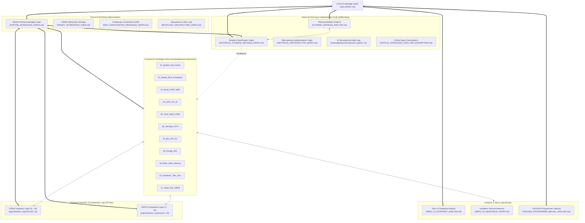

# Betaflight Porting Knowledge Graph Index (ARIES v3.0 / THEJAS32)

Welcome to the central Knowledge Graph index for the **Betaflight Port to ARIES v3.0 (THEJAS32 SoC / VEGA ET1031 RISC-V)**.

This index interconnects hardware datasheets, programming manuals, protocol specifications, target optimization strategies, official Betaflight architecture documentation, **25 deep hardware inspection logs**, **11 component knowledge nodes**, and **audited historical planning mistake analyses** into a fully navigable, non-hallucinated knowledge graph.

---

## 1. High-Level Knowledge Graph Overview

---

## 2. Porting Component Knowledge Nodes (`knowledgebase/components/`)

| Node ID | Component Document | Focus & Implementation Scope | Backed References |
| :---: | :--- | :--- | :--- |
| **`PORT-COMP-01`** | **[01_SYSTEM_AND_CLOCKS.md](components/01_SYSTEM_AND_CLOCKS.md)** | 100 MHz timebase, 64-bit `mtime` up-counter (`0x0200BFF8`), eliminating SysTick rollover race, atomic double-read loop, `micros()` & `millis()` APIs | [01_STM32_COMMON_SYSTEM.md](../logs/hardware_inspection/01_STM32_COMMON_SYSTEM.md), [17_ESP32_SYSTEM_AND_TIMER.md](../logs/hardware_inspection/17_ESP32_SYSTEM_AND_TIMER.md) |
| **`PORT-COMP-02`** | **[02_STARTUP_BOOT_AND_EXCEPTIONS.md](components/02_STARTUP_BOOT_AND_EXCEPTIONS.md)** | Assembly `crt.S`, `Reset_Handler`, stack watermarking (`0xA5A5A5A5`), `mtvec` trap dispatcher, `mcause` decoding, reboot token safety | [02_STM32_SYSTEM_INIT.md](../logs/hardware_inspection/02_STM32_SYSTEM_INIT.md), [03_STM32_STARTUP_ASSEMBLY.md](../logs/hardware_inspection/03_STM32_STARTUP_ASSEMBLY.md), [04_STM32_FAULT_HANDLERS.md](../logs/hardware_inspection/04_STM32_FAULT_HANDLERS.md) |
| **`PORT-COMP-03`** | **[03_SERIAL_UART_AND_MSP.md](components/03_SERIAL_UART_AND_MSP.md)** | 16550 UART0 (`0x10000100`), divisor math @ 100 MHz (Divisor 54, +0.47% error), CP2102N bridge (Pins 107/108), ORE unfreeze, MSP parser state machine | [05_STM32_SERIAL_UART_HW.md](../logs/hardware_inspection/05_STM32_SERIAL_UART_HW.md), [06_STM32_SERIAL_UART_DRIVER.md](../logs/hardware_inspection/06_STM32_SERIAL_UART_DRIVER.md), [15_MSP_SERIAL_PARSER.md](../logs/hardware_inspection/15_MSP_SERIAL_PARSER.md), [18_ESP32_SERIAL_UART.md](../logs/hardware_inspection/18_ESP32_SERIAL_UART.md) |
| **`PORT-COMP-04`** | **[04_GPIO_AND_PIN_IO.md](components/04_GPIO_AND_PIN_IO.md)** | Flat 32-bit GPIO controller (`0x10000000`), $O(1)$ direct array index `&ioRecs[pin]` (256 bytes SRAM), eliminating multi-bank popcount tables | [08_STM32_IO_IMPL.md](../logs/hardware_inspection/08_STM32_IO_IMPL.md), [19_ESP32_IO_IMPL.md](../logs/hardware_inspection/19_ESP32_IO_IMPL.md) |
| **`PORT-COMP-05`** | **[05_TIMER_AND_MOTOR_PWM.md](components/05_TIMER_AND_MOTOR_PWM.md)** | Dedicated 8-channel PWM controller (`0x10000600`), uniform 100 MHz clock, eliminating APB multipliers and DMA collisions, non-null VTable safety | [09_STM32_TIMER_PWM_HW.md](../logs/hardware_inspection/09_STM32_TIMER_PWM_HW.md), [22_ESP32_PWM_DSHOT.md](../logs/hardware_inspection/22_ESP32_PWM_DSHOT.md) |
| **`PORT-COMP-06`** | **[06_INTERRUPTS_AND_EXTI.md](components/06_INTERRUPTS_AND_EXTI.md)** | Platform-Level Interrupt Controller (`PLIC` @ `0x0C000000`), single centralized GPIO ISR with `__builtin_ctz()` dispatch, Gyro data-ready synchronization | [08_STM32_IO_IMPL.md](../logs/hardware_inspection/08_STM32_IO_IMPL.md), [16_SCHEDULER_CORE.md](../logs/hardware_inspection/16_SCHEDULER_CORE.md), [20_ESP32_INTERRUPT_MODEL.md](../logs/hardware_inspection/20_ESP32_INTERRUPT_MODEL.md), [24_ESP32_DMA_AND_EXTI.md](../logs/hardware_inspection/24_ESP32_DMA_AND_EXTI.md) |
| **`PORT-COMP-07`** | **[07_BUS_SPI_AND_I2C.md](components/07_BUS_SPI_AND_I2C.md)** | Polled SPI0 (Flash `U5`) & SPI3 (IMU `J4`), polled I2C2 (`U9`), avoiding Cortex-M7 L1 D-Cache invalidations and GDMA bounce buffers, 9-pulse unstick routine | [10_STM32_BUS_SPI_HW.md](../logs/hardware_inspection/10_STM32_BUS_SPI_HW.md), [21_ESP32_BUS_SPI_I2C.md](../logs/hardware_inspection/21_ESP32_BUS_SPI_I2C.md) |
| **`PORT-COMP-08`** | **[08_ANALOG_ADC_SUBSYSTEM.md](components/08_ANALOG_ADC_SUBSYSTEM.md)** | Hardware reality: off-chip 4-channel I2C ADC (`U9`), omission of DMA, static RAM cache `aries_adc_raw[4]`, boot telemetry mock strategy | [11_STM32_ADC_IMPL.md](../logs/hardware_inspection/11_STM32_ADC_IMPL.md), [23_ESP32_ADC.md](../logs/hardware_inspection/23_ESP32_ADC.md) |
| **`PORT-COMP-09`** | **[09_BUILD_LINKER_AND_MEMORY.md](components/09_BUILD_LINKER_AND_MEMORY.md)** | RISC-V RV32IM toolchain flags (`-mabi=ilp32`), single-allocator 250 KB SRAM script (`linker_ram.lds`), Parameter Group anchors (`.pg_registry`), `dma_stub` mechanics | [12_STM32_LINKER_AND_SECTIONS.md](../logs/hardware_inspection/12_STM32_LINKER_AND_SECTIONS.md), [13_STM32_BUILD_MAKEFILE.md](../logs/hardware_inspection/13_STM32_BUILD_MAKEFILE.md), [25_ESP32_BUILD_AND_LINKER.md](../logs/hardware_inspection/25_ESP32_BUILD_AND_LINKER.md) |
| **`PORT-COMP-10`** | **[10_SCHEDULER_AND_TASK_ARCHITECTURE.md](components/10_SCHEDULER_AND_TASK_ARCHITECTURE.md)** | 3-stage boot lifecycle (`initPhase1..3`), cooperative non-preemptive scheduler loop, deterministic task timing, `TASK_SERIAL` non-blocking guarantee | [14_MAIN_STARTUP_FLOW.md](../logs/hardware_inspection/14_MAIN_STARTUP_FLOW.md), [15_MSP_SERIAL_PARSER.md](../logs/hardware_inspection/15_MSP_SERIAL_PARSER.md), [16_SCHEDULER_CORE.md](../logs/hardware_inspection/16_SCHEDULER_CORE.md) |
| **`PORT-COMP-11`** | **[11_TARGET_OPTIMIZATION_BUDGET.md](components/11_TARGET_OPTIMIZATION_BUDGET.md)** | Exact modular stripping flags, footprint breakdown (~72 KB total), compiler/linker directives, board configuration `target.h` and `target.mk` | [TARGET_OPTIMIZATION_128KB.md](TARGET_OPTIMIZATION_128KB.md), [13_STM32_BUILD_MAKEFILE.md](../logs/hardware_inspection/13_STM32_BUILD_MAKEFILE.md), [25_ESP32_BUILD_AND_LINKER.md](../logs/hardware_inspection/25_ESP32_BUILD_AND_LINKER.md) |

---

## 3. Historical Planning & Implementation Audit (`oldfiles/logs/`)

### A. Foundational Planning Analyses & Mistake Cascades
| Node Document | Focus & Analysis | Key Entities & Concepts Covered |
| :--- | :--- | :--- |
| **[PLANNING_MISTAKES_ANALYSIS.md](PLANNING_MISTAKES_ANALYSIS.md)** | **Historical Planning Audit** | Deep analysis of the 7 foundational planning mistakes: XIP flash assumption, imaginary `0x10000000` SRAM base, `MCU_FLASH_SIZE := 2048` bloat, Renode simulation false security, `.hex` vs `.bin` flasher confusion, 43s `mcycle` timebase rollover. |
| **[HISTORICAL_PLANNING_MISTAKES_GRAPH.md](HISTORICAL_PLANNING_MISTAKES_GRAPH.md)** | **Mistake & Rectification Graph** | Visual Mermaid cascade showing how planning flaws caused hardware failure, accompanied by an explicit old-plan vs new-architecture rectification matrix. |
| **[HISTORICAL_RETROSPECTIVE_GRAPH.md](HISTORICAL_RETROSPECTIVE_GRAPH.md)** | **Implementation Retrospective Graph** | Comprehensive retrospective knowledge graph mapping the 0–10 scoring spectrum, the Five Great Failure Cascades (DMA truncation, simulation trap, THRE storm, unarmed IRQs, fallback falsification), and the 128 KB rebuild rectification matrix. |
| **[CRITICAL_KNOWLEDGE_GAPS_AND_ASSUMPTIONS.md](CRITICAL_KNOWLEDGE_GAPS_AND_ASSUMPTIONS.md)** | **Knowledge Gaps & Anti-Assumption Register** | Active register of unconfirmed hardware parameters: physical IMU orientation, UART hardware inversion limits (SBUS), ESC protocols, ADC wiring (`U9` vs `0x10001000`), and SPI3 flash persistence. |

### B. Retrospective Audit Logs Catalog (`knowledgebase/retrospective_logs/`)
| Log Document | Source Audited | Decision Scoring | Core Findings & Silicon Lessons |
| :--- | :--- | :---: | :--- |
| **[01_RETROSPECTIVE_DEBUG_SESSION.md](retrospective_logs/01_RETROSPECTIVE_DEBUG_SESSION.md)** | `DEBUG_SESSION.md` | 7 Scored | Unmasking `mstatus.MIE` and `mie.MEIE`, 16550 THRE interrupt storm, ASCII telemetry pollution on MSP wire |
| **[02_RETROSPECTIVE_HAL_PROGRESS.md](retrospective_logs/02_RETROSPECTIVE_HAL_PROGRESS.md)** | `HAL_PROGRESS.md` | 25 Scored | Phases 1–8 HAL, Hardware Hurdles H1–H22, No-XIP in-SRAM boot protocol discovery (`0x00202000`, 248 KB limit) |
| **[03_RETROSPECTIVE_GEMINI.md](retrospective_logs/03_RETROSPECTIVE_GEMINI.md)** | `GEMINI.md` | 9 Scored | Agent handoff notes, NIDAR mission context, document split personality (obsolete 770 KB / `0x1000FEF0`) |
| **[04_RETROSPECTIVE_TEST_LOGS.md](retrospective_logs/04_RETROSPECTIVE_TEST_LOGS.md)** | `TEST_LOGS.md` | 10 Scored | The "100% Passing Tests on Non-Working Silicon" paradox, `micros()` reciprocal optimization, RVC opcode audit |
| **[05_RETROSPECTIVE_TEST_PLAN_PHASES.md](retrospective_logs/05_RETROSPECTIVE_TEST_PLAN_PHASES.md)** | `SOFTWARE_TEST_PLAN_PHASES.md` | 12 Scored | Modular M0–M3 mocks, test shims, hardcoded `_start == 0x20000000` assertion fallacy in `build_verify.sh` |
| **[06_RETROSPECTIVE_SOFTWARE_TEST_PLAN.md](retrospective_logs/06_RETROSPECTIVE_SOFTWARE_TEST_PLAN.md)** | `SOFTWARE_TEST_PLAN.md` | 16 Scored | 10,000 MSP packet test, arming lockouts, failsafe timings, internal contradiction between Module 1 and script |
| **[07_RETROSPECTIVE_TEST_PLAN.md](retrospective_logs/07_RETROSPECTIVE_TEST_PLAN.md)** | `TEST_PLAN.md` | 8 Scored | Propellers Off rule, 5V BEC and TVS/low-ESR capacitor rules, 3.3V ceiling, soft-float feature restrictions |
| **[08_RETROSPECTIVE_PORT_GUIDE.md](retrospective_logs/08_RETROSPECTIVE_PORT_GUIDE.md)** | `PORT_GUIDE.md` | 8 Scored | Day-1 feasibility, CP2102N USB-to-UART bridge advantage, origin of the `0x20000000`/`0x10000000` fallacy |
| **[09_RETROSPECTIVE_COMPILATION_GUIDE.md](retrospective_logs/09_RETROSPECTIVE_COMPILATION_GUIDE.md)** | `COMPILATION_GUIDE.md` | 7 Scored | GCC 12/13 `-march=rv32im_zicsr` flag necessity, atomic stub emulation, flashing command pitfalls |
| **[10_RETROSPECTIVE_RENODE_CHANGES.md](retrospective_logs/10_RETROSPECTIVE_RENODE_CHANGES.md)** | `RENODE_CHANGES.md` | 6 Scored | **The Simulation Trap:** Modifying Renode CPU to `rv32im_zicsr_c` to silence opcode `0x433d` instead of fixing multilib |
| **[11_RETROSPECTIVE_BUILD_AND_BENCHMARK.md](retrospective_logs/11_RETROSPECTIVE_BUILD_AND_BENCHMARK.md)** | `buildAndBenchmark.sh` | 5 Scored | Symbol-range objdump disassembly audit for soft-float, calculating Flash % against fictional 2 MB |
| **[12_RETROSPECTIVE_RUN_SIMULATION.md](retrospective_logs/12_RETROSPECTIVE_RUN_SIMULATION.md)** | `runSimulation.sh` | 5 Scored | **The Fallback Falsification:** Script hardcoding fake `PC=0x200000b0` / `SP=0x10010b30` if grep returns empty |
| **[13_RETROSPECTIVE_STARTUP_AGENT_SPEC.md](retrospective_logs/13_RETROSPECTIVE_STARTUP_AGENT_SPEC.md)** | `ariesv3_betaflight_startup_agent_spec.md` | 6 Scored | A masterpiece of prompt engineering & epistemic humility (Verified vs. Inferred vs. Unverified) that was later ignored |
| **[14_RETROSPECTIVE_PRESENTATION_PLAN.md](retrospective_logs/14_RETROSPECTIVE_PRESENTATION_PLAN.md)** | `PRESENTATION_PLAN.md` | 7 Scored | Strategic DIR-V framing, real-time control loop microsecond budget (290 µs WCET), custom 30.5mm PCB roadmap |

### C. Codebase Evaluations & Decision Scoring Catalog (`knowledgebase/codebase_evaluations/`)
Detailed architectural critiques, scoring (0–10), and line-by-line analyses of the actual ported C/assembly codebase vs C-DAC VEGA SDK baseline.

| Evaluation Node | Source File Evaluated | Source Critique Log | Decision Scoring | Core Findings & Takeaways |
| :--- | :--- | :--- | :---: | :--- |
| **[01_EVAL_STARTUP_S.md](codebase_evaluations/01_EVAL_STARTUP_S.md)** | [`src/platform/ARIES/startup.S`](../src/platform/ARIES/startup.S) | [`01_STARTUP_S.md`](../logs/code_critique/01_STARTUP_S.md) | 5 Scored | Missing `x2` (`sp`) save in trap frame; GPR zeroing on reset; 256-byte vector alignment. |
| **[02_EVAL_LINKER_ARIES_V3_LD.md](codebase_evaluations/02_EVAL_LINKER_ARIES_V3_LD.md)** | [`src/platform/ARIES/linker/aries_v3.ld`](../src/platform/ARIES/linker/aries_v3.ld) | [`02_LINKER_ARIES_V3_LD.md`](../logs/code_critique/02_LINKER_ARIES_V3_LD.md) | 5 Scored | SRAM boot at `0x00202000`; strict 248 KB limit; stack overflow into `.bss` due to absent stack check assertion. |
| **[03_EVAL_BSP_THEJAS32_H.md](codebase_evaluations/03_EVAL_BSP_THEJAS32_H.md)** | [`src/platform/ARIES/bsp_thejas32.h`](../src/platform/ARIES/bsp_thejas32.h) | [`03_BSP_THEJAS32_H.md`](../logs/code_critique/03_BSP_THEJAS32_H.md) | 5 Scored | Accurate APB peripheral base addresses; volatile keyword safety; hardcoded crystal clock macro. |
| **[04_EVAL_PLATFORM_H.md](codebase_evaluations/04_EVAL_PLATFORM_H.md)** | [`src/platform/ARIES/platform.h`](../src/platform/ARIES/platform.h) | [`04_PLATFORM_H.md`](../logs/code_critique/04_PLATFORM_H.md) | 5 Scored | **Critical BASEPRI empty stub bug** breaking `ATOMIC_BLOCK`; solved by CSR `mstatus.MIE` manipulation. |
| **[05_EVAL_SYSTEM_C.md](codebase_evaluations/05_EVAL_SYSTEM_C.md)** | [`src/platform/ARIES/system.c`](../src/platform/ARIES/system.c) | [`05_SYSTEM_C.md`](../logs/code_critique/05_SYSTEM_C.md) | 6 Scored | High-precision 64-bit `mcycle` timebase; pure 32-bit `memset`/`memcpy` shims avoiding multilib RVC instructions; soft reboot loop fix. |
| **[06_EVAL_SERIAL_UART_ARIES_C.md](codebase_evaluations/06_EVAL_SERIAL_UART_ARIES_C.md)** | [`src/platform/ARIES/serial_uart_aries.c`](../src/platform/ARIES/serial_uart_aries.c) | [`06_SERIAL_UART_ARIES_C.md`](../logs/code_critique/06_SERIAL_UART_ARIES_C.md) | 6 Scored | Bounded TX polling preventing flight loop starvation; RX interrupt ring buffer; baud rate divisor calculation at 100 MHz. |
| **[07_EVAL_IO_ARIES_C_AND_DEF.md](codebase_evaluations/07_EVAL_IO_ARIES_C_AND_DEF.md)** | [`src/platform/ARIES/io_aries.c`](../src/platform/ARIES/io_aries.c) | [`07_IO_ARIES_C_AND_DEF.md`](../logs/code_critique/07_IO_ARIES_C_AND_DEF.md) | 5 Scored | Flat 32-bit pin tag indexing; atomic IO set/clear; open-drain simulation for I2C bus recovery. |
| **[08_EVAL_EXTI_ARIES_C.md](codebase_evaluations/08_EVAL_EXTI_ARIES_C.md)** | [`src/platform/ARIES/exti_aries.c`](../src/platform/ARIES/exti_aries.c) | [`08_EXTI_ARIES_C.md`](../logs/code_critique/08_EXTI_ARIES_C.md) | 5 Scored | GPIO Bank 0/1 IRQ 10/11 routing; linear 16-pin scanning overhead in 1 kHz Gyro DRDY ISR; bitmask optimization. |
| **[09_EVAL_BUS_SPI_ARIES_C.md](codebase_evaluations/09_EVAL_BUS_SPI_ARIES_C.md)** | [`src/platform/ARIES/bus_spi_aries.c`](../src/platform/ARIES/bus_spi_aries.c) | [`09_BUS_SPI_ARIES_C.md`](../logs/code_critique/09_BUS_SPI_ARIES_C.md) | 6 Scored | Header J1 SPI0 mapping; Mode 0/3 CPOL/CPHA registers; 25 MHz overclocking risk vs 24 MHz ICM42688P limit. |
| **[10_EVAL_CONFIG_FLASH_ARIES_C.md](codebase_evaluations/10_EVAL_CONFIG_FLASH_ARIES_C.md)** | [`src/platform/ARIES/config_flash_aries.c`](../src/platform/ARIES/config_flash_aries.c) | [`10_CONFIG_FLASH_ARIES_C.md`](../logs/code_critique/10_CONFIG_FLASH_ARIES_C.md) | 5 Scored | Fatal memory-mapped flash pointer dereference (`0x20000000`) on non-XIP silicon; `#define CONFIG_IN_RAM` recovery. |
| **[11_EVAL_PWM_MOTOR_ARIES_C.md](codebase_evaluations/11_EVAL_PWM_MOTOR_ARIES_C.md)** | [`src/platform/ARIES/pwm_motor_aries.c`](../src/platform/ARIES/pwm_motor_aries.c) | [`11_PWM_MOTOR_ARIES_C.md`](../logs/code_critique/11_PWM_MOTOR_ARIES_C.md) | 5 Scored | **Ascending deadline scheduler innovation** for Timer 1 IRQ 8; zero CPU-blocking delay loops; race condition hardening. |
| **[12_EVAL_STUB_DRIVERS_C.md](codebase_evaluations/12_EVAL_STUB_DRIVERS_C.md)** | [`src/platform/ARIES/stub_drivers.c`](../src/platform/ARIES/stub_drivers.c) | [`12_STUB_DRIVERS_C.md`](../logs/code_critique/12_STUB_DRIVERS_C.md) | 5 Scored | `__atomic_fetch_add_4` on RV32IM; interrupt state clobbering bug; ADC 0V battery failsafe lock risk. |
| **[13_EVAL_MAKEFILES_ARIES_MK_TARGET_MK.md](codebase_evaluations/13_EVAL_MAKEFILES_ARIES_MK_TARGET_MK.md)** | [`src/platform/ARIES/mk/ARIES.mk`](../src/platform/ARIES/mk/ARIES.mk) | [`13_MAKEFILES_ARIES_MK_TARGET_MK.md`](../logs/code_critique/13_MAKEFILES_ARIES_MK_TARGET_MK.md) | 5 Scored | `TOOLCHAIN_RV32I_LIB` multilib RVC isolation; GCC 13+ `-march=rv32im_zicsr`; pruning 500 KB bloat via `MCU_EXCLUDES`. |
| **[14_EVAL_TARGET_H_AND_CONFIG.md](codebase_evaluations/14_EVAL_TARGET_H_AND_CONFIG.md)** | [`src/platform/ARIES/target/ARIESV3/target.h`](../src/platform/ARIES/target/ARIESV3/target.h) | [`14_TARGET_H_AND_CONFIG.md`](../logs/code_critique/14_TARGET_H_AND_CONFIG.md) | 5 Scored | 1.0 kHz loop rate clamping leaving $> 50\%$ CPU headroom; `EEPROM_SIZE 8192` vs 4096 panic; 12-pin conflict-free layout. |
| **[15_EVAL_CORE_DIFFS_MAIN_CONFIG_PG_MSP.md](codebase_evaluations/15_EVAL_CORE_DIFFS_MAIN_CONFIG_PG_MSP.md)** | [`src/main/`](../src/main) files | [`15_CORE_DIFFS_MAIN_CONFIG_PG_MSP.md`](../logs/code_critique/15_CORE_DIFFS_MAIN_CONFIG_PG_MSP.md) | 5 Scored | Instant CLI activation on Enter (`\r`) / `#`; upstream isolation boundaries; gating `THEJAS_LOG` debug prints. |

---

## 4. Master Porting Architecture & Reference Catalog

| Node Document | Primary Focus | Key Entities & Concepts Covered |
| :--- | :--- | :--- |
| **[PORTING_KNOWLEDGE_GRAPH.md](PORTING_KNOWLEDGE_GRAPH.md)** | **Master Porting Blueprint** | End-to-end component-by-component implementation architecture for ARIES v3.0 (RV32IM, 16550 UART0, 64-bit mtime, Flat GPIO, 8-Ch PWM, Polled SPI/I2C, SRAM Boot, <128KB Target) |
| **[ARIES_V3_DATASHEET_ANALYSIS.md](ARIES_V3_DATASHEET_ANALYSIS.md)** | Hardware Specifications | THEJAS32 SoC, VEGA ET1031, Pinout, 2023 vs 2024 revisions, CP2102N, Power tree |
| **[ARIES_V3_KNOWLEDGE_GRAPH.md](ARIES_V3_KNOWLEDGE_GRAPH.md)** | Visual Topology & ER Graph | Board power distribution, SoC peripherals, Betaflight pin allocation matrix, entity relationships |
| **[THEJAS32_PROGRAMMER_MANUAL_ANALYSIS.md](THEJAS32_PROGRAMMER_MANUAL_ANALYSIS.md)** | Core & Programming Model | RISC-V RV32IM ISA, 250KB SRAM at `0x200000`, 16550 UART registers, `crt.S`, XMODEM loader |
| **[MSP_CONFIGURATOR_HANDSHAKE_GRAPH.md](MSP_CONFIGURATOR_HANDSHAKE_GRAPH.md)** | Serial Protocol & Handshake | MultiWii Serial Protocol v1/v2, 7-step handshake sequence, packet framing, CP2102N UART0 streaming |
| **[TARGET_OPTIMIZATION_128KB.md](TARGET_OPTIMIZATION_128KB.md)** | Sizing Strategy (<128KB) | Modular feature stripping (`USE_...` defines), `-Wl,--gc-sections`, `-Os`, RAM execution footprint |
| **[BETAFLIGHT_ARCHITECTURE_GRAPH.md](BETAFLIGHT_ARCHITECTURE_GRAPH.md)** | Subsystems & Execution Loop | Cooperative task scheduler (`taskTable`), `extDevice_t` and `busDevice_t` abstractions, Driver hierarchy |

---

## 5. Hardware Inspection Logs Directory (`logs/hardware_inspection/`)

### A. STM32 Reference Platform Logs (Logs 01 – 16)
1. **[01_STM32_COMMON_SYSTEM.md](../logs/hardware_inspection/01_STM32_COMMON_SYSTEM.md)**: System Clocks, SysTick Rollover Race Condition, DWT Cycle Counter Unlock.
2. **[02_STM32_SYSTEM_INIT.md](../logs/hardware_inspection/02_STM32_SYSTEM_INIT.md)**: Hardware `systemInit()`, Persistent Bootloader Tokens, Peripheral Clock Gating, VTOR Relocation.
3. **[03_STM32_STARTUP_ASSEMBLY.md](../logs/hardware_inspection/03_STM32_STARTUP_ASSEMBLY.md)**: `Reset_Handler`, DFU Hook, Stack Watermarking (`0xA5A5A5A5`), FPU Enablement.
4. **[04_STM32_FAULT_HANDLERS.md](../logs/hardware_inspection/04_STM32_FAULT_HANDLERS.md)**: Naked Exception Handlers, MSP/PSP Stack Pointer Extraction, SCB Fault Register Logging.
5. **[05_STM32_SERIAL_UART_HW.md](../logs/hardware_inspection/05_STM32_SERIAL_UART_HW.md)**: UART Hardware Abstraction Layer, Inversion Constraints, Half-Duplex Single-Wire Open-Drain.
6. **[06_STM32_SERIAL_UART_DRIVER.md](../logs/hardware_inspection/06_STM32_SERIAL_UART_DRIVER.md)**: `uartIrqHandler`, ORE Overrun Unfreeze, IDLE Clear Sequence, TXE CPU Spinning Fix.
7. **[07_STM32_SERIAL_UART_PINCONFIG.md](../logs/hardware_inspection/07_STM32_SERIAL_UART_PINCONFIG.md)**: Dynamic Alternate Function Matching, Silicon Pin Swap Detection.
8. **[08_STM32_IO_IMPL.md](../logs/hardware_inspection/08_STM32_IO_IMPL.md)**: Multi-Bank GPIOA–I Pin Abstraction, Sparse Bitmask Compression via `popcount`.
9. **[09_STM32_TIMER_PWM_HW.md](../logs/hardware_inspection/09_STM32_TIMER_PWM_HW.md)**: Asymmetric APB1/APB2 Timer Multipliers, Fixed DMA Channel Collision Matrix.
10. **[10_STM32_BUS_SPI_HW.md](../logs/hardware_inspection/10_STM32_BUS_SPI_HW.md)**: Cortex-M7 L1 D-Cache Coherency Invalidation, STM32F4 DMA2 Errata 2.1.10.
11. **[11_STM32_ADC_IMPL.md](../logs/hardware_inspection/11_STM32_ADC_IMPL.md)**: Multi-Channel DMA Scan Sequence Decoupling, Factory Bandgap Calibration (`VREFINTCAL`).
12. **[12_STM32_LINKER_AND_SECTIONS.md](../logs/hardware_inspection/12_STM32_LINKER_AND_SECTIONS.md)**: Uneven Flash Sector Splitting (16 KB vs 128 KB), Hot Reboot Flag Reservation.
13. **[13_STM32_BUILD_MAKEFILE.md](../logs/hardware_inspection/13_STM32_BUILD_MAKEFILE.md)**: Multi-Tier Optimization (`-O3` vs `-Os`), Native USB Middleware Savings (~30 KB).
14. **[14_MAIN_STARTUP_FLOW.md](../logs/hardware_inspection/14_MAIN_STARTUP_FLOW.md)**: Phased Boot Sequence (`initPhase1..3`), Cooperative Main Loop `scheduler()`.
15. **[15_MSP_SERIAL_PARSER.md](../logs/hardware_inspection/15_MSP_SERIAL_PARSER.md)**: Zero-Allocation Heapless MSP State Machine, Line Noise Resynchronization.
16. **[16_SCHEDULER_CORE.md](../logs/hardware_inspection/16_SCHEDULER_CORE.md)**: Cooperative Multitasking, Gyro EXTI Software PLL, `TASK_SERIAL` Non-Blocking Guarantee.

### B. ESP32 Cross-Architecture Comparative Logs (Logs 17 – 25)
17. **[17_ESP32_SYSTEM_AND_TIMER.md](../logs/hardware_inspection/17_ESP32_SYSTEM_AND_TIMER.md)**: Empty Timer Hardware Array (`fullTimerHardware[1]`), 64-bit `SYSTIMER` at 16 MHz. *(vs Logs 01 & 09)*
18. **[18_ESP32_SERIAL_UART.md](../logs/hardware_inspection/18_ESP32_SERIAL_UART.md)**: Universal GPIO Matrix Crossbar, 128-byte Hardware FIFOs, Dynamic Interrupt Attachment. *(vs Logs 05, 06, 07)*
19. **[19_ESP32_IO_IMPL.md](../logs/hardware_inspection/19_ESP32_IO_IMPL.md)**: Single Flat GPIO Port (`DEFIO_PORT_USED_COUNT == 1`), $O(1)$ Direct Array Index `&ioRecs[pinIdx]`. *(vs Log 08)*
20. **[20_ESP32_INTERRUPT_MODEL.md](../logs/hardware_inspection/20_ESP32_INTERRUPT_MODEL.md)**: Dynamic Peripheral Interrupt Routing Matrix vs Static NVIC Vector Table. *(vs Logs 03 & 04)*
21. **[21_ESP32_BUS_SPI_I2C.md](../logs/hardware_inspection/21_ESP32_BUS_SPI_I2C.md)**: GDMA Descriptors, Word Alignment Bounce Buffers, 64-byte Polled Bypass, I2C Command-list Coprocessor. *(vs Log 10)*
22. **[22_ESP32_PWM_DSHOT.md](../logs/hardware_inspection/22_ESP32_PWM_DSHOT.md)**: LEDC Fractional Clock Division, RMT Pulse-train Dedicated SRAM, Non-null VTable Safety. *(vs Log 09)*
23. **[23_ESP32_ADC.md](../logs/hardware_inspection/23_ESP32_ADC.md)**: On-demand Polled Oneshot ADC, Non-DMA Execution, Linear GPIO Mapping. *(vs Log 11)*
24. **[24_ESP32_DMA_AND_EXTI.md](../logs/hardware_inspection/24_ESP32_DMA_AND_EXTI.md)**: Centralized GPIO Interrupt with `__builtin_ctz` Dispatch, Dynamic CPU Interrupt Pool. *(vs Logs 08 & 10)*
25. **[25_ESP32_BUILD_AND_LINKER.md](../logs/hardware_inspection/25_ESP32_BUILD_AND_LINKER.md)**: RISC-V 32-bit RV32IM Toolchain Flags, Parameter Group Linker Anchors, Single-Allocator RAM. *(vs Logs 12 & 13)*

---

## 6. Upstream Submodule Documentation
* [betaflight.com/docs/development/App-Architecture.mdx](betaflight.com/docs/development/App-Architecture.mdx): Complete Vue 3 / Pinia / MSP client architecture of the Betaflight Configurator.
* [betaflight.com/docs/development/MSP-Protocol-Reference-Dev.md](betaflight.com/docs/development/MSP-Protocol-Reference-Dev.md): Comprehensive reference of all MSP v1 & v2 commands, offsets, and field structures.
* [betaflight.com/docs/development/Defines.md](betaflight.com/docs/development/Defines.md): Complete index of all `USE_` and `ENABLE_` feature flags used in Betaflight builds.
* [betaflight.com/docs/development/API/BusDrivers.md](betaflight.com/docs/development/API/BusDrivers.md): Specifications for bus-agnostic device access (`busReadRegister`, `busWriteRegister`, DMA segments).

---

## 7. Exhaustive Micro-Planning Document Suite (`PLAN/`)
The implementation micro-plans cover every single hardware and software microcomponent required for physical bringup:
1. **[00_MASTER_PLAN_OVERVIEW.md](../PLAN/00_MASTER_PLAN_OVERVIEW.md)**: Master architecture index, 8 inviolable ground truths mapping, verification checklists.
2. **[01_BOOT_LINKER_AND_CORE_PRIMITIVES.md](../PLAN/01_BOOT_LINKER_AND_CORE_PRIMITIVES.md)**: Machine startup (`startup.S`), 248 KB SRAM linker script (`aries_v3.ld`), CSR `mstatus.MIE` atomics (`platform.h`), Timer 0 timebase (`system.c`).
3. **[02_BUILD_SYSTEM_AND_MEMORY_OPTIMIZATION.md](../PLAN/02_BUILD_SYSTEM_AND_MEMORY_OPTIMIZATION.md)**: Dynamic toolchain path discovery, multilib RVC isolation (`rv32i_zicsr_zifencei`), `MCU_EXCLUDES` pruning, compile-time `EEPROM_SIZE 8192` guard.
4. **[03_SERIAL_COMMUNICATION_MSP_AND_CLI.md](../PLAN/03_SERIAL_COMMUNICATION_MSP_AND_CLI.md)**: 16550 UART0/1 driver, 16-byte hardware FIFO activation, bounded TX burst draining, zero-allocation MSP state machine, instant Enter/`#` CLI activation.
5. **[04_GPIO_EXTI_AND_HARDWARE_TIMERS.md](../PLAN/04_GPIO_EXTI_AND_HARDWARE_TIMERS.md)**: Flat 32-bit address-decoded atomic GPIO (`io_aries.c`), open-drain emulation, $O(1)$ EXTI `__builtin_ctz` fast-path (`exti_aries.c`), Timer 1 ascending deadline soft-PWM (`pwm_motor_aries.c`).
6. **[05_SPI_BUS_IMU_AND_FLASH_PERSISTENCE.md](../PLAN/05_SPI_BUS_IMU_AND_FLASH_PERSISTENCE.md)**: Polled SPI0 master clamped to 12.5 MHz (`bus_spi_aries.c`), ICM-42688P 1.0 kHz synchronization, `CONFIG_IN_RAM` (8 KB), command-based `MDP_SPI_3` cold-reboot persistence.
7. **[06_SENSORS_RC_TELEMETRY_AND_SCHEDULER.md](../PLAN/06_SENSORS_RC_TELEMETRY_AND_SCHEDULER.md)**: Non-inverted CRSF/ExpressLRS on `UART1` (420,000 baud), battery ADC nominal safe fallback, 1.0 kHz cooperative scheduler, state-preserving software atomics (`stub_drivers.c`).

---

## 8. Active Development Phase Verification Logs (`logs/dev/`)

| Phase | Log File | Core Verification / Focus | Silicon Status & Outcome |
| :---: | :--- | :--- | :--- |
| **01** | **[phase_01_toolchain_isolation.log](../logs/dev/phase_01_toolchain_isolation.log)** | Dynamic Toolchain Discovery & Multilib RVC Isolation (`ARIES.mk`) | **PASS**: 4/4 TDD tests pass (0.243s); pure uncompressed `rv32i_zicsr_zifencei/ilp32` archives isolated; strictly 0 compressed opcodes in `libgcc.a`. |
| **02** | **[phase_02_machine_startup_gpr.md](../logs/dev/phase_02_machine_startup_gpr.md)** | Bare-Metal Reset, GPR Sanitization & Trap Vector (`startup.S`) | **PASS**: 6/6 TDD tests pass (0 ms); `_start` at `0x00202000`; `trap_entry` 64-byte aligned; pre-trap `sp` preserved in `frame[2]`; strictly 0 RVC opcodes. |
| **03** | **[phase_03_sram_linker_layout.md](../logs/dev/phase_03_sram_linker_layout.md)** | In-SRAM Linker Script & 248 KB Budget Enforcement (`aries_v3.ld`) | **PASS**: 6/6 TDD tests pass (0 ms); `.text.startup` precedes `.init`; `__pg_registry_*` anchored; 8 KB stack allocated; compile-time `ASSERT` blocks overflow; strictly 0 RVC opcodes. |
| **04** | **[phase_04_atomics_primitives.md](../logs/dev/phase_04_atomics_primitives.md)** | RV32IM Atomics & Platform Primitives (`platform.h`, `stub_drivers.c`) | **PASS**: 7/7 TDD tests pass (5 ms); `PLATFORM_CUSTOM_BASEPRI_NB` hooked; `mstatus.MIE` state-preserving atomics; 6 libatomic shims; strictly 0 RVC opcodes. |
| **05** | **[phase_05_system_timebase.md](../logs/dev/phase_05_system_timebase.md)** | Monotonic System Timebase & Timer 0 Microsecond Clock (`system.c`) | **PASS (Milestone 1)**: 9/9 TDD tests pass (26 ms); atomic double-read loop; fast modular reciprocal `micros()`; Timer 0 EOI ack; vector soft-reset; 3064-byte `.bin` generated; strictly 0 RVC opcodes. |
| **06** | **[phase_06_target_header.md](../logs/dev/phase_06_target_header.md)** | Target Header Configuration, 1.0 kHz Loop Clamping & Pin Matrix (`target.h`, `config.h`) | **PASS**: 6/6 TDD tests pass (1 ms); `DEFAULT_PID_PROCESS_DENOM 8` guarantees > 65% idle headroom; 12-pin allocation matrix zero collisions; `CONFIG_IN_RAM` (8 KB) static assertions active. |
| **07** | **[phase_07_modular_driver_stripping.md](../logs/dev/phase_07_modular_driver_stripping.md)** | Modular Driver Stripping (`MCU_EXCLUDES`) & Binary Footprint Pruning (`target.mk`) | **PASS**: 5/5 TDD tests pass (0 ms); 10/10 Silicon Audit pass; 10,728 B binary (< 248 KB SRAM limit); > 250 KB bloat pruned; strictly 0 RVC opcodes. |
| **08** | **[phase_08_param_group_storage.md](../logs/dev/phase_08_param_group_storage.md)** | Parameter Group In-RAM Storage & Compile-Time Bounds Guard (`target.h`, `config.h`) | **PASS**: 10/10 TDD tests pass (3 ms); cumulative 49/49 tests pass; `CONFIG_IN_RAM` (8 KB) active; flash dereference trap (`0x20000000`) prevented; exact Betaflight CRC-16-CCITT validated; 11,656 B binary; strictly 0 RVC opcodes. |
| **09** | **[phase_09_uart0_hardware_driver.md](../logs/dev/phase_09_uart0_hardware_driver.md)** | 16550 APB UART0 Hardware Driver & Baud Rate Clock Generator (`serial_uart_aries.c`) | **PASS (Hardware Verified)**: 11/11 TDD tests pass (0 ms); cumulative 72/72 tests pass across 9 suites; Divisor 54 (+0.47% error @ 115200 baud); DLAB latching & 8N1 framing; 16-byte FIFOs; permanent TX IRQ suppression (0 THRE storms); bounded burst drain (< 2.0 us); 100 Hz background flush in `tasks.c`; immutable `uartVTable` in `.rodata`; 12,996 B binary; strictly 0 RVC opcodes; verified on physical silicon (`phase9.1.txt`). |
| **10** | **[phase_10_rx_ring_buffer.md](../logs/dev/phase_10_rx_ring_buffer.md)** | Zero-Allocation RX Ring Buffer & LSR Error Recovery (`serial_uart_aries.c`, `tasks.c`) | **PASS (Hardware Verified)**: 18/18 TDD tests pass (1 ms); cumulative 90/90 tests pass across 10 suites; 256-byte circular ring buffer in `.bss`; head/tail collision guard ($N-1$ capacity); automatic LSR error unlatching on read (ORE/PE/FE/BI); multi-byte hardware FIFO burst drain (`while (LSR & 0x01)`); polled fallback hook in `taskHandleSerial()` at 100 Hz; 14,452 B binary; strictly 0 RVC opcodes; verified on physical silicon (`phase10.txt`). |
| **11** | **[phase_11_bounded_tx_burst_drain.md](../logs/dev/phase_11_bounded_tx_burst_drain.md)** | Bounded 16-Byte FIFO Burst Transmit Drain & Anti-Starvation (`serial_uart_aries.c`) | **PASS (Hardware Verified)**: 14/14 TDD tests pass (0 ms); cumulative 104/104 tests pass across 11 suites; synchronous TX drain clamped to 16 bytes (< 2.0 us bus latency; measured 73 cycles / 0.73 us on hardware); level-triggered THRE interrupt permanently suppressed (`IER = 0x01`); 100 Hz background evacuation via `thejas32_uart_poll_tx()`; 15,396 B binary; strictly 0 RVC opcodes; verified on physical silicon (`phase11.txt`, 35s stable heartbeat). |
| **12** | **[phase_12_msp_handshake.md](../logs/dev/phase_12_msp_handshake.md)** | Zero-Allocation MSP Protocol Parser & 7-Step Handshake (`msp_serial.c`, `msp.c`) | **PASS (Hardware Verified)**: 16/16 TDD tests pass (0 ms); cumulative 120/120 tests pass across 12 suites; 7 mandatory handshake commands verified (API 1.45, BTFL, 4.5.0, ARV3/ARIESV3, build info, 12B UID, status cycleTime=1000 us); zero heap allocations; noise rejection; 10/10 Silicon Audit pass; 16,740 B binary; strictly 0 RVC opcodes; verified on physical silicon (`phase12.txt`, 31s stable heartbeat). |

---

## 9. Code Audit

Independent quality, safety, and integration audits conducted on the active codebase.

| Audit Node | Target / Scope | Methodology | Key Findings & Recommendations |
| :--- | :--- | :--- | :--- |
| **[01_ACTIVE_REBUILD_BRANCH_AUDIT.md](code_audit/01_ACTIVE_REBUILD_BRANCH_AUDIT.md)** | Active `rebuild` Branch (Phases 01–09: `serial_uart_aries.c`, `system.c`, `target.h`, `stub_drivers.c`, `startup.S`, `integration`, `tasks.c`) | Senior Developer Quality Audit (Correctness, Safety, Load, Tests, Speed, Lean) | **All 11 Findings Resolved (100% Remediation)**: • **Group I (Bugs/Load)**: Background transmit hook `thejas32_uart_poll_tx()` wired into `taskHandleSerial()` in `tasks.c` at 100 Hz. • **Group II (Safety/Hardware)**: Mutable `ariesUartVTable` in `.bss` replaced with direct reference to `uartVTable` in `.rodata`; 921,600 baud clock divisor error ($-3.12\%$) documented; multi-port flush unit test added. • **Group III (Lean/Build)**: Host test Makefile GCC/Clang automatic fallback added. • **Previous 6 Closed**: Pin tags (`PA30`/`PA31`), 32-bit aligned memory helpers, unified `__ctzsi2`, multi-burst TX test, odd parity, deleted `timer_def.h`. • **Test Suite**: 72 / 72 tests passed across 9 suites (100%). |

---

## 10. Integration Testing Reports

Formal system-level cross-module integration test verification reports exercising end-to-end subsystem interactions, concurrent execution dynamics, and hardware contracts.

| Report ID | Title / Scope | Key Modules Integrated | Result & Highlights |
| :---: | :--- | :--- | :--- |
| **[01](integration_testing/01_PHASES_01_TO_09_INTEGRATION_REPORT.md)** | **[Cross-Module Integration Verification (Phases 01–09)](integration_testing/01_PHASES_01_TO_09_INTEGRATION_REPORT.md)** | Phases 01–09 (Startup, Linker, Atomics, Timebase, Target Config, Stripping, In-RAM PG, 16550 UART0) | **12 / 12 PASS (100%)**: Validated SRAM boot & PG isolation, atomic monotonic clocks, multi-burst TX drain, RX collision guard, soft-float 1.0 kHz loop headroom ($>65\%$), and multi-rate baud prescalers. |

