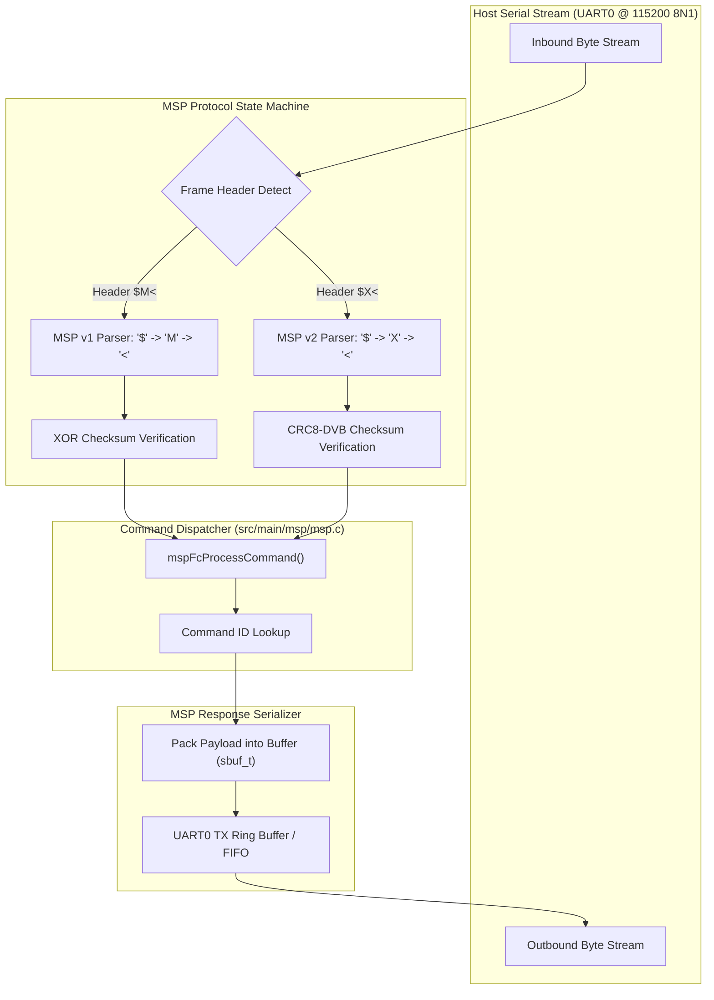
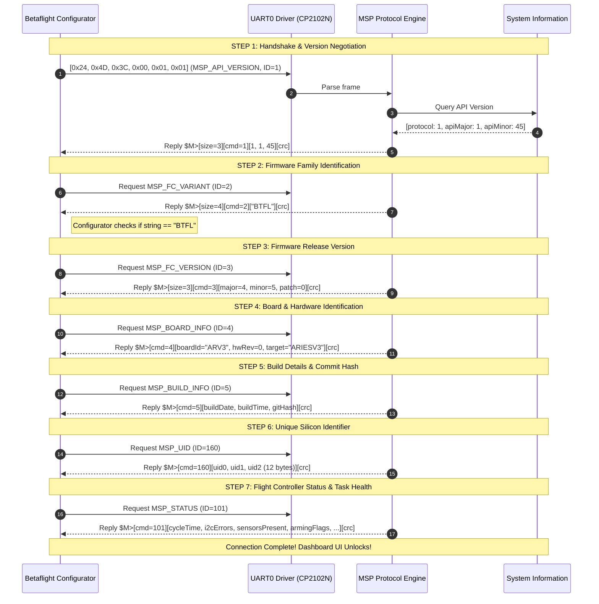

# Betaflight MSP & Configurator Handshake Knowledge Graph

## 1. Overview & Context

This knowledge base document defines the protocol layer, packet formats, and exact handshake transactions between the **Betaflight Configurator** and the **Betaflight Firmware** on the **ARIES v3.0 (THEJAS32)** platform.

### Connected Knowledge Nodes
* **Hardware Physical Link**: [ARIES_V3_DATASHEET_ANALYSIS.md](file:///home/ivan/Desktop/betaflight/knowledgebase/ARIES_V3_DATASHEET_ANALYSIS.md#31-serial-interfaces-uart) (CP2102N USB-to-UART bridge on `UART0`)
* **SoC Low-Level Registers**: [THEJAS32_PROGRAMMER_MANUAL_ANALYSIS.md](file:///home/ivan/Desktop/betaflight/knowledgebase/THEJAS32_PROGRAMMER_MANUAL_ANALYSIS.md#4-hardware-peripheral-register-map--direct-access) (`UART0_TX` at `0x10000100`, `LSR` at `0x10000114`)
* **Target Memory Constraints**: [TARGET_OPTIMIZATION_128KB.md](file:///home/ivan/Desktop/betaflight/knowledgebase/TARGET_OPTIMIZATION_128KB.md) (Minimal feature set for <128KB binary)
* **Master Knowledge Index**: [INDEX.md](file:///home/ivan/Desktop/betaflight/knowledgebase/INDEX.md)
* **Betaflight Docs Reference**: [betaflight.com MSP Protocol Reference](file:///home/ivan/Desktop/betaflight/knowledgebase/betaflight.com/docs/development/MSP-Protocol-Reference-Dev.md)

---

## 2. MultiWii Serial Protocol (MSP) Architecture

Betaflight communicates with host software (Configurator, OSD, Blackbox, Lua telemetry scripts) using the MultiWii Serial Protocol (MSP). Two framing standards coexist in modern Betaflight:

---

## 3. Frame Layout & Serialization

### 3.1 MSP Version 1 (V1) Frame Structure
Used for legacy messages and standard commands (Command IDs 0 to 254):

| Byte Index | Field Name | Type | Value / Purpose |
| :--- | :--- | :--- | :--- |
| **0** | `preamble1` | `uint8_t` | `'$'` (`0x24`) |
| **1** | `preamble2` | `uint8_t` | `'M'` (`0x4D`) |
| **2** | `direction` | `uint8_t` | `'<'` (`0x3C`) for request to FC, `'>'` (`0x3E`) for response from FC, `'!'` (`0x21`) for error |
| **3** | `payload_size` | `uint8_t` | Size in bytes of data payload ($0$ to $255$) |
| **4** | `cmd_id` | `uint8_t` | MSP command opcode ($0$ to $254$) |
| **5 .. (5+size-1)** | `payload` | `uint8_t[]` | Message specific data bytes |
| **5 + size** | `checksum` | `uint8_t` | XOR sum: `payload_size ^ cmd_id ^ payload[0] ^ ... ^ payload[n]` |

---

### 3.2 MSP Version 2 (V2) Frame Structure
Indicated by `MSP_V2_FRAME` (`255` / `0xFF`) or starting header `'$X'`:

| Byte Index | Field Name | Type | Value / Purpose |
| :--- | :--- | :--- | :--- |
| **0** | `preamble1` | `uint8_t` | `'$'` (`0x24`) |
| **1** | `preamble2` | `uint8_t` | `'X'` (`0x58`) |
| **2** | `direction` | `uint8_t` | `'<'` to FC, `'>'` from FC, `'!'` error |
| **3** | `flag` | `uint8_t` | Protocol flags (usually `0`) |
| **4 - 5** | `cmd_id` | `uint16_t` | 16-bit command code (Little Endian) |
| **6 - 7** | `payload_size` | `uint16_t` | 16-bit payload length (Little Endian) |
| **8 .. (8+size-1)** | `payload` | `uint8_t[]` | Data bytes |
| **8 + size** | `crc8` | `uint8_t` | CRC8-DVB over `flag`, `cmd_id`, `payload_size`, and `payload` |

---

## 4. Configurator Connect Handshake State Machine

When the user clicks **"Connect"** in the Betaflight Configurator, the following mandatory handshake state machine executes over the CP2102N USB serial port (UART0 at 115200 baud):

---

## 5. Minimum Implementation Checklist for ARIES v3.0

To achieve a successful Configurator connection on ARIES v3.0 with minimal code size (<128KB), the firmware only requires these 7 commands in `src/main/msp/msp.c`:

| MSP Command | Code | Direction | Minimal Payload Required by Configurator | Source File Reference |
| :--- | :--- | :--- | :--- | :--- |
| `MSP_API_VERSION` | `1` | from FC | `uint8_t protocol=1`, `uint8_t apiMajor=1`, `uint8_t apiMinor=45` | `src/main/msp/msp.c` |
| `MSP_FC_VARIANT` | `2` | from FC | 4-byte ASCII string `"BTFL"` | `src/main/msp/msp.c` |
| `MSP_FC_VERSION` | `3` | from FC | `uint8_t major`, `uint8_t minor`, `uint8_t patch` | `src/main/msp/msp.c` |
| `MSP_BOARD_INFO` | `4` | from FC | `char boardId[4] = "ARV3"`, `uint16_t hwRevision = 0`, Target Name | `src/main/msp/msp.c` |
| `MSP_BUILD_INFO` | `5` | from FC | Date string (11 bytes), Time string (8 bytes), Git commit (7 bytes) | `src/main/msp/msp.c` |
| `MSP_STATUS` | `101`| from FC | `cycleTime`, `i2cErrors=0`, `sensorsPresent=0`, `flightModeFlags=0`, `armingDisableFlags=0` | `src/main/msp/msp.c` |
| `MSP_UID` | `160`| from FC | 3x `uint32_t` unique ID words | `src/main/msp/msp.c` |

---

## 6. Serial Port Configuration Requirements

1. **Baud Rate**: Default must be **115,200 baud**, 8 data bits, no parity, 1 stop bit (`8N1`).
2. **Buffer Sizes**:
   * Minimum `rxBufferSize`: 256 bytes (to hold bursts of multi-command requests).
   * Minimum `txBufferSize`: 256 bytes (for serialization of `MSP_BOARD_INFO` and `MSP_STATUS`).
3. **Polling vs Interrupt**:
   * For the initial prototype, UART0 can use ring buffers filled by the 16550 UART RX interrupt, with non-blocking TX draining via the `LSR` register (`0x10000114`).
