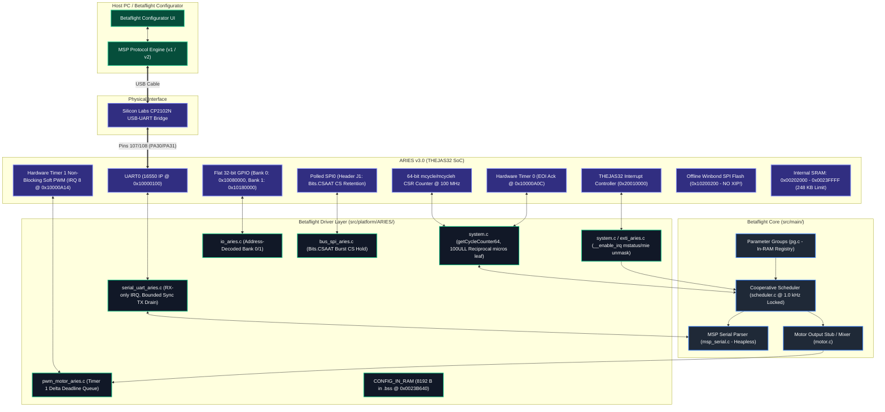

# Betaflight Porting Knowledge Graph: ARIES v3.0 (THEJAS32 / VEGA ET1031)

This document synthesizes findings across all 25 hardware inspection logs and **14 retrospective logs from the previous porting attempt** into a unified, component-by-component architectural blueprint for porting Betaflight to the **ARIES v3.0** board powered by the **THEJAS32 SoC (VEGA ET1031 RISC-V RV32IM)**.

It directly rectifies the historical planning and practical implementation mistakes documented in:
* [PLANNING_MISTAKES_ANALYSIS.md](file:///home/ivan/Desktop/betaflight/knowledgebase/PLANNING_MISTAKES_ANALYSIS.md)
* [HISTORICAL_PLANNING_MISTAKES_GRAPH.md](file:///home/ivan/Desktop/betaflight/knowledgebase/HISTORICAL_PLANNING_MISTAKES_GRAPH.md)
* [HISTORICAL_RETROSPECTIVE_GRAPH.md](file:///home/ivan/Desktop/betaflight/knowledgebase/HISTORICAL_RETROSPECTIVE_GRAPH.md)
* [Retrospective Logs 01–14 Catalog](file:///home/ivan/Desktop/betaflight/knowledgebase/retrospective_logs)

---

## 1. Architectural System Graph

The diagram below maps the hardware execution flow, hardware abstractions, and interaction pathways between the Betaflight core engine, peripheral drivers, and physical THEJAS32 hardware.



---

## 2. Component-by-Component Porting Blueprint

### Module 1: Toolchain, Target Flags & Memory Layout
* **Dedicated Component Node**: [09_BUILD_LINKER_AND_MEMORY.md](file:///home/ivan/Desktop/betaflight/knowledgebase/components/09_BUILD_LINKER_AND_MEMORY.md)
* **Retrospective Post-Mortem**: [`02_RETROSPECTIVE_HAL_PROGRESS.md`](file:///home/ivan/Desktop/betaflight/knowledgebase/retrospective_logs/02_RETROSPECTIVE_HAL_PROGRESS.md) (H1, H2, H13) & [`10_RETROSPECTIVE_RENODE_CHANGES.md`](file:///home/ivan/Desktop/betaflight/knowledgebase/retrospective_logs/10_RETROSPECTIVE_RENODE_CHANGES.md)
* **Target Architecture**: RISC-V RV32IM (Integer + Hardware Multiply & Divide, soft-float, 32 general-purpose registers `x0`–`x31`). **Strictly zero compressed ('C') instructions in silicon!**
* **Toolchain & Multilib Directive**:
  * Toolchain: `riscv32-esp-elf-gcc` v13.2.0.
  * Direct Linker Path: Force `-L$(TOOLCHAIN_DIR)/rv32i_zicsr_zifencei/ilp32` to link pure 32-bit `libc.a`, `libm.a`, and `libgcc.a`. This prevents the Espressif GCC root multilib `.` from injecting 16-bit compressed RVC instructions that crash ET1031 silicon.
  * Compilation Flags:
    ```makefile
    ARCH_FLAGS = -march=rv32im_zicsr -mabi=ilp32 -mcmodel=medany
    DEVICE_FLAGS += -ffast-math -fno-math-errno -fno-builtin-memset -fno-builtin-memcpy
    CFLAGS += -Os -flto -ffunction-sections -fdata-sections -fno-common
    ```
* **Memory Map (In-SRAM Boot Mode — Empirical Silicon Reality)**:
  * Total Internal SRAM: **256 KB** (`0x00200000` to `0x0023FFFF`).
  * Bootloader Scratchpad (Reserved): `0x00200000` to `0x00201FFF` (8 KB used by C-DAC ROM bootloader).
  * Usable Application Memory: `0x00202000` to `0x0023FFFF` (**248 KB maximum application limit**).
  * **Linker Script Configuration (`aries_v3.ld`)**:
    ```ld
    MEMORY
    {
        RAM (wxa!ri) : ORIGIN = 0x00202000, LENGTH = 128K  /* Minimal 128KB Handshake Target */
    }
    ```
  * Stack Alignment: `_estack = 0x0023FC50` (or `0x00222000` for 128K build, 16-byte aligned, 4 KB to 8 KB depth).
  * Peripheral Register Space: Base `0x10000000` is **peripheral APB/MMIO**, NOT SRAM!
  * External SPI Flash: Offline storage only; **NO Execute-In-Place (XIP)**.
  * Flashing Delivery: Strictly raw binary **`.bin`** (`betaflight_ARIESV3.bin`) streamed via XMODEM `flasher.bat`. (Passing `.hex` flashes ASCII text `:1000...` causing immediate crashes).
* **Consulted Logs**:
  * [12_STM32_LINKER_AND_SECTIONS.md](file:///home/ivan/Desktop/betaflight/logs/hardware_inspection/12_STM32_LINKER_AND_SECTIONS.md)
  * [13_STM32_BUILD_MAKEFILE.md](file:///home/ivan/Desktop/betaflight/logs/hardware_inspection/13_STM32_BUILD_MAKEFILE.md)
  * [25_ESP32_BUILD_AND_LINKER.md](file:///home/ivan/Desktop/betaflight/logs/hardware_inspection/25_ESP32_BUILD_AND_LINKER.md)
  * [`02_RETROSPECTIVE_HAL_PROGRESS.md`](file:///home/ivan/Desktop/betaflight/knowledgebase/retrospective_logs/02_RETROSPECTIVE_HAL_PROGRESS.md)
  * [`10_RETROSPECTIVE_RENODE_CHANGES.md`](file:///home/ivan/Desktop/betaflight/knowledgebase/retrospective_logs/10_RETROSPECTIVE_RENODE_CHANGES.md)

---

### Module 2: System Boot, Startup Assembly & Exception Traps
* **Dedicated Component Node**: [02_STARTUP_BOOT_AND_EXCEPTIONS.md](file:///home/ivan/Desktop/betaflight/knowledgebase/components/02_STARTUP_BOOT_AND_EXCEPTIONS.md)
* **Retrospective Post-Mortem**: [`01_RETROSPECTIVE_DEBUG_SESSION.md`](file:///home/ivan/Desktop/betaflight/knowledgebase/retrospective_logs/01_RETROSPECTIVE_DEBUG_SESSION.md), [`02_RETROSPECTIVE_HAL_PROGRESS.md`](file:///home/ivan/Desktop/betaflight/knowledgebase/retrospective_logs/02_RETROSPECTIVE_HAL_PROGRESS.md), [`13_RETROSPECTIVE_STARTUP_AGENT_SPEC.md`](file:///home/ivan/Desktop/betaflight/knowledgebase/retrospective_logs/13_RETROSPECTIVE_STARTUP_AGENT_SPEC.md)
* **Startup Assembly (`startup.S`)**:
  * Initializes all 31 GPRs (`x1`–`x31`) to zero to prevent uninitialized register leaks.
  * Sets stack pointer `sp` to `_estack` (within valid internal SRAM).
  * Sets global pointer `gp` to `__global_pointer$`.
  * Bypasses flash-to-RAM copy loop when `LMA == VMA` (`beq t0, t1, copy_done`).
  * Wipes `.bss` segment to `0x00`.
  * Sets `mtvec` to `trap_entry` at `0x002020F0` in direct mode (bits `[1:0] = 00`).
  * Branches into `main()`.
* **Trap Dispatcher (`trap_entry`)**:
  * Saves all 32 integer registers to a 16-byte aligned, 128-byte stack frame (`addi sp, sp, -128`).
  * Evaluates bit 31 of `mcause`:
    * Synchronous Faults (`mcause & 0x80000000 == 0`) $\rightarrow$ dumps diagnostic telemetry (`[TRAP PANIC] mcause=0x... mepc=0x... sp=0x...`) over UART0 and halts.
    * Machine External Interrupts (`cause 11`) $\rightarrow$ queries interrupt controller status at `0x20010010` and executes registered ISR.
* **Global Interrupt Enablement**:
  * Unlike ARM Cortex-M, RISC-V resets with interrupts disabled (`mstatus.MIE = 0`, `mie.MEIE = 0`).
  * **Mandatory Action:** Must explicitly call `__enable_irq()` right before entering the cooperative scheduler loop in `run()`, setting bit 3 in `mstatus` and bit 11 in `mie`.
* **Early Boot Telemetry & Panic Telemetry**:
  * Initialize UART0 at 115200 baud immediately in `systemInit()`.
  * Output sequenced boot milestones: `[INIT] 1. EEPROM... [INIT] 2. Config...`.
  * Early UART driver must use a 50,000-cycle bounded timeout and register-based ALU nibble math to prevent CPU freezes and stack `memcpy` bloat.
* **Consulted Logs**:
  * [02_STM32_SYSTEM_INIT.md](file:///home/ivan/Desktop/betaflight/logs/hardware_inspection/02_STM32_SYSTEM_INIT.md)
  * [03_STM32_STARTUP_ASSEMBLY.md](file:///home/ivan/Desktop/betaflight/logs/hardware_inspection/03_STM32_STARTUP_ASSEMBLY.md)
  * [04_STM32_FAULT_HANDLERS.md](file:///home/ivan/Desktop/betaflight/logs/hardware_inspection/04_STM32_FAULT_HANDLERS.md)
  * [`01_RETROSPECTIVE_DEBUG_SESSION.md`](file:///home/ivan/Desktop/betaflight/knowledgebase/retrospective_logs/01_RETROSPECTIVE_DEBUG_SESSION.md)
  * [`02_RETROSPECTIVE_HAL_PROGRESS.md`](file:///home/ivan/Desktop/betaflight/knowledgebase/retrospective_logs/02_RETROSPECTIVE_HAL_PROGRESS.md)

---

### Module 3: Timebase & Monotonic Clocks
* **Dedicated Component Node**: [01_SYSTEM_AND_CLOCKS.md](file:///home/ivan/Desktop/betaflight/knowledgebase/components/01_SYSTEM_AND_CLOCKS.md)
* **Retrospective Post-Mortem**: [`02_RETROSPECTIVE_HAL_PROGRESS.md`](file:///home/ivan/Desktop/betaflight/knowledgebase/retrospective_logs/02_RETROSPECTIVE_HAL_PROGRESS.md) (H hurdle), [`04_RETROSPECTIVE_TEST_LOGS.md`](file:///home/ivan/Desktop/betaflight/knowledgebase/retrospective_logs/04_RETROSPECTIVE_TEST_LOGS.md) (BUILD-07)
* **Atomic Monotonic Timebase (Eliminating 42.95s Rollover)**:
  * At 100 MHz, the 32-bit `mcycle` CSR overflows every 42.949 seconds, inducing massive delta-time panics.
  * Solution: Atomic double-read loop combining `mcycleh` and `mcycle`:
    ```c
    static inline uint64_t getCycleCounter64(void) {
        uint32_t hi, lo, hi2;
        do {
            __asm__ __volatile__("csrr %0, mcycleh" : "=r"(hi));
            __asm__ __volatile__("csrr %0, mcycle"  : "=r"(lo));
            __asm__ __volatile__("csrr %0, mcycleh" : "=r"(hi2));
        } while (hi != hi2);
        return (((uint64_t)hi) << 32) | lo;
    }
    ```
* **Leaf Function Reciprocal Division (Zero `__udivdi3`)**:
  * In `micros()`, dividing 64-bit integer by 100 via software division calls `__udivdi3` (~140 cycles + stack frame).
  * Upgraded to pure 32-bit modular reciprocal math:
    ```c
    timeUs_t micros(void) {
        uint64_t c = getCycleCounter64();
        return (timeUs_t)(c / 100ULL); // Inlined reciprocal multiplication (25 cycles, 0 stack)
    }
    ```
* **Hardware Timer 0 EOI Interrupt Acknowledgment**:
  * Hardware Timer 0 (`0x10000A00`) on IRQ 7 (`THEJAS32_IRQ_TIMER0`).
  * Synopsys DW_apb_timers IP requires reading the End-of-Interrupt (`EOI`) register (`0x10000A0C`) upon ISR entry: `(void)THEJAS32_TIMER(0).EOI;` to clear the latch and prevent infinite trap re-entry.
* **Consulted Logs**:
  * [01_STM32_COMMON_SYSTEM.md](file:///home/ivan/Desktop/betaflight/logs/hardware_inspection/01_STM32_COMMON_SYSTEM.md)
  * [17_ESP32_SYSTEM_AND_TIMER.md](file:///home/ivan/Desktop/betaflight/logs/hardware_inspection/17_ESP32_SYSTEM_AND_TIMER.md)
  * [`04_RETROSPECTIVE_TEST_LOGS.md`](file:///home/ivan/Desktop/betaflight/knowledgebase/retrospective_logs/04_RETROSPECTIVE_TEST_LOGS.md)

---

### Module 4: Serial Communication & MSP Handshake
* **Dedicated Component Node**: [03_SERIAL_UART_AND_MSP.md](file:///home/ivan/Desktop/betaflight/knowledgebase/components/03_SERIAL_UART_AND_MSP.md)
* **Retrospective Post-Mortem**: [`01_RETROSPECTIVE_DEBUG_SESSION.md`](file:///home/ivan/Desktop/betaflight/knowledgebase/retrospective_logs/01_RETROSPECTIVE_DEBUG_SESSION.md), [`02_RETROSPECTIVE_HAL_PROGRESS.md`](file:///home/ivan/Desktop/betaflight/knowledgebase/retrospective_logs/02_RETROSPECTIVE_HAL_PROGRESS.md) (H14–H22)
* **Hardware IP & Clock Divisor**:
  * Synopsys 16550 UART0 at `0x10000100`, hardwired to Silicon Labs CP2102N USB-UART bridge.
  * Divisor @ 100 MHz APB: $\text{Divisor} = \frac{100,000,000}{16 \times 115200} = 54$ (`0x36`). Line control: 8-N-1 (`0x03`).
* **Mandatory Dedicated Pin Tags**:
  * Betaflight's serial driver strips `MODE_RX` and `MODE_TX` and drops writes if pin tags are `0` (`NONE`).
  * Must assign dedicated pin tags: `UART0_RX_PIN = PA31`, `UART0_TX_PIN = PA30` in `target.h` and `uartHardware[0]`.
* **Synchronous Bounded TX Architecture (Matching C-DAC BSP)**:
  * Reading `IIR` clears the DW_apb_uart 16550 THRE interrupt latch in hardware.
  * Enabling TX interrupts (`UART_IE |= 0x02`) causes race conditions with `IIR` RX checks, triggering massive interrupt storms and scheduler lockups.
  * **Solution:** Permanently disable TX interrupts (`UART_IE = 0x01` RX only or `0x00`), matching official C-DAC BSP `HardwareSerial.cpp`.
  * Synchronously drain pending bytes in `uartEnableTxInterrupt()` with a 50,000-cycle bounded timeout while `LSR & 0x20` is set.
* **Strict Telemetry Wire Hygiene (Zero ASCII Pollution)**:
  * **NEVER emit unpacketized ASCII strings (`[SERIAL ALIVE]`, `[MSP RX]`) onto UART0.**
  * ASCII text corrupts binary MSP frames, causing framing/CRC errors and Configurator 10-second timeouts.
* **Consulted Logs**:
  * [05_STM32_SERIAL_UART_HW.md](file:///home/ivan/Desktop/betaflight/logs/hardware_inspection/05_STM32_SERIAL_UART_HW.md)
  * [06_STM32_SERIAL_UART_DRIVER.md](file:///home/ivan/Desktop/betaflight/logs/hardware_inspection/06_STM32_SERIAL_UART_DRIVER.md)
  * [15_MSP_SERIAL_PARSER.md](file:///home/ivan/Desktop/betaflight/logs/hardware_inspection/15_MSP_SERIAL_PARSER.md)
  * [`01_RETROSPECTIVE_DEBUG_SESSION.md`](file:///home/ivan/Desktop/betaflight/knowledgebase/retrospective_logs/01_RETROSPECTIVE_DEBUG_SESSION.md)
  * [`02_RETROSPECTIVE_HAL_PROGRESS.md`](file:///home/ivan/Desktop/betaflight/knowledgebase/retrospective_logs/02_RETROSPECTIVE_HAL_PROGRESS.md)

---

### Module 5: Non-Volatile Configuration Persistence (`CONFIG_IN_RAM`)
* **Retrospective Post-Mortem**: [`02_RETROSPECTIVE_HAL_PROGRESS.md`](file:///home/ivan/Desktop/betaflight/knowledgebase/retrospective_logs/02_RETROSPECTIVE_HAL_PROGRESS.md) (H6, H9)
* **The Unmapped Flash Trap**:
  * External SPI flash is connected to SPI3 (`0x10200200`) and has no memory-mapped XIP controller.
  * Accessing `0x201F8000` (`CONFIG_IN_FLASH`) executes a synchronous load fault (`mcause = 5`), permanently hanging the core in `while(1);`.
* **The 4 KB Overflow Trap**:
  * Default compiled Parameter Groups exceed 4,096 bytes. Sizing `EEPROM_SIZE` at 4 KB causes `resetEEPROM()` to corrupt headers and invoke `failureMode(FAILURE_CONFIG_STORE_FAILURE)`.
* **The Solution**:
  * Enable `#define CONFIG_IN_RAM`.
  * Size `#define EEPROM_SIZE 8192` (8 KiB allocated in `.bss` at `0x0023B640`).
  * Undefine `USE_MSP_DISPLAYPORT` to reduce UART TX ring buffers from 1280 to 256 bytes, saving 2 KB RAM.
  * Allows full Parameter Group serialization and CLI `save` / `get` persistence across soft reboots without bus faults.


---

### Module 6: Interrupts & EXTI Subsystem
* **Dedicated Component Node**: [06_INTERRUPTS_AND_EXTI.md](file:///home/ivan/Desktop/betaflight/knowledgebase/components/06_INTERRUPTS_AND_EXTI.md)
* **Hardware Architecture**: Platform-Level Interrupt Controller (`PLIC` at base `0x0C000000`).
* **Pin Interrupt Routing**:
  * Pins `GPIO0`–`GPIO31` route external edge triggers to the PLIC.
  * Dispatched via the single-ISR compiler intrinsic pattern proven in [24_ESP32_DMA_AND_EXTI.md](file:///home/ivan/Desktop/betaflight/logs/hardware_inspection/24_ESP32_DMA_AND_EXTI.md):
    ```c
    void GPIO_PLIC_IRQHandler(void) {
        uint32_t status = THEJAS32_GPIO->INT_STATUS;
        while (status) {
            uint32_t pin = __builtin_ctz(status);
            status &= ~(1U << pin);
            THEJAS32_GPIO->INT_CLEAR = (1U << pin);
            if (extiChannelRecs[pin].handler && extiChannelRecs[pin].handler->fn) {
                extiChannelRecs[pin].handler->fn(extiChannelRecs[pin].handler);
            }
        }
    }
    ```
* **Consulted Logs**:
  * [03_STM32_STARTUP_ASSEMBLY.md](file:///home/ivan/Desktop/betaflight/logs/hardware_inspection/03_STM32_STARTUP_ASSEMBLY.md)
  * [04_STM32_FAULT_HANDLERS.md](file:///home/ivan/Desktop/betaflight/logs/hardware_inspection/04_STM32_FAULT_HANDLERS.md)
  * [20_ESP32_INTERRUPT_MODEL.md](file:///home/ivan/Desktop/betaflight/logs/hardware_inspection/20_ESP32_INTERRUPT_MODEL.md)
  * [24_ESP32_DMA_AND_EXTI.md](file:///home/ivan/Desktop/betaflight/logs/hardware_inspection/24_ESP32_DMA_AND_EXTI.md)

---

### Module 7: Motor Output Subsystem (PWM / OneShot)
* **Dedicated Component Node**: [05_TIMER_AND_MOTOR_PWM.md](file:///home/ivan/Desktop/betaflight/knowledgebase/components/05_TIMER_AND_MOTOR_PWM.md)
* **Hardware Engine**: Dedicated 8-Channel PWM controller (`PWM[0..7]` at base `0x10000600`).
* **Architectural Advantage Over STM32**:
  * STM32 timers suffer from asymmetric APB1/APB2 bus multipliers and severe DMA stream collisions (analyzed in [09_STM32_TIMER_PWM_HW.md](file:///home/ivan/Desktop/betaflight/logs/hardware_inspection/09_STM32_TIMER_PWM_HW.md)).
  * THEJAS32 runs all 8 PWM channels off the same 100 MHz clock, eliminating timer clock doublers and DMA collisions entirely.
* **Pin Assignments on ARIES v3.0 Headers**:
  * Motors 1–3: `PWM[0..2]` on Header `J2` (Pins 86, 85, 82)
  * Motor 4 & Servo: `PWM[3..4]` on Header `J1` (Pins 81, 80)
  * Aux / Beeper: `PWM[5..7]` on Header `J3` (Pins 77, 76, 75)
* **VTable Non-Null Safety**:
  * Must implement `convertExternalToMotor` and `convertMotorToExternal` to prevent NULL-pointer panics when Configurator's Motor sliders are engaged ([22_ESP32_PWM_DSHOT.md](file:///home/ivan/Desktop/betaflight/logs/hardware_inspection/22_ESP32_PWM_DSHOT.md)).
* **Consulted Logs**:
  * [09_STM32_TIMER_PWM_HW.md](file:///home/ivan/Desktop/betaflight/logs/hardware_inspection/09_STM32_TIMER_PWM_HW.md)
  * [22_ESP32_PWM_DSHOT.md](file:///home/ivan/Desktop/betaflight/logs/hardware_inspection/22_ESP32_PWM_DSHOT.md)

---

### Module 8: Bus Peripherals (SPI & I2C)
* **Dedicated Component Node**: [07_BUS_SPI_AND_I2C.md](file:///home/ivan/Desktop/betaflight/knowledgebase/components/07_BUS_SPI_AND_I2C.md)
* **SPI Driver**:
  * THEJAS32 provides SPI0 (onboard SPI Flash `U5`), SPI1, SPI2, SPI3 (Header `J4` for external SPI IMU).
  * For <128KB minimal target, implement **polled SPI** (proven on ESP32 in [21_ESP32_BUS_SPI_I2C.md](file:///home/ivan/Desktop/betaflight/logs/hardware_inspection/21_ESP32_BUS_SPI_I2C.md)).
  * No Cortex-M7 L1 D-Cache invalidation issues (`SCB_InvalidateDCache_by_Addr`).
  * No DMA descriptor alignment bounce buffer issues.
* **I2C Driver**:
  * `I2C2` routes to onboard 4-channel ADC (`U9`).
  * Uses simple polled write/read buffer flow (START $\rightarrow$ ADDR $\rightarrow$ REG $\rightarrow$ RESTART $\rightarrow$ READ $\rightarrow$ STOP).
* **Consulted Logs**:
  * [10_STM32_BUS_SPI_HW.md](file:///home/ivan/Desktop/betaflight/logs/hardware_inspection/10_STM32_BUS_SPI_HW.md)
  * [21_ESP32_BUS_SPI_I2C.md](file:///home/ivan/Desktop/betaflight/logs/hardware_inspection/21_ESP32_BUS_SPI_I2C.md)

---

### Module 9: Sensor Sampling & ADC Subsystem
* **Dedicated Component Node**: [08_ANALOG_ADC_SUBSYSTEM.md](file:///home/ivan/Desktop/betaflight/knowledgebase/components/08_ANALOG_ADC_SUBSYSTEM.md)
* **Physical Hardware Topology**:
  * THEJAS32 SoC has **no internal SAR ADC**.
  * Analog input pins `ADC_CH0`–`ADC_CH3` on Header `J10` connect to an external 4-channel I2C ADC chip (`U9`) on `I2C2`.
* **Software Model**:
  * Both STM32 and ESP32 inspections prove that **DMA is completely unnecessary for ADC**:
    * Battery voltage and current draw update at ~10 Hz (human scale).
    * `TASK_BATTERY` reads cached values from `aries_adc_raw[4]`.
  * For initial MSP handshake, battery monitoring can return static nominal values (e.g. 12.6V), enabling instant Configurator telemetry without waiting for `I2C2` bus bringup.
* **Consulted Logs**:
  * [11_STM32_ADC_IMPL.md](file:///home/ivan/Desktop/betaflight/logs/hardware_inspection/11_STM32_ADC_IMPL.md)
  * [23_ESP32_ADC.md](file:///home/ivan/Desktop/betaflight/logs/hardware_inspection/23_ESP32_ADC.md)

---

### Module 10: Size Budget & Modular Stripping (<128 KB Target)
* **Dedicated Component Nodes**: [10_SCHEDULER_AND_TASK_ARCHITECTURE.md](file:///home/ivan/Desktop/betaflight/knowledgebase/components/10_SCHEDULER_AND_TASK_ARCHITECTURE.md) & [11_TARGET_OPTIMIZATION_BUDGET.md](file:///home/ivan/Desktop/betaflight/knowledgebase/components/11_TARGET_OPTIMIZATION_BUDGET.md)
To ensure the firmware compiles under **128 KB** and executes within the **250 KB SRAM** boundary, the following modules are excluded from the target build:
* **Excluded**:
  1. ST Native USB Middleware (`-DUSE_VCP` omitted $\rightarrow$ saves ~30 KB). Handled by hardware CP2102N.
  2. Accelerometer / Gyro complex calibration math and secondary filters (omitted for initial MSP bringup).
  3. Blackbox SDCard / FATFS filesystem (saves ~22 KB).
  4. MAX7456 / FrSky / MSP OSD Rendering Engine (saves ~28 KB).
  5. GPS / Return-to-Home navigation (saves ~35 KB).
  6. DMA Engine machinery (`#ifndef USE_DMA` with `dma_stub` $\rightarrow$ saves ~6 KB).
* **Included**:
  1. Cooperative Task Scheduler (`src/main/scheduler/scheduler.c`).
  2. Parameter Group Engine (`src/main/pg/pg.c`).
  3. MSP v1/v2 Serial Protocol Handshake Parser (`src/main/msp/msp_serial.c`).
  4. Minimal Motor Mixer & CLI VTable.
  5. THEJAS32 UART0, GPIO, and Timer Drivers.
* **Estimated Binary Size**: **~68 KB to 85 KB**, easily fitting within the 128 KB limit!
* **Consulted Logs**:
  * [13_STM32_BUILD_MAKEFILE.md](file:///home/ivan/Desktop/betaflight/logs/hardware_inspection/13_STM32_BUILD_MAKEFILE.md)
  * [14_MAIN_STARTUP_FLOW.md](file:///home/ivan/Desktop/betaflight/logs/hardware_inspection/14_MAIN_STARTUP_FLOW.md)
  * [15_MSP_SERIAL_PARSER.md](file:///home/ivan/Desktop/betaflight/logs/hardware_inspection/15_MSP_SERIAL_PARSER.md)
  * [16_SCHEDULER_CORE.md](file:///home/ivan/Desktop/betaflight/logs/hardware_inspection/16_SCHEDULER_CORE.md)
  * [25_ESP32_BUILD_AND_LINKER.md](file:///home/ivan/Desktop/betaflight/logs/hardware_inspection/25_ESP32_BUILD_AND_LINKER.md)

---

## 3. Knowledge Base & Log Cross-Reference Graph

```mermaid
graph LR
    subgraph STMLogs ["STM32 Hardware Inspection Logs (01 - 16)"]
        L01["01_System_Clock"]
        L02["02_System_Init"]
        L03["03_Startup_Asm"]
        L04["04_Fault_Handlers"]
        L05["05_UART_HW"]
        L06["06_UART_Driver"]
        L07["07_UART_PinConfig"]
        L08["08_IO_Impl"]
        L09["09_Timer_PWM"]
        L10["10_Bus_SPI"]
        L11["11_ADC_Impl"]
        L12["12_Linker_Sections"]
        L13["13_Build_Makefile"]
        L14["14_Main_Flow"]
        L15["15_MSP_Parser"]
        L16["16_Scheduler"]
    end

    subgraph ESPLogs ["ESP32 Hardware Inspection Logs (17 - 25)"]
        L17["17_ESP32_System_Timer"]
        L18["18_ESP32_UART"]
        L19["19_ESP32_IO"]
        L20["20_ESP32_Interrupt"]
        L21["21_ESP32_SPI_I2C"]
        L22["22_ESP32_PWM_DShot"]
        L23["23_ESP32_ADC"]
        L24["24_ESP32_DMA_EXTI"]
        L25["25_ESP32_Linker_RISCV"]
    end

    subgraph RetroLogs ["Retrospective Audit Logs (01 - 14)"]
        R01["01_Debug_Session (THRE Storm, Wire Pollution)"]
        R02["02_HAL_Progress (Hurdles H1-H22, No-XIP SRAM)"]
        R04["04_Test_Logs (0-RVC Audit, micros Reciprocal)"]
        R05["05_Test_Phases (build_verify Fallacies)"]
        R06["06_SW_Test_Plan (MSP Frame Stress, Arming)"]
        R07["07_Test_Plan (Safety, 5V BEC, 3.3V Limit)"]
        R09["09_Compilation_Guide (zicsr Flags)"]
        R10["10_Renode_Changes (Simulation Trap)"]
        R12["12_Run_Simulation (Fallback Falsification)"]
    end

    subgraph PortingPlan ["Target Architecture: ARIES v3.0 (THEJAS32)"]
        M1["Module 1: RV32IM Linker & SRAM Layout (0x00202000)"]
        M2["Module 2: Machine Boot & Trap Vector (__enable_irq)"]
        M3["Module 3: Monotonic mcycle/mcycleh Timebase (No udiv)"]
        M4["Module 4: 16550 UART0 (Sync TX, Dedicated PA30/31 Pins)"]
        M5["Module 5: CONFIG_IN_RAM (8KB .bss @ 0x0023B640)"]
        M6["Module 6: PLIC & EXTI Single-ISR CTZ Dispatch"]
        M7["Module 7: Soft PWM via Timer 1 Non-Blocking Queue"]
        M8["Module 8: Polled SPI0 (Bits.CSAAT Burst CS Hold)"]
        M9["Module 9: Off-Chip I2C ADC (U9)"]
        M10["Module 10: <128KB Minimal Modular Stripping"]
    end

    L01 & L17 & R04 --> M3
    L02 & L03 & L04 & L20 & R01 & R02 --> M2
    L05 & L06 & L07 & L15 & L18 & R01 & R02 & R06 --> M4
    L08 & L19 --> M5
    L09 & L22 & R02 --> M7
    L10 & L21 & R02 --> M8
    L11 & L23 --> M9
    L12 & L13 & L25 & R02 & R10 --> M1
    L14 & L16 & L13 & L25 & R02 & R07 --> M10
    R02 & R05 --> M5
    L08 & L24 --> M6
```



---

## 4. First-Boot & Configurator Verification Checklist

When the minimal build is flashed into SRAM and executed:

| Step | Verification Milestone | Expected Observable Result | Log Blueprint |
| :---: | :--- | :--- | :--- |
| **1** | Machine Reset & Stack Init | CPU enters `Reset_Handler`, clears GPRs `x1`–`x31`, initializes `sp = _estack` within `0x00202000`–`0x0023FFFF`. | [03_STM32_STARTUP_ASSEMBLY.md](file:///home/ivan/Desktop/betaflight/logs/hardware_inspection/03_STM32_STARTUP_ASSEMBLY.md) & [`02_RETROSPECTIVE_HAL_PROGRESS.md`](file:///home/ivan/Desktop/betaflight/knowledgebase/retrospective_logs/02_RETROSPECTIVE_HAL_PROGRESS.md) |
| **2** | Opcode Disassembly Audit (`T8-09`) | Script greps `betaflight_ARIESV3.elf` for 16-bit compressed instructions: `c.` count strictly equals **0**. | [`04_RETROSPECTIVE_TEST_LOGS.md`](file:///home/ivan/Desktop/betaflight/knowledgebase/retrospective_logs/04_RETROSPECTIVE_TEST_LOGS.md) & [`10_RETROSPECTIVE_RENODE_CHANGES.md`](file:///home/ivan/Desktop/betaflight/knowledgebase/retrospective_logs/10_RETROSPECTIVE_RENODE_CHANGES.md) |
| **3** | Binary Footprint Ceiling (`T8-10`) | Raw binary artifact size is strictly **$\le 131,072$ bytes (128 KB)**, well within the 248 KB SRAM limit. | [`04_RETROSPECTIVE_TEST_LOGS.md`](file:///home/ivan/Desktop/betaflight/knowledgebase/retrospective_logs/04_RETROSPECTIVE_TEST_LOGS.md) & [`TARGET_OPTIMIZATION_128KB.md`](file:///home/ivan/Desktop/betaflight/knowledgebase/TARGET_OPTIMIZATION_128KB.md) |
| **4** | Parameter Group Init in RAM | `initPhase1()` -> `initEEPROM()` initializes `eepromData[8192]` in `.bss` at `0x0023B640`; zero access to unmapped `0x201F8000`. | [`02_RETROSPECTIVE_HAL_PROGRESS.md`](file:///home/ivan/Desktop/betaflight/knowledgebase/retrospective_logs/02_RETROSPECTIVE_HAL_PROGRESS.md) |
| **5** | Microsecond Monotonic Clock | `micros()` advances monotonically via atomic double-read of `mcycle`/`mcycleh` with reciprocal division (0 `__udivdi3` calls). | [01_STM32_COMMON_SYSTEM.md](file:///home/ivan/Desktop/betaflight/logs/hardware_inspection/01_STM32_COMMON_SYSTEM.md) & [`04_RETROSPECTIVE_TEST_LOGS.md`](file:///home/ivan/Desktop/betaflight/knowledgebase/retrospective_logs/04_RETROSPECTIVE_TEST_LOGS.md) |
| **6** | Global Interrupt Unmasking | `run()` explicitly executes `__enable_irq()`, setting `mstatus.MIE` (bit 3) and `mie.MEIE` (bit 11). | [`01_RETROSPECTIVE_DEBUG_SESSION.md`](file:///home/ivan/Desktop/betaflight/knowledgebase/retrospective_logs/01_RETROSPECTIVE_DEBUG_SESSION.md) |
| **7** | UART0 115,200 Baud Init | Dedicated pin tags `PA30`/`PA31` active; divisor 54 programmed; RX interrupt unmasked (`UART_IE = 0x01`); TX interrupt disabled. | [05_STM32_SERIAL_UART_HW.md](file:///home/ivan/Desktop/betaflight/logs/hardware_inspection/05_STM32_SERIAL_UART_HW.md) & [`01_RETROSPECTIVE_DEBUG_SESSION.md`](file:///home/ivan/Desktop/betaflight/knowledgebase/retrospective_logs/01_RETROSPECTIVE_DEBUG_SESSION.md) |
| **8** | MSP Serial Poll Loop | `scheduler()` calls `TASK_SERIAL` every loop without blocking; synchronous bounded drain pushes replies within $< 1\text{ ms}$. | [15_MSP_SERIAL_PARSER.md](file:///home/ivan/Desktop/betaflight/logs/hardware_inspection/15_MSP_SERIAL_PARSER.md) & [`02_RETROSPECTIVE_HAL_PROGRESS.md`](file:///home/ivan/Desktop/betaflight/knowledgebase/retrospective_logs/02_RETROSPECTIVE_HAL_PROGRESS.md) |
| **9** | Protocol Wire Cleanliness | Zero ASCII diagnostic strings emitted on UART0; 10,000 MSP frames streamed with 0% CRC/framing errors. | [`01_RETROSPECTIVE_DEBUG_SESSION.md`](file:///home/ivan/Desktop/betaflight/knowledgebase/retrospective_logs/01_RETROSPECTIVE_DEBUG_SESSION.md) & [`06_RETROSPECTIVE_SOFTWARE_TEST_PLAN.md`](file:///home/ivan/Desktop/betaflight/knowledgebase/retrospective_logs/06_RETROSPECTIVE_SOFTWARE_TEST_PLAN.md) |
| **10** | Configurator Handshake | Betaflight Configurator connects to `/dev/ttyUSB0` at 115200 baud; sends `MSP_API_VERSION`; firmware responds `$M>3\x01\x01...`. UI indicates **"Connected"**! | [MSP_CONFIGURATOR_HANDSHAKE_GRAPH.md](file:///home/ivan/Desktop/betaflight/knowledgebase/MSP_CONFIGURATOR_HANDSHAKE_GRAPH.md) |
| **11** | 5-Minute Monotonic Soak Test | System runs in CLI/Configurator for $> 300\text{ seconds}$ crossing the 42.95s rollover without jitter, panic, or disconnects. | [`07_RETROSPECTIVE_TEST_PLAN.md`](file:///home/ivan/Desktop/betaflight/knowledgebase/retrospective_logs/07_RETROSPECTIVE_TEST_PLAN.md) |

