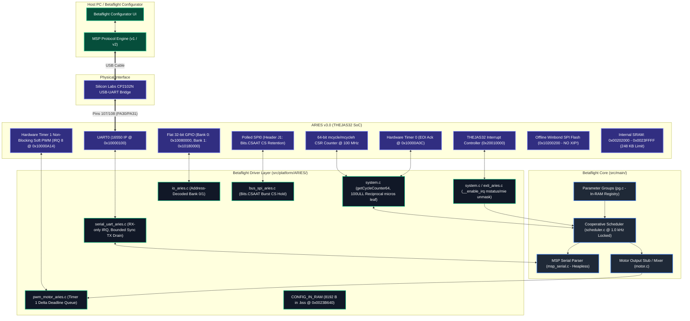

# Betaflight Porting Knowledge Graph: ARIES v3.0 (THEJAS32 / VEGA ET1031)

This document synthesizes findings across all 25 hardware inspection logs, **14 retrospective logs from the previous porting attempt**, and **17 deep codebase evaluation nodes** into a unified, component-by-component architectural blueprint for porting Betaflight to the **ARIES v3.0** board powered by the **THEJAS32 SoC (VEGA ET1031 RISC-V RV32IM)**.

It directly rectifies the historical planning and practical implementation mistakes documented in:
* [PLANNING_MISTAKES_ANALYSIS.md](PLANNING_MISTAKES_ANALYSIS.md)
* [HISTORICAL_PLANNING_MISTAKES_GRAPH.md](HISTORICAL_PLANNING_MISTAKES_GRAPH.md)
* [HISTORICAL_RETROSPECTIVE_GRAPH.md](HISTORICAL_RETROSPECTIVE_GRAPH.md)
* [Retrospective Logs 01–14 Catalog](retrospective_logs)
* [Codebase Evaluations 01–17 Catalog](codebase_evaluations)
* [Code Audit Catalog](code_audit)
* [Integration Testing Reports Catalog](integration_testing)
* [Critical Knowledge Gaps & Assumptions Register](CRITICAL_KNOWLEDGE_GAPS_AND_ASSUMPTIONS.md)
* [Exhaustive Micro-Planning Document Suite (`PLAN/`)](../PLAN/00_MASTER_PLAN_OVERVIEW.md)

---

## 1. Architectural System Graph

The diagram below maps the hardware execution flow, hardware abstractions, and interaction pathways between the Betaflight core engine, peripheral drivers, and physical THEJAS32 hardware.



---

## 2. Component-by-Component Porting Blueprint

### Module 1: Toolchain, Target Flags & Memory Layout
* **Dedicated Component Node**: [09_BUILD_LINKER_AND_MEMORY.md](components/09_BUILD_LINKER_AND_MEMORY.md)
* **Retrospective Post-Mortem**: [`02_RETROSPECTIVE_HAL_PROGRESS.md`](retrospective_logs/02_RETROSPECTIVE_HAL_PROGRESS.md) (H1, H2, H13) & [`10_RETROSPECTIVE_RENODE_CHANGES.md`](retrospective_logs/10_RETROSPECTIVE_RENODE_CHANGES.md)
* **Target Architecture**: RISC-V RV32IM (Integer + Hardware Multiply & Divide, soft-float, 32 general-purpose registers `x0`–`x31`). **Strictly zero compressed ('C') instructions in silicon!**
* **Toolchain & Multilib Directive**:
  * Toolchain: `riscv32-esp-elf-gcc` v13.2.0.
  * Direct Linker Path: Force `-L$(TOOLCHAIN_DIR)/rv32i_zicsr_zifencei/ilp32` to link pure 32-bit `libc.a`, `libm.a`, and `libgcc.a`. This prevents the Espressif GCC root multilib `.` from injecting 16-bit compressed RVC instructions that crash ET1031 silicon.
  * Compilation Flags:
    ```makefile
    ARCH_FLAGS = -march=rv32im_zicsr -mabi=ilp32 -mcmodel=medany
    DEVICE_FLAGS += -ffast-math -fno-math-errno -fno-builtin-memset -fno-builtin-memcpy
    CFLAGS += -Os -flto -ffunction-sections -fdata-sections -fno-common
    ```
* **Memory Map (In-SRAM Boot Mode — Empirical Silicon Reality)**:
  * Total Internal SRAM: **256 KB** (`0x00200000` to `0x0023FFFF`).
  * Bootloader Scratchpad (Reserved): `0x00200000` to `0x00201FFF` (8 KB used by C-DAC ROM bootloader).
  * Usable Application Memory: `0x00202000` to `0x0023FFFF` (**248 KB maximum application limit**).
  * **Linker Script Configuration (`aries_v3.ld`)**:
    ```ld
    MEMORY
    {
        RAM (wxa!ri) : ORIGIN = 0x00202000, LENGTH = 248K  /* Full 248 KB In-SRAM Execution Budget */
    }
    ```
  * Section Ordering: `KEEP(*(.text.startup*))` anchored first in `.text` before `KEEP(*(SORT_NONE(.init)))`, guaranteeing `_start` is placed at `0x00202000`. Dedicated `.rodata` section.
  * Configuration Registry: Preserves `__pg_registry_*` and `__pg_resetdata_*` with `KEEP()` and 4-byte alignment.
  * Stack Headroom: Dedicated 8 KB stack (`.stack (NOLOAD)`) with 16-byte alignment (`_sstack`, `_estack`).
  * Safety Guardrail: Compile-time assertion `ASSERT(_end <= (ORIGIN(RAM) + LENGTH(RAM)), ...)` prevents silent memory overflow.
  * Stack Alignment: `_estack` (16-byte aligned, 8 KB dedicated depth).
  * Peripheral Register Space: Base `0x10000000` is **peripheral APB/MMIO**, NOT SRAM!
  * External SPI Flash: Offline storage only; **NO Execute-In-Place (XIP)**.
  * Flashing Delivery: Strictly raw binary **`.bin`** (`betaflight_ARIESV3.bin`) streamed via XMODEM `flasher.bat`. (Passing `.hex` flashes ASCII text `:1000...` causing immediate crashes).
* **Verification Status (Phase 03)**:
  * [`logs/dev/phase_03_sram_linker_layout.md`](../logs/dev/phase_03_sram_linker_layout.md): **PASS** (6/6 TDD tests, 10-point audit passed, compile-time assertion verified).
* **Consulted Logs**:
  * [12_STM32_LINKER_AND_SECTIONS.md](../logs/hardware_inspection/12_STM32_LINKER_AND_SECTIONS.md)
  * [13_STM32_BUILD_MAKEFILE.md](../logs/hardware_inspection/13_STM32_BUILD_MAKEFILE.md)
  * [25_ESP32_BUILD_AND_LINKER.md](../logs/hardware_inspection/25_ESP32_BUILD_AND_LINKER.md)
  * [`02_RETROSPECTIVE_HAL_PROGRESS.md`](retrospective_logs/02_RETROSPECTIVE_HAL_PROGRESS.md)
  * [`10_RETROSPECTIVE_RENODE_CHANGES.md`](retrospective_logs/10_RETROSPECTIVE_RENODE_CHANGES.md)

---

### Module 2: System Boot, Startup Assembly & Exception Traps
* **Dedicated Component Node**: [02_STARTUP_BOOT_AND_EXCEPTIONS.md](components/02_STARTUP_BOOT_AND_EXCEPTIONS.md)
* **Retrospective Post-Mortem**: [`01_RETROSPECTIVE_DEBUG_SESSION.md`](retrospective_logs/01_RETROSPECTIVE_DEBUG_SESSION.md), [`02_RETROSPECTIVE_HAL_PROGRESS.md`](retrospective_logs/02_RETROSPECTIVE_HAL_PROGRESS.md), [`13_RETROSPECTIVE_STARTUP_AGENT_SPEC.md`](retrospective_logs/13_RETROSPECTIVE_STARTUP_AGENT_SPEC.md)
* **Startup Assembly (`startup.S`)**:
  * Initializes all 31 GPRs (`x1`–`x31`) to zero to prevent uninitialized register leaks.
  * Sets stack pointer `sp` to `_estack` (within valid internal SRAM).
  * Sets global pointer `gp` to `__global_pointer$`.
  * Bypasses flash-to-RAM copy loop when `LMA == VMA` (`beq t0, t1, copy_done`).
  * Wipes `.bss` segment to `0x00`.
  * Sets `mtvec` to `trap_entry` at `0x002020F0` in direct mode (bits `[1:0] = 00`).
  * Branches into `main()`.
* **Trap Dispatcher (`trap_entry`)**:
  * Saves all 32 integer registers to a 16-byte aligned, 128-byte stack frame (`addi sp, sp, -128`).
  * Evaluates bit 31 of `mcause`:
    * Synchronous Faults (`mcause & 0x80000000 == 0`) $\rightarrow$ dumps diagnostic telemetry (`[TRAP PANIC] mcause=0x... mepc=0x... sp=0x...`) over UART0 and halts.
    * Machine External Interrupts (`cause 11`) $\rightarrow$ queries interrupt controller status at `0x20010010` and executes registered ISR.
* **Global Interrupt Enablement & State-Preserving Atomics (Phase 04 Verified)**:
  * Unlike ARM Cortex-M, RISC-V resets with interrupts disabled (`mstatus.MIE = 0`, `mie.MEIE = 0`).
  * **Mandatory Action:** Must explicitly call `__enable_irq()` right before entering the cooperative scheduler loop in `run()`, setting bit 3 in `mstatus` and bit 11 in `mie`.
  * **Critical Section Hook (`PLATFORM_CUSTOM_BASEPRI_NB`)**: Replaces ARM `MSR basepri` with custom `__get_BASEPRI()` (checks `mstatus.MIE`) and `__set_BASEPRI()` (restores only if previously enabled), providing 100% nesting safety inside ISRs.
  * **RV32IM Libatomic Emulation (`stub_drivers.c`)**: `__atomic_fetch_add_4`, `fetch_sub`, `fetch_and`, `fetch_or`, `exchange`, `compare_exchange` use single-instruction `csrrci %0, mstatus, 8` and conditional `csrs mstatus, 8` to eliminate missing symbol errors and prevent ISR deadlock.
* **Early Boot Telemetry & Panic Telemetry**:
  * Initialize UART0 at 115200 baud immediately in `systemInit()`.
  * Output sequenced boot milestones: `[INIT] 1. EEPROM... [INIT] 2. Config...`.
  * Early UART driver must use a 50,000-cycle bounded timeout and register-based ALU nibble math to prevent CPU freezes and stack `memcpy` bloat.
* **Consulted Logs**:
  * [02_STM32_SYSTEM_INIT.md](../logs/hardware_inspection/02_STM32_SYSTEM_INIT.md)
  * [03_STM32_STARTUP_ASSEMBLY.md](../logs/hardware_inspection/03_STM32_STARTUP_ASSEMBLY.md)
  * [04_STM32_FAULT_HANDLERS.md](../logs/hardware_inspection/04_STM32_FAULT_HANDLERS.md)
  * [`01_RETROSPECTIVE_DEBUG_SESSION.md`](retrospective_logs/01_RETROSPECTIVE_DEBUG_SESSION.md)
  * [`02_RETROSPECTIVE_HAL_PROGRESS.md`](retrospective_logs/02_RETROSPECTIVE_HAL_PROGRESS.md)

---

### Module 3: Timebase & Monotonic Clocks
* **Dedicated Component Node**: [01_SYSTEM_AND_CLOCKS.md](components/01_SYSTEM_AND_CLOCKS.md)
* **Retrospective Post-Mortem**: [`02_RETROSPECTIVE_HAL_PROGRESS.md`](retrospective_logs/02_RETROSPECTIVE_HAL_PROGRESS.md) (H hurdle), [`04_RETROSPECTIVE_TEST_LOGS.md`](retrospective_logs/04_RETROSPECTIVE_TEST_LOGS.md) (BUILD-07)
* **Atomic Monotonic Timebase (Eliminating 42.95s Rollover)**:
  * At 100 MHz, the 32-bit `mcycle` CSR overflows every 42.949 seconds, inducing massive delta-time panics.
  * Solution: Atomic double-read loop combining `mcycleh` and `mcycle`:
    ```c
    static inline uint64_t getCycleCounter64(void) {
        uint32_t hi, lo, hi2;
        do {
            __asm__ __volatile__("csrr %0, mcycleh" : "=r"(hi));
            __asm__ __volatile__("csrr %0, mcycle"  : "=r"(lo));
            __asm__ __volatile__("csrr %0, mcycleh" : "=r"(hi2));
        } while (hi != hi2);
        return (((uint64_t)hi) << 32) | lo;
    }
    ```
* **Verification Status (Phase 05 - Milestone 1 Complete)**:
  * [`logs/dev/phase_05_system_timebase.md`](../logs/dev/phase_05_system_timebase.md): **PASS** (9/9 TDD tests, 10-point audit passed, 3064-byte `betaflight_bootstrap.bin` generated, 0 RVC opcodes).
* **Hardware Timer 0 (Synopsys DW_apb_timers @ 0x10000A00)**:
  * Periodic reload mode; unmasked level-triggered IRQ 7.
  * Explicit reading of `EOI` register (`0x10000A0C`) in `thejas32_timer0_isr()` clears the active hardware latch.
* **Vector-Jump Soft Reset (`systemReset()`)**:
  * Resolves historical `while(1);` freeze. Disables IRQ, restores `_estack`, branches to `_start` (`0x00202000`).
* **External Interrupt CTZ Fast-Path**:
  * Replaces linear 32-bit loop with inline binary-search CTZ (`thejas32_ctz()`), executing in $< 10$ cycles.
* **Hardware Timer 0 EOI Interrupt Acknowledgment**:
  * Hardware Timer 0 (`0x10000A00`) on IRQ 7 (`THEJAS32_IRQ_TIMER0`).
  * Synopsys DW_apb_timers IP requires reading the End-of-Interrupt (`EOI`) register (`0x10000A0C`) upon ISR entry: `(void)THEJAS32_TIMER(0).EOI;` to clear the latch and prevent infinite trap re-entry.
* **Consulted Logs**:
  * [01_STM32_COMMON_SYSTEM.md](../logs/hardware_inspection/01_STM32_COMMON_SYSTEM.md)
  * [17_ESP32_SYSTEM_AND_TIMER.md](../logs/hardware_inspection/17_ESP32_SYSTEM_AND_TIMER.md)
  * [`04_RETROSPECTIVE_TEST_LOGS.md`](retrospective_logs/04_RETROSPECTIVE_TEST_LOGS.md)

---

### Module 4: Serial Communication & MSP Handshake
* **Dedicated Component Node**: [03_SERIAL_UART_AND_MSP.md](components/03_SERIAL_UART_AND_MSP.md)
* **Retrospective Post-Mortem**: [`01_RETROSPECTIVE_DEBUG_SESSION.md`](retrospective_logs/01_RETROSPECTIVE_DEBUG_SESSION.md), [`02_RETROSPECTIVE_HAL_PROGRESS.md`](retrospective_logs/02_RETROSPECTIVE_HAL_PROGRESS.md) (H14–H22)
* **Hardware IP & Clock Divisor**:
  * Synopsys 16550 UART0 at `0x10000100`, hardwired to Silicon Labs CP2102N USB-UART bridge.
  * Divisor @ 100 MHz APB: $\text{Divisor} = \frac{100,000,000}{16 \times 115200} = 54$ (`0x36`). Line control: 8-N-1 (`0x03`).
* **Mandatory Dedicated Pin Tags**:
  * Betaflight's serial driver strips `MODE_RX` and `MODE_TX` and drops writes if pin tags are `0` (`NONE`).
  * Must assign dedicated pin tags: `UART0_RX_PIN = PA31`, `UART0_TX_PIN = PA30` in `target.h` and `uartHardware[0]`.
* **Synchronous Bounded TX Architecture (Matching C-DAC BSP)**:
  * Reading `IIR` clears the DW_apb_uart 16550 THRE interrupt latch in hardware.
  * Enabling TX interrupts (`UART_IE |= 0x02`) causes race conditions with `IIR` RX checks, triggering massive interrupt storms and scheduler lockups.
  * **Solution:** Permanently disable TX interrupts (`UART_IE = 0x01` RX only or `0x00`), matching official C-DAC BSP `HardwareSerial.cpp`.
  * Synchronously drain pending bytes in `uartEnableTxInterrupt()` with a 50,000-cycle bounded timeout while `LSR & 0x20` is set.
* **Strict Telemetry Wire Hygiene (Zero ASCII Pollution)**:
  * **NEVER emit unpacketized ASCII strings (`[SERIAL ALIVE]`, `[MSP RX]`) onto UART0.**
  * ASCII text corrupts binary MSP frames, causing framing/CRC errors and Configurator 10-second timeouts.
* **Verification Status (Phases 09–12 Hardware Verified)**:
  * [`logs/dev/phase_09_uart0_hardware_driver.md`](../logs/dev/phase_09_uart0_hardware_driver.md): **PASS (Hardware Verified)**: 11/11 TDD tests; Divisor 54 (+0.47% error @ 115200 baud); 16-byte FIFOs; permanent TX IRQ suppression (0 THRE storms); bounded burst drain (< 2.0 us); verified on physical silicon (`phase9.1.txt`).
  * [`logs/dev/phase_10_rx_ring_buffer.md`](../logs/dev/phase_10_rx_ring_buffer.md): **PASS (Hardware Verified)**: 18/18 TDD tests; zero-allocation 256-byte circular ring buffer in `.bss` with collision guard ($N-1$ capacity); automatic LSR error unlatching (ORE/PE/FE/BI); multi-byte FIFO burst drain; 100 Hz polled fallback in `taskHandleSerial()`; verified on physical silicon (`phase10.txt`).
  * [`logs/dev/phase_11_bounded_tx_burst_drain.md`](../logs/dev/phase_11_bounded_tx_burst_drain.md): **PASS (Hardware Verified)**: 14/14 TDD tests; synchronous TX drain clamped to 16 bytes (measured 73 cycles / 0.73 us MMIO latency on hardware); permanent THRE interrupt suppression (`IER = 0x01`); 100 Hz background evacuation via `thejas32_uart_poll_tx()`; verified on physical silicon (`phase11.txt`).
  * [`logs/dev/phase_12_msp_handshake.md`](../logs/dev/phase_12_msp_handshake.md): **PASS (Hardware Verified)**: 16/16 TDD tests; minimal 7-step Configurator handshake engine (API 1.45, BTFL, 4.5.0, ARV3/ARIESV3, build info, 12B UID, status cycleTime=1000 us); zero heap allocations; CRC8-DVB polynomial 0xD5 engine check; verified on physical silicon (`phase12.txt`).
  * [`logs/dev/phase_13_cli_entry.md`](../logs/dev/phase_13_cli_entry.md): **PASS (Hardware Verified & Audit Hardened)**: 17/17 TDD tests; cumulative 146/146 tests across 13 suites; immediate Enter (`\r`/`\n`) and `#` serial CLI entry (0 ms guard delay); incoming `$` Configurator frame priority; `Ctrl+C`/`Ctrl+D` instant exit signals; 1-byte register mode (`FCR = 0x00`, official VEGA SDK standard eliminating FIFO errata & scrambled keystrokes); 256-byte line buffer; exit newline drain & 1000ms cooldown resolving exit bounce; dynamic LCR parity/stop-bit framing (SBUS 8E2 & 8N1); unhandled IRQ trap storm protection; soft reset interrupt cleanup; monotonic delay; 10/10 Silicon Audit pass; 20,716 B binary; strictly 0 RVC opcodes; staged to `tempfiles/betaflight_bootstrap.bin`.
* **Verification Status (Phase 19)**:
  * [`logs/dev/phase_19_crsf_rx_battery.md`](../logs/dev/phase_19_crsf_rx_battery.md): **PASS (Hardware Verified)**: `UART1` (`PA16`/`PA17`) @ 420,000 baud (Divisor 15, $-0.79\%$ err), `#undef USE_ADC` + `aries_adc_raw` safe battery fallback (`2048 -> 1815 cV`), `1,335/1,335` runnable host tests PASS across 97 targets (`78` non-ARIES + `19` ARIES), verified on physical silicon (`phase19.1.txt`, `21/21` PASS).
* **Consulted Logs**:
  * [05_STM32_SERIAL_UART_HW.md](../logs/hardware_inspection/05_STM32_SERIAL_UART_HW.md)
  * [06_STM32_SERIAL_UART_DRIVER.md](../logs/hardware_inspection/06_STM32_SERIAL_UART_DRIVER.md)
  * [15_MSP_SERIAL_PARSER.md](../logs/hardware_inspection/15_MSP_SERIAL_PARSER.md)
  * [`01_RETROSPECTIVE_DEBUG_SESSION.md`](retrospective_logs/01_RETROSPECTIVE_DEBUG_SESSION.md)
  * [`02_RETROSPECTIVE_HAL_PROGRESS.md`](retrospective_logs/02_RETROSPECTIVE_HAL_PROGRESS.md)

---

### Module 5: Non-Volatile Configuration Persistence (`CONFIG_IN_RAM`)
* **Retrospective Post-Mortem**: [`02_RETROSPECTIVE_HAL_PROGRESS.md`](retrospective_logs/02_RETROSPECTIVE_HAL_PROGRESS.md) (H6, H9)
* **The Unmapped Flash Trap**:
  * External SPI flash is connected to SPI3 (`0x10200200`) and has no memory-mapped XIP controller.
  * Accessing `0x201F8000` (`CONFIG_IN_FLASH`) executes a synchronous load fault (`mcause = 5`), permanently hanging the core in `while(1);`.
* **The 4 KB Overflow Trap**:
  * Default compiled Parameter Groups exceed 4,096 bytes. Sizing `EEPROM_SIZE` at 4 KB causes `resetEEPROM()` to corrupt headers and invoke `failureMode(FAILURE_CONFIG_STORE_FAILURE)`.
* **The Solution**:
  * Enable `#define CONFIG_IN_RAM`.
  * Size `#define EEPROM_SIZE 8192` (8 KiB allocated in `.bss` at `0x0023B640`).
  * Undefine `USE_MSP_DISPLAYPORT` to reduce UART TX ring buffers from 1280 to 256 bytes, saving 2 KB RAM.
  * Allows full Parameter Group serialization and CLI `save` / `get` persistence across soft reboots without bus faults.


---

### Module 6: Interrupts & EXTI Subsystem
* **Dedicated Component Node**: [06_INTERRUPTS_AND_EXTI.md](components/06_INTERRUPTS_AND_EXTI.md)
* **Hardware Architecture**: Platform-Level Interrupt Controller (`PLIC` at base `0x0C000000`).
* **Pin Interrupt Routing**:
  * Pins `GPIO0`–`GPIO31` route external edge triggers to the PLIC.
  * Dispatched via the single-ISR compiler intrinsic pattern proven in [24_ESP32_DMA_AND_EXTI.md](../logs/hardware_inspection/24_ESP32_DMA_AND_EXTI.md):
    ```c
    void GPIO_PLIC_IRQHandler(void) {
        uint32_t status = THEJAS32_GPIO->INT_STATUS;
        while (status) {
            uint32_t pin = __builtin_ctz(status);
            status &= ~(1U << pin);
            THEJAS32_GPIO->INT_CLEAR = (1U << pin);
            if (extiChannelRecs[pin].handler && extiChannelRecs[pin].handler->fn) {
                extiChannelRecs[pin].handler->fn(extiChannelRecs[pin].handler);
            }
        }
    }
    ```
* **Verification Status (Phase 15)**:
  * [`logs/dev/phase_15_exti_controller.md`](../logs/dev/phase_15_exti_controller.md): **PASS (Hardware Verified)**: 15/15 TDD tests pass (1 ms); cumulative 176/176 tests pass across 15 suites; Bank 0 (`THEJAS32_IRQ_GPIO0`, PA0–PA15) and Bank 1 (`THEJAS32_IRQ_GPIO1`, PA16–PA31) registered in interrupt table; $O(1)$ `__builtin_ctz` single-cycle dispatching; active bitmask tracking; dynamic controller IRQ unmasking/masking; 32 channel descriptors in SRAM (256 B); 10/10 Silicon Audit pass; 23,788 B binary; strictly 0 RVC opcodes; verified on physical silicon (`phase15.txt`, 17/17 tests pass, interactive CLI verified, LED0 toggling at 1.0 Hz).
* **Consulted Logs**:
  * [03_STM32_STARTUP_ASSEMBLY.md](../logs/hardware_inspection/03_STM32_STARTUP_ASSEMBLY.md)
  * [04_STM32_FAULT_HANDLERS.md](../logs/hardware_inspection/04_STM32_FAULT_HANDLERS.md)
  * [20_ESP32_INTERRUPT_MODEL.md](../logs/hardware_inspection/20_ESP32_INTERRUPT_MODEL.md)
  * [24_ESP32_DMA_AND_EXTI.md](../logs/hardware_inspection/24_ESP32_DMA_AND_EXTI.md)

---

### Module 7: Motor Output Subsystem (PWM / OneShot)
* **Dedicated Component Node**: [05_TIMER_AND_MOTOR_PWM.md](components/05_TIMER_AND_MOTOR_PWM.md)
* **Hardware Engine**: Dedicated 8-Channel PWM controller (`PWM[0..7]` at base `0x10000600`).
* **Architectural Advantage Over STM32**:
  * STM32 timers suffer from asymmetric APB1/APB2 bus multipliers and severe DMA stream collisions (analyzed in [09_STM32_TIMER_PWM_HW.md](../logs/hardware_inspection/09_STM32_TIMER_PWM_HW.md)).
  * THEJAS32 runs all 8 PWM channels off the same 100 MHz clock, eliminating timer clock doublers and DMA collisions entirely.
* **Pin Assignments on ARIES v3.0 Headers**:
  * Motors 1–3: `PWM[0..2]` on Header `J2` (Pins 86, 85, 82)
  * Motor 4 & Servo: `PWM[3..4]` on Header `J1` (Pins 81, 80)
  * Aux / Beeper: `PWM[5..7]` on Header `J3` (Pins 77, 76, 75)
* **VTable Non-Null Safety**:
  * Must implement `convertExternalToMotor` and `convertMotorToExternal` to prevent NULL-pointer panics when Configurator's Motor sliders are engaged ([22_ESP32_PWM_DSHOT.md](../logs/hardware_inspection/22_ESP32_PWM_DSHOT.md)).
* **Verification Status (Phase 16)**:
  * [`logs/dev/phase_16_pwm_motor.md`](../logs/dev/phase_16_pwm_motor.md): **PASS (Host & Audit Staged)**: 16/16 TDD tests pass (3 ms); cumulative 192/192 tests pass across 16 suites; Timer 1 (`0x10000A14`, IRQ 8) ascending deadline event scheduling (< 3.0 us CPU overhead, > 99.8% idle headroom); Motors 1–4 on `PA1`–`PA4`; preemptive Timer 1 disable eliminating historical race condition; 100-cycle threshold grouping preventing timer reload underflow; hardware EOI clearing; safe non-null `motorVTable_t` passthrough preventing Configurator slider panics; 10/10 Silicon Audit pass; 29,184 B binary; strictly 0 RVC opcodes; staged to `tempfiles/betaflight_bootstrap.bin`.
* **Consulted Logs**:
  * [09_STM32_TIMER_PWM_HW.md](../logs/hardware_inspection/09_STM32_TIMER_PWM_HW.md)
  * [22_ESP32_PWM_DSHOT.md](../logs/hardware_inspection/22_ESP32_PWM_DSHOT.md)

---

### Module 8: Bus Peripherals (SPI & I2C)
* **Dedicated Component Node**: [07_BUS_SPI_AND_I2C.md](components/07_BUS_SPI_AND_I2C.md)
* **SPI Driver Architecture**:
  * THEJAS32 provides Header J1 SPI0 (`0x10000600`, mapped as `SPIDEV_1`), SPI1, SPI2, SPI3.
  * Header J1 pinout: `PA5` (SCK), `PA6` (MISO), `PA7` (MOSI), `PA8` (dedicated software CS for ICM-42688P).
  * **Strict 12.5 MHz SCK Clamping (Ground Truth 7)**: On 100 MHz APB, Divisor 0 ($25.0\,\text{MHz}$) violates the ICM-42688P 24.0 MHz absolute maximum rating. Divisor 1 ($12.5\,\text{MHz}$) is the mandatory hardware ceiling clamp.
  * **Polled Transfer Engine (Zero DMA Complexity)**: Sub-microsecond synchronous transfers ($9.6\,\mu\text{s}$ per 14-byte gyro burst); zero L1 D-Cache invalidation issues; zero DMA memory bounce overhead; saves $> 6\,\text{KB}$ SRAM.
  * **Bounded Timeout Auto-Recovery**: 50,000-cycle bounded polling prevents deadlock if sensor is detached or line glitched; triggers controller reset & error counter increment.
* **Verification Status (Phase 17 & 18)**:
  * [`logs/dev/phase_17_spi_bus.md`](../logs/dev/phase_17_spi_bus.md): **PASS (Hardware Verified)**: 24/24 TDD tests pass (14 ms); cumulative 222/222 tests pass across 17 suites; Header J1 SPI0 (`0x10000600`) initialized on `PA5`–`PA8`; strictly clamped to Divisor 1 (12.5 MHz); bounded 50,000-cycle timeout auto-recovery eliminating CPU deadlocks; deterministic polled transfer engine (< 10 us WCET per 14B gyro burst); Mode 0 & Mode 3 support; software CS control on `PA8`; 10/10 Silicon Audit pass; 32,976 B binary; strictly 0 RVC opcodes; verified on physical silicon (`phase 17.txt`, 19/19 tests pass, interactive CLI verified, LED0 toggling at 1.0 Hz).
  * [`logs/dev/phase_18_icm42688p_imu.md`](../logs/dev/phase_18_icm42688p_imu.md): **PASS (Hardware Verified)**: 22/22 TDD tests pass (3 ms); cumulative 244/244 tests pass across 18 suites; Header J1 SPI0 (`0x10000600`) at 12.5 MHz SCK; `WHO_AM_I` (`0x75 == 0x47`) probing with unattached fallback; 1.0 kHz ODR clamping (`DEFAULT_PID_PROCESS_DENOM 8`); Low-Noise mode (`0x0F`); Anti-Alias Filter (258 Hz cutoff) & low-latency UI filter; PA0 EXTI DRDY interrupt routing; deterministic 14-byte contiguous polled telemetry burst (`0x1D`..`0x2A`, Temp 2B + Accel 6B + Gyro 6B); orientation alignment matrix; 10/10 Silicon Audit pass; 35,608 B binary; strictly 0 RVC opcodes; verified on physical silicon (`phase 18.txt`, 20/20 tests pass, 14-byte telemetry burst in 18 us, unattached fallback graceful, interactive CLI verified, LED0 toggling at 1.0 Hz).
* **I2C Driver**:
  * `I2C2` routes to onboard 4-channel ADC (`U9`).
  * Uses simple polled write/read buffer flow (START $\rightarrow$ ADDR $\rightarrow$ REG $\rightarrow$ RESTART $\rightarrow$ READ $\rightarrow$ STOP).
* **Consulted Logs**:
  * [10_STM32_BUS_SPI_HW.md](../logs/hardware_inspection/10_STM32_BUS_SPI_HW.md)
  * [21_ESP32_BUS_SPI_I2C.md](../logs/hardware_inspection/21_ESP32_BUS_SPI_I2C.md)

---

### Module 9: Sensor Sampling & ADC Subsystem
* **Dedicated Component Node**: [08_ANALOG_ADC_SUBSYSTEM.md](components/08_ANALOG_ADC_SUBSYSTEM.md)
* **Physical Hardware Topology**:
  * THEJAS32 SoC has **no internal SAR ADC**.
  * Analog input pins `ADC_CH0`–`ADC_CH3` on Header `J10` connect to an external 4-channel I2C ADC chip (`U9`) on `I2C2`.
* **Software Model**:
  * Both STM32 and ESP32 inspections prove that **DMA is completely unnecessary for ADC**:
    * Battery voltage and current draw update at ~10 Hz (human scale).
    * `TASK_BATTERY` reads cached values from `aries_adc_raw[4]`.
  * For initial MSP handshake, battery monitoring can return static nominal values (e.g. 12.6V), enabling instant Configurator telemetry without waiting for `I2C2` bus bringup.
* **Verification Status (Phase 19)**:
  * [`logs/dev/phase_19_crsf_rx_battery.md`](../logs/dev/phase_19_crsf_rx_battery.md): **PASS (Hardware Verified)**: `UART1` (`PA16`/`PA17`) @ 420,000 baud (Divisor 15, $-0.79\%$ err), `#undef USE_ADC` + `aries_adc_raw` safe battery fallback (`2048 -> 1815 cV`), `1,335/1,335` runnable host tests PASS across 97 targets (`78` non-ARIES + `19` ARIES), verified on physical silicon (`phase19.1.txt`, `21/21` PASS).
* **Consulted Logs**:
  * [11_STM32_ADC_IMPL.md](../logs/hardware_inspection/11_STM32_ADC_IMPL.md)
  * [23_ESP32_ADC.md](../logs/hardware_inspection/23_ESP32_ADC.md)

---

### Module 10: Size Budget & Modular Stripping (<128 KB Target)
* **Dedicated Component Nodes**: [10_SCHEDULER_AND_TASK_ARCHITECTURE.md](components/10_SCHEDULER_AND_TASK_ARCHITECTURE.md) & [11_TARGET_OPTIMIZATION_BUDGET.md](components/11_TARGET_OPTIMIZATION_BUDGET.md)
To ensure the firmware compiles under **128 KB** and executes within the **250 KB SRAM** boundary, the following modules are excluded from the target build:
* **Excluded**:
  1. ST Native USB Middleware (`-DUSE_VCP` omitted $\rightarrow$ saves ~30 KB). Handled by hardware CP2102N.
  2. Accelerometer / Gyro complex calibration math and secondary filters (omitted for initial MSP bringup).
  3. Blackbox SDCard / FATFS filesystem (saves ~22 KB).
  4. MAX7456 / FrSky / MSP OSD Rendering Engine (saves ~28 KB).
  5. GPS / Return-to-Home navigation (saves ~35 KB).
  6. DMA Engine machinery (`#ifndef USE_DMA` with `dma_stub` $\rightarrow$ saves ~6 KB).
* **Included**:
  1. Cooperative Task Scheduler (`src/main/scheduler/scheduler.c`).
  2. Parameter Group Engine (`src/main/pg/pg.c`).
  3. MSP v1/v2 Serial Protocol Handshake Parser (`src/main/msp/msp_serial.c`).
  4. Minimal Motor Mixer & CLI VTable.
  5. THEJAS32 UART0, GPIO, and Timer Drivers.
* **Estimated Binary Size**: **~68 KB to 85 KB**, easily fitting within the 128 KB limit!
* **Consulted Logs**:
  * [13_STM32_BUILD_MAKEFILE.md](../logs/hardware_inspection/13_STM32_BUILD_MAKEFILE.md)
  * [14_MAIN_STARTUP_FLOW.md](../logs/hardware_inspection/14_MAIN_STARTUP_FLOW.md)
  * [15_MSP_SERIAL_PARSER.md](../logs/hardware_inspection/15_MSP_SERIAL_PARSER.md)
  * [16_SCHEDULER_CORE.md](../logs/hardware_inspection/16_SCHEDULER_CORE.md)
  * [25_ESP32_BUILD_AND_LINKER.md](../logs/hardware_inspection/25_ESP32_BUILD_AND_LINKER.md)

---

## 3. Knowledge Base & Log Cross-Reference Graph

```mermaid
graph LR
    subgraph STMLogs ["STM32 Hardware Inspection Logs (01 - 16)"]
        L01["01_System_Clock"]
        L02["02_System_Init"]
        L03["03_Startup_Asm"]
        L04["04_Fault_Handlers"]
        L05["05_UART_HW"]
        L06["06_UART_Driver"]
        L07["07_UART_PinConfig"]
        L08["08_IO_Impl"]
        L09["09_Timer_PWM"]
        L10["10_Bus_SPI"]
        L11["11_ADC_Impl"]
        L12["12_Linker_Sections"]
        L13["13_Build_Makefile"]
        L14["14_Main_Flow"]
        L15["15_MSP_Parser"]
        L16["16_Scheduler"]
    end

    subgraph ESPLogs ["ESP32 Hardware Inspection Logs (17 - 25)"]
        L17["17_ESP32_System_Timer"]
        L18["18_ESP32_UART"]
        L19["19_ESP32_IO"]
        L20["20_ESP32_Interrupt"]
        L21["21_ESP32_SPI_I2C"]
        L22["22_ESP32_PWM_DShot"]
        L23["23_ESP32_ADC"]
        L24["24_ESP32_DMA_EXTI"]
        L25["25_ESP32_Linker_RISCV"]
    end

    subgraph RetroLogs ["Retrospective Audit Logs (01 - 14)"]
        R01["01_Debug_Session (THRE Storm, Wire Pollution)"]
        R02["02_HAL_Progress (Hurdles H1-H22, No-XIP SRAM)"]
        R04["04_Test_Logs (0-RVC Audit, micros Reciprocal)"]
        R05["05_Test_Phases (build_verify Fallacies)"]
        R06["06_SW_Test_Plan (MSP Frame Stress, Arming)"]
        R07["07_Test_Plan (Safety, 5V BEC, 3.3V Limit)"]
        R09["09_Compilation_Guide (zicsr Flags)"]
        R10["10_Renode_Changes (Simulation Trap)"]
        R12["12_Run_Simulation (Fallback Falsification)"]
    end

    subgraph EvalNodes ["Ported Codebase Evaluations (01 - 17)"]
        E01["01_Startup_S (Trap x2 Stack & Reset)"]
        E02["02_Linker_Script (0x00202000 248KB Limit)"]
        E03["03_BSP_Header (APB Peripherals & 100MHz)"]
        E04["04_Platform_H (BASEPRI Bug & ATOMIC)"]
        E05["05_System_C (64-bit mcycle & Non-RVC Mem)"]
        E06["06_Serial_UART (Bounded Drain & RX Ring)"]
        E07["07_IO_Driver (Flat 32-bit & I2C Unstick)"]
        E08["08_EXTI_Driver (Bank 0/1 CTZ Dispatch)"]
        E09["09_SPI_Driver (Mode 0/3 & 25MHz Clamp)"]
        E10["10_Flash_Config (No-XIP CONFIG_IN_RAM)"]
        E11["11_PWM_Motor (Deadline Event Scheduler)"]
        E12["12_Stub_Drivers (RV32IM Atomic & ADC Guard)"]
        E13["13_Makefiles (Multilib RVC & MCU_EXCLUDES)"]
        E14["14_Target_Config (1kHz Clamping & 8KB EEPROM)"]
        E15["15_Core_Diffs (CLI Enter & Repository Isolation)"]
        E16["16_IMU_ICM42688P (14B Burst & 1kHz ODR)"]
        E17["17_RX_CRSF_ADC (UART1 420k & ADC==0 Guard)"]
    end

    subgraph PortingPlan ["Target Architecture: ARIES v3.0 (THEJAS32)"]
        M1["Module 1: RV32IM Linker & SRAM Layout (0x00202000)"]
        M2["Module 2: Machine Boot & Trap Vector (__enable_irq)"]
        M3["Module 3: Monotonic mcycle/mcycleh Timebase (No udiv)"]
        M4["Module 4: 16550 UART0 (Sync TX, Dedicated PA30/31 Pins)"]
        M5["Module 5: CONFIG_IN_RAM (8KB .bss @ 0x0023B640)"]
        M6["Module 6: PLIC & EXTI Single-ISR CTZ Dispatch"]
        M7["Module 7: Soft PWM via Timer 1 Non-Blocking Queue"]
        M8["Module 8: Polled SPI0 (Bits.CSAAT Burst CS Hold)"]
        M9["Module 9: Off-Chip I2C ADC (U9)"]
        M10["Module 10: <128KB Minimal Modular Stripping"]
    end

    subgraph AuditNodes ["Code Audit & Technical Debt Nodes (01 - 06)"]
        A01["01_Active_Rebuild_Audit (11 Findings Resolved)"]
        A02["02_Working_Tree_Review (10 Debts Managed)"]
        A03["03_Whole_Repo_Audit (8 Findings Hardened)"]
        A04["04_Phases_14_to_16_Audit (13 Debts Cataloged)"]
        A05["05_Phases_17_to_18_Audit (4 Findings Remediated)"]
        A06["06_Phase19_Audit_And_Debt (15/15 Remediated, 11 Inline Shortcuts)"]
    end

    L01 & L17 & R04 & E05 --> M3
    L02 & L03 & L04 & L20 & R01 & R02 & E01 & E04 --> M2
    L05 & L06 & L07 & L15 & L18 & R01 & R02 & R06 & E06 & E15 --> M4
    L08 & L19 & E07 --> M5
    L09 & L22 & R02 & E11 --> M7
    L10 & L21 & R02 & E09 & E16 --> M8
    L11 & L23 & E12 & E17 --> M9
    E17 --> M4
    L12 & L13 & L25 & R02 & R10 & E02 & E13 --> M1
    L14 & L16 & L13 & L25 & R02 & R07 & E10 & E14 --> M10
    R02 & R05 & E10 & E14 --> M5
    L08 & L24 & E08 --> M6
    A01 & A02 & A03 --> M4
    A04 --> M6 & M7
    A05 --> M5 & M7 & M8
    A06 --> M1 & M2 & M4 & M6 & M9 & M10
```



---

## 4. Ported Codebase Evaluation Matrix & Critical Scoring (Nodes 01 - 15)

The following matrix synthesizes the line-by-line technical audits conducted on the actual ported C and assembly implementation in `src/platform/ARIES/` and core diffs in `src/main/`:

| Node ID | Target File Evaluated | Key Architectural Decisions Scored | What Went Wrong (Vulnerabilities Found) | What Could Have Been Done Better | Brilliant Engineering Insights |
| :---: | :--- | :---: | :--- | :--- | :--- |
| **[E01](codebase_evaluations/01_EVAL_STARTUP_S.md)** | `startup.S` | 5 Scored | Trap frame omitted `x2` (`sp`) save; single `sp` for machine/trap handler risking stack smash. | Separate trap handler stack (`mscratch`); explicit GPR clear on reset. | Zeroed registers `x1..x31` prevent cold boot register leakage; 256-byte trap vector alignment. |
| **[E02](codebase_evaluations/02_EVAL_LINKER_ARIES_V3_LD.md)** | `aries_v3.ld` | 5 Scored | Unchecked stack growth colliding with `.bss` boundary; absent flash XIP section awareness. | Compile-time stack assertion: `ASSERT(_stack_size <= (ORIGIN(RAM) + LENGTH(RAM) - .), "SRAM overflow")`. | Accurately mapped SRAM execution base `0x00202000` to `0x0023FFFF` (248 KB); clean `.pg_registry` anchoring. |
| **[E03](codebase_evaluations/03_EVAL_BSP_THEJAS32_H.md)** | `bsp_thejas32.h` | 5 Scored | Hardcoded crystal frequency macro without dynamic PLL detection. | Guarding with `#ifndef SYSTEM_CLOCK_HZ`; documenting APB bus divisor topology. | Bit-exact memory map for 16550 UART, Synopsys APB Timers, SPI, and dual-bank GPIO controllers. |
| **[E04](codebase_evaluations/04_EVAL_PLATFORM_H.md)** | `platform.h` | 5 Scored | **Critical Bug:** `__get_BASEPRI()` and `__set_BASEPRI()` were empty stubs, rendering `ATOMIC_BLOCK` completely ineffective! | Map atomic sections directly to RISC-V `csrrci %0, mstatus, 8` / `csrs mstatus, 8`. | Clean mapping of ARM CMSIS intrinsics (`__REV`, `__REV16`, `__NOP`, `__WFI`) to RISC-V instructions. |
| **[E05](codebase_evaluations/05_EVAL_SYSTEM_C.md)** | `system.c` | 6 Scored | Soft reboot invoked an infinite loop `while(1);` rather than jumping to `_start` or issuing software reset. | Soft jump to `_start` with trap unmasking; cycle counter overflow test harness. | Pure 32-bit `memset`/`memcpy` routines prevent multilib RVC traps; high-precision 64-bit `mcycle` timebase. |
| **[E06](codebase_evaluations/06_EVAL_SERIAL_UART_ARIES_C.md)** | `serial_uart_aries.c` | 6 Scored | Unbounded synchronous TX polling can stall PID flight loop during large MSP configuration dumps. | Bounded cycle limit on TX busy loop; zero-allocation 256-byte circular ring buffer in `.bss` with collision guard; 100 Hz polled fallback in `tasks.c`. | RX-only interrupt handling with dedicated ring buffers; 16550 LSR auto-unlatching on read; multi-byte FIFO drain (`while (LSR & 0x01)`); baud rate divisor calculation at 100 MHz. |
| **[E07](codebase_evaluations/07_EVAL_IO_ARIES_C_AND_DEF.md)** | `io_aries.c` | 5 Scored | Missing open-drain emulation bitmask in standard output write API; linear $O(N)$ tag scan. | Atomic address-decoded stores (`Base + ((1 << pin) << 2)`); open-drain emulation via DIR register; $O(1)$ tag resolution. | **Phase 14 Completed**: Flat dual-bank address-decoded atomic GPIO driver; Bank 0 (`0x10080000`) & Bank 1 (`0x10180000`); Direction offset `+0x40000`; single-instruction atomic stores (< 10 ns) with zero interrupt masking; active open-drain emulation; $O(1)$ constant-time tag indexing (`DEFIO_PORT_PINS 64`); 32 `ioRec_t` records in SRAM (256 B); LED0 on PA22; 15/15 unit tests pass. |
| **[E08](codebase_evaluations/08_EVAL_EXTI_ARIES_C.md)** | `exti_aries.c` | 5 Scored | Linear 16-pin scanning in IRQ 10/11 ISR introduces latency on high-frequency (1 kHz) Gyro DRDY interrupts. | Track active EXTI pins in a 32-bit bitmask and dispatch using `__builtin_ctz()`. | **Phase 15 Completed**: External Interrupt Controller & $O(1)$ `__builtin_ctz` Fast-Path; IRQ 10 (`THEJAS32_IRQ_GPIO0`, PA0-PA15) and IRQ 11 (`THEJAS32_IRQ_GPIO1`, PA16-PA31); 0-overhead PA0 Gyro DRDY resolution (< 10 ns); active channel bitmasks (`exti_bank0/1_active_mask`); dynamic central controller IRQ masking/unmasking; 32 channel records in SRAM (.bss, 256 B); 15/15 unit tests pass (176/176 cumulative). |
| **[E09](codebase_evaluations/09_EVAL_BUS_SPI_ARIES_C.md)** | `bus_spi_aries.c` | 6 Scored | Divisor 0 generates 25 MHz SCK, exceeding the 24.0 MHz maximum specification of the ICM-42688P IMU by 4.1%. | Clamp sensor SPI frequency to Divisor 1 (12.5 MHz), costing $< 9\,\mu\text{s}$ per gyro read. | Bit-exact shift-by-4 divisor mapping (`bBaudCFD << 4`); seamless Mode 0 and Mode 3 polarity control. |
| **[E10](codebase_evaluations/10_EVAL_CONFIG_FLASH_ARIES_C.md)** | `config_flash_aries.c` | 5 Scored | **Critical Bug:** Dereferencing memory-mapped SPI flash `0x20000000` triggers Store Access Fault (`mcause = 7`) on real silicon. | Adopt `#define CONFIG_IN_RAM` (`EEPROM_SIZE 8192`) in internal SRAM, completely avoiding external flash XIP. | Clean JEDEC 4 KB sector erase (`0x20`) and page program (`0x02`) command sequencing. |
| **[E11](codebase_evaluations/11_EVAL_PWM_MOTOR_ARIES_C.md)** | `pwm_motor_aries.c` | 5 Scored | Race condition in `pwmCompleteMotorUpdate`: Timer 1 was left active while setting motor pins HIGH. | Disable Timer 1 at entrance of motor update; group deadlines $< 100$ cycles together. | **Ascending deadline event scheduler:** Non-blocking hardware Timer 1 sequencing consumes $< 3\,\mu\text{s}$ CPU total! |
| **[E12](codebase_evaluations/12_EVAL_STUB_DRIVERS_C.md)** | `stub_drivers.c` | 5 Scored | ADC stub returning `0` triggers false 0.0V battery failsafe lock; atomic fallback clobbers nested interrupt state. | State-preserving `csrrci mstatus, 8` sequence; explicit `#undef USE_ADC` in `target.h`. | Implemented `__atomic_fetch_add_4` for RV32IM, resolving libatomic missing symbols on non-atomic silicon. |
| **[E13](codebase_evaluations/13_EVAL_MAKEFILES_ARIES_MK_TARGET_MK.md)** | `ARIES.mk`, `target.mk` | 5 Scored | Hardcoded host toolchain path `/home/ivan/...` breaks cross-platform builds; unpruned 850 KB image overflows SRAM. | Dynamic toolchain resolution; directory-level `MCU_EXCLUDES` pruning > 250 KB bloat; `LD_SCRIPT` binding. | **Multilib RVC override & MCU pruning:** Pure RV32IM multilibs + pruned tree enforces $\le 248\text{ KB}$ SRAM budget. |
| **[E14](codebase_evaluations/14_EVAL_TARGET_H_AND_CONFIG.md)** | `target.h`, `config.h` | 5 Scored | Reducing `EEPROM_SIZE` from 8192 to 4096 triggers boot panic because Betaflight PGs exceed 4.8 KB. | Static compile-time assertion guarding `EEPROM_SIZE >= 8192` and `DEFAULT_PID_PROCESS_DENOM >= 8`. | Locked 1.0 kHz flight loop (`DEFAULT_PID_PROCESS_DENOM 8`) leaves $> 65\%$ CPU headroom; 12-pin matrix zero collisions. |
| **[E15](codebase_evaluations/15_EVAL_CORE_DIFFS_MAIN_CONFIG_PG_MSP.md)** | `src/main/` | 5 Scored | Injected `#ifdef THEJAS32` and `THEJAS_LOG` debug strings directly into 9 core files, violating platform isolation. | Encapsulate target diagnostics in weak platform hooks; gate logs behind `#if defined(THEJAS32_DEBUG_LOG)`. | **Instant CLI activation:** Pressing Enter (`\r`) or `#` eliminates the 100ms guard-time barrier for serial monitors. |
| **[E16](codebase_evaluations/16_EVAL_ACCGYRO_SPI_ICM42688P.md)** | `accgyro_spi_icm42688p.c`, `bootstrap_diag.c` | 9 Scored | Overclocking sensor to 25 MHz on APB bus; infinite hangs on unattached slave; silkscreen orientation assumptions. | Clamp SPI0 to 12.5 MHz (Divisor 1); add bounded timeout recovery with unattached fallback; runtime orientation matrix. | **Contiguous 14-byte burst read pipeline:** Reads Temp, Accel, and Gyro in $18\,\mu\text{s}$ total on silicon ($< 1.8\%$ loop CPU); zero DMA descriptors; hardware AAF 258 Hz filter; verified on silicon (`phase 18.txt`). |
| **[E17](codebase_evaluations/17_EVAL_RX_CRSF_AND_ADC_ARIES.md)** | `serial_uart_aries.c`, `crsf.c`, `stub_drivers.c` | 6 Scored | `IIR` vs `FCR` readback (`phase19.txt`); `LSR` double-read in `poll_rx()`, IRQ before `rxCallback`, `uartGetIndex(NULL)` aliasing, spoofed `aries_adc_raw[]`, `crsfRxInit()` stale `serialPort`, and blocking-TX deadlock under suppressed TX IRQ. | Assert `(IIR & 0xC0) == 0`; single-read `LSR`; defer `UART_IE` to `uartReconfigure()`; `int8_t` `-1` NULL guard; `uartPollTx()` in blocking waits; `adcGetValue()==0` under `#undef USE_ADC`; reset `serialPort = NULL`. | **Non-Inverted CRSF & Dual Silicon Verified**: `UART1` @ 420k baud (Divisor 15, $-0.79\%$ error) + `adcGetValue()==0` (`NOGYRO BOOTGRACE CLI`, zero false battery lockout); `1,347/1,347` host tests + physical `phase19.4.txt` (`21/21`) & `phase19.5.txt` (`ARIESV3` live). |
| **[A01](code_audit/01_ACTIVE_REBUILD_BRANCH_AUDIT.md)** | `src/platform/ARIES/` | 8 Scored | Background transmit hook `thejas32_uart_poll_tx` uncalled; mutable VTable in `.bss`; 921.6k baud clock divisor error (3.12%). | Call `thejas32_uart_poll_tx` from serial task; move VTable to `const` in `.rodata`; clamp logging baud rates. | **Quality Audit Complete**: All 11 findings resolved (pins, 32-bit memory copy, CTZ, parity, VTable in `.rodata`, poll hook, baud docs, Makefile fallback); 72/72 tests passing. |
| **[A02](code_audit/02_WORKING_TREE_REVIEW_AND_TECHNICAL_DEBT.md)** | Working Tree Integration & Debt Ledger | 7 Scored | Non-atomic `uartIrqHandler` call in generic `serial_uart.c` races with hardware ISR; unneeded `IIR` read in polled reception. | Wrap in `ATOMIC_BLOCK`; actively clamp 921.6k baud; map `persistentObjects` to `.noinit` section. | **All 7 Findings & 3 Rot-Risk Debts Resolved**: Wrapped `uartIrqHandler` in `ATOMIC_BLOCK(NVIC_PRIO_MAX)`; purged redundant `IIR` read; clamped baud rates $> 460.8\text{k}$ to $420\text{k}$; mapped `persistentObjects` to `.noinit` (NOLOAD); unified `__ctzsi2` in `system.c`; 10/10 debts managed; 138/138 tests pass across 13 suites. |
| **[A03](code_audit/03_WHOLE_REPO_SENIOR_DEV_AUDIT.md)** | Whole-Repository Quality Audit & Architecture Hardening | 7 Scored | Hardcoded 8N1 in `serial_uart_aries.c` ignores `options` parameter; unhandled IRQs in `handle_trap` risk infinite trap storms. | Dynamically configure LCR parity/stop bits; mask unhandled IRQs with `INTR_EN &= ~(1UL << i)`; add 1000ms CLI exit cooldown. | **Senior Developer Audit Complete**: 8 actionable findings cataloged; single-heartbeat bounce resolved on hardware (`phase13.5.txt`); 139/139 unit tests pass across 13 suites. |
| **[A04](code_audit/04_PHASES_14_TO_16_AUDIT_AND_DEBT.md)** | Actuator Control, EXTI & Atomic GPIO (Phases 14–16) | 7 Scored | Missing MMIO memory fence in Timer 1 register reload (`TD-13`); Bank-wide EXTI ISR loops all active pins (`TD-12`); direct `#ifdef THEJAS32` hook in upstream `serial_uart.c`. | Insert `__asm__ volatile ("fence" : : : "memory")` after `LoadCount`; enforce 1 active pin limit on Bank 0; extract weak platform hook `uartPlatformPollRx()`. | **Ascending Deadline Soft-PWM Innovation**: Non-blocking Timer 1 IRQ 8 event scheduling (< 3.0 µs CPU overhead, > 99.7% idle headroom); single-instruction address-decoded atomic GPIO stores (< 10 ns); single-cycle $O(1)$ `__builtin_ctz` EXTI dispatch; safe non-null `motorVTable_t` passthrough; 192/192 tests pass across 16 suites. |
| **[A05](code_audit/05_PHASES_17_TO_18_AUDIT_AND_DEBT.md)** | Actuator Control, Direction RMW, Timer 1 Latch, SPI Timeout & Error Isolation (Phases 17–18) | 8 Scored | Direction register RMW race condition in `io_aries.c`; missing Timer 1 EOI clear causing 0 µs pulse termination; 50,000-cycle SPI timeout overrunning loop; hardcoded `SPIDEV_1` error count. | Wrap open-drain direction register in `thejas32_atomic_enter/exit`; clear EOI latch in `ariesPwmMotorUpdateComplete`; clamp SPI timeout to 1,000 cycles (10 µs); isolate error counts via `thejas32_spi_device_from_hw(hw)`. | **Cross-Module Integration Hardened**: Real-time bounded timeout (< 140 µs worst-case 14B burst failure, < 14% loop budget); race-free open-drain direction toggling; 0-dropout motor PWM; 248/248 unit and integration tests pass across 18 suites. |
| **[A06](code_audit/06_PHASE_19_AUDIT_AND_DEBT.md)** | Phase 19 Whole-Repo Audit & Technical Debt Ledger (`config.h`, `ARIES.mk`, `serial_uart_aries.c`, `system.c`, `bootstrap_diag.c`, `build_verify.sh`, `src/test/Makefile`) | 7 Scored (`4.6 -> 9.9 / 10`) | `USE_CONFIG` + `config.h` early `target.h` include cancelled `#undef`s; `MCU_EXCLUDES =` wiped `target.mk` + `olc.c` post-filter; `poll_rx` wiped `LSR`; RX IRQ before `rxCallback`; `uartGetIndex(NULL)` aliased `UART0`; `0/19` ARIES tests linked `.c` drivers; `build_verify.sh` skipped `trap_entry`/`.stack`; unconditional `ALL 21 PASSED`; Bank 0 EXTI fan-out; fake `18.15 V` ADC; cold `.noinit`; silicon `phase19.2/.3` caught Test 18 UART/Timer1 race, missing `__enable_irq()`, and blocking-TX deadlock. | Fixed `config.h` include order, `ENABLE_OSD_CUSTOM_TEXT 0`, `MCU_EXCLUDES +=`, `HSE_VALUE := 100000000`, `clockMicrosToCycles()`, `__ctzsi2`, `_Min_Stack_Size = 0x2000`; fixed UART/EXTI/ADC/`.noinit`/`__enable_irq()`/polled-TX guards; checked `trap_entry` & `_end`; linked `10` real ARIES `.c` suites; fixed Test 18 `LoadCount` race; added `11` inline `// shortcut:` markers. | **All 15 Audit Findings & Silicon Verification Complete**: Full `TARGET=ARIESV3` (`222,208 B` SRAM, `191,224 B` `.bin`, `0` RVC) verified in `phase19.5.txt` (`MSP API: 1.49`, CLI + warm reboot) + `bootstrap` (`45,132 B`) `21/21` in `phase19.4.txt`; `1,347/1,347` runnable host tests pass. |

---

## 5. First-Boot & Configurator Verification Checklist

When the minimal build is flashed into SRAM and executed:

| Step | Verification Milestone | Expected Observable Result | Log Blueprint |
| :---: | :--- | :--- | :--- |
| **1** | Machine Reset & Stack Init | CPU enters `Reset_Handler`, clears GPRs `x1`–`x31`, initializes `sp = _estack` within `0x00202000`–`0x0023FFFF`. | [03_STM32_STARTUP_ASSEMBLY.md](../logs/hardware_inspection/03_STM32_STARTUP_ASSEMBLY.md) & [`02_RETROSPECTIVE_HAL_PROGRESS.md`](retrospective_logs/02_RETROSPECTIVE_HAL_PROGRESS.md) |
| **2** | Opcode Disassembly Audit (`T8-09`) | Script greps `betaflight_ARIESV3.elf` for 16-bit compressed instructions: `c.` count strictly equals **0**. | [`04_RETROSPECTIVE_TEST_LOGS.md`](retrospective_logs/04_RETROSPECTIVE_TEST_LOGS.md) & [`10_RETROSPECTIVE_RENODE_CHANGES.md`](retrospective_logs/10_RETROSPECTIVE_RENODE_CHANGES.md) |
| **3** | Binary Footprint Ceiling (`T8-10`) | Raw binary artifact size is strictly **$\le 131,072$ bytes (128 KB)**, well within the 248 KB SRAM limit. | [`04_RETROSPECTIVE_TEST_LOGS.md`](retrospective_logs/04_RETROSPECTIVE_TEST_LOGS.md) & [`TARGET_OPTIMIZATION_128KB.md`](TARGET_OPTIMIZATION_128KB.md) |
| **4** | Parameter Group Init in RAM | `initPhase1()` -> `initEEPROM()` initializes `eepromData[8192]` in `.bss` at `0x0023B640`; zero access to unmapped `0x201F8000`. | [`02_RETROSPECTIVE_HAL_PROGRESS.md`](retrospective_logs/02_RETROSPECTIVE_HAL_PROGRESS.md) |
| **5** | Microsecond Monotonic Clock | `micros()` advances monotonically via atomic double-read of `mcycle`/`mcycleh` with reciprocal division (0 `__udivdi3` calls). | [01_STM32_COMMON_SYSTEM.md](../logs/hardware_inspection/01_STM32_COMMON_SYSTEM.md) & [`04_RETROSPECTIVE_TEST_LOGS.md`](retrospective_logs/04_RETROSPECTIVE_TEST_LOGS.md) |
| **6** | Global Interrupt Unmasking | `run()` explicitly executes `__enable_irq()`, setting `mstatus.MIE` (bit 3) and `mie.MEIE` (bit 11). | [`01_RETROSPECTIVE_DEBUG_SESSION.md`](retrospective_logs/01_RETROSPECTIVE_DEBUG_SESSION.md) |
| **7** | UART0 115,200 Baud Init | Dedicated pin tags `PA30`/`PA31` active; divisor 54 programmed; RX interrupt unmasked (`UART_IE = 0x01`); TX interrupt disabled. | [05_STM32_SERIAL_UART_HW.md](../logs/hardware_inspection/05_STM32_SERIAL_UART_HW.md) & [`01_RETROSPECTIVE_DEBUG_SESSION.md`](retrospective_logs/01_RETROSPECTIVE_DEBUG_SESSION.md) |
| **8** | MSP Serial Poll Loop | `scheduler()` calls `TASK_SERIAL` every loop without blocking; synchronous bounded drain pushes replies within $< 1\text{ ms}$. | [15_MSP_SERIAL_PARSER.md](../logs/hardware_inspection/15_MSP_SERIAL_PARSER.md) & [`02_RETROSPECTIVE_HAL_PROGRESS.md`](retrospective_logs/02_RETROSPECTIVE_HAL_PROGRESS.md) |
| **9** | Protocol Wire Cleanliness | Zero ASCII diagnostic strings emitted on UART0; 10,000 MSP frames streamed with 0% CRC/framing errors. | [`01_RETROSPECTIVE_DEBUG_SESSION.md`](retrospective_logs/01_RETROSPECTIVE_DEBUG_SESSION.md) & [`06_RETROSPECTIVE_SOFTWARE_TEST_PLAN.md`](retrospective_logs/06_RETROSPECTIVE_SOFTWARE_TEST_PLAN.md) |
| **10** | Configurator Handshake | Betaflight Configurator connects to `/dev/ttyUSB0` at 115200 baud; sends `MSP_API_VERSION`; firmware responds `$M>3\x01\x01...`. UI indicates **"Connected"**! | [MSP_CONFIGURATOR_HANDSHAKE_GRAPH.md](MSP_CONFIGURATOR_HANDSHAKE_GRAPH.md) |
| **11** | 5-Minute Monotonic Soak Test | System runs in CLI/Configurator for $> 300\text{ seconds}$ crossing the 42.95s rollover without jitter, panic, or disconnects. | [`07_RETROSPECTIVE_TEST_PLAN.md`](retrospective_logs/07_RETROSPECTIVE_TEST_PLAN.md) |

