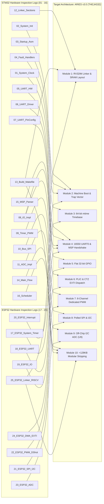

# Betaflight Porting Knowledge Graph: ARIES v3.0 (THEJAS32 / VEGA ET1031)

This document synthesizes findings across all 25 hardware inspection logs into a unified, component-by-component architectural blueprint for porting Betaflight to the **ARIES v3.0** board powered by the **THEJAS32 SoC (VEGA ET1031 RISC-V RV32IM)**.

---

## 1. Architectural System Graph

The diagram below maps the hardware execution flow, hardware abstractions, and interaction pathways between the Betaflight core engine, peripheral drivers, and physical THEJAS32 hardware.

```mermaid
graph TD
    subgraph Configurator ["Host PC / Betaflight Configurator"]
        GUI["Betaflight Configurator UI"]
        MSP_LAYER["MSP Protocol Engine (v1 / v2)"]
        GUI <--> MSP_LAYER
    end

    subgraph Physical_Link ["Physical Interface"]
        CP2102N["Silicon Labs CP2102N USB-UART Bridge"]
        MSP_LAYER <== USB Cable ==> CP2102N
    end

    subgraph Hardware_Layer ["ARIES v3.0 (THEJAS32 SoC)"]
        CP2102N <== Pins 107/108 ==> UART0["UART0 (16550 IP @ 0x10000100)"]
        CLINT["64-bit mtime @ 100 MHz (0x02000000)"]
        PLIC["PLIC Interrupt Controller (0x0C000000)"]
        GPIO["Flat 32-bit GPIO (0x10000000)"]
        PWM["8-Ch Dedicated PWM (0x10000600)"]
        SPI0["Polled SPI0 / SPI3"]
        I2C2["I2C2 Bus Controller"]
        U9_ADC["External 4-Ch I2C ADC (U9)"]
        I2C2 <==> U9_ADC
    end

    subgraph Drivers ["Betaflight Driver Layer (src/platform/THEJAS32/)"]
        UART_DRV["serial_uart_thejas32.c"]
        TIME_DRV["system_thejas32.c / timer_thejas32.c"]
        INTR_DRV["interrupt_thejas32.c / exti_thejas32.c"]
        IO_DRV["io_thejas32.c"]
        PWM_DRV["pwm_motor_thejas32.c"]
        BUS_DRV["bus_spi_thejas32.c / bus_i2c_thejas32.c"]
        ADC_DRV["adc_thejas32.c"]

        UART0 <--> UART_DRV
        CLINT <--> TIME_DRV
        PLIC <--> INTR_DRV
        GPIO <--> IO_DRV
        GPIO <--> INTR_DRV
        PWM <--> PWM_DRV
        SPI0 <--> BUS_DRV
        I2C2 <--> BUS_DRV
        BUS_DRV <--> ADC_DRV
    end

    subgraph Core ["Betaflight Core (src/main/)"]
        SCHED["Cooperative Scheduler (scheduler.c)"]
        MSP_SRV["MSP Serial Parser (msp_serial.c)"]
        PG["Parameter Groups (pg.c)"]
        MOTOR["Motor Mixer & Output (motor.c)"]
        BATT["Battery Monitor (battery.c)"]

        UART_DRV <--> MSP_SRV
        TIME_DRV <--> SCHED
        INTR_DRV --> SCHED
        SCHED --> MSP_SRV
        SCHED --> MOTOR
        SCHED --> BATT
        MOTOR --> PWM_DRV
        BATT --> ADC_DRV
        PG --> SCHED
    end

    classDef core fill:#1f2937,stroke:#3b82f6,stroke-width:2px,color:#fff;
    classDef drv fill:#111827,stroke:#10b981,stroke-width:2px,color:#fff;
    classDef hw fill:#312e81,stroke:#818cf8,stroke-width:2px,color:#fff;
    classDef host fill:#064e3b,stroke:#34d399,stroke-width:2px,color:#fff;

    class GUI,MSP_LAYER host;
    class CP2102N,UART0,CLINT,PLIC,GPIO,PWM,SPI0,I2C2,U9_ADC hw;
    class UART_DRV,TIME_DRV,INTR_DRV,IO_DRV,PWM_DRV,BUS_DRV,ADC_DRV drv;
    class SCHED,MSP_SRV,PG,MOTOR,BATT core;
```



---

## 2. Component-by-Component Porting Blueprint

### Module 1: Toolchain, Target Flags & Memory Layout
* **Dedicated Component Node**: [09_BUILD_LINKER_AND_MEMORY.md](file:///home/ivan/Desktop/betaflight/knowledgebase/components/09_BUILD_LINKER_AND_MEMORY.md)
* **Target Architecture**: RISC-V RV32IM (Integer + Hardware Multiply & Divide, soft-float, 32 general-purpose registers `x0`–`x31`).
* **Toolchain Prefix**: `riscv32-unknown-elf-`
* **Compilation Flags**:
  ```makefile
  ARCH_FLAGS = -march=rv32im -mabi=ilp32
  CFLAGS += -Os -flto -ffunction-sections -fdata-sections -fno-common
  ```
* **Memory Map (SRAM Boot Mode)**:
  * Internal SRAM: `0x00200000` to `0x0023E7FF` (250 KB usable space).
  * Single Unified Memory Region (`RWX`): Prevents instruction/data VMA overlap (learned from [25_ESP32_BUILD_AND_LINKER.md](file:///home/ivan/Desktop/betaflight/logs/hardware_inspection/25_ESP32_BUILD_AND_LINKER.md)).
  * Mandatory Parameter Group Linker Sections:
    ```ld
    .pg_registry : {
        PROVIDE_HIDDEN (__pg_registry_start = .);
        KEEP (*(.pg_registry))
        KEEP (*(SORT(.pg_registry.*)))
        PROVIDE_HIDDEN (__pg_registry_end = .);
    } > RAM
    .pg_resetdata : {
        PROVIDE_HIDDEN (__pg_resetdata_start = .);
        KEEP (*(.pg_resetdata))
        PROVIDE_HIDDEN (__pg_resetdata_end = .);
    } > RAM
    ```
* **Consulted Logs**:
  * [12_STM32_LINKER_AND_SECTIONS.md](file:///home/ivan/Desktop/betaflight/logs/hardware_inspection/12_STM32_LINKER_AND_SECTIONS.md)
  * [13_STM32_BUILD_MAKEFILE.md](file:///home/ivan/Desktop/betaflight/logs/hardware_inspection/13_STM32_BUILD_MAKEFILE.md)
  * [25_ESP32_BUILD_AND_LINKER.md](file:///home/ivan/Desktop/betaflight/logs/hardware_inspection/25_ESP32_BUILD_AND_LINKER.md)

---

### Module 2: System Boot, Startup Assembly & Exception Traps
* **Dedicated Component Node**: [02_STARTUP_BOOT_AND_EXCEPTIONS.md](file:///home/ivan/Desktop/betaflight/knowledgebase/components/02_STARTUP_BOOT_AND_EXCEPTIONS.md)
* **Startup Code (`crt.S`)**:
  * Initializes Stack Pointer (`sp = _heap_stack_end`).
  * Clears `.bss` segment to zero.
  * Copies initialized data (`.data`) from flash/load address to SRAM if executing dual-stage, or verifies integrity in SRAM boot.
  * Writes stack watermark pattern (`0xA5A5A5A5`) to enable stack monitoring.
  * Sets Machine Trap-Vector Base-Address Register (`mtvec`) pointing to `trap_entry`.
  * Branches directly into `main()`.
* **Trap Dispatcher (`trap_entry`)**:
  * Saves caller-saved registers (`ra`, `t0`-`t6`, `a0`-`a7`) onto machine stack.
  * Reads `mcause` to differentiate between:
    * Synchronous Faults (Illegal Instruction, Load/Store Address Misaligned, Instruction/Data Bus Fault) $\rightarrow$ dumps register frame into crash log buffer and enters LED SOS blink loop.
    * External Interrupts (`mcause & 0x80000000` with code 11 for Machine External Interrupt) $\rightarrow$ dispatches to PLIC handler.
* **Consulted Logs**:
  * [02_STM32_SYSTEM_INIT.md](file:///home/ivan/Desktop/betaflight/logs/hardware_inspection/02_STM32_SYSTEM_INIT.md)
  * [03_STM32_STARTUP_ASSEMBLY.md](file:///home/ivan/Desktop/betaflight/logs/hardware_inspection/03_STM32_STARTUP_ASSEMBLY.md)
  * [04_STM32_FAULT_HANDLERS.md](file:///home/ivan/Desktop/betaflight/logs/hardware_inspection/04_STM32_FAULT_HANDLERS.md)
  * [20_ESP32_INTERRUPT_MODEL.md](file:///home/ivan/Desktop/betaflight/logs/hardware_inspection/20_ESP32_INTERRUPT_MODEL.md)

---

### Module 3: Timebase & Monotonic Clocks
* **Dedicated Component Node**: [01_SYSTEM_AND_CLOCKS.md](file:///home/ivan/Desktop/betaflight/knowledgebase/components/01_SYSTEM_AND_CLOCKS.md)
* **Hardware Engine**: THEJAS32 Memory-Mapped Machine Timer (`mtime` / `mtimecmp` registers at `0x0200BFF8` and `0x02004000`).
* **Clock Frequency**: Fixed 100 MHz clock source.
* **Architectural Advantage Over STM32**:
  * STM32 uses a 24-bit down-counter SysTick, which wraps every 10–20 ms, requiring complex atomic rollover compensation and DWT unlock loops (analyzed in [01_STM32_COMMON_SYSTEM.md](file:///home/ivan/Desktop/betaflight/logs/hardware_inspection/01_STM32_COMMON_SYSTEM.md)).
  * THEJAS32's 64-bit `mtime` up-counter runs monotonically for over **5,800 years** without wrapping!
* **Driver Implementation**:
  ```c
  static inline uint64_t getMTime(void) {
      volatile uint32_t *mtime_l = (uint32_t *)0x0200BFF8;
      volatile uint32_t *mtime_h = (uint32_t *)0x0200BFFC;
      uint32_t h1, l, h2;
      do {
          h1 = *mtime_h;
          l = *mtime_l;
          h2 = *mtime_h;
      } while (h1 != h2);
      return (((uint64_t)h1) << 32) | l;
  }

  uint32_t micros(void) {
      return (uint32_t)(getMTime() / 100ULL); // 100 MHz / 100 = 1 MHz (1 us)
  }

  uint32_t millis(void) {
      return (uint32_t)(getMTime() / 100000ULL);
  }
  ```
* **Consulted Logs**:
  * [01_STM32_COMMON_SYSTEM.md](file:///home/ivan/Desktop/betaflight/logs/hardware_inspection/01_STM32_COMMON_SYSTEM.md)
  * [17_ESP32_SYSTEM_AND_TIMER.md](file:///home/ivan/Desktop/betaflight/logs/hardware_inspection/17_ESP32_SYSTEM_AND_TIMER.md)

---

### Module 4: Serial Communication & MSP Handshake
* **Dedicated Component Node**: [03_SERIAL_UART_AND_MSP.md](file:///home/ivan/Desktop/betaflight/knowledgebase/components/03_SERIAL_UART_AND_MSP.md)
* **Hardware IP**: National Semiconductor 16550-compatible UART IP (`UART0` at base `0x10000100`).
* **Physical Pin Mapping**: Hardwired to onboard Silicon Labs CP2102N USB-to-UART bridge on pins 107 (`UART0_TXD`) and 108 (`UART0_RXD`).
* **Registers**:
  * `0x00`: `RBR` (Receiver Buffer Register, read) / `THR` (Transmitter Holding Register, write) / `DLL` (Divisor Latch Low, when DLAB=1)
  * `0x04`: `IER` (Interrupt Enable Register) / `DLM` (Divisor Latch High, when DLAB=1)
  * `0x08`: `IIR` (Interrupt Identification Register, read) / `FCR` (FIFO Control Register, write)
  * `0x0C`: `LCR` (Line Control Register, bit 7 = DLAB)
  * `0x14`: `LSR` (Line Status Register, bit 0 = `DR` Data Ready, bit 5 = `THRE` Transmit Holding Register Empty)
* **Baud Rate Configuration (115,200 baud @ 100 MHz clock)**:
  $$\text{Divisor} = \frac{100{,}000{,}000}{16 \times 115{,}200} \approx 54.253 \implies \text{Divisor} = 54$$
  $$\text{Actual Baud} = \frac{100{,}000{,}000}{16 \times 54} \approx 115{,}740\,\text{bps}\quad (\text{Error: } +0.47\% \ll 2\% \text{ limit!})$$
* **Driver Architecture**:
  * Interrupt-driven RX with circular buffer (`rxRingBuffer[256]`).
  * Polled or ring-buffered TX. Because CP2102N can absorb byte bursts into its internal USB FIFO, writing to `THR` when `LSR & 0x20` is non-blocking.
  * Direct integration with `mspSerialProcess()` in cooperative scheduler.
* **Consulted Logs**:
  * [05_STM32_SERIAL_UART_HW.md](file:///home/ivan/Desktop/betaflight/logs/hardware_inspection/05_STM32_SERIAL_UART_HW.md)
  * [06_STM32_SERIAL_UART_DRIVER.md](file:///home/ivan/Desktop/betaflight/logs/hardware_inspection/06_STM32_SERIAL_UART_DRIVER.md)
  * [07_STM32_SERIAL_UART_PINCONFIG.md](file:///home/ivan/Desktop/betaflight/logs/hardware_inspection/07_STM32_SERIAL_UART_PINCONFIG.md)
  * [15_MSP_SERIAL_PARSER.md](file:///home/ivan/Desktop/betaflight/logs/hardware_inspection/15_MSP_SERIAL_PARSER.md)
  * [18_ESP32_SERIAL_UART.md](file:///home/ivan/Desktop/betaflight/logs/hardware_inspection/18_ESP32_SERIAL_UART.md)

---

### Module 5: GPIO & Pin IO Abstraction
* **Dedicated Component Node**: [04_GPIO_AND_PIN_IO.md](file:///home/ivan/Desktop/betaflight/knowledgebase/components/04_GPIO_AND_PIN_IO.md)
* **Hardware Architecture**: Flat 32-bit GPIO controller (`GPIO0` to `GPIO31` at base `0x10000000`).
* **Architectural Advantage Over STM32**:
  * STM32 scatters pins across multiple 16-bit banks (`GPIOA`–`GPIOI`), requiring memory-hungry sparse lookup tables and `popcount` routines (analyzed in [08_STM32_IO_IMPL.md](file:///home/ivan/Desktop/betaflight/logs/hardware_inspection/08_STM32_IO_IMPL.md)).
  * Matches the flat single-port architecture of ESP32 ([19_ESP32_IO_IMPL.md](file:///home/ivan/Desktop/betaflight/logs/hardware_inspection/19_ESP32_IO_IMPL.md)), with `DEFIO_PORT_USED_COUNT == 1`.
* **Driver Implementation**:
  ```c
  #define THEJAS32_GPIO_COUNT 32
  static ioRec_t ioRecs[THEJAS32_GPIO_COUNT];

  IO_t IOGetByTag(ioTag_t tag) {
      if (!tag || tag > THEJAS32_GPIO_COUNT) return IO_NONE;
      return &ioRecs[tag - 1]; // O(1) direct indexing, 0 bytes waste
  }
  ```
* **Consulted Logs**:
  * [08_STM32_IO_IMPL.md](file:///home/ivan/Desktop/betaflight/logs/hardware_inspection/08_STM32_IO_IMPL.md)
  * [19_ESP32_IO_IMPL.md](file:///home/ivan/Desktop/betaflight/logs/hardware_inspection/19_ESP32_IO_IMPL.md)

---

### Module 6: Interrupts & EXTI Subsystem
* **Dedicated Component Node**: [06_INTERRUPTS_AND_EXTI.md](file:///home/ivan/Desktop/betaflight/knowledgebase/components/06_INTERRUPTS_AND_EXTI.md)
* **Hardware Architecture**: Platform-Level Interrupt Controller (`PLIC` at base `0x0C000000`).
* **Pin Interrupt Routing**:
  * Pins `GPIO0`–`GPIO31` route external edge triggers to the PLIC.
  * Dispatched via the single-ISR compiler intrinsic pattern proven in [24_ESP32_DMA_AND_EXTI.md](file:///home/ivan/Desktop/betaflight/logs/hardware_inspection/24_ESP32_DMA_AND_EXTI.md):
    ```c
    void GPIO_PLIC_IRQHandler(void) {
        uint32_t status = THEJAS32_GPIO->INT_STATUS;
        while (status) {
            uint32_t pin = __builtin_ctz(status);
            status &= ~(1U << pin);
            THEJAS32_GPIO->INT_CLEAR = (1U << pin);
            if (extiChannelRecs[pin].handler && extiChannelRecs[pin].handler->fn) {
                extiChannelRecs[pin].handler->fn(extiChannelRecs[pin].handler);
            }
        }
    }
    ```
* **Consulted Logs**:
  * [03_STM32_STARTUP_ASSEMBLY.md](file:///home/ivan/Desktop/betaflight/logs/hardware_inspection/03_STM32_STARTUP_ASSEMBLY.md)
  * [04_STM32_FAULT_HANDLERS.md](file:///home/ivan/Desktop/betaflight/logs/hardware_inspection/04_STM32_FAULT_HANDLERS.md)
  * [20_ESP32_INTERRUPT_MODEL.md](file:///home/ivan/Desktop/betaflight/logs/hardware_inspection/20_ESP32_INTERRUPT_MODEL.md)
  * [24_ESP32_DMA_AND_EXTI.md](file:///home/ivan/Desktop/betaflight/logs/hardware_inspection/24_ESP32_DMA_AND_EXTI.md)

---

### Module 7: Motor Output Subsystem (PWM / OneShot)
* **Dedicated Component Node**: [05_TIMER_AND_MOTOR_PWM.md](file:///home/ivan/Desktop/betaflight/knowledgebase/components/05_TIMER_AND_MOTOR_PWM.md)
* **Hardware Engine**: Dedicated 8-Channel PWM controller (`PWM[0..7]` at base `0x10000600`).
* **Architectural Advantage Over STM32**:
  * STM32 timers suffer from asymmetric APB1/APB2 bus multipliers and severe DMA stream collisions (analyzed in [09_STM32_TIMER_PWM_HW.md](file:///home/ivan/Desktop/betaflight/logs/hardware_inspection/09_STM32_TIMER_PWM_HW.md)).
  * THEJAS32 runs all 8 PWM channels off the same 100 MHz clock, eliminating timer clock doublers and DMA collisions entirely.
* **Pin Assignments on ARIES v3.0 Headers**:
  * Motors 1–3: `PWM[0..2]` on Header `J2` (Pins 86, 85, 82)
  * Motor 4 & Servo: `PWM[3..4]` on Header `J1` (Pins 81, 80)
  * Aux / Beeper: `PWM[5..7]` on Header `J3` (Pins 77, 76, 75)
* **VTable Non-Null Safety**:
  * Must implement `convertExternalToMotor` and `convertMotorToExternal` to prevent NULL-pointer panics when Configurator's Motor sliders are engaged ([22_ESP32_PWM_DSHOT.md](file:///home/ivan/Desktop/betaflight/logs/hardware_inspection/22_ESP32_PWM_DSHOT.md)).
* **Consulted Logs**:
  * [09_STM32_TIMER_PWM_HW.md](file:///home/ivan/Desktop/betaflight/logs/hardware_inspection/09_STM32_TIMER_PWM_HW.md)
  * [22_ESP32_PWM_DSHOT.md](file:///home/ivan/Desktop/betaflight/logs/hardware_inspection/22_ESP32_PWM_DSHOT.md)

---

### Module 8: Bus Peripherals (SPI & I2C)
* **Dedicated Component Node**: [07_BUS_SPI_AND_I2C.md](file:///home/ivan/Desktop/betaflight/knowledgebase/components/07_BUS_SPI_AND_I2C.md)
* **SPI Driver**:
  * THEJAS32 provides SPI0 (onboard SPI Flash `U5`), SPI1, SPI2, SPI3 (Header `J4` for external SPI IMU).
  * For <128KB minimal target, implement **polled SPI** (proven on ESP32 in [21_ESP32_BUS_SPI_I2C.md](file:///home/ivan/Desktop/betaflight/logs/hardware_inspection/21_ESP32_BUS_SPI_I2C.md)).
  * No Cortex-M7 L1 D-Cache invalidation issues (`SCB_InvalidateDCache_by_Addr`).
  * No DMA descriptor alignment bounce buffer issues.
* **I2C Driver**:
  * `I2C2` routes to onboard 4-channel ADC (`U9`).
  * Uses simple polled write/read buffer flow (START $\rightarrow$ ADDR $\rightarrow$ REG $\rightarrow$ RESTART $\rightarrow$ READ $\rightarrow$ STOP).
* **Consulted Logs**:
  * [10_STM32_BUS_SPI_HW.md](file:///home/ivan/Desktop/betaflight/logs/hardware_inspection/10_STM32_BUS_SPI_HW.md)
  * [21_ESP32_BUS_SPI_I2C.md](file:///home/ivan/Desktop/betaflight/logs/hardware_inspection/21_ESP32_BUS_SPI_I2C.md)

---

### Module 9: Sensor Sampling & ADC Subsystem
* **Dedicated Component Node**: [08_ANALOG_ADC_SUBSYSTEM.md](file:///home/ivan/Desktop/betaflight/knowledgebase/components/08_ANALOG_ADC_SUBSYSTEM.md)
* **Physical Hardware Topology**:
  * THEJAS32 SoC has **no internal SAR ADC**.
  * Analog input pins `ADC_CH0`–`ADC_CH3` on Header `J10` connect to an external 4-channel I2C ADC chip (`U9`) on `I2C2`.
* **Software Model**:
  * Both STM32 and ESP32 inspections prove that **DMA is completely unnecessary for ADC**:
    * Battery voltage and current draw update at ~10 Hz (human scale).
    * `TASK_BATTERY` reads cached values from `aries_adc_raw[4]`.
  * For initial MSP handshake, battery monitoring can return static nominal values (e.g. 12.6V), enabling instant Configurator telemetry without waiting for `I2C2` bus bringup.
* **Consulted Logs**:
  * [11_STM32_ADC_IMPL.md](file:///home/ivan/Desktop/betaflight/logs/hardware_inspection/11_STM32_ADC_IMPL.md)
  * [23_ESP32_ADC.md](file:///home/ivan/Desktop/betaflight/logs/hardware_inspection/23_ESP32_ADC.md)

---

### Module 10: Size Budget & Modular Stripping (<128 KB Target)
* **Dedicated Component Nodes**: [10_SCHEDULER_AND_TASK_ARCHITECTURE.md](file:///home/ivan/Desktop/betaflight/knowledgebase/components/10_SCHEDULER_AND_TASK_ARCHITECTURE.md) & [11_TARGET_OPTIMIZATION_BUDGET.md](file:///home/ivan/Desktop/betaflight/knowledgebase/components/11_TARGET_OPTIMIZATION_BUDGET.md)
To ensure the firmware compiles under **128 KB** and executes within the **250 KB SRAM** boundary, the following modules are excluded from the target build:
* **Excluded**:
  1. ST Native USB Middleware (`-DUSE_VCP` omitted $\rightarrow$ saves ~30 KB). Handled by hardware CP2102N.
  2. Accelerometer / Gyro complex calibration math and secondary filters (omitted for initial MSP bringup).
  3. Blackbox SDCard / FATFS filesystem (saves ~22 KB).
  4. MAX7456 / FrSky / MSP OSD Rendering Engine (saves ~28 KB).
  5. GPS / Return-to-Home navigation (saves ~35 KB).
  6. DMA Engine machinery (`#ifndef USE_DMA` with `dma_stub` $\rightarrow$ saves ~6 KB).
* **Included**:
  1. Cooperative Task Scheduler (`src/main/scheduler/scheduler.c`).
  2. Parameter Group Engine (`src/main/pg/pg.c`).
  3. MSP v1/v2 Serial Protocol Handshake Parser (`src/main/msp/msp_serial.c`).
  4. Minimal Motor Mixer & CLI VTable.
  5. THEJAS32 UART0, GPIO, and Timer Drivers.
* **Estimated Binary Size**: **~68 KB to 85 KB**, easily fitting within the 128 KB limit!
* **Consulted Logs**:
  * [13_STM32_BUILD_MAKEFILE.md](file:///home/ivan/Desktop/betaflight/logs/hardware_inspection/13_STM32_BUILD_MAKEFILE.md)
  * [14_MAIN_STARTUP_FLOW.md](file:///home/ivan/Desktop/betaflight/logs/hardware_inspection/14_MAIN_STARTUP_FLOW.md)
  * [15_MSP_SERIAL_PARSER.md](file:///home/ivan/Desktop/betaflight/logs/hardware_inspection/15_MSP_SERIAL_PARSER.md)
  * [16_SCHEDULER_CORE.md](file:///home/ivan/Desktop/betaflight/logs/hardware_inspection/16_SCHEDULER_CORE.md)
  * [25_ESP32_BUILD_AND_LINKER.md](file:///home/ivan/Desktop/betaflight/logs/hardware_inspection/25_ESP32_BUILD_AND_LINKER.md)

---

## 3. Knowledge Base & Log Cross-Reference Graph



---

## 4. First-Boot & Configurator Verification Checklist

When the minimal build is flashed into SRAM and executed:

| Step | Verification Milestone | Expected Observable Result | Log Blueprint |
| :---: | :--- | :--- | :--- |
| **1** | Machine Reset & Stack Init | CPU enters `Reset_Handler`, initializes `sp`, sets watermark `0xA5A5A5A5`. | [03_STM32_STARTUP_ASSEMBLY.md](file:///home/ivan/Desktop/betaflight/logs/hardware_inspection/03_STM32_STARTUP_ASSEMBLY.md) |
| **2** | Parameter Group Init | `pgResetAll()` iterates over `.pg_registry` successfully without dereferencing NULL. | [25_ESP32_BUILD_AND_LINKER.md](file:///home/ivan/Desktop/betaflight/logs/hardware_inspection/25_ESP32_BUILD_AND_LINKER.md) |
| **3** | Microsecond Monotonic Clock | `micros()` advances monotonically by 1000 every millisecond via `mtime`. | [01_STM32_COMMON_SYSTEM.md](file:///home/ivan/Desktop/betaflight/logs/hardware_inspection/01_STM32_COMMON_SYSTEM.md) & [17_ESP32_SYSTEM_AND_TIMER.md](file:///home/ivan/Desktop/betaflight/logs/hardware_inspection/17_ESP32_SYSTEM_AND_TIMER.md) |
| **4** | UART0 115,200 Baud Init | Oscilloscope/Logic Analyzer shows clean 115.2 kbps square waves on pin 107. | [05_STM32_SERIAL_UART_HW.md](file:///home/ivan/Desktop/betaflight/logs/hardware_inspection/05_STM32_SERIAL_UART_HW.md) & [18_ESP32_SERIAL_UART.md](file:///home/ivan/Desktop/betaflight/logs/hardware_inspection/18_ESP32_SERIAL_UART.md) |
| **5** | MSP Serial Poll Loop | `scheduler()` calls `TASK_SERIAL` every loop without blocking other tasks. | [15_MSP_SERIAL_PARSER.md](file:///home/ivan/Desktop/betaflight/logs/hardware_inspection/15_MSP_SERIAL_PARSER.md) & [16_SCHEDULER_CORE.md](file:///home/ivan/Desktop/betaflight/logs/hardware_inspection/16_SCHEDULER_CORE.md) |
| **6** | Configurator Connection | Configurator sends `MSP_API_VERSION` (`$M<0\x01\x01`); firmware responds `$M>3\x01\x01...`. UI indicates **"Connected"**! | [MSP_CONFIGURATOR_HANDSHAKE_GRAPH.md](file:///home/ivan/Desktop/betaflight/knowledgebase/MSP_CONFIGURATOR_HANDSHAKE_GRAPH.md) |
