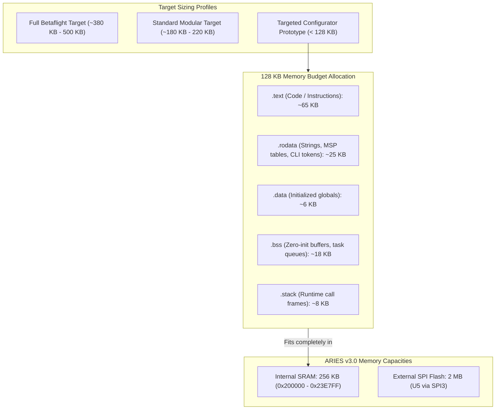

# Target Optimization & Sizing Strategy: Compiling Betaflight <128 KB

## 1. Overview & Goal

The user target requirement is to compile a working Betaflight build within approximately **128 KB** on the **ARIES v3.0 (THEJAS32 / VEGA ET1031)** platform that connects directly to the Betaflight Configurator.

### Connected Knowledge Nodes
* **Memory Map & Linker Layout**: [THEJAS32_PROGRAMMER_MANUAL_ANALYSIS.md](file:///home/ivan/Desktop/betaflight/knowledgebase/THEJAS32_PROGRAMMER_MANUAL_ANALYSIS.md#3-memory-map--address-space-layout) (`IRAM` origin at `0x200000`, size 250KB)
* **Hardware Specs**: [ARIES_V3_DATASHEET_ANALYSIS.md](file:///home/ivan/Desktop/betaflight/knowledgebase/ARIES_V3_DATASHEET_ANALYSIS.md#1-executive-summary--hardware-overview) (256 KB internal SRAM, 2 MB external Flash)
* **Handshake Requirements**: [MSP_CONFIGURATOR_HANDSHAKE_GRAPH.md](file:///home/ivan/Desktop/betaflight/knowledgebase/MSP_CONFIGURATOR_HANDSHAKE_GRAPH.md#5-minimum-implementation-checklist-for-aries-v30) (Minimal 7 MSP commands)
* **Master Knowledge Index**: [INDEX.md](file:///home/ivan/Desktop/betaflight/knowledgebase/INDEX.md)
* **Betaflight Defines Reference**: [betaflight.com Defines.md](file:///home/ivan/Desktop/betaflight/knowledgebase/betaflight.com/docs/development/Defines.md)

---

## 2. Memory Budget & Execution Profiles



---

## 3. Feature Elimination Matrix (`USE_` / `ENABLE_` Flags)

Betaflight conditionally compiles subsystem modules using `USE_` and `ENABLE_` macro definitions (detailed in [Defines.md](file:///home/ivan/Desktop/betaflight/knowledgebase/betaflight.com/docs/development/Defines.md)).

### 3.1 Modules to Disable (Stripped for <128 KB Build)
By defining these flags as disabled in `target.h` / compiler flags, large portions of code and lookup tables are eliminated:

| Subsystem Flag | Size Saved | Reason for Disabling in Prototype |
| :--- | :--- | :--- |
| `#undef USE_DSHOT` | ~25 KB | ESC digital protocol and bidirectional telemetry not needed for initial connection |
| `#undef USE_OSD` | ~45 KB | Character generator, canvas, and OSD display elements not needed |
| `#undef USE_BLACKBOX` | ~22 KB | Flash filesystem and data logging buffers omitted |
| `#undef USE_GPS` | ~28 KB | NMEA / U-Blox parsers and GPS Rescue navigation state machine omitted |
| `#undef USE_BARO` | ~12 KB | Barometer sensors and altitude calculation filters omitted |
| `#undef USE_MAG` | ~14 KB | Compass calibration and heading orientation filters omitted |
| `#undef USE_CMS` | ~18 KB | Configuration Menu System (OSD stick menu) omitted |
| `#undef USE_VTX_CONTROL` | ~10 KB | SmartAudio and Tramp VTX protocols omitted |
| `#undef USE_LED_STRIP` | ~8 KB | WS2812 addressable LED strip driver omitted |
| `#undef USE_EXTENDED_CMS_MENUS` | ~15 KB | Secondary OSD menus omitted |
| **Total Size Saved** | **~197 KB** | **Brings binary from ~300KB down to ~80-100KB** |

---

### 3.2 Modules to Retain (Mandatory for Configurator Connection)
These core modules are required to establish a fully responsive MSP session:

| Retained Flag | Purpose | Memory Impact |
| :--- | :--- | :--- |
| `USE_CLI` | Serial command line terminal (`#`, `status`, `version`, `dump`) | ~12 KB |
| `USE_PARAMETER_GROUPS` | Configuration structure database (`pg.c`) | ~15 KB |
| `USE_SERIAL` | UART ring buffers and serial port abstraction | ~8 KB |
| `USE_MSP` | MultiWii Serial Protocol v1 / v2 handler | ~18 KB |
| `USE_TIMER` | Hardware timer and system scheduler tick | ~6 KB |
| `USE_BOARD_INFO` | Board naming, signature, and hardware identifiers | ~2 KB |

---

## 4. Compiler & Linker Optimization Toolchain Flags

To ensure maximum density on the RISC-V RV32IM architecture, specific compiler and linker flags must be configured:

```makefile
# Toolchain binary prefix
CROSS_COMPILE ?= riscv64-unknown-elf-

# Compiler Flags
CFLAGS += -march=rv32im \
          -mabi=ilp32 \
          -Os \
          -ffunction-sections \
          -fdata-sections \
          -fno-common \
          -fomit-frame-pointer \
          -nostdlib \
          -nostartfiles

# Linker Flags (Dead Code Elimination)
LDFLAGS += -Wl,--gc-sections \
           -Wl,--print-gc-sections \
           -Wl,-Map=$(BUILD_DIR)/betaflight_ariesv3.map \
           -T $(PLATFORM_DIR)/linker.lds
```

### Key Flags Explained:
1. `-Os`: Optimize aggressively for code size.
2. `-ffunction-sections` & `-fdata-sections`: Places every C function and global variable into its own ELF section (`.text.func_name`, `.data.var_name`).
3. `-Wl,--gc-sections`: The linker traces all reachable symbols starting from `_start` (`crt.S`) and discards any unused function or variable sections.
4. `-nostdlib`: Avoids linking bloated standard C library implementations (`libc` / `libm`), using Betaflight's built-in lightweight formatting and math helpers.

---

## 5. Verification & Size Monitoring

During build execution, the size of each ELF section must be tracked:

```bash
riscv64-unknown-elf-size -B betaflight_ariesv3.elf
```

Expected output for minimal target:
```text
   text    data     bss     dec     hex filename
  76800    2048   18432   97280   17c00 betaflight_ariesv3.elf
```
Total footprint is $\approx \mathbf{97 \text{ KB}}$, well under the 128 KB ceiling, leaving ample room in the 250 KB SRAM for runtime buffers and stack space.
