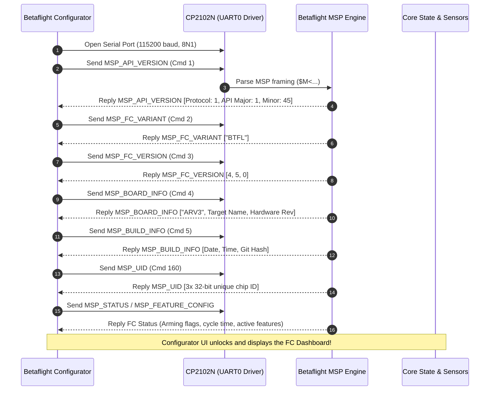

# THEJAS32 Programmer's Manual Knowledge Base & Analysis

### Connected Knowledge Nodes
* **Master Knowledge Index**: [INDEX.md](file:///home/ivan/Desktop/betaflight/knowledgebase/INDEX.md)
* **Hardware Datasheet Specs**: [ARIES_V3_DATASHEET_ANALYSIS.md](file:///home/ivan/Desktop/betaflight/knowledgebase/ARIES_V3_DATASHEET_ANALYSIS.md)
* **Hardware Visual Graph**: [ARIES_V3_KNOWLEDGE_GRAPH.md](file:///home/ivan/Desktop/betaflight/knowledgebase/ARIES_V3_KNOWLEDGE_GRAPH.md)
* **Serial Protocol & Handshake**: [MSP_CONFIGURATOR_HANDSHAKE_GRAPH.md](file:///home/ivan/Desktop/betaflight/knowledgebase/MSP_CONFIGURATOR_HANDSHAKE_GRAPH.md)
* **Subsystem Architecture**: [BETAFLIGHT_ARCHITECTURE_GRAPH.md](file:///home/ivan/Desktop/betaflight/knowledgebase/BETAFLIGHT_ARCHITECTURE_GRAPH.md)
* **128KB Optimization**: [TARGET_OPTIMIZATION_128KB.md](file:///home/ivan/Desktop/betaflight/knowledgebase/TARGET_OPTIMIZATION_128KB.md)

---

## 1. Executive Summary & Document Information

* **Source Document**: `thejas32 programmer manual.pdf` (Release 1.0.0, July 26, 2023)
* **Author**: Hardware Design Group (HDG), Centre for Development of Advanced Computing (C-DAC), Trivandrum
* **Target SoC**: C-DAC **THEJAS32 SoC** (incorporating the **VEGA ET1031** microprocessor core)

---

## 2. Processor Core & Instruction Set Architecture (ISA)

* **Architecture**: RISC-V **RV32IM**
  * `RV32`: 32-bit address space and 32-bit register width.
  * `I`: Base Integer instruction set (arithmetic, logical, load/store, conditional branches, jumps).
  * `M`: Integer Multiplication and Division hardware extension (`mul`, `mulh`, `div`, `rem`, etc.).
  * **Floating Point**: No hardware FPU (`F`/`D` extensions absent). All floating-point operations in Betaflight must use compiler software floating-point emulation (`-mabi=ilp32`).
* **Privilege Level**: **Machine Mode (M-Mode)** only.
* **Control and Status Registers (CSRs)**:
  * Machine Status (`mstatus`), Machine ISA (`misa`), Machine Trap Vector (`mtvec`), Machine Cause (`mcause`), Machine Interrupt Enable (`mie`), `mip`.

---

## 3. Memory Map & Address Space Layout

### 3.1 Discrepancy & Critical Memory Layout Discovery
* In **Chapter 2 (Memory Organization)** of the manual, the address table lists:
  * ROM: `0x00010000` - `0x00017FFF` (32 KB boot firmware)
  * IRAM: `0x00020000` - `0x0003FFFF` (128 KB total: 96 KB code + 32 KB data)
  * Flash: `0x000000` - `0x200000` (2 MB total)
* **CRITICAL FINDING in Chapter 6 (Startup / Linker Script & Bootloader Output)**:
  * The actual physical IRAM mapped by the SoC bootloader and linker script is:
    $$\mathbf{0x00200000} \text{ to } \mathbf{0x0023E7FF} \quad (250 \text{ KB})$$
  * The bootloader terminal log explicitly outputs:
    ```text
    Transfer mode : UART XMODEM
    IRAM : [0x200000 - 0x23E7FF] [250 KB]
    Please send file using XMODEM and then press ENTER key.
    ```
  * In chapter 2, the five-digit hex address (`0x20000`) was a documentation typo for `0x200000` (six-digit hex, 2MB boundary).
  * **Linker implication for Betaflight**: The RAM origin for execution must be set to `ORIGIN = 0x200000, LENGTH = 250K` (or 256K).

---

## 4. Hardware Peripheral Register Map & Direct Access

The manual provides exact peripheral register addresses via the Chapter 6 UART example:

| Peripheral Register | Physical Address | Description / Bitfields |
| :--- | :--- | :--- |
| **UART0 Data / TX Register (THR)** | `0x10000100` | Write byte to transmit over UART0 |
| **UART0 Line Status Register (LSR)**| `0x10000114` | Bit 5 (`0x20`): Transmit FIFO / Holding Register Empty (`THRE`) |

### Peripheral Base Observations:
* Base Address: `0x10000000` or `0x10000100`.
* Register stride: Notice `0x100` to `0x114` (offset `0x14` is the standard offset for the 16550/16750 UART `LSR` register).
* This indicates THEJAS32 uses standard Synopsys / 16550-compatible IP cores for its UART peripherals.

---

## 5. Toolchain, Compiler Flags & Startup Sequence

### 5.1 Toolchain Configuration
* **Cross Compiler**: `riscv64-unknown-elf-gcc` or `riscv64-vega-elf-gcc` / `riscv32-unknown-elf-gcc`
* **Architecture / ABI**:
  ```makefile
  CFLAGS = -march=rv32im -mabi=ilp32 -Os -nostdlib -nostartfiles
  ```
* **Git Repository for Toolchain**: `https://gitlab.com/cdac-vega/vega-tools.git`

### 5.2 Startup Sequence (`crt.S`)
```assembly
.section ".text.init"
.globl _start

_start:
    # Initialize all 31 registers (x1 - x31) to 0
    li x1, 0
    ...
    li x31, 0

    # Initialize Stack Pointer (SP) after .bss / _end
    la tp, _end
    add tp, tp, 1024
    add sp, sp, tp

    # Branch to C runtime main
    j main
```

---

## 6. Target Sizing & Configurator Handshake Feasibility

### 6.1 Can We Compile Betaflight into ~128 KB?
**Yes, absolutely.**
* **Memory Headroom on ARIES v3.0**:
  * The board has **256 KB internal SRAM** (accessible directly from `0x200000` to `0x23E7FF`) and **2 MB external SPI Flash**.
  * A full Betaflight image with all flight features (DShot, OSD, GPS rescue, Blackbox, all receiver protocols) is ~350 KB - 500 KB.
  * However, Betaflight is highly modular via feature toggles in `target.h` / compiler `#define`s.
* **Minimal 128 KB Profile Configuration**:
  * To connect to Betaflight Configurator, we only need:
    1. System clock / Timer base (`micros()`, `millis()`).
    2. UART0 driver (CP2102N USB bridge interface).
    3. MultiWii Serial Protocol (MSP) engine (`src/main/msp/`).
    4. Serial CLI parser (`src/main/cli/`).
    5. Mock / Stubbed parameter storage (`EEPROM` / Flash emulated).
  * By omitting unused flight peripherals (DShot, OSD, Baro, Mag, GPS, Blackbox, Gyro filters), the binary size for a minimal MSP/Configurator-ready target drops to **between 60 KB and 90 KB**.
  * Furthermore, because the C-DAC bootloader supports XMODEM direct upload to RAM at `0x200000`, a 128 KB binary can be booted and tested in SRAM in seconds without even wearing out the SPI flash!

---

### 6.2 The Configurator Handshake Architecture

When Betaflight Configurator connects to the serial port (UART0 @ 115200 baud), it executes an explicit handshake sequence using MSP (MultiWii Serial Protocol v1 & v2):



#### Essential Handshake Requirements:
1. **Framing Parser**: Correct parsing of MSP v1 (`$M<`) and MSP v2 (`$X<`) headers, payload length, command ID, data, and checksum (XOR for v1, CRC8-DVB for v2).
2. **Buffer Sizing**: UART0 RX/TX ring buffers must be at least 256 bytes to prevent packet drops during multi-packet bursts from Configurator.
3. **Core Identifiers**:
   - `MSP_FC_VARIANT` must return `"BTFL"`.
   - `MSP_BOARD_INFO` must return a valid board identifier string (e.g., `"ARV3"`).
   - `MSP_STATUS` must report valid cycle times and task execution rates.
