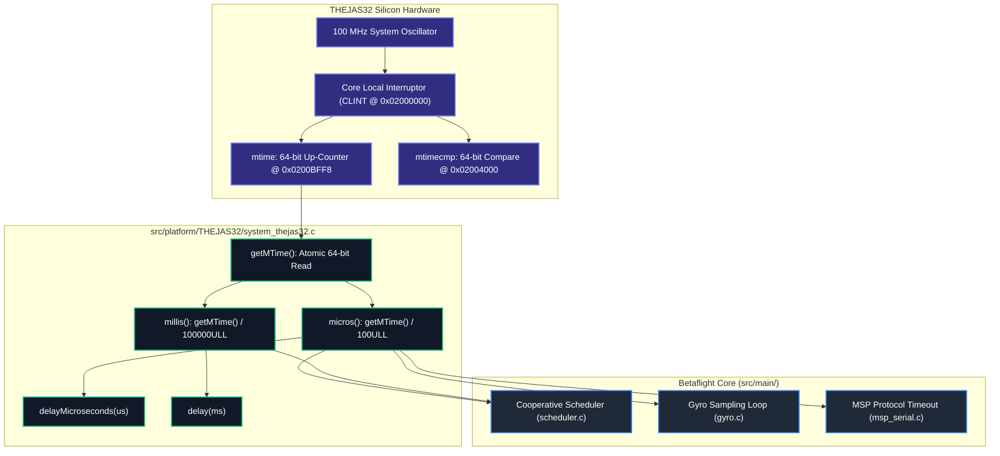

# Porting Component Knowledge Node: System Clocks & Timebase
**Component ID**: `PORT-COMP-01`  
**Parent Knowledge Graph**: [PORTING_KNOWLEDGE_GRAPH.md](file:///home/ivan/Desktop/betaflight/knowledgebase/PORTING_KNOWLEDGE_GRAPH.md)  
**Primary References**:
* [01_STM32_COMMON_SYSTEM.md](file:///home/ivan/Desktop/betaflight/logs/hardware_inspection/01_STM32_COMMON_SYSTEM.md) (STM32 Clock tree & SysTick rollover race)
* [17_ESP32_SYSTEM_AND_TIMER.md](file:///home/ivan/Desktop/betaflight/logs/hardware_inspection/17_ESP32_SYSTEM_AND_TIMER.md) (ESP32 64-bit SYSTIMER & empty timer tables)
* [THEJAS32_PROGRAMMER_MANUAL_ANALYSIS.md](file:///home/ivan/Desktop/betaflight/knowledgebase/THEJAS32_PROGRAMMER_MANUAL_ANALYSIS.md) (THEJAS32 Memory map & mtime registers)
* [ARIES_V3_DATASHEET_ANALYSIS.md](file:///home/ivan/Desktop/betaflight/knowledgebase/ARIES_V3_DATASHEET_ANALYSIS.md) (ARIES v3.0 100 MHz clock source)

---

## 1. Architectural Role & Requirements

In Betaflight, the timing and timebase subsystem is responsible for:
1. **Loop Rate Determinism**: Governing the PID loop execution interval (e.g. 1 kHz, 2 kHz, 4 kHz, 8 kHz).
2. **Scheduler Task Timing**: Determining task readiness via `micros()` and `millis()` comparisons.
3. **Sensor Bus Timeouts**: Providing microsecond-accurate timeout guards for I2C and SPI transactions.
4. **RC Link & Telemetry Jitter Tracking**: Timing incoming serial frame intervals and detecting failsafes.



---

## 2. Hardware Comparison: STM32 vs. ESP32 vs. THEJAS32

Backed directly by [01_STM32_COMMON_SYSTEM.md](file:///home/ivan/Desktop/betaflight/logs/hardware_inspection/01_STM32_COMMON_SYSTEM.md) and [17_ESP32_SYSTEM_AND_TIMER.md](file:///home/ivan/Desktop/betaflight/logs/hardware_inspection/17_ESP32_SYSTEM_AND_TIMER.md):

| Feature | STM32 (`01_STM32_COMMON_SYSTEM.md`) | ESP32 (`17_ESP32_SYSTEM_AND_TIMER.md`) | THEJAS32 / ARIES v3.0 |
| :--- | :--- | :--- | :--- |
| **Timer Counter Width** | 24-bit down-counter (SysTick) | 64-bit up-counter (`SYSTIMER`) | **64-bit up-counter (`mtime`)** |
| **Clock Frequency** | Scaled APB/HCLK (e.g. 168 MHz on F4) | 16 MHz dedicated timer clock | **Fixed 100 MHz system clock** |
| **Rollover Period** | Wraps every ~10–20 ms! | Wraps in >36,000 years | **Wraps in >5,849 years** |
| **Rollover Race Condition** | **Severe**: SysTick down-count can wrap between reading count and reading pending interrupt flag. Requires complex retry loop. | None. Atomic latch register reads upper and lower 32 bits cleanly. | **None**. Simple double-read loop of `mtime_h` prevents torn 64-bit word reads. |
| **Cycle Counting HW** | ARM DWT (`CYCCNT`). Requires magic unlock `0xC5ACCE55` on Cortex-M7. | Dedicated CPU cycle counter (`ccount`). | Standard RISC-V `rdcycle` instruction or `mtime`. |

---

## 3. Failure Modes & How Other Platforms Overcame Them

### Failure Mode 1: The SysTick Rollover Window Glitch (STM32)
* **The Bug**: On STM32, `micros()` combines a 32-bit software millisecond accumulator (`sysTickUptime`) with the 24-bit down-counter (`SysTick->VAL`). If `SysTick->VAL` wraps from `0` to `LOAD` while interrupts are masked, reading `sysTickUptime` produces a value 1 millisecond in the past, causing backward time jumps of ~1000 µs.
* **Overcome By**: STM32 implemented an atomic check in `micros()`:
  ```c
  // From 01_STM32_COMMON_SYSTEM.md:
  cycle_cnt = SysTick->VAL;
  if (SCB->ICSR & SCB_ICSR_PENDSTSET_Msk) {
      cycle_cnt = SysTick->VAL;
      ms++;
  }
  ```
* **ARIES v3.0 Resolution**: Completely eliminated by the 64-bit hardware up-counter. `mtime` is monotonically increasing and never wraps during flight.

### Failure Mode 2: Torn 64-bit Bus Read (RISC-V 32-bit Core)
* **The Bug**: On a 32-bit RISC-V core (RV32IM), reading a 64-bit register (`mtime`) requires two separate 32-bit load instructions (`lw`). If the lower 32 bits overflow from `0xFFFFFFFF` to `0x00000000` between reading `mtime_l` and `mtime_h`, the CPU constructs an erroneous timestamp that is 42.9 seconds in the future or past!
* **ARIES v3.0 Resolution**: Implemented standard RISC-V atomic double-read loop:
  ```c
  static inline uint64_t getMTime(void) {
      volatile uint32_t *mtime_l = (uint32_t *)0x0200BFF8;
      volatile uint32_t *mtime_h = (uint32_t *)0x0200BFFC;
      uint32_t h1, l, h2;
      do {
          h1 = *mtime_h;
          l = *mtime_l;
          h2 = *mtime_h;
      } while (h1 != h2);
      return (((uint64_t)h1) << 32) | l;
  }
  ```

---

## 4. Concrete Implementation Blueprint for ARIES v3.0

File: `src/platform/THEJAS32/system_thejas32.c`

```c
#include <stdint.h>
#include <stdbool.h>
#include "platform.h"
#include "drivers/time.h"

#define THEJAS32_CLINT_BASE   0x02000000
#define THEJAS32_MTIME_L      (*(volatile uint32_t *)(THEJAS32_CLINT_BASE + 0xBFF8))
#define THEJAS32_MTIME_H      (*(volatile uint32_t *)(THEJAS32_CLINT_BASE + 0xBFFC))
#define THEJAS32_SYS_CLK_HZ   100000000ULL  // 100 MHz Oscillator

uint64_t getMTime(void) {
    uint32_t h1, l, h2;
    do {
        h1 = THEJAS32_MTIME_H;
        l = THEJAS32_MTIME_L;
        h2 = THEJAS32_MTIME_H;
    } while (h1 != h2);
    return (((uint64_t)h1) << 32) | l;
}

uint32_t micros(void) {
    // 100 MHz clock: 100 ticks per microsecond
    return (uint32_t)(getMTime() / (THEJAS32_SYS_CLK_HZ / 1000000ULL));
}

uint32_t millis(void) {
    // 100 MHz clock: 100,000 ticks per millisecond
    return (uint32_t)(getMTime() / (THEJAS32_SYS_CLK_HZ / 1000ULL));
}

void delayMicroseconds(uint32_t us) {
    uint32_t start = micros();
    while ((micros() - start) < us);
}

void delay(uint32_t ms) {
    while (ms--) {
        delayMicroseconds(1000);
    }
}
```

---

## 5. Verification Checklist
- [ ] `micros()` returns monotonically increasing values without 1 ms jitter or downward steps.
- [ ] 1,000 iterations of `delayMicroseconds(1000)` measures exactly 1,000,000 µs (1.000 second).
- [ ] Double-read loop handles rollover of lower 32-bit register correctly.
