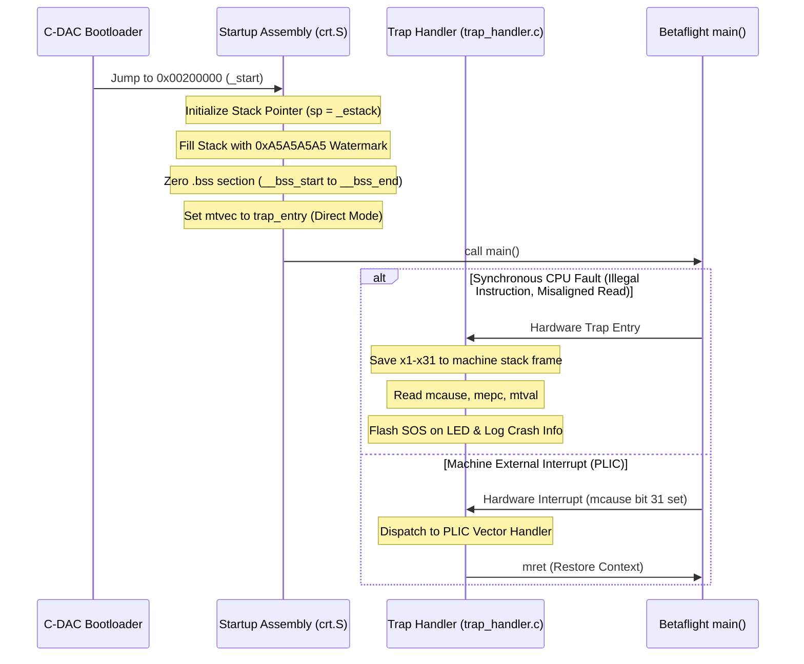

# Porting Component Knowledge Node: Startup Boot & Exception Traps
**Component ID**: `PORT-COMP-02`  
**Parent Knowledge Graph**: [PORTING_KNOWLEDGE_GRAPH.md](../PORTING_KNOWLEDGE_GRAPH.md)  
**Primary References**:
* [02_STM32_SYSTEM_INIT.md](../../logs/hardware_inspection/02_STM32_SYSTEM_INIT.md) (Persistent boot tokens, VTOR relocation)
* [03_STM32_STARTUP_ASSEMBLY.md](../../logs/hardware_inspection/03_STM32_STARTUP_ASSEMBLY.md) (Stack watermarking `0xA5A5A5A5`, DFU hook)
* [04_STM32_FAULT_HANDLERS.md](../../logs/hardware_inspection/04_STM32_FAULT_HANDLERS.md) (Naked fault handlers, register frame extraction)
* [20_ESP32_INTERRUPT_MODEL.md](../../logs/hardware_inspection/20_ESP32_INTERRUPT_MODEL.md) (Interrupt routing vs static vector table)
* [THEJAS32_PROGRAMMER_MANUAL_ANALYSIS.md](../THEJAS32_PROGRAMMER_MANUAL_ANALYSIS.md) (RISC-V Machine-mode CSRs: `mstatus`, `mtvec`, `mcause`, `mepc`, `sp`)

---

## 1. Architectural Role & Execution Flow

The startup assembly and trap subsystem is the absolute first code executed upon MCU reset:
1. **Machine Initialization**: Initializes CPU registers, sets Machine Trap-Vector Base Address (`mtvec`), points `sp` to top of SRAM.
2. **Memory Layout Zeroing & Watermarking**: Clears `.bss`, sets memory watermarks (`0xA5A5A5A5`) to measure runtime stack usage, and initializes global data.
3. **Trap & Fault Management**: Catches memory bus faults, illegal instructions, and misaligned pointer accesses, saving crash logs before an unrecoverable freeze occurs.



---

## 2. Hardware Comparison: ARM Cortex-M vs. RISC-V THEJAS32

Backed directly by [03_STM32_STARTUP_ASSEMBLY.md](../../logs/hardware_inspection/03_STM32_STARTUP_ASSEMBLY.md), [04_STM32_FAULT_HANDLERS.md](../../logs/hardware_inspection/04_STM32_FAULT_HANDLERS.md), and [THEJAS32_PROGRAMMER_MANUAL_ANALYSIS.md](../THEJAS32_PROGRAMMER_MANUAL_ANALYSIS.md):

| Feature | ARM Cortex-M (`03_STM32_...`, `04_STM32_...`) | RISC-V RV32IM (THEJAS32 / VEGA ET1031) |
| :--- | :--- | :--- |
| **Privilege Modes** | Handler Mode (Privileged) vs Thread Mode (User). | Machine Mode (`M-mode`), User Mode (`U-mode`). Boot runs exclusively in M-mode. |
| **Vector Table Architecture** | Fixed hardware vector array (16 core exceptions + $N$ external IRQs). Base set by `SCB->VTOR`. | Base address programmed into `mtvec`. Supports **Direct Mode** (all traps vector to single address) or **Vectored Mode** ($4\times\text{cause}$). Direct mode is preferred for simplicity. |
| **Stack Architecture** | Dual Hardware Stacks: Main Stack Pointer (`MSP`) and Process Stack Pointer (`PSP`). | Single standard architectural stack pointer (`sp` / register `x2`). |
| **Fault Diagnostic Registers** | Hardware SCB registers: `CFSR`, `HFSR`, `MMFAR`, `BFAR`. | Standard Machine CSRs: `mcause` (fault type), `mepc` (faulting instruction PC), `mtval` (bad address or opcode). |
| **Hardware Register Stacking** | Hardware automatically pushes 8 registers (`r0`-`r3`, `r12`, `lr`, `pc`, `xPSR`) to stack before entering ISR. | **Software responsibility**: ISR must manually push caller-saved registers onto the stack. |

---

## 3. Failure Modes & How Other Platforms Overcame Them

### Failure Mode 1: Corrupting Hot Reboot Reason Tokens (STM32)
* **The Bug**: On STM32, `persistentObjectWrite()` writes soft-reboot flags (e.g. `BOOTLOADER_REQUEST_ROM`) at the very top of SRAM (`0x20000000 + RAM_SIZE`). When the chip resets, `Reset_Handler` points `sp` to the very top of RAM. The initial function call immediately pushes registers and destroys the reboot token before `systemInit()` can read it!
* **Overcome By**: From [12_STM32_LINKER_AND_SECTIONS.md](../../logs/hardware_inspection/12_STM32_LINKER_AND_SECTIONS.md), STM32 offsets `_estack` by 16 bytes:
  ```ld
  _Hot_Reboot_Flags_Size = 16;
  _estack = ORIGIN(RAM) + LENGTH(RAM) - _Hot_Reboot_Flags_Size;
  ```
* **ARIES v3.0 Resolution**: Adopt this exact 16-byte reservation in `linker_ram.lds`:
  ```ld
  _estack = ORIGIN(RAM) + LENGTH(RAM) - 16;
  ```

### Failure Mode 2: Misaligned Word Access Exception (RISC-V)
* **The Bug**: In STM32 Cortex-M4, unaligned 32-bit loads/stores are automatically split into multi-cycle bus transactions by hardware. In contrast, many RISC-V RV32IM cores (including VEGA ET1031) trigger a synchronous `Load/Store Address Misaligned` trap (`mcause = 4` or `mcause = 6`) if software attempts a 32-bit `lw` instruction on an address that is not a multiple of 4!
* **ARIES v3.0 Resolution**:
  1. Linker script enforces 4-byte (`ALIGN(4)`) boundaries on all section allocations.
  2. Trap handler decodes `mcause == 4 || mcause == 6` to identify unaligned struct accesses during bringup.

---

## 4. Concrete Implementation Blueprint for ARIES v3.0

### Assembly Startup: `src/platform/THEJAS32/startup_thejas32.S`
```assembly
    .section .text.init
    .globl _start
    .type _start, @function

_start:
    /* Disable all Machine interrupts during startup */
    csrw mie, zero
    csrw mip, zero

    /* Initialize Machine Trap-Vector Base-Address to Direct Mode */
    la t0, trap_entry
    csrw mtvec, t0

    /* Initialize Stack Pointer to top of SRAM (leaving 16 bytes for reboot flags) */
    la sp, _estack

    /* Stack Watermarking with 0xA5A5A5A5 (Learned from STM32 Log 03) */
    la t0, _ebss
    la t1, _estack
    li t2, 0xA5A5A5A5
watermark_loop:
    bgeu t0, t1, clear_bss
    sw t2, 0(t0)
    addi t0, t0, 4
    j watermark_loop

clear_bss:
    /* Zero the .bss section */
    la t0, _sbss
    la t1, _ebss
zero_loop:
    bgeu t0, t1, jump_main
    sw zero, 0(t0)
    addi t0, t0, 4
    j zero_loop

jump_main:
    /* Call Betaflight main entry point */
    call main

1:  wfi
    j 1b
```

### C Trap Handler: `src/platform/THEJAS32/trap_handler.c`
```c
#include <stdint.h>
#include "platform.h"

typedef struct trapFrame_s {
    uint32_t ra, sp, gp, tp, t0, t1, t2, s0, s1, a0;
    uint32_t a1, a2, a3, a4, a5, a6, a7, s2, s3, s4;
    uint32_t s5, s6, s7, s8, s9, s10, s11, t3, t4, t5, t6;
} trapFrame_t;

void c_trap_handler(trapFrame_t *tf, uint32_t mcause, uint32_t mepc, uint32_t mtval) {
    if (mcause & 0x80000000) {
        // Asynchronous Machine External Interrupt (from PLIC)
        extern void plic_dispatch_interrupt(void);
        plic_dispatch_interrupt();
    } else {
        // Synchronous Hardware Fault (Crash)
        // mcause 2 = Illegal Instruction, 4 = Misaligned Load, 6 = Misaligned Store
        while (1) {
            // Flash failure LED on ARIES v3.0 board (Pin 25 / GPIO0)
            volatile uint32_t *gpio_data = (uint32_t *)0x10000008;
            *gpio_data ^= (1 << 0);
            for (volatile int i = 0; i < 500000; i++);
        }
    }
}
```

---

## 5. Verification Checklist
- [ ] Assembly `_start` boots directly from C-DAC XMODEM loader jump to `0x00200000`.
- [ ] Memory range between `_ebss` and `_estack` is verified to be initialized with pattern `0xA5A5A5A5`.
- [ ] `.bss` variables are confirmed to be strictly zero at entry to `main()`.
- [ ] Hardware exceptions jump to `trap_entry` without crashing or looping infinitely in ROM.
