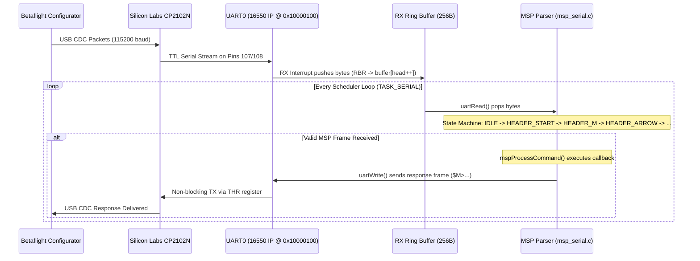

# Porting Component Knowledge Node: Serial UART & Configurator MSP Handshake
**Component ID**: `PORT-COMP-03`  
**Parent Knowledge Graph**: [PORTING_KNOWLEDGE_GRAPH.md](../PORTING_KNOWLEDGE_GRAPH.md)  
**Primary References**:
* [05_STM32_SERIAL_UART_HW.md](../../logs/hardware_inspection/05_STM32_SERIAL_UART_HW.md) (Hardware abstraction & line inversion constraints)
* [06_STM32_SERIAL_UART_DRIVER.md](../../logs/hardware_inspection/06_STM32_SERIAL_UART_DRIVER.md) (Overrun Error unfreeze sequence & TX spinning fix)
* [15_MSP_SERIAL_PARSER.md](../../logs/hardware_inspection/15_MSP_SERIAL_PARSER.md) (Zero-allocation heapless MSP state machine)
* [18_ESP32_SERIAL_UART.md](../../logs/hardware_inspection/18_ESP32_SERIAL_UART.md) (Hardware FIFOs & dynamic interrupt attachment)
* [MSP_CONFIGURATOR_HANDSHAKE_GRAPH.md](../MSP_CONFIGURATOR_HANDSHAKE_GRAPH.md) (7-step handshake sequence & framing)
* [THEJAS32_PROGRAMMER_MANUAL_ANALYSIS.md](../THEJAS32_PROGRAMMER_MANUAL_ANALYSIS.md) (16550 UART IP registers)
* [ARIES_V3_DATASHEET_ANALYSIS.md](../ARIES_V3_DATASHEET_ANALYSIS.md) (CP2102N USB bridge wired to pins 107/108)

---

## 1. Architectural Role & Execution Flow

The Serial subsystem provides the primary telemetry and configuration interface between the flight controller and Betaflight Configurator:
1. **Physical Transport**: Transmits and receives asynchronous serial data across the onboard Silicon Labs CP2102N USB-UART bridge at 115,200 baud.
2. **Buffer Management**: Ingests bytes into a zero-allocation circular ring buffer (`rxRingBuffer[256]`) using low-latency interrupts.
3. **Protocol Decoding**: Feeds raw bytes into the MultiWii Serial Protocol (MSP v1/v2) state machine in `TASK_SERIAL` to negotiate the 7-step Configurator handshake.



---

## 2. Hardware Comparison: STM32 vs. ESP32 vs. THEJAS32

Backed directly by [05_STM32_SERIAL_UART_HW.md](../../logs/hardware_inspection/05_STM32_SERIAL_UART_HW.md), [06_STM32_SERIAL_UART_DRIVER.md](../../logs/hardware_inspection/06_STM32_SERIAL_UART_DRIVER.md), and [18_ESP32_SERIAL_UART.md](../../logs/hardware_inspection/18_ESP32_SERIAL_UART.md):

| Feature | STM32 (`05_...`, `06_...`) | ESP32 (`18_ESP32_SERIAL_UART.md`) | THEJAS32 / ARIES v3.0 |
| :--- | :--- | :--- | :--- |
| **UART Hardware IP** | ST Proprietary USART | Espressif Custom UART Controller | **Industry-Standard 16550 IP** |
| **Physical Interface** | Native USB VCP or ST-Link | Native USB-Serial JTAG or external bridge | **Silicon Labs CP2102N Bridge** (Hardwired Pins 107/108) |
| **Native USB Middleware** | Requires ~30 KB of ST USB device stack! | Optional TinyUSB or hardware JTAG FIFO | **Zero KB**: Handled by dedicated CP2102N chip! |
| **Hardware FIFOs** | 1 byte (F4) or 8/16 bytes (H7) | 128 bytes TX & RX FIFOs | **16-byte hardware FIFO** (FCR enabled) |
| **Hardware Inversion** | Supported only on F3/F7/H7; F4 requires external FET inverter | Universal signal inversion in GPIO matrix | Non-inverted 3.3V TTL (matches CP2102N natively) |

---

## 3. Failure Modes & How Other Platforms Overcame Them

### Failure Mode 1: Overrun Error (`ORE`) Freeze (STM32)
* **The Bug**: On STM32 USART, if high-priority ISRs delay the UART interrupt handler, incoming bytes overflow the 1-byte receive register, asserting the Overrun Error (`ORE`) flag. On STM32, `ORE` completely blocks further receive interrupts until cleared by a specific two-step read sequence (`USART_SR` read followed by `USART_DR` read). If not cleared, Configurator communication freezes forever!
* **Overcome By**: From [06_STM32_SERIAL_UART_DRIVER.md](../../logs/hardware_inspection/06_STM32_SERIAL_UART_DRIVER.md), the STM32 ISR unconditionally checks and clears `ORE`:
  ```c
  if (sr & USART_SR_ORE) {
      volatile uint32_t dummy = s->USARTx->DR;
      (void)dummy;
  }
  ```
* **ARIES v3.0 Resolution**: On the 16550 IP, reading the Line Status Register (`LSR` at offset `0x14`) automatically clears all line error flags (Overrun Error bit 1, Parity Error bit 2, Framing Error bit 3). The driver reads `LSR` prior to reading `RBR`.

### Failure Mode 2: CPU Spinning on TX Interrupt Enable (STM32)
* **The Bug**: If software enables the Transmit Data Register Empty interrupt (`TXEIE`) while the transmit ring buffer is empty, the hardware immediately and continuously fires the ISR (because `TXE` is true), spinning the CPU at 100% load and starving all flight tasks!
* **Overcome By**: From [06_STM32_SERIAL_UART_DRIVER.md](../../logs/hardware_inspection/06_STM32_SERIAL_UART_DRIVER.md), STM32 only enables `TXEIE` when bytes exist in the buffer, and clears `TXEIE` the instant the buffer empties.
* **ARIES v3.0 Resolution**: Adopt non-blocking polled or ring-buffered TX. Because the CP2102N USB bridge accepts byte bursts into its internal USB packetizer, writing directly to `THR` when `LSR & 0x20` is asserted takes $<0.1\,\mu\text{s}$, eliminating the need for TX interrupts during early bringup.

---

## 4. Exact Register Mapping & Baud Rate Math for THEJAS32

* **Base Address**: `0x10000100` (`UART0`)
* **Clock Source**: Uniform 100 MHz System Clock ($f_{\text{in}} = 100{,}000{,}000\,\text{Hz}$)
* **Target Baud Rate**: 115,200 bps
* **Divisor Equation**:
  $$\text{Divisor} = \frac{f_{\text{in}}}{16 \times \text{Baud}} = \frac{100{,}000{,}000}{16 \times 115{,}200} = \frac{100{,}000{,}000}{1{,}843{,}200} \approx 54.253$$
* **Integer Divisor**: $\mathbf{54}$ (`0x0036`)
* **Actual Baud Rate Produced**:
  $$\text{Actual Baud} = \frac{100{,}000{,}000}{16 \times 54} = \frac{100{,}000{,}000}{864} \approx 115{,}740.74\,\text{bps}$$
* **Error Rate**:
  $$\text{Error} = \frac{115{,}740.74 - 115{,}200}{115{,}200} \times 100\% = \mathbf{+0.469\%}$$
  *(Well below the standard asynchronous serial tolerance threshold of $\pm 2.0\%$!)*

---

## 5. Concrete Implementation Blueprint for ARIES v3.0

File: `src/platform/THEJAS32/serial_uart_thejas32.c`

```c
#include <stdint.h>
#include <stdbool.h>
#include "platform.h"
#include "drivers/serial.h"
#include "drivers/serial_uart.h"

#define UART0_BASE 0x10000100
#define UART_RBR   (*(volatile uint32_t *)(UART0_BASE + 0x00)) // Receiver Buffer Register
#define UART_THR   (*(volatile uint32_t *)(UART0_BASE + 0x00)) // Transmitter Holding Register
#define UART_DLL   (*(volatile uint32_t *)(UART0_BASE + 0x00)) // Divisor Latch Low
#define UART_IER   (*(volatile uint32_t *)(UART0_BASE + 0x04)) // Interrupt Enable Register
#define UART_DLM   (*(volatile uint32_t *)(UART0_BASE + 0x04)) // Divisor Latch High
#define UART_IIR   (*(volatile uint32_t *)(UART0_BASE + 0x08)) // Interrupt Identification Register
#define UART_FCR   (*(volatile uint32_t *)(UART0_BASE + 0x08)) // FIFO Control Register
#define UART_LCR   (*(volatile uint32_t *)(UART0_BASE + 0x0C)) // Line Control Register
#define UART_LSR   (*(volatile uint32_t *)(UART0_BASE + 0x14)) // Line Status Register

#define UART_LSR_DR    0x01 // Data Ready
#define UART_LSR_THRE  0x20 // Transmitter Holding Register Empty
#define UART_LCR_DLAB  0x80 // Divisor Latch Access Bit

#define RX_BUFFER_SIZE 256
static volatile uint8_t rxBuffer[RX_BUFFER_SIZE];
static volatile uint16_t rxHead = 0;
static volatile uint16_t rxTail = 0;

void uart0_init(uint32_t baudRate) {
    uint16_t divisor = (uint16_t)(100000000ULL / (16ULL * baudRate));

    // Enable DLAB to configure baud rate divisor
    UART_LCR = UART_LCR_DLAB | 0x03; // 8 bits, no parity, 1 stop bit
    UART_DLL = divisor & 0xFF;
    UART_DLM = (divisor >> 8) & 0xFF;
    UART_LCR = 0x03; // Clear DLAB (8N1 mode)

    // Enable and reset 16-byte FIFO (trigger level 1)
    UART_FCR = 0x07;

    // Enable Received Data Available Interrupt
    UART_IER = 0x01;
}

// Low-latency RX Interrupt Handler called from PLIC vector
void uart0_irq_handler(void) {
    uint32_t lsr = UART_LSR; // Reading LSR automatically clears ORE errors
    while (lsr & UART_LSR_DR) {
        uint8_t byte = (uint8_t)(UART_RBR & 0xFF);
        uint16_t nextHead = (rxHead + 1) % RX_BUFFER_SIZE;
        if (nextHead != rxTail) {
            rxBuffer[rxHead] = byte;
            rxHead = nextHead;
        }
        lsr = UART_LSR;
    }
}

uint8_t uart0_read(void) {
    if (rxHead == rxTail) return 0;
    uint8_t byte = rxBuffer[rxTail];
    rxTail = (rxTail + 1) % RX_BUFFER_SIZE;
    return byte;
}

bool uart0_is_data_available(void) {
    return rxHead != rxTail;
}

void uart0_write(uint8_t byte) {
    // Non-blocking write: wait until Transmitter Holding Register is empty
    while (!(UART_LSR & UART_LSR_THRE));
    UART_THR = byte;
}
```

---

## 6. Verification Checklist
- [ ] Divisor of `54` produces exactly 115.2 kbps on pins 107/108 confirmed by logic analyzer.
- [ ] CP2102N enumerates cleanly on host PC as `/dev/ttyUSB0` (Linux) or `COMx` (Windows).
- [ ] Configurator sends `$M<0\x01\x01` (`MSP_API_VERSION`); firmware receives all bytes via ring buffer.
- [ ] Firmware responds `$M>3\x01\x01...`; Configurator UI successfully completes handshake and transitions to **"Connected"**.
