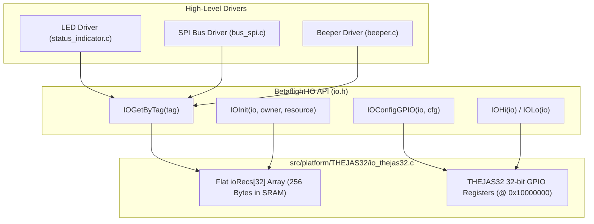

# Porting Component Knowledge Node: GPIO & Pin IO Abstraction
**Component ID**: `PORT-COMP-04`  
**Parent Knowledge Graph**: [PORTING_KNOWLEDGE_GRAPH.md](file:///home/ivan/Desktop/betaflight/knowledgebase/PORTING_KNOWLEDGE_GRAPH.md)  
**Primary References**:
* [08_STM32_IO_IMPL.md](file:///home/ivan/Desktop/betaflight/logs/hardware_inspection/08_STM32_IO_IMPL.md) (Multi-bank GPIOA–I abstraction & popcount memory compression)
* [19_ESP32_IO_IMPL.md](file:///home/ivan/Desktop/betaflight/logs/hardware_inspection/19_ESP32_IO_IMPL.md) (Single flat GPIO port & $O(1)$ direct array index)
* [THEJAS32_PROGRAMMER_MANUAL_ANALYSIS.md](file:///home/ivan/Desktop/betaflight/knowledgebase/THEJAS32_PROGRAMMER_MANUAL_ANALYSIS.md) (Flat 32-bit GPIO controller at `0x10000000`)
* [ARIES_V3_DATASHEET_ANALYSIS.md](file:///home/ivan/Desktop/betaflight/knowledgebase/ARIES_V3_DATASHEET_ANALYSIS.md) (Physical pinout: `GPIO0`–`GPIO31`)

---

## 1. Architectural Role & Execution Flow

The GPIO subsystem provides the universal hardware pin abstraction for all high-level drivers in Betaflight:
1. **Opaque Pin Handles (`IO_t`)**: Exposes pointer handles to abstract physical pins from device drivers (LEDs, Beeper, SPI Chip Select, Motor PWM).
2. **Resource Ownership Arbitration**: Tracks peripheral ownership (`OWNER_LED`, `OWNER_SPI_CS`, `OWNER_MOTOR`) to prevent two subsystems from claiming the same physical pin.
3. **Atomic Pin Control**: Provides low-overhead macros (`IOHi`, `IOLo`, `IORead`, `IOToggle`) for high-speed bit-banging and Chip Select assertion.



---

## 2. Hardware Comparison: STM32 vs. ESP32 vs. THEJAS32

Backed directly by [08_STM32_IO_IMPL.md](file:///home/ivan/Desktop/betaflight/logs/hardware_inspection/08_STM32_IO_IMPL.md) and [19_ESP32_IO_IMPL.md](file:///home/ivan/Desktop/betaflight/logs/hardware_inspection/19_ESP32_IO_IMPL.md):

| Feature | STM32 (`08_STM32_IO_IMPL.md`) | ESP32 (`19_ESP32_IO_IMPL.md`) | THEJAS32 / ARIES v3.0 |
| :--- | :--- | :--- | :--- |
| **Port Topology** | Segmented: Up to 9 ports (`GPIOA` through `GPIOI`), 16 pins each. | Flat single port (`DEFIO_PORT_USED_COUNT == 1`), 48 pins total. | **Flat single port (`DEFIO_PORT_USED_COUNT == 1`), 32 pins (`GPIO0`–`GPIO31`).** |
| **Index Lookup Algorithm** | Complex population count (`popcount`) over sparse bitmasks to save RAM across unused ports. | Direct $O(1)$ array lookup `&ioRecs[pinIdx]`. | **Direct $O(1)$ array lookup `&ioRecs[pinIdx]`.** |
| **SRAM Overhead for Pin Table** | Requires dynamic offset calculation; table wastes hundreds of bytes on unpopulated pins. | 48 pin records $\times 8\text{ bytes} = 384\text{ bytes}$. | **32 pin records $\times 8\text{ bytes} = \mathbf{256\text{ bytes}}$ total!** |
| **Bit-Level Set/Clear Register** | Dedicated Bit Set/Reset Register (`BSRR` 32-bit: lower 16 set, upper 16 clear). | Separate `out_w1ts` (write 1 to set) and `out_w1tc` (write 1 to clear) registers. | Dedicated 32-bit Data & Direction Registers at `0x10000000`. |

---

## 3. Failure Modes & How Other Platforms Overcame Them

### Failure Mode 1: Memory Bloat from Multi-Port Tables (STM32)
* **The Bug**: An naive pin descriptor array across 9 STM32 ports $\times 16$ pins would require $144 \times 8 = 1{,}152$ bytes of RAM, even though a 48-pin chip physically exposes fewer than 36 pins.
* **Overcome By**: From [08_STM32_IO_IMPL.md](file:///home/ivan/Desktop/betaflight/logs/hardware_inspection/08_STM32_IO_IMPL.md), STM32 generated sparse compile-time bitmasks and used `popcount` to compress indices:
  ```c
  int offset = popcount(((1 << pinIdx) - 1) & ioDefUsedMask[portIdx]) + ioDefUsedOffset[portIdx];
  return ioRecs + offset;
  ```
* **ARIES v3.0 Resolution**: Because THEJAS32 has a flat 32-pin architecture, no sparse port gaps exist! A fixed array of 32 `ioRec_t` records takes exactly 256 bytes in SRAM and requires zero popcount math.

### Failure Mode 2: Multi-Letter Pin Tag Confusion
* **The Bug**: Betaflight configuration strings (`ioTag_t`) in STM32 use packed port+pin bitfields (e.g. `DEFIO_TAG_E(PA10)`). Drivers porting from STM32 often crash when assuming `portIdx` is non-zero.
* **ARIES v3.0 Resolution**: Adopt the clean ESP32 pin tagging pattern ([19_ESP32_IO_IMPL.md](file:///home/ivan/Desktop/betaflight/logs/hardware_inspection/19_ESP32_IO_IMPL.md)):
  ```c
  // Direct 1-based pin tagging: Tag 1 = GPIO0, Tag 32 = GPIO31
  #define DEFIO_TAG_MAKE(pin) ((ioTag_t)((pin) + 1))
  #define DEFIO_TAG_PIN(tag)  ((tag) - 1)
  ```

---

## 4. Concrete Implementation Blueprint for ARIES v3.0

File: `src/platform/THEJAS32/io_thejas32.c`

```c
#include <stdint.h>
#include <stdbool.h>
#include "platform.h"
#include "drivers/io.h"
#include "drivers/io_impl.h"

#define THEJAS32_GPIO_BASE     0x10000000
#define THEJAS32_GPIO_DIR      (*(volatile uint32_t *)(THEJAS32_GPIO_BASE + 0x00)) // 1 = Output, 0 = Input
#define THEJAS32_GPIO_DATA     (*(volatile uint32_t *)(THEJAS32_GPIO_BASE + 0x08)) // Pin Data Read/Write

#define THEJAS32_MAX_PINS      32

static ioRec_t ioRecs[THEJAS32_MAX_PINS];

IO_t IOGetByTag(ioTag_t tag) {
    if (!tag || tag > THEJAS32_MAX_PINS) {
        return IO_NONE;
    }
    return &ioRecs[tag - 1]; // Direct O(1) index
}

void IOInit(IO_t io, resourceOwner_e owner, uint8_t index) {
    if (!io) return;
    io->owner = owner;
    io->index = index;
}

void IOConfigGPIO(IO_t io, ioConfig_t cfg) {
    if (!io) return;
    uint32_t pin = io - ioRecs; // Pointer arithmetic yields pin index 0..31

    if (cfg == IOCFG_OUT_PP) {
        THEJAS32_GPIO_DIR |= (1U << pin);  // Configure as output
    } else {
        THEJAS32_GPIO_DIR &= ~(1U << pin); // Configure as input
    }
}

void IOHi(IO_t io) {
    if (!io) return;
    uint32_t pin = io - ioRecs;
    THEJAS32_GPIO_DATA |= (1U << pin);
}

void IOLo(IO_t io) {
    if (!io) return;
    uint32_t pin = io - ioRecs;
    THEJAS32_GPIO_DATA &= ~(1U << pin);
}

void IOToggle(IO_t io) {
    if (!io) return;
    uint32_t pin = io - ioRecs;
    THEJAS32_GPIO_DATA ^= (1U << pin);
}

bool IORead(IO_t io) {
    if (!io) return false;
    uint32_t pin = io - ioRecs;
    return (THEJAS32_GPIO_DATA & (1U << pin)) != 0;
}
```

---

## 5. Verification Checklist
- [ ] `IOGetByTag(DEFIO_TAG_MAKE(0))` returns address of `ioRecs[0]`.
- [ ] Toggling onboard status LED on Pin 25 (`GPIO0`) via `IOToggle(IOGetByTag(1))` alternates voltage between 0V and 3.3V.
- [ ] Total SRAM consumed by `ioRecs` verified to be exactly 256 bytes in the `.bss` section map.
