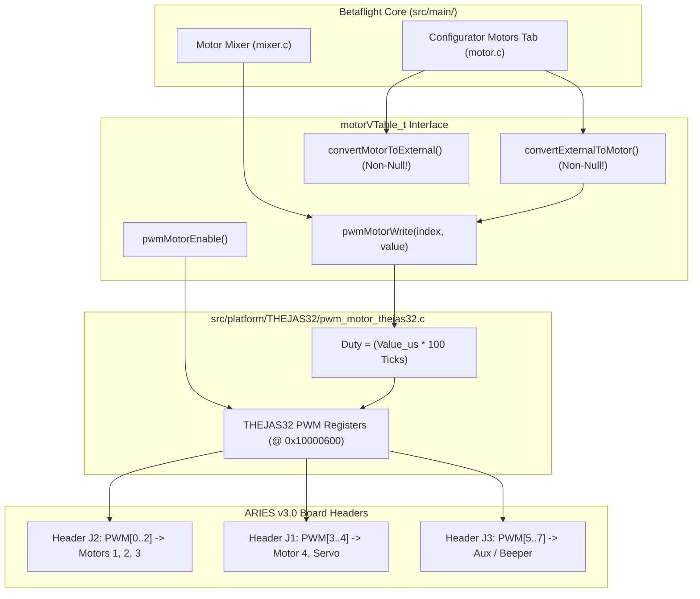

# Porting Component Knowledge Node: Timer & Motor PWM Subsystem
**Component ID**: `PORT-COMP-05`  
**Parent Knowledge Graph**: [PORTING_KNOWLEDGE_GRAPH.md](../PORTING_KNOWLEDGE_GRAPH.md)  
**Primary References**:
* [09_STM32_TIMER_PWM_HW.md](../../logs/hardware_inspection/09_STM32_TIMER_PWM_HW.md) (Asymmetric APB1/APB2 clock multipliers & DMA collision matrix)
* [22_ESP32_PWM_DSHOT.md](../../logs/hardware_inspection/22_ESP32_PWM_DSHOT.md) (LEDC fractional divider & mandatory non-null VTable safety)
* [THEJAS32_PROGRAMMER_MANUAL_ANALYSIS.md](../THEJAS32_PROGRAMMER_MANUAL_ANALYSIS.md) (Dedicated 8-Channel PWM controller at `0x10000600`)
* [ARIES_V3_DATASHEET_ANALYSIS.md](../ARIES_V3_DATASHEET_ANALYSIS.md) (PWM pin headers: J2, J1, J3)

---

## 1. Architectural Role & Execution Flow

The Motor PWM subsystem converts raw mixer commands calculated by the PID loop into physical electrical pulse widths to drive ESCs and motors:
1. **Pulse Geometry Translation**: Maps normalized motor command values ($1000$ to $2000\,\mu\text{s}$) into hardware timer compare counts.
2. **Protocol Generation**: Generates standard analog PWM ($400\,\text{Hz}$ / $1000$–$2000\,\mu\text{s}$) or OneShot125 ($125$–$250\,\mu\text{s}$).
3. **Configurator Interactive Testing**: Implements the `motorVTable_t` interface to allow motor spinning and direction testing from the Betaflight Configurator "Motors" tab.



---

## 2. Hardware Comparison: STM32 vs. ESP32 vs. THEJAS32

Backed directly by [09_STM32_TIMER_PWM_HW.md](../../logs/hardware_inspection/09_STM32_TIMER_PWM_HW.md) and [22_ESP32_PWM_DSHOT.md](../../logs/hardware_inspection/22_ESP32_PWM_DSHOT.md):

| Feature | STM32 (`09_STM32_TIMER_PWM_HW.md`) | ESP32 (`22_ESP32_PWM_DSHOT.md`) | THEJAS32 / ARIES v3.0 |
| :--- | :--- | :--- | :--- |
| **PWM Subsystem Architecture** | Timers TIM1–TIM14 scattered across APB1 and APB2 buses. | Dedicated LED Controller (`LEDC`) with 8 low-speed channels. | **Dedicated 8-Channel Hardware PWM Controller (`PWM[0..7]`).** |
| **Timer Clock Calculation** | **Asymmetric**: APB1 timers run at 84 MHz ($2\times$ PLL doubler), APB2 timers run at 168 MHz. | Uniform 80 MHz APB slow clock. | **Uniform 100 MHz clock directly feeding all 8 channels.** |
| **DMA Stream Collisions** | **Severe**: Motors wired to pins sharing the same DMA stream (e.g. TIM3_CH4 vs TIM5_CH1) cannot run DShot. | None (RMT pulse-train coprocessor uses dedicated internal SRAM). | **None**: Dedicated hardware PWM counters operate independently without DMA. |
| **Pin Mapping Flexibility** | Rigid Alternate Function pin tables (`fullTimerHardware`). | Fully dynamic via GPIO Matrix crossbar. | Dedicated physical header pins (J2, J1, J3). |

---

## 3. Failure Modes & How Other Platforms Overcame Them

### Failure Mode 1: Null-Pointer VTable Panic in Configurator (ESP32)
* **The Bug**: From [22_ESP32_PWM_DSHOT.md](../../logs/hardware_inspection/22_ESP32_PWM_DSHOT.md), the Betaflight Configurator "Motors" slider tool directly calls `motorConvertFromExternal()` and `motorConvertToExternal()` through the driver's `vTable` without a `NULL` guard. If a platform port leaves these function pointers `NULL`, moving the motor slider immediately triggers an unrecoverable hard fault exception!
* **Overcome By**: ESP32 implemented linear passthrough functions:
  ```c
  static float pwmMotorConvertFromExternal(uint16_t externalValue) { return (float)externalValue; }
  static uint16_t pwmMotorConvertToExternal(float motorValue) { return (uint16_t)motorValue; }
  ```
* **ARIES v3.0 Resolution**: Explicitly define and link these two non-null passthrough functions in `thejas32MotorVTable`.

### Failure Mode 2: Multi-Bus Timer Doubler Clock Drift (STM32)
* **The Bug**: On STM32F4, if a motor output was moved from `TIM1` (APB2) to `TIM3` (APB1), the timer prescaler calculation drifted because APB1 runs at half speed ($42\,\text{MHz}$) unless multiplied by $2$ ($84\,\text{MHz}$).
* **ARIES v3.0 Resolution**: All 8 PWM channels on THEJAS32 connect to the exact same 100 MHz peripheral bus. Duty calculations are identical for every motor:
  $$\text{Ticks per Microsecond} = \frac{100{,}000{,}000\,\text{Hz}}{1{,}000{,}000} = 100\,\text{ticks}/\mu\text{s}$$

---

## 4. Physical Pin Allocation on ARIES v3.0

Backed directly by [ARIES_V3_DATASHEET_ANALYSIS.md](../ARIES_V3_DATASHEET_ANALYSIS.md):

| Motor Index | Logical Signal | Hardware PWM Channel | Board Connector | Physical SoC Pin |
| :---: | :---: | :---: | :---: | :---: |
| **Motor 1** | Motor Output 1 | `PWM[0]` | Header `J2` | Pin 86 |
| **Motor 2** | Motor Output 2 | `PWM[1]` | Header `J2` | Pin 85 |
| **Motor 3** | Motor Output 3 | `PWM[2]` | Header `J2` | Pin 82 |
| **Motor 4** | Motor Output 4 | `PWM[3]` | Header `J1` | Pin 81 |
| **Motor 5 / Servo** | Motor Output 5 | `PWM[4]` | Header `J1` | Pin 80 |
| **Aux 1 / Beeper** | Auxiliary / Beeper | `PWM[5]` | Header `J3` | Pin 77 |
| **Aux 2** | Auxiliary Output | `PWM[6]` | Header `J3` | Pin 76 |
| **Aux 3** | Auxiliary Output | `PWM[7]` | Header `J3` | Pin 75 |

---

## 5. Concrete Implementation Blueprint for ARIES v3.0

File: `src/platform/THEJAS32/pwm_motor_thejas32.c`

```c
#include <stdint.h>
#include <stdbool.h>
#include "platform.h"
#include "drivers/motor.h"
#include "drivers/motor_impl.h"

#define THEJAS32_PWM_BASE      0x10000600
#define PWM_PERIOD_REG(ch)     (*(volatile uint32_t *)(THEJAS32_PWM_BASE + (ch * 8)))
#define PWM_DUTY_REG(ch)       (*(volatile uint32_t *)(THEJAS32_PWM_BASE + (ch * 8) + 4))

#define PWM_SYS_CLOCK_HZ       100000000ULL // 100 MHz
#define PWM_FREQ_400HZ         400          // Standard ESC update rate
#define PWM_PERIOD_COUNTS      (PWM_SYS_CLOCK_HZ / PWM_FREQ_400HZ) // 250,000 counts

static bool motorsEnabled = false;

static float pwmConvertFromExternal(uint16_t externalValue) {
    return (float)externalValue; // Essential: Prevents Configurator Slider Hard Fault
}

static uint16_t pwmConvertToExternal(float motorValue) {
    return (uint16_t)motorValue;
}

static bool pwmEnable(void) {
    motorsEnabled = true;
    return true;
}

static void pwmDisable(void) {
    motorsEnabled = false;
    for (int i = 0; i < 4; i++) {
        PWM_DUTY_REG(i) = 0; // Turn off pulses
    }
}

static bool pwmIsEnabled(unsigned index) {
    return motorsEnabled && index < 4;
}

static void pwmWrite(uint8_t index, float value) {
    if (index >= 4 || !motorsEnabled) return;

    // Constrain standard pulse width: 1000 us (disarmed) to 2000 us (full throttle)
    if (value < 1000.0f) value = 1000.0f;
    if (value > 2000.0f) value = 2000.0f;

    // 100 MHz clock = 100 counts per microsecond
    uint32_t dutyCounts = (uint32_t)(value * 100.0f);
    PWM_DUTY_REG(index) = dutyCounts;
}

static void pwmWriteInt(uint8_t index, uint16_t value) {
    pwmWrite(index, (float)value);
}

static const motorVTable_t thejas32MotorVTable = {
    .convertExternalToMotor = pwmConvertFromExternal,
    .convertMotorToExternal = pwmConvertToExternal,
    .enable = pwmEnable,
    .disable = pwmDisable,
    .isMotorEnabled = pwmIsEnabled,
    .write = pwmWrite,
    .writeInt = pwmWriteInt,
};

bool motorDevInit(motorDevice_t *device, const motorDevConfig_t *motorConfig, uint16_t idlePulse) {
    (void)motorConfig;
    (void)idlePulse;

    // Initialize all 4 primary motor PWM channels for 400 Hz operation
    for (int ch = 0; ch < 4; ch++) {
        PWM_PERIOD_REG(ch) = PWM_PERIOD_COUNTS;
        PWM_DUTY_REG(ch) = 100000; // 1000 us idle pulse (disarmed)
    }

    device->vTable = &thejas32MotorVTable;
    device->count = 4;
    device->initialized = true;

    return true;
}
```

---

## 6. Verification Checklist
- [ ] PWM output frequency on Header J2 Pin 86 measured at exactly $400.0\,\text{Hz}$ on oscilloscope.
- [ ] Setting motor value to 1000 produces exactly $1.000\,\text{ms}$ ($1000\,\mu\text{s}$) high time; 2000 produces $2.000\,\text{ms}$.
- [ ] Entering Configurator "Motors" tab and moving motor test sliders does not trigger CPU fault.
