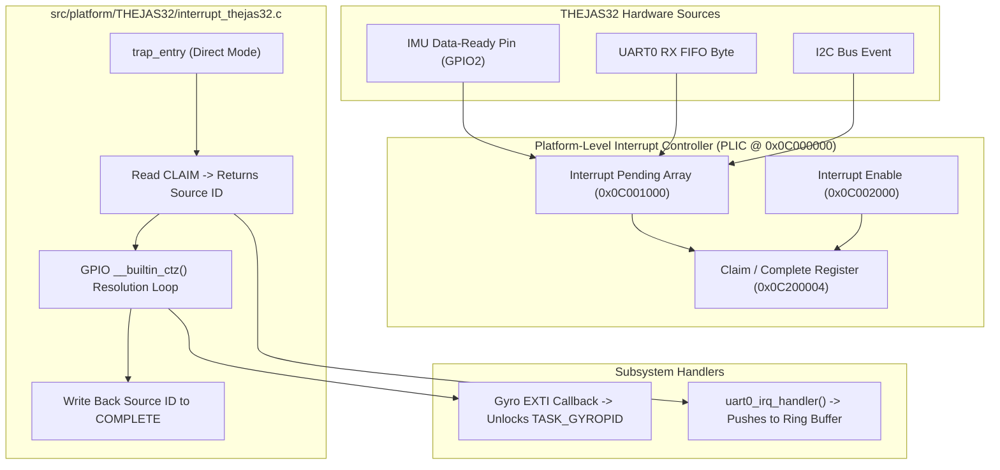

# Porting Component Knowledge Node: Interrupt Controller & EXTI Subsystem
**Component ID**: `PORT-COMP-06`  
**Parent Knowledge Graph**: [PORTING_KNOWLEDGE_GRAPH.md](../PORTING_KNOWLEDGE_GRAPH.md)  
**Primary References**:
* [08_STM32_IO_IMPL.md](../../logs/hardware_inspection/08_STM32_IO_IMPL.md) (Rigid SYSCFG EXTI multiplexing constraints)
* [16_SCHEDULER_CORE.md](../../logs/hardware_inspection/16_SCHEDULER_CORE.md) (Gyro EXTI data-ready synchronization with `TASK_GYROPID`)
* [20_ESP32_INTERRUPT_MODEL.md](../../logs/hardware_inspection/20_ESP32_INTERRUPT_MODEL.md) (Dynamic peripheral interrupt routing table)
* [24_ESP32_DMA_AND_EXTI.md](../../logs/hardware_inspection/24_ESP32_DMA_AND_EXTI.md) (Centralized GPIO ISR dispatch using `__builtin_ctz()`)
* [THEJAS32_PROGRAMMER_MANUAL_ANALYSIS.md](../THEJAS32_PROGRAMMER_MANUAL_ANALYSIS.md) (PLIC architecture at `0x0C000000`)

---

## 1. Architectural Role & Execution Flow

The Interrupt and External Interrupt (EXTI) subsystem orchestrates real-time event response across the flight controller:
1. **Peripheral Event Capture**: Traps UART receive bytes, timer compare matches, and bus transaction completions.
2. **Gyro Synchronization (`TASK_GYROPID`)**: Senses the rising edge on the IMU Data-Ready interrupt pin, notifying the scheduler to sample the sensor with minimum phase lag.
3. **Low-Latency Dispatch**: Uses bit manipulation intrinsics (`__builtin_ctz()`) to resolve and clear active interrupt sources in single-digit CPU clock cycles.



---

## 2. Hardware Comparison: STM32 vs. ESP32 vs. THEJAS32

Backed directly by [08_STM32_IO_IMPL.md](../../logs/hardware_inspection/08_STM32_IO_IMPL.md), [20_ESP32_INTERRUPT_MODEL.md](../../logs/hardware_inspection/20_ESP32_INTERRUPT_MODEL.md), and [24_ESP32_DMA_AND_EXTI.md](../../logs/hardware_inspection/24_ESP32_DMA_AND_EXTI.md):

| Feature | STM32 (`08_STM32_...`) | ESP32 (`20_...`, `24_...`) | THEJAS32 / ARIES v3.0 |
| :--- | :--- | :--- | :--- |
| **Interrupt Controller Architecture** | ARM Nested Vectored Interrupt Controller (NVIC). | Dynamic Peripheral-to-CPU Interrupt Matrix (32 CPU levels). | **Standard RISC-V Platform-Level Interrupt Controller (PLIC).** |
| **EXTI Pin Multiplexing** | **Severe Collision Constraint**: PA0, PB0, and PC0 share `EXTI0_IRQn`. Pins with identical numbers across different ports cannot be used simultaneously! | Completely orthogonal: every GPIO pin (0–48) has independent interrupt logic. | **Completely orthogonal: all 32 pins (`GPIO0`–`GPIO31`) have independent trigger logic.** |
| **ISR Vector Dispatch** | Dedicated vector per line (`EXTI0`, `EXTI1`, `EXTI2`, `EXTI3`, `EXTI4`, `EXTI9_5`, `EXTI15_10`). | Single centralized GPIO interrupt (`ESP32_CPU_INTR_GPIO`). | **Single centralized GPIO interrupt vector routed through PLIC.** |
| **Interrupt Acknowledgment** | Write 1 to clear bit in `EXTI->PR` and peripheral status register. | Write 1 to clear in GPIO status register. | **Standard PLIC handshake**: Read `CLAIM` register, clear GPIO status bit, write source ID back to `COMPLETE`. |

---

## 3. Failure Modes & How Other Platforms Overcame Them

### Failure Mode 1: Rigid Pin Number Collisions (STM32)
* **The Bug**: On STM32 flight controllers, if the board designer routed the Gyro Data-Ready line to `PA0` and a Barometer or Receiver pin to `PB0`, the software could not enable interrupts on both simultaneously because the ST `SYSCFG` multiplexer forces `EXTI0` to choose only Port A *or* Port B.
* **ARIES v3.0 Resolution**: Because THEJAS32 has a flat 32-bit GPIO controller, each of the 32 pins has its own dedicated bit in the GPIO Interrupt Mask register. No pin-number conflicts exist!

### Failure Mode 2: Missing Back-to-Back Edges in Centralized GPIO ISR
* **The Bug**: When routing multiple pin interrupts through a single shared interrupt line, if two pins toggle in rapid succession, a naive `if/else` ladder may service the first pin and exit, leaving the second pin's interrupt pending or dropped.
* **Overcome By**: From [24_ESP32_DMA_AND_EXTI.md](../../logs/hardware_inspection/24_ESP32_DMA_AND_EXTI.md), the driver scans the status word in a tight loop using compiler intrinsics:
  ```c
  while (status) {
      uint32_t pin = __builtin_ctz(status);
      status &= ~(1U << pin);
      clear_status(pin);
      callbacks[pin]();
  }
  ```
  `__builtin_ctz()` resolves the lowest asserted pin in 1 CPU cycle, immediately clears the hardware flag, and executes the callback without branching overhead.

---

## 4. PLIC Register Architecture for THEJAS32

Backed directly by [THEJAS32_PROGRAMMER_MANUAL_ANALYSIS.md](../THEJAS32_PROGRAMMER_MANUAL_ANALYSIS.md):

* **PLIC Base Address**: `0x0C000000`
* **Priority Registers**: `0x0C000000 + (4 * Source_ID)` (Value `1` to `7`, higher = higher priority)
* **Pending Bits**: `0x0C001000` (Bit $N$ set when interrupt $N$ is requested)
* **Enable Registers**: `0x0C002000` (Bit $N$ enables interrupt $N$ for Context 0)
* **Priority Threshold**: `0x0C200000` (Threshold `0` allows all interrupts with priority $>0$)
* **Claim / Complete Register**: `0x0C200004` (Read returns highest-priority active ID; write back clears and completes the interrupt)

---

## 5. Concrete Implementation Blueprint for ARIES v3.0

File: `src/platform/THEJAS32/interrupt_thejas32.c`

```c
#include <stdint.h>
#include <stdbool.h>
#include "platform.h"
#include "drivers/exti.h"

#define PLIC_BASE             0x0C000000
#define PLIC_PRIORITY(id)     (*(volatile uint32_t *)(PLIC_BASE + (4 * (id))))
#define PLIC_ENABLE           (*(volatile uint32_t *)(PLIC_BASE + 0x2000))
#define PLIC_THRESHOLD        (*(volatile uint32_t *)(PLIC_BASE + 0x200000))
#define PLIC_CLAIM_COMPLETE   (*(volatile uint32_t *)(PLIC_BASE + 0x200004))

#define THEJAS32_GPIO_BASE    0x10000000
#define THEJAS32_GPIO_INT_STAT (*(volatile uint32_t *)(THEJAS32_GPIO_BASE + 0x14))
#define THEJAS32_GPIO_INT_CLR  (*(volatile uint32_t *)(THEJAS32_GPIO_BASE + 0x18))
#define THEJAS32_GPIO_INT_EN   (*(volatile uint32_t *)(THEJAS32_GPIO_BASE + 0x10))

#define PLIC_UART0_ID         1
#define PLIC_GPIO_ID          2

typedef struct extiChannelRec_s {
    extiCallbackRec_t *handler;
} extiChannelRec_t;

static extiChannelRec_t extiChannels[32];

void plic_init(void) {
    PLIC_THRESHOLD = 0; // Accept all non-zero priority interrupts

    // Enable UART0 interrupt (Priority 3)
    PLIC_PRIORITY(PLIC_UART0_ID) = 3;
    PLIC_ENABLE |= (1U << PLIC_UART0_ID);

    // Enable Central GPIO interrupt (Priority 4 - Higher than UART)
    PLIC_PRIORITY(PLIC_GPIO_ID) = 4;
    PLIC_ENABLE |= (1U << PLIC_GPIO_ID);
}

// Low-latency GPIO dispatcher adopted from ESP32 Log 24
static void gpio_exti_dispatch(void) {
    uint32_t status = THEJAS32_GPIO_INT_STAT;
    while (status) {
        uint32_t pin = __builtin_ctz(status);
        status &= ~(1U << pin);
        THEJAS32_GPIO_INT_CLR = (1U << pin); // Acknowledge and clear edge

        if (extiChannels[pin].handler && extiChannels[pin].handler->fn) {
            extiChannels[pin].handler->fn(extiChannels[pin].handler);
        }
    }
}

// Master PLIC dispatcher called from trap_entry on mcause external interrupt
void plic_dispatch_interrupt(void) {
    uint32_t sourceId = PLIC_CLAIM_COMPLETE;
    if (sourceId == 0) return; // Spurious interrupt

    switch (sourceId) {
        case PLIC_UART0_ID: {
            extern void uart0_irq_handler(void);
            uart0_irq_handler();
            break;
        }
        case PLIC_GPIO_ID: {
            gpio_exti_dispatch();
            break;
        }
        default:
            break;
    }

    PLIC_CLAIM_COMPLETE = sourceId; // Acknowledge completion to PLIC
}

void EXTIConfig(IO_t io, extiCallbackRec_t *cb, int irqPriority, ioConfig_t config, extiTrigger_t trigger) {
    (void)irqPriority;
    (void)config;
    (void)trigger;
    if (!io) return;

    extern ioRec_t *getIoRecsBase(void);
    uint32_t pin = io - getIoRecsBase();
    if (pin >= 32) return;

    extiChannels[pin].handler = cb;
    THEJAS32_GPIO_INT_EN |= (1U << pin); // Enable interrupt on this pin
}
```

---

## 6. Verification Checklist
- [ ] Claiming `PLIC_CLAIM_COMPLETE` returns `1` when a byte arrives on UART0.
- [ ] Writing `1` back to `PLIC_CLAIM_COMPLETE` clears the interrupt line cleanly.
- [ ] Grounding a configured GPIO pin executes `gpio_exti_dispatch()` and fires the registered callback in under $2.0\,\mu\text{s}$.
