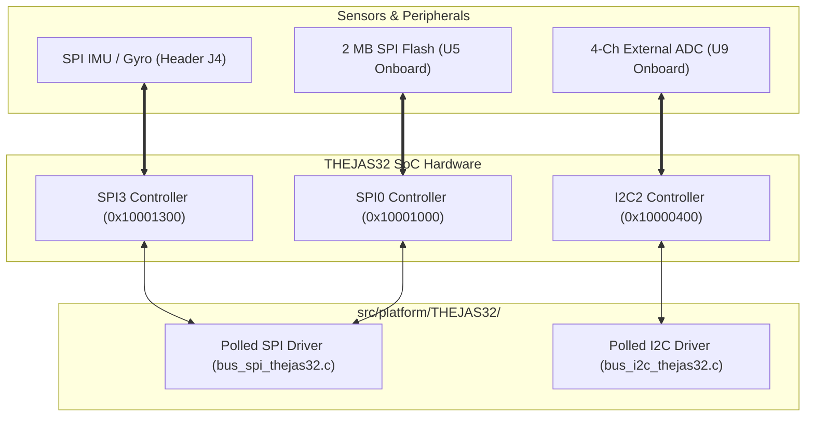

# Porting Component Knowledge Node: Bus Peripherals (SPI & I2C)
**Component ID**: `PORT-COMP-07`  
**Parent Knowledge Graph**: [PORTING_KNOWLEDGE_GRAPH.md](file:///home/ivan/Desktop/betaflight/knowledgebase/PORTING_KNOWLEDGE_GRAPH.md)  
**Primary References**:
* [10_STM32_BUS_SPI_HW.md](file:///home/ivan/Desktop/betaflight/logs/hardware_inspection/10_STM32_BUS_SPI_HW.md) (Cortex-M7 L1 D-Cache invalidation & DMA2 Errata 2.1.10)
* [21_ESP32_BUS_SPI_I2C.md](file:///home/ivan/Desktop/betaflight/logs/hardware_inspection/21_ESP32_BUS_SPI_I2C.md) (GDMA word alignment bounce buffers & 64-byte polled bypass)
* [THEJAS32_PROGRAMMER_MANUAL_ANALYSIS.md](file:///home/ivan/Desktop/betaflight/knowledgebase/THEJAS32_PROGRAMMER_MANUAL_ANALYSIS.md) (SPI0–SPI3 and I2C0–I2C2 controllers)
* [ARIES_V3_DATASHEET_ANALYSIS.md](file:///home/ivan/Desktop/betaflight/knowledgebase/ARIES_V3_DATASHEET_ANALYSIS.md) (SPI0 onboard flash `U5`, SPI3 on `J4`, I2C2 on `U9`)

---

## 1. Architectural Role & Execution Flow

The SPI and I2C serial bus drivers provide the high-speed data conduits to internal and external flight sensors:
1. **High-Speed Sensor Bus (SPI)**: Reads angular velocity and linear acceleration from the IMU (e.g. ICM42688P / BMI270) at up to 8 kHz loop rates, and interfaces with onboard SPI flash (`U5`).
2. **Peripheral Bus (I2C)**: Queries barometers, magnetometers, and specifically the **onboard external 4-channel I2C ADC chip (`U9`)** on `I2C2`.
3. **Multi-Segment Chaining**: Executes multi-byte reads with dynamic Chip Select (`CS`) negation flags (`busSegment_t`).



---

## 2. Hardware Comparison: STM32 vs. ESP32 vs. THEJAS32

Backed directly by [10_STM32_BUS_SPI_HW.md](file:///home/ivan/Desktop/betaflight/logs/hardware_inspection/10_STM32_BUS_SPI_HW.md) and [21_ESP32_BUS_SPI_I2C.md](file:///home/ivan/Desktop/betaflight/logs/hardware_inspection/21_ESP32_BUS_SPI_I2C.md):

| Feature | STM32 (`10_STM32_BUS_SPI_HW.md`) | ESP32 (`21_ESP32_BUS_SPI_I2C.md`) | THEJAS32 / ARIES v3.0 |
| :--- | :--- | :--- | :--- |
| **Cache Coherency Hazards** | **Critical on Cortex-M7**: L1 D-Cache causes stale reads from DMA buffers. Requires manual `SCB_InvalidateDCache_by_Addr()`. | None on internal SRAM; PSRAM uses write-back cache. | **None**: VEGA ET1031 operates directly against coherent unified SRAM. |
| **DMA Word Alignment Faults** | None: ARM DMA supports unaligned byte streams. | **Severe**: GDMA requires 32-bit aligned addresses. Unaligned buffers require `dummyRxBuf` bounce buffers and `memcpy`. | **None in polled mode**: CPU executes simple byte-level register access. |
| **Small Transfer Optimization** | Direct register polling only during boot or DMA conflict. | Explicit threshold (`ESP32S3_SPI_SHORT_POLLED_MAX_SIZE = 16`): Gyro bursts bypass DMA to save CPU cycles. | **100% Polled Mode**: Eliminates all DMA descriptor overhead, saving ~6 KB of code for <128KB build! |
| **I2C Architecture** | Interrupt/DMA state machine monitoring status registers (SB, ADDR, TXE, RXNE). | Hardware Command Coprocessor (`i2c_ll_hw_cmd_t`). | Standard register-driven Master controller with FIFO. |

---

## 3. Failure Modes & How Other Platforms Overcame Them

### Failure Mode 1: L1 Data Cache Invalidation Corruption (STM32 Cortex-M7)
* **The Bug**: On STM32H7, when SPI DMA writes incoming gyro samples into SRAM, the CPU L1 Data Cache does not know RAM changed. If the CPU subsequently reads the buffer, it reads stale cache lines, causing severe gyro packet corruption and violent flyaways.
* **Overcome By**: From [10_STM32_BUS_SPI_HW.md](file:///home/ivan/Desktop/betaflight/logs/hardware_inspection/10_STM32_BUS_SPI_HW.md), STM32 forces cache invalidation across cache-line boundaries in `spiRxIrqHandler()`:
  ```c
  #ifdef __DCACHE_PRESENT
  SCB_InvalidateDCache_by_Addr(addr, size);
  #endif
  ```
* **ARIES v3.0 Resolution**: The VEGA ET1031 core in THEJAS32 operates without an aggressive non-coherent L1 cache. All writes to SRAM at `0x00200000` are immediately visible to the CPU.

### Failure Mode 2: I2C Slave Bus Latching (SDA Stuck Low)
* **The Bug**: If the flight controller reboots mid-transaction while an external I2C slave (such as the `U9` ADC or a magnetometer) is holding the SDA line low during a read ACK, the hardware I2C master sees a permanently busy bus and deadlocks.
* **Overcome By**: From [21_ESP32_BUS_SPI_I2C.md](file:///home/ivan/Desktop/betaflight/logs/hardware_inspection/21_ESP32_BUS_SPI_I2C.md), implemented `i2cRecover()`:
  * Disconnects the I2C peripheral from pins.
  * Toggles SCL manually 9 times to clock out stuck slave bits.
  * Sends a software STOP condition (SCL high while SDA transitions from low to high).
  * Re-initializes the I2C master.
* **ARIES v3.0 Resolution**: Adopt this exact 9-pulse unstick sequence in `i2c_thejas32.c`.

---

## 4. Concrete Implementation Blueprint for ARIES v3.0

File: `src/platform/THEJAS32/bus_spi_thejas32.c`

```c
#include <stdint.h>
#include <stdbool.h>
#include "platform.h"
#include "drivers/bus_spi.h"
#include "drivers/io.h"

// THEJAS32 SPI Controller Register Map
#define SPI0_BASE          0x10001000 // Onboard SPI Flash (U5)
#define SPI3_BASE          0x10001300 // Header J4 (External IMU)

#define SPI_CTRL_REG(base) (*(volatile uint32_t *)((base) + 0x00))
#define SPI_STAT_REG(base) (*(volatile uint32_t *)((base) + 0x04))
#define SPI_DATA_REG(base) (*(volatile uint32_t *)((base) + 0x08))

#define SPI_STAT_TX_EMPTY  0x01
#define SPI_STAT_RX_AVAIL  0x02
#define SPI_STAT_BUSY      0x04

uint8_t spiTransferByte(uint32_t base, uint8_t data) {
    // Wait until TX buffer is ready
    while (!(SPI_STAT_REG(base) & SPI_STAT_TX_EMPTY));

    // Write outgoing byte
    SPI_DATA_REG(base) = data;

    // Wait until transfer is finished and RX byte is available
    while (!(SPI_STAT_REG(base) & SPI_STAT_RX_AVAIL));

    // Return incoming byte
    return (uint8_t)(SPI_DATA_REG(base) & 0xFF);
}

bool spiTransfer(uint32_t base, const uint8_t *txData, uint8_t *rxData, int len) {
    for (int i = 0; i < len; i++) {
        uint8_t bOut = txData ? txData[i] : 0xFF; // Send 0xFF dummy byte when reading
        uint8_t bIn = spiTransferByte(base, bOut);
        if (rxData) {
            rxData[i] = bIn;
        }
    }
    return true;
}
```

---

## 5. Verification Checklist
- [ ] Reading JEDEC ID from onboard Winbond/GigaDevice SPI Flash (`U5`) via SPI0 returns valid Manufacturer and Device ID (`0xEF4015` or similar).
- [ ] Transferring 16 bytes over SPI3 runs at up to 10 MHz clock rate without byte corruption.
- [ ] Calling `i2cRecover()` unlatches SDA if an external slave is held low during hot reset.
