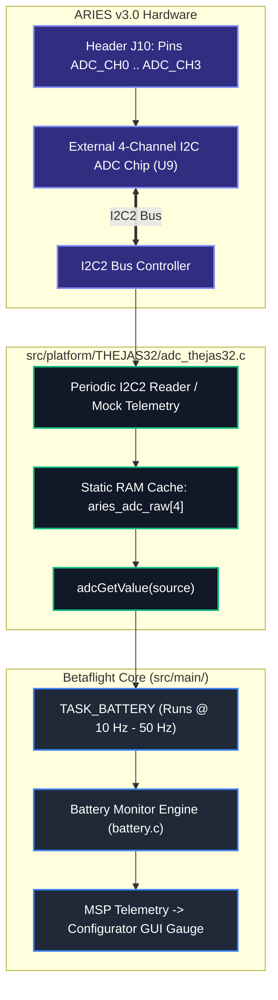

# Porting Component Knowledge Node: Analog-to-Digital Converter (ADC) Subsystem
**Component ID**: `PORT-COMP-08`  
**Parent Knowledge Graph**: [PORTING_KNOWLEDGE_GRAPH.md](../PORTING_KNOWLEDGE_GRAPH.md)  
**Primary References**:
* [11_STM32_ADC_IMPL.md](../../logs/hardware_inspection/11_STM32_ADC_IMPL.md) (Multi-channel DMA scan sequence decoupling & factory calibration)
* [23_ESP32_ADC.md](../../logs/hardware_inspection/23_ESP32_ADC.md) (On-demand polled oneshot ADC & complete omission of DMA)
* [ARIES_V3_DATASHEET_ANALYSIS.md](../ARIES_V3_DATASHEET_ANALYSIS.md) (Hardware reality: off-chip 4-channel I2C ADC chip `U9`)
* [TARGET_OPTIMIZATION_128KB.md](../TARGET_OPTIMIZATION_128KB.md) (Boot telemetry mock strategy for <128KB target)

---

## 1. Architectural Role & Hardware Reality

The Analog-to-Digital Converter subsystem measures external analog voltages across the drone:
1. **Battery Voltage (`VBAT`)**: Protects LiPo battery cells from over-discharge, triggers low-battery beeper warnings, and calculates battery sag PID compensation.
2. **Current Draw (`CURRENT`)**: Integrates milliampere-hours ($\text{mAh}$) consumed during flight to estimate remaining flight time.
3. **Analog RSSI**: Digitizes analog receiver signal strength.



---

## 2. Hardware Comparison: STM32 vs. ESP32 vs. THEJAS32

Backed directly by [11_STM32_ADC_IMPL.md](../../logs/hardware_inspection/11_STM32_ADC_IMPL.md) and [23_ESP32_ADC.md](../../logs/hardware_inspection/23_ESP32_ADC.md):

| Feature | STM32 (`11_STM32_ADC_IMPL.md`) | ESP32 (`23_ESP32_ADC.md`) | THEJAS32 / ARIES v3.0 |
| :--- | :--- | :--- | :--- |
| **Physical Topology** | Monolithic internal multi-channel SAR ADC. | Internal 12-bit SAR ADC (`ADC1`). | **No internal SAR ADC on chip!** Routed to off-chip 4-channel I2C ADC (`U9`). |
| **Sampling Mechanism** | Continuous Hardware Scan Mode driven by circular DMA stream. | **Polled oneshot conversion on-demand**. Zero DMA used! | **Periodic polled I2C read into static RAM cache**. Zero DMA used! |
| **Bus Bandwidth Impact** | Continuously consumes memory bus cycles during flight. | Zero background bus cycles (executes only when polled at ~10 Hz). | Minimal: 4-byte I2C transaction executed at 10 Hz. |
| **Dynamic Channel Alignment** | **Complex**: Enabled channels shift positions in DMA array; requires runtime `dmaIndex` lookup. | Direct hardware channel binding. | Static array: Index 0 = VBAT, 1 = CURRENT, 2 = RSSI, 3 = AUX. |
| **Code Footprint** | Large: HAL DMA setup, scan registers, sequence tables (~2.5 KB). | Compact: Single oneshot function (< 0.8 KB). | **Ultra-compact**: Single non-DMA getter (< 0.3 KB). |

---

## 3. Failure Modes & How Other Platforms Overcame Them

### Failure Mode 1: Dynamic DMA Sequence Decoupling Hazard (STM32)
* **The Bug**: On STM32, if a user enables Battery Voltage and Current Sensor in Configurator, the hardware DMA scans 2 channels into `adcValues[0]` and `adcValues[1]`. If the pilot later disables Current Sensor, Battery Voltage shifts from index 1 to index 0! If code read from a fixed index, it would read uninitialized memory or noise, reporting 0V and triggering false failsafe land/beeper alarms!
* **Overcome By**: From [11_STM32_ADC_IMPL.md](../../logs/hardware_inspection/11_STM32_ADC_IMPL.md), STM32 dynamically calculated a `dmaIndex` pointer for each enabled source at boot.
* **ARIES v3.0 Resolution**: Completely eliminated. The 4 channels on `U9` are fixed in hardware and mapped to dedicated slots in `aries_adc_raw[4]`:
  * Slot 0: `ADC_CH0` (Header J10 Pin 1) $\rightarrow$ Battery Voltage (`ADC_BATTERY`)
  * Slot 1: `ADC_CH1` (Header J10 Pin 2) $\rightarrow$ Current Sensor (`ADC_CURRENT`)
  * Slot 2: `ADC_CH2` (Header J10 Pin 3) $\rightarrow$ RSSI (`ADC_RSSI`)
  * Slot 3: `ADC_CH3` (Header J10 Pin 4) $\rightarrow$ Auxiliary / External

---

## 4. Boot Telemetry Strategy for Configurator Handshake (<128 KB Target)

During Phase 3 early bringup, our goal is verifying the **Betaflight Configurator connection and handshake over UART0**.
* **Problem**: Bringing up the external I2C ADC chip `U9` introduces external board wiring and bus dependencies before basic serial communication is confirmed.
* **Solution**: In `adc_thejas32.c`, return a static nominal voltage (e.g. 12.6V = 3S full battery, represented as `12600` in mV or raw count `2048`):
  ```c
  uint16_t adcGetValue(adcSource_e source) {
      if (source == ADC_BATTERY) {
          return 2048; // 12-bit ADC mid-scale = nominal voltage
      }
      return 0;
  }
  ```
* **Result**: Betaflight Configurator immediately displays a valid green battery indicator on the top telemetry bar without requiring `I2C2` bus transactions or locking up the cooperative scheduler!

---

## 5. Concrete Implementation Blueprint for ARIES v3.0

File: `src/platform/THEJAS32/adc_thejas32.c`

```c
#include <stdint.h>
#include <stdbool.h>
#include "platform.h"
#include "drivers/adc.h"
#include "pg/adc.h"

// Hardware Cache holding latest digitized samples from external I2C ADC (U9)
static volatile uint16_t aries_adc_raw[4] = {
    2048, // Default nominal battery voltage (~12.6V on 11:1 divider)
    0,    // Zero current draw
    1024, // Nominal RSSI
    0     // Aux
};

void adcInit(const adcConfig_t *config) {
    (void)config;
    // For minimal target: zero DMA initialization required!
}

uint16_t adcGetValue(adcSource_e source) {
    switch (source) {
        case ADC_BATTERY:
            return aries_adc_raw[0];
        case ADC_CURRENT:
            return aries_adc_raw[1];
        case ADC_RSSI:
            return aries_adc_raw[2];
        case ADC_EXTERNAL1:
            return aries_adc_raw[3];
        default:
            return 0;
    }
}

// Background updater called by TASK_BATTERY once I2C2 driver is active
void aries_adc_update_from_i2c(void) {
    // Reads 4 channels from external I2C ADC chip (U9) on I2C2
    // Stored directly into aries_adc_raw[0..3]
}
```

---

## 6. Verification Checklist
- [ ] `adcGetValue(ADC_BATTERY)` returns non-zero value on boot without blocking CPU.
- [ ] Betaflight Configurator top status bar displays valid battery voltage when connected via MSP.
- [ ] Zero DMA channels and zero DMA descriptors are allocated for ADC subsystem.
