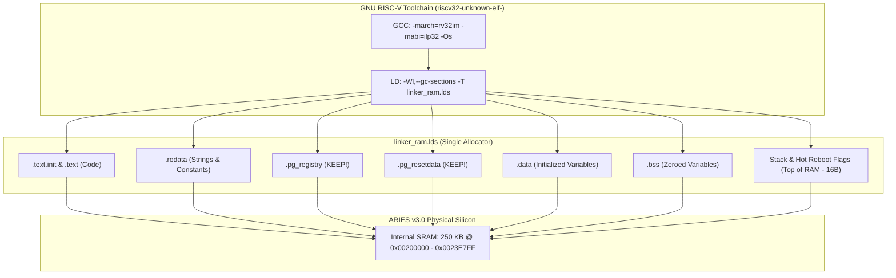

# Porting Component Knowledge Node: Build System, Linker Script & Memory Architecture
**Component ID**: `PORT-COMP-09`  
**Parent Knowledge Graph**: [PORTING_KNOWLEDGE_GRAPH.md](../PORTING_KNOWLEDGE_GRAPH.md)  
**Primary References**:
* [12_STM32_LINKER_AND_SECTIONS.md](../../logs/hardware_inspection/12_STM32_LINKER_AND_SECTIONS.md) (Uneven Flash sector splitting & hot reboot flag reservation)
* [13_STM32_BUILD_MAKEFILE.md](../../logs/hardware_inspection/13_STM32_BUILD_MAKEFILE.md) (Optimization tiers & native USB middleware savings)
* [25_ESP32_BUILD_AND_LINKER.md](../../logs/hardware_inspection/25_ESP32_BUILD_AND_LINKER.md) (RISC-V 32-bit RV32IM flags, PG anchors & single-allocator RAM)
* [THEJAS32_PROGRAMMER_MANUAL_ANALYSIS.md](../THEJAS32_PROGRAMMER_MANUAL_ANALYSIS.md) (250 KB internal SRAM at `0x00200000`)
* [TARGET_OPTIMIZATION_128KB.md](../TARGET_OPTIMIZATION_128KB.md) (Target sizing strategy under 128 KB)

---

## 1. Architectural Role & Execution Flow

The build system and linker script define how source code is compiled, linked, and laid out in physical silicon memory:
1. **Instruction Set Architecture (ISA) Targeting**: Enforces RISC-V RV32IM soft-float machine instructions and standard 32-bit register calling conventions.
2. **Unified SRAM Layout**: Allocates code, read-only constants, variables, heap, and stacks within the 250 KB internal SRAM at `0x00200000`.
3. **Parameter Group (PG) Anchor Management**: Preserves distributed configuration tables (`.pg_registry` and `.pg_resetdata`) from linker dead-code elimination (`-Wl,--gc-sections`).
4. **DMA Stub Resolution**: Provides lightweight symbol stubs (`spiUseDMA() = false`) when `USE_DMA` is undefined, avoiding linking DMA machinery.



---

## 2. Hardware Comparison: STM32 vs. ESP32 vs. THEJAS32

Backed directly by [12_STM32_LINKER_AND_SECTIONS.md](../../logs/hardware_inspection/12_STM32_LINKER_AND_SECTIONS.md) and [25_ESP32_BUILD_AND_LINKER.md](../../logs/hardware_inspection/25_ESP32_BUILD_AND_LINKER.md):

| Feature | STM32 (`12_STM32_...`, `13_STM32_...`) | ESP32-C5 (`25_ESP32_BUILD_AND_LINKER.md`) | THEJAS32 / ARIES v3.0 |
| :--- | :--- | :--- | :--- |
| **Processor Architecture** | ARM Cortex-M4 / M7 | RISC-V RV32IMAC (with Zicsr, Zifencei) | **RISC-V RV32IM (ET1031 Core)** |
| **Floating-Point Unit (FPU)** | Hardware Single-Precision FPU (`-mfloat-abi=hard`). | Soft-Float (`-mabi=ilp32`). | **Soft-Float (`-mabi=ilp32`).** (No HW FPU on ET1031) |
| **Flash Partitioning** | **Split Flash Layout**: 16 KB Sector 0, 16 KB Sector 1 (Config), 480 KB Sector 2+ due to uneven sector sizes. | Flat MMU-mapped Flash with 64 KB config sector at end. | **Uniform SRAM Boot**: All code & data loaded via XMODEM into 250 KB SRAM. |
| **RAM Region Structure** | Split into SRAM1, SRAM2, CCM/DTCM with separate bus masters. | Unified HP SRAM (`0x40800000`, 384 KB) single allocator. | **Unified SRAM (`0x00200000`, 250 KB) single allocator.** |
| **DMA Dependency** | Mandatory in default makefile; deep driver coupling. | Optional via `dma_stub_esp32.c` when `USE_DMA` is undefined. | **Optional via `dma_stub_thejas32.c`**, saving ~6 KB. |

---

## 3. Failure Modes & How Other Platforms Overcame Them

### Failure Mode 1: The Missing `.pg_registry` Linker Anchor Crash
* **The Bug**: Betaflight uses distributed macros (`PG_REGISTER`) to register configuration objects into a special linker section (`.pg_registry`). If the linker script does not declare `__pg_registry_start` and `__pg_registry_end`, or if the linker strips them during garbage collection (`--gc-sections`), `pgResetAll()` iterates over invalid pointers and crashes the MCU during the very first boot loop!
* **Overcome By**: From [25_ESP32_BUILD_AND_LINKER.md](../../logs/hardware_inspection/25_ESP32_BUILD_AND_LINKER.md), explicit `KEEP()` guards and boundary symbols are defined:
  ```ld
  .pg_registry : {
      PROVIDE_HIDDEN (__pg_registry_start = .);
      KEEP (*(.pg_registry))
      KEEP (*(SORT(.pg_registry.*)))
      PROVIDE_HIDDEN (__pg_registry_end = .);
  } > RAM
  ```
* **ARIES v3.0 Resolution**: Included verbatim in `linker_ram.lds`.

### Failure Mode 2: Dual IRAM/DRAM Overlap Memory Corruption
* **The Bug**: On Harvard-architecture SoCs, internal SRAM can be accessed via an instruction bus port and a data bus port. If a linker script declares two overlapping memory segments at the same physical address (e.g. `iram (RX)` and `dram (RW)`), the linker assigns identical addresses to code and variables, causing variables to overwrite executable functions!
* **Overcome By**: From [25_ESP32_BUILD_AND_LINKER.md](../../logs/hardware_inspection/25_ESP32_BUILD_AND_LINKER.md), declared a **single unified allocator**:
  ```ld
  RAM (RWX) : org = 0x00200000, len = 250K
  ```
* **ARIES v3.0 Resolution**: Both code and data are sequentially allocated from the same single `RAM` block, completely eliminating overlap corruption.

---

## 4. Concrete Implementation Blueprint for ARIES v3.0

### Linker Script: `src/platform/THEJAS32/link/linker_ram.lds`
```ld
OUTPUT_ARCH(riscv)
ENTRY(_start)

MEMORY
{
    /* 250 KB Usable Internal SRAM mapped by C-DAC XMODEM Bootloader */
    RAM (rwx) : ORIGIN = 0x00200000, LENGTH = 250K
}

_Min_Stack_Size = 0x2000; /* 8 KB Stack */

SECTIONS
{
    . = ORIGIN(RAM);

    /* Startup Assembly Entry Point */
    .text.init :
    {
        KEEP(*(.text.init))
    } > RAM

    /* Executable Code */
    .text :
    {
        _stext = .;
        *(.text .text.*)
        _etext = .;
    } > RAM

    /* Read-Only Data */
    .rodata :
    {
        _srodata = .;
        *(.rodata .rodata.*)
        *(.srodata .srodata.*)
        _erodata = .;
    } > RAM

    /* Parameter Group Registry Tables (Mandatory for Betaflight Boot!) */
    .pg_registry :
    {
        PROVIDE_HIDDEN (__pg_registry_start = .);
        KEEP (*(.pg_registry))
        KEEP (*(SORT(.pg_registry.*)))
        PROVIDE_HIDDEN (__pg_registry_end = .);
    } > RAM

    .pg_resetdata :
    {
        PROVIDE_HIDDEN (__pg_resetdata_start = .);
        KEEP (*(.pg_resetdata))
        PROVIDE_HIDDEN (__pg_resetdata_end = .);
    } > RAM

    /* Initialized Read-Write Data */
    .data :
    {
        _sdata = .;
        *(.data .data.*)
        *(.sdata .sdata.*)
        _edata = .;
    } > RAM

    /* Zero-Initialized Data */
    .bss (NOLOAD) :
    {
        _sbss = .;
        *(.bss .bss.*)
        *(.sbss .sbss.*)
        *(COMMON)
        _ebss = .;
    } > RAM

    /* Stack placed at peak of RAM, leaving 16 bytes for reboot tokens */
    _estack = ORIGIN(RAM) + LENGTH(RAM) - 16;
    _heap_start = _ebss;
    _heap_end = _estack - _Min_Stack_Size;

    /DISCARD/ :
    {
        *(.comment)
        *(.note.*)
        *(.eh_frame*)
    }
}
```

### Platform Makefile: `src/platform/THEJAS32/mk/THEJAS32.mk`
```makefile
# THEJAS32 Platform Makefile Include

# Toolchain Override
CROSS_COMPILE ?= riscv32-unknown-elf-
CC             = $(CROSS_COMPILE)gcc
OBJCOPY        = $(CROSS_COMPILE)objcopy
SIZE           = $(CROSS_COMPILE)size

# RISC-V RV32IM Target Flags (Soft-Float)
ARCH_FLAGS     = -march=rv32im -mabi=ilp32
CFLAGS        += $(ARCH_FLAGS) -Os -flto -ffunction-sections -fdata-sections -fno-common
LD_FLAGS      += $(ARCH_FLAGS) -nostartfiles -static -Wl,-gc-sections -T$(LINKER_DIR)/linker_ram.lds

# Platform Source Collection
MCU_COMMON_SRC += \
    THEJAS32/startup_thejas32.S \
    THEJAS32/trap_handler.c \
    THEJAS32/system_thejas32.c \
    THEJAS32/interrupt_thejas32.c \
    THEJAS32/io_thejas32.c \
    THEJAS32/serial_uart_thejas32.c \
    THEJAS32/pwm_motor_thejas32.c \
    THEJAS32/bus_spi_thejas32.c \
    THEJAS32/adc_thejas32.c \
    THEJAS32/dma_stub_thejas32.c
```

### DMA Stub: `src/platform/THEJAS32/dma_stub_thejas32.c`
```c
#include <stdbool.h>
#include "platform.h"

#ifndef USE_DMA
#include "drivers/bus_spi.h"

bool spiUseDMA(const extDevice_t *dev) {
    (void)dev;
    return false;
}

bool spiUseSDO_DMA(const extDevice_t *dev) {
    (void)dev;
    return false;
}
#endif
```

---

## 5. Verification Checklist
- [ ] Binary compiles cleanly with `riscv32-unknown-elf-gcc` without undefined reference errors.
- [ ] Total ELF size (`size target.elf`) shows `text + data + bss` $< 128\,\text{KB}$.
- [ ] Symbol table (`nm target.elf | grep __pg_registry`) confirms `__pg_registry_start` and `__pg_registry_end` are preserved.
