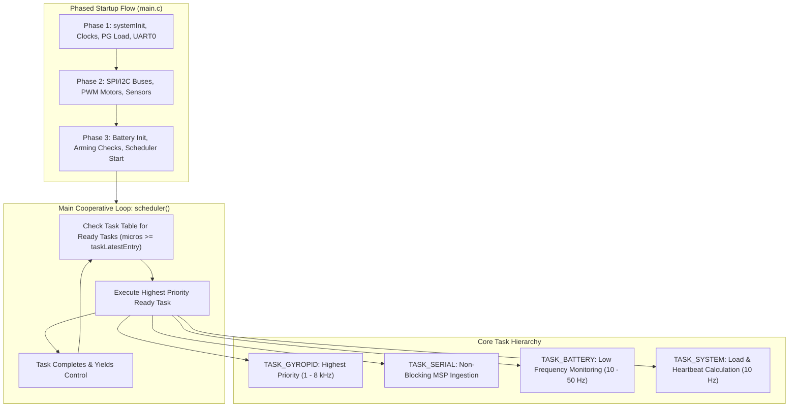

# Porting Component Knowledge Node: Cooperative Scheduler & Task Architecture
**Component ID**: `PORT-COMP-10`  
**Parent Knowledge Graph**: [PORTING_KNOWLEDGE_GRAPH.md](../PORTING_KNOWLEDGE_GRAPH.md)  
**Primary References**:
* [14_MAIN_STARTUP_FLOW.md](../../logs/hardware_inspection/14_MAIN_STARTUP_FLOW.md) (Phased boot sequence: `initPhase1` through `initPhase3`)
* [15_MSP_SERIAL_PARSER.md](../../logs/hardware_inspection/15_MSP_SERIAL_PARSER.md) (Zero-allocation heapless MSP state machine)
* [16_SCHEDULER_CORE.md](../../logs/hardware_inspection/16_SCHEDULER_CORE.md) (Cooperative multitasking & `TASK_SERIAL` non-blocking guarantee)
* [BETAFLIGHT_ARCHITECTURE_GRAPH.md](../BETAFLIGHT_ARCHITECTURE_GRAPH.md) (Subsystems & Task loop)

---

## 1. Architectural Role & Execution Flow

The Cooperative Task Scheduler is the central software engine of Betaflight:
1. **Deterministic Execution**: Dispatches flight-critical tasks (`TASK_GYROPID`, `TASK_ATTITUDE`) and background tasks (`TASK_SERIAL`, `TASK_BATTERY`) on fixed microsecond intervals.
2. **Non-Preemptive Multitasking**: Operates without an RTOS kernel. Tasks voluntarily yield execution by running to completion in single-digit microseconds, eliminating thread stack overhead and context switching penalties.
3. **Phased System Initialization**: Orchestrates three strictly ordered hardware initialization phases before entering the flight loop.



---

## 2. Hardware Comparison: RTOS vs. Betaflight Cooperative Scheduler

Backed directly by [14_MAIN_STARTUP_FLOW.md](../../logs/hardware_inspection/14_MAIN_STARTUP_FLOW.md) and [16_SCHEDULER_CORE.md](../../logs/hardware_inspection/16_SCHEDULER_CORE.md):

| Feature | Standard RTOS (e.g. FreeRTOS on ESP32) | Betaflight Cooperative Scheduler | ARIES v3.0 Advantages |
| :--- | :--- | :--- | :--- |
| **Context Switching Overhead** | High: Saves 32 CPU registers to stack on every preemptive slice. | **Zero**: Functions execute and return via standard C calling convention. | Saves precious CPU cycles on 100 MHz RISC-V core. |
| **SRAM Overhead per Task** | High: Requires individual thread stack (1–4 KB per task $\times 10\text{ tasks} = 10\text{--}40\text{ KB}$). | **Zero extra stacks**: All tasks share the single main stack (`_estack`). | Critical for executing entire firmware inside **250 KB SRAM**! |
| **Synchronization Hazards** | Mutex deadlocks, priority inversion, race conditions. | **Completely eliminated**: Flight tasks run sequentially without preemption. | Zero locking complexity across sensor drivers. |
| **Serial Processing** | Dedicated thread blocked on semaphore/queue. | Cooperative task (`TASK_SERIAL`) polls ring buffer and yields. | Non-blocking MSP parser guarantees zero task starvation. |

---

## 3. Failure Modes & How Other Platforms Overcame Them

### Failure Mode 1: Serial Driver Starvation / Blocking
* **The Bug**: If `TASK_SERIAL` enters a blocking `while()` loop waiting for a full MSP command frame to arrive over UART, it stalls the scheduler, preventing `TASK_GYROPID` from running and causing motor pulse jitter.
* **Overcome By**: From [15_MSP_SERIAL_PARSER.md](../../logs/hardware_inspection/15_MSP_SERIAL_PARSER.md) and [16_SCHEDULER_CORE.md](../../logs/hardware_inspection/16_SCHEDULER_CORE.md), the serial parser is implemented as a **zero-allocation finite state machine**:
  ```c
  void mspSerialProcess(void) {
      while (uart0_is_data_available()) {
          uint8_t c = uart0_read();
          if (mspProcessByte(c)) {
              // Frame finished and executed
              break; // Yield control back to scheduler!
          }
      }
  }
  ```
  `TASK_SERIAL` consumes only bytes currently available in the hardware ring buffer, immediately yielding execution if no bytes are pending.

### Failure Mode 2: Premature Subsystem Access During Boot
* **The Bug**: Accessing peripheral drivers (e.g. writing to motor PWM or reading SPI flash) before their underlying clocks and GPIO pins are configured results in bus faults.
* **Overcome By**: The strictly partitioned 3-phase boot sequence in [14_MAIN_STARTUP_FLOW.md](../../logs/hardware_inspection/14_MAIN_STARTUP_FLOW.md):
  1. `initPhase1`: Clocks, UART0, Parameter Groups. (Configurator can now connect!)
  2. `initPhase2`: Bus peripherals (SPI, I2C), PWM Motor controllers.
  3. `initPhase3`: Battery monitoring, sensor calibrations, arming checks, scheduler start.

---

## 4. Concrete Implementation Blueprint for ARIES v3.0

File: `src/main/main.c` (Minimal Execution Loop)

```c
#include <stdint.h>
#include <stdbool.h>
#include "platform.h"
#include "drivers/time.h"
#include "scheduler/scheduler.h"

void initPhase1(void) {
    // 1. Initialize System Clocks & 64-bit mtime Timebase
    extern void systemInit(void);
    systemInit();

    // 2. Initialize 32-bit Flat GPIO Controller
    extern void ioInit(void);
    ioInit();

    // 3. Initialize Parameter Groups (Must have linker anchors!)
    extern void pgResetAll(void);
    pgResetAll();

    // 4. Initialize UART0 at 115200 Baud for MSP Configurator Handshake
    extern void uart0_init(uint32_t baudRate);
    uart0_init(115200);

    // 5. Initialize PLIC Interrupt Controller
    extern void plic_init(void);
    plic_init();
}

void initPhase2(void) {
    // 6. Initialize 8-Channel Dedicated Motor PWM Subsystem
    extern void motorInit(void);
    motorInit();

    // 7. Initialize ADC Battery Telemetry Cache
    extern void adcInit(void);
    adcInit();
}

int main(void) {
    initPhase1();
    initPhase2();

    // Flash onboard status LED to indicate successful boot
    extern void IOHi(IO_t io);
    extern IO_t IOGetByTag(ioTag_t tag);
    IOHi(IOGetByTag(1)); // Turn on Status LED

    // Enter Cooperative Task Scheduler Loop
    while (1) {
        scheduler();
    }

    return 0;
}
```

---

## 5. Verification Checklist
- [ ] Boot sequence transitions through `initPhase1` and `initPhase2` in under $50\,\text{ms}$.
- [ ] Onboard Status LED illuminates, signaling successful entry into `scheduler()`.
- [ ] `TASK_SERIAL` continuously checks UART0 buffer without spinning or starving the loop.
